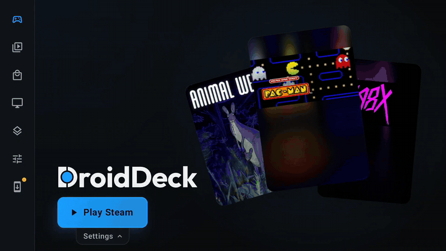
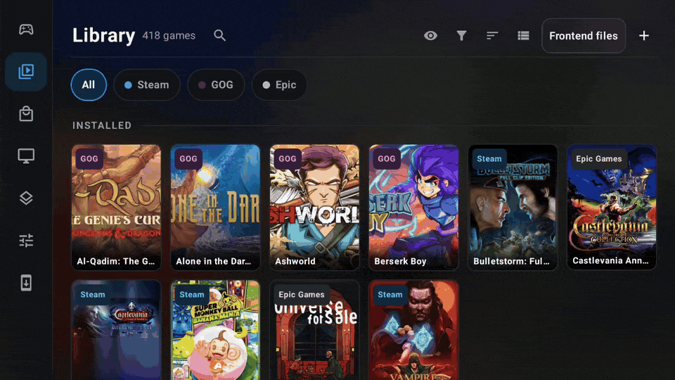
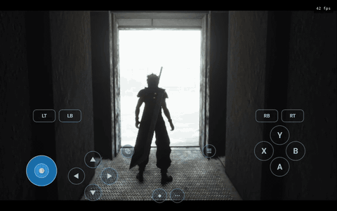
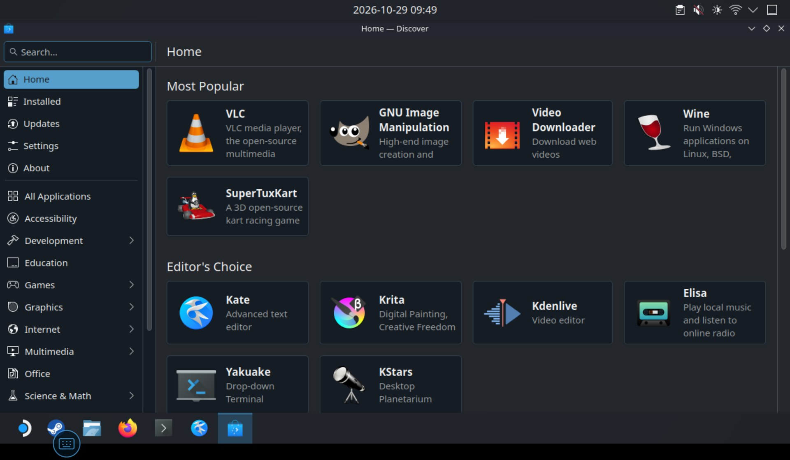

<p align="center">
  <picture>
    <source media="(prefers-color-scheme: dark)" srcset="artwork/droiddeck-banner-dark.svg">
    
  </picture>
</p>

DroidDeck brings the SteamOS experience to Android: Valve's Steam client in Big Picture on your Adreno handheld, with Windows games through Valve's ARM64 Proton.

<p align="center"><b>100% open source. No ads. No telemetry. No source withheld.</b></p>

<p align="center">
  <a href="https://github.com/Droid-Deck/DroidDeck/releases/download/0.6.7/DroidDeck-0.6.7.apk"></a>
  <a href="https://discord.gg/JRGAvawjsm"></a>
</p>

<p align="center">
  <a href="https://www.star-history.com/droid-deck/droiddeck"></a>
</p>

<p align="center">
  <a href="https://trendshift.io/repositories/267852"></a>
  <a href="https://trendshift.io/repositories/267852"></a>
</p>

<p align="center"></p>

> DroidDeck has no website. Only download it from this repository's [Releases](https://github.com/Droid-Deck/DroidDeck/releases).

<p align="center">
  
  
  
  
</p>

## Install

1. Android 9 or newer on Adreno 730 or newer, or any 8xx. Adreno 6xx is experimental. Mali, Xclipse, PowerVR and Adreno 710 are unsupported. No root needed.
2. About 3 GB free for the runtime, plus 1.1 GB for the desktop and emulators.
3. Install the [APK](https://github.com/Droid-Deck/DroidDeck/releases/download/0.6.7/DroidDeck-0.6.7.apk), install the Linux runtime, press **Play** and sign in to Steam.
4. On Android 14 and newer, turn on **Disable child process restrictions** in Developer options. On Android 12 and 13, Steam's first launch shows a **Fix it for me** button that walks you through it.

Smart glasses setup is in the [support matrix](docs/smart-glasses-support.md). Release notes are in [docs/releases](docs/releases).

Help, Preview builds and device reports are on [Discord](https://discord.gg/JRGAvawjsm). For bugs, post in **#bug-reports** with the zip from **Share logs**.

## Build

Needs Docker, Java 17, the Android SDK and NDK, Rust via rustup, GitHub CLI, Python 3 and `zstd`.

```bash
tools/build_local.sh
```

The APK lands in `app/build/outputs/apk/release/`. Install it with `tools/deploy_local.sh`. After the first run, `./gradlew :app:assembleRelease` reuses the prepared inputs. Unit tests run with `./gradlew -PskipRust=true :app:testDebugUnitTest`, and the helper and preload suite with `bash tools/test_local.sh`.

On Windows, see `tools/run_windows.ps1` and `tools/prepare_windows_runtime.py`.

## Limits

Compatibility and performance vary by device. Desktop compositing is software rendered, and Firefox sandboxing is reduced under proot.

## Credits and licence

DroidDeck is [GPL-3.0](LICENSE). Steam and Proton belong to Valve Corporation. VITURE, RayNeo, XREAL, Rokid, REDMAGIC, Nintendo Switch and Joy-Con are trademarks of their owners. This project is not affiliated with any of them.

<details>
<summary><b>Runtime, Wine and Proton</b></summary>

- Runtime, shim, input and controller work build on WinNative and Bannerlator by maxjivi05.
- mmap ring buffer controller input by ribbit384 ([WinNative #345](https://github.com/WinNative-Emu/WinNative/pull/345)).
- [FEX](https://github.com/FEX-Emu/FEX) (MIT) runs x86 code. DroidDeck's build puts the platform name under `AT_PLATFORM` so [sharun](https://github.com/VHSgunzo/sharun) AppImages by VHSgunzo (MIT) start through its [userland-execve](https://crates.io/crates/userland-execve) loader (MIT). FEX's code disk cache was checked in its source.
- x86 AppImages, and arm64 ones whose runtime can't unpack on Android, are unpacked with [uruntime](https://github.com/VHSgunzo/uruntime) by VHSgunzo (MIT), shipped unmodified with its licence.
- x86 programs linking OpenSSL 3 use the copy in the [Steam Linux Runtime 4.0](https://gitlab.steamos.cloud/steamrt/steamrt). x86 Linux games get the `/etc/asound.conf` that [pressure-vessel](https://gitlab.steamos.cloud/steamrt/steam-runtime-tools) writes.
- `WriteProcessMemory` hooks fall back to `/proc/<pid>/mem` the way [Wine](https://gitlab.winehq.org/wine/wine)'s `server/ptrace.c` did before Wine 11.
- Wine write watches use userfaultfd support in [Proton](https://github.com/ValveSoftware/wine)'s `dlls/ntdll/unix/virtual.c` (LGPL-2.1-or-later). libblsession supplies the arm64 syscall number and answers `PAGEMAP_SCAN` from `/proc/self/pagemap`.
- libblsession runs Wine's arm64 `SIGUSR2` context handler (`dlls/ntdll/unix/signal_arm64.c`, LGPL-2.1-or-later) in place on a frame laid out like [Linux](https://github.com/torvalds/linux)'s `arch/arm64/kernel/signal.c`, and serves `fill_vm_counters` in `dlls/ntdll/unix/process.c` the kernel's own `/proc/<pid>/status`.
- droiddeck-ntsync follows the [Linux](https://github.com/torvalds/linux) ntsync semantics in `Documentation/userspace-api/ntsync.rst` (GPL-2.0).
- The proot fast path orders bindings like [PRoot](https://github.com/proot-me/proot)'s `path/binding.c` (GPL-2.0-or-later).
- Games use [Mesa](https://gitlab.freedesktop.org/mesa/mesa) Turnip's per render pass memory choice. The Steam client keeps `TU_DEBUG=sysmem`.
- Black Ops III and Dark Souls Remastered start without [umu-protonfixes](https://github.com/Open-Wine-Components/umu-protonfixes) (BSD-2-Clause), whose `311210.py` and `570940.py` fail under ARM64 Proton.
- [ReSkate](https://github.com/Dingo-Shenanigans/ReSkate) (GPL-3.0) by Dingo Shenanigans uses the launch option from its README and D3D12 feature level 12_1.
- The arm64 client's sign in was checked by reading Steam's saved token with the `ConnectCache` format from [deadlock-api-ingest](https://github.com/deadlock-api/deadlock-api-ingest).

</details>

<details>
<summary><b>Stores</b></summary>

- Epic Games and GOG build on [Phobos](https://github.com/phobos665)'s adaptation of [Legendary](https://github.com/legendary-gl/legendary) and [gogdl](https://github.com/Heroic-Games-Launcher/heroic-gogdl). GOG install script registry entries are read the way [Heroic Games Launcher](https://github.com/Heroic-Games-Launcher/HeroicGamesLauncher) (GPL-3.0) reads them.
- Epic's official Linux launcher preview runs through FEX. That setup is outside Epic's listed Linux support.
- Battle.net is by [@kayakyakr](https://github.com/kayakyakr). It runs Blizzard's own client in Proton (downloaded from Blizzard, not included) and shows key art from the [Battle.net Shop](https://shop.battle.net). Without Steam, its games see the pad as an Xbox 360 controller via `PROTON_SPOOF_STEAMINPUT_VIDPID` in [Proton](https://github.com/ValveSoftware/wine)'s `dlls/winebus.sys`.
- Battle.net installs drive Blizzard's Agent the way [@barncastle](https://github.com/barncastle)'s [Battle.Net-Installer](https://github.com/barncastle/Battle.Net-Installer) does, with requests from [wowdev.wiki](https://wowdev.wiki/Agent). Read without taking code: [@mubaraknumann](https://github.com/mubaraknumann)'s [unifideck](https://github.com/mubaraknumann/unifideck), [@djmittens](https://github.com/djmittens)'s [neo-mittens](https://github.com/djmittens/neo-mittens) `bnetswitch`, [@BCD1210](https://github.com/BCD1210)'s [soju](https://github.com/BCD1210/soju) and [Lutris](https://github.com/lutris/lutris)'s `product.db` reader.
- Xbox games load [@domsvoboda](https://github.com/domsvoboda)'s [xodus-nexus](https://github.com/domsvoboda/xodus-nexus) modules (LGPL-2.1-or-later), including `wintypes.dll`. Minecraft's GameInput setup was checked against [@Wyze3306](https://github.com/Wyze3306)'s [BedrockOnLinux](https://github.com/Wyze3306/BedrockOnLinux) (MIT).
- The itch.io butler pack ships butler's `7z.so`, itch.io's build of [7-Zip](https://www.7-zip.org) by Igor Pavlov (LGPL-2.1, unRAR restriction on RAR code), unmodified. Other archives use Apache Commons Compress and the runtime's bsdtar (libarchive).
- The Store uses [Flatpak](https://github.com/flatpak/flatpak) (LGPL-2.1) through DroidDeck's own bubblewrap shim. Chromium and Electron apps start directly, since [zypak](https://github.com/refi64/zypak) by [@refi64](https://github.com/refi64) (BSD-3-Clause) always uses Flatpak's spawn portal.

</details>

<details>
<summary><b>Audio, video and HUD</b></summary>

- Steam audio goes through [@The412Banner](https://github.com/The412Banner)'s [DirectAudio](https://github.com/The412Banner/directaudio) PulseAudio sink (LGPL-2.1-or-later), built from `tools/directaudio/sink`.
- The DroidDeck HUD is [@The412Banner](https://github.com/The412Banner)'s [FusionHUD](https://github.com/The412Banner/FusionHUD) (GPL-3.0 with an attribution term). Its readings match Valve's [MangoHud](https://github.com/flightlessmango/MangoHud) build (MIT), with frame times from gamescope patch 0125.
- LSFG frame generation comes from Camille LaVey and the [Eden](https://eden-emu.dev) project, following [lsfg-vk](https://github.com/PancakeTAS/lsfg-vk), ported by [@maxjivi05](https://github.com/maxjivi05). It needs your own copy of [Lossless Scaling](https://store.steampowered.com/app/993090/) and ships none of its shaders.
- Remote Play decodes through Android's MediaCodec or the [FFmpeg](https://ffmpeg.org) (LGPL-2.1-or-later) in Steam's runtime. Qualcomm low latency settings follow [Moonlight](https://github.com/moonlight-stream/moonlight-android) (GPL-3.0).
- [PipeWire](https://gitlab.freedesktop.org/pipewire/pipewire) (MIT) sockets use the settings in its `module-access.c`, and [WirePlumber](https://gitlab.freedesktop.org/pipewire/wireplumber) (MIT) keeps those clients at full permissions.

</details>

<details>
<summary><b>Desktop</b></summary>

- The KDE pacman repository snapshots [Arch Linux ARM](https://archlinuxarm.org) and installs with [pacman](https://gitlab.archlinux.org/pacman/pacman) (GPL-2.0-or-later).
- [KWin](https://invent.kde.org/plasma/kwin) (GPL-2.0-or-later) is patched to pass on the scroll data its `wayland_backend.cpp` leaves as a TODO.
- Read without taking code: [Qt](https://code.qt.io/cgit/qt/qtbase.git)'s `qwaylandinputdevice.cpp` and `qguiapplication.cpp`, [Konsole](https://invent.kde.org/utilities/konsole)'s `TerminalDisplay.cpp`, and [Mesa](https://gitlab.freedesktop.org/mesa/mesa)'s `u_threaded_context.c` and `zink_resource.c`.
- The Steam Keyboard window rule follows Valve's `steamdeck-kde-presets` with [Bazzite](https://github.com/ublue-os/bazzite)'s `0001-steam-virtual-keyboard.patch`.
- Steam's Browse buttons open a GTK 3 file chooser via PyGObject (LGPL-2.1-or-later), shown over Steam by [gamescope](https://github.com/ValveSoftware/gamescope) (BSD-2-Clause) through `GetAppIdFromReaper`.
- The AYN Odin 2 phantom second display was confirmed by [@SapphireRhodonite](https://github.com/SapphireRhodonite)'s [WatermelonDS 0.0.5](https://github.com/SapphireRhodonite/WatermelonDS/releases/tag/0.0.5) notes and [iiSU #363](https://github.com/iisu-network/iiSU/issues/363), without taking their code.

</details>

<details>
<summary><b>Smart glasses</b></summary>

- Builds on WinNative's VITURE work. Protocol checked against [@wheaney](https://github.com/wheaney)'s [XRLinuxDriver](https://github.com/wheaney/XRLinuxDriver), [@badicsalex](https://github.com/badicsalex)'s [ar-drivers-rs](https://github.com/badicsalex/ar-drivers-rs) and [go-macos/iokit](https://pkg.go.dev/github.com/go-macos/iokit/viture). The optional VITURE SDK is not included.
- RayNeo adapts [@informalTechCode](https://github.com/informalTechCode)'s [RayNeo-Air-Series-3DoF-Scaffold](https://github.com/informalTechCode/RayNeo-Air-Series-3DoF-Scaffold) (Apache-2.0) and references [@verncat](https://github.com/verncat)'s [RayNeo-Air-3S-Pro-OpenVR](https://github.com/verncat/RayNeo-Air-3S-Pro-OpenVR) (MIT) and [Monado](https://gitlab.freedesktop.org/monado/monado) (BSL-1.0). See [docs/third-party/rayneo](docs/third-party/rayneo/README.md).
- XREAL 1S references XRLinuxDriver and [xrealOneDeviceKit](https://github.com/wheaney/xrealOneDeviceKit) by @wheaney, [@rohitsangwan01](https://github.com/rohitsangwan01)'s [xreal_one_driver](https://github.com/rohitsangwan01/xreal_one_driver) (MIT) and [@0xcaff](https://github.com/0xcaff)'s [xr-tools](https://github.com/0xcaff/xr-tools).
- Rokid follows ar-drivers-rs, @badicsalex's [Void Computing write-ups](https://voidcomputing.hu/blog/worse-better-prettier/) and Monado's Rokid driver.
- REDMAGIC display findings draw on [@mekhontsev](https://github.com/mekhontsev)'s [MagicDesk investigation](https://github.com/mekhontsev/magicdesk/blob/main/docs/xr-resolution-fix.md) and [@Coding-BR](https://github.com/Coding-BR)'s [decompiled Nubia kernel](https://github.com/Coding-BR/android_kernel_nubia_sm8850_qwjujube).

</details>

<details>
<summary><b>VR, Joy-Con and hand tracking</b></summary>

- Joy-Con VR ports the arm model from Google's [GVR SDK for Unity](https://github.com/googlevr/gvr-unity-sdk) (Apache-2.0) and adapts the hand skeleton from Valve's [OpenVR](https://github.com/ValveSoftware/openvr) `handskeletonsimulation` sample (BSD-3-Clause), which follows Moshi Turner's work in Monado. Index offsets come from Monado's `vive_poses.c` (BSL-1.0).
- Joy-Con research: Linux's [hid-nintendo](https://github.com/torvalds/linux/blob/master/drivers/hid/hid-nintendo.c) by Daniel J. Ogorchock, [@dekuNukem](https://github.com/dekuNukem)'s [Nintendo_Switch_Reverse_Engineering](https://github.com/dekuNukem/Nintendo_Switch_Reverse_Engineering), [SDL](https://github.com/libsdl-org/SDL) and AOSP. Checked against [ALVR](https://github.com/alvr-org/ALVR), [OpenComposite](https://gitlab.com/znixian/OpenOVR), [PSMoveSteamVRBridge](https://github.com/HipsterSloth/PSMoveSteamVRBridge), [@F8LEFT](https://github.com/F8LEFT)'s [JoyConVr](https://github.com/F8LEFT/JoyConVr), [@krnelpan1c](https://github.com/krnelpan1c)'s [Daydream-Controller-SteamVR](https://github.com/krnelpan1c/Daydream-Controller-SteamVR), [@yoyobuae](https://github.com/yoyobuae)'s [joyconvr](https://github.com/yoyobuae/joyconvr), [Moonlight](https://github.com/moonlight-stream/moonlight-android) and [Dolphin](https://github.com/dolphin-emu/dolphin). See [docs/third-party/joycon](docs/third-party/joycon/README.md).
- Camera hand tracking runs Google's [MediaPipe](https://github.com/google-ai-edge/mediapipe) Pose Landmarker (Lite), BlazePose GHUM 3D and Hand Landmarker (Apache-2.0) on [CameraX](https://developer.android.com/jetpack/androidx/releases/camera) frames (Apache-2.0), with usage reports off. Checked against JoyConVr's camera app (MIT).
- Tracking math: the GVR arm model's accelerometer mode, Eric Foxlin's zero velocity updates, Frosio, Pedersini and Borghese's accelerometer autocalibration, a Kalman filter (Kalman, 1960), Horn's quaternion method (1987) and the 1€ filter (Casiez, Roussel and Vogel, 2012).
- Gestures follow [ALVR](https://github.com/alvr-org/ALVR)'s `hand_gestures.rs` (MIT) and Meta Quest's menu pinch, tuned on [HaGRID](https://github.com/hukenovs/hagrid) photos (CC BY-SA 4.0, not included).
- The glove model follows OpenVR's render model reference, is meshed with surface nets (Gibson, 1998; Mikola Lysenko), and uses Inigo Quilez's smooth minimum, distance field ambient occlusion and polygon distance (MIT). See [docs/third-party/handtracking](docs/third-party/handtracking/README.md).

</details>

## Star history

<a href="https://www.star-history.com/#Droid-Deck/DroidDeck&Date">
  <picture>
    <source media="(prefers-color-scheme: dark)" srcset="https://api.star-history.com/svg?repos=Droid-Deck/DroidDeck&type=Date&theme=dark">
    
  </picture>
</a>
