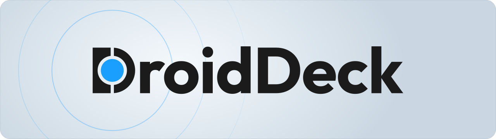
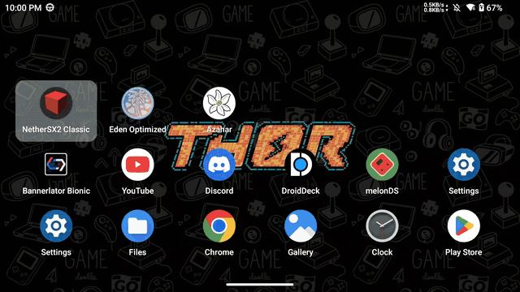

  <picture>
    <source media="(prefers-color-scheme: dark)" srcset="artwork/droiddeck-banner-dark.svg">
    
  </picture>

DroidDeck brings the SteamOS experience to Android: Valve's Steam client in Big Picture on your Adreno handheld, with Windows games through Valve's ARM64 Proton.

 

  
  

  
  

> Note: DroidDeck does not have a stand-alone website. Do not click on any download links from websites claiming to be the DroidDeck team. 

## Requirements and install

Use Android 9 or newer on a supported Adreno device (730 or newer, or 8xx). Adreno 6xx is experimental: DirectX 11 uses DXVK 2 and may run, and DirectX 12 games can still crash. Mali, Xclipse, PowerVR, and Adreno 710 are unsupported. No root is required. Allow about 3 GB for the runtime and 1.1 GB more for the desktop and emulators. Install the APK from [Releases](https://github.com/Droid-Deck/DroidDeck/releases), install the Linux runtime, then press **Play** and sign in. Steam downloads on first launch. Install **Desktop & apps** to use the desktop and emulators. The **Store** installs Linux apps and games from Flathub (ARM64 builds) with Flatpak; with additional options to install Appimages and set up scripts. **Stores** (Setup › Stores › "Show Stores in the rail") signs in to GOG, Epic Games and Amazon Games and downloads games into the Games storage. Epic keeps its direct API install path. Opening Epic Stores prepares Epic’s official Linux launcher preview. When installed, Epic games launched from DroidDeck use that client, and games installed in the client are imported into DroidDeck’s library and shortcuts. The x86-64 client runs through FEX on ARM and DroidDeck retains its Proton hooks; this preview and ARM setup are outside Epic’s listed Linux support. The cog on a store’s chip row sets its opening tab and download speed tier.

On Android 14 and newer, before Steam launches, you must turn on **Disable child process restrictions** in Developer options. If this option is not available in developer settings (Android 12 and 13 devices), first launch of Steam will present a "Fix it for me" button, which will help automate the setup process.

## Smart glasses

Use **Setup → Smart glasses** for app-wide virtual-screen settings across DroidDeck menus, launchers, desktop sessions, and games. Supported VITURE, RayNeo, XREAL, and Rokid connections provide 3DoF; Luma Ultra adds optional experimental 6DoF and stereo-assisted hand/Joy-Con tracking. Model support and SDK requirements differ: see the [smart-glasses support matrix](docs/smart-glasses-support.md) for supported devices, controls, setup, and limitations.

## Community

Join the [DroidDeck Discord](https://discord.gg/JRGAvawjsm) for help, Preview builds, and device reports. Bug reports go in its **#bug-reports** forum; attach the zip from **Share logs** (Setup, or the session drawer) so the logs come with it.

## Build

Run `tools/build_local.sh` with Docker, Java 17, the Android SDK/NDK, Rust through rustup, GitHub CLI, Python 3, and `zstd` installed. It prepares the same native libraries, pinned components and audio sinks as CI, then checks the APK's assets, JNI exports and dependencies. The APK is at `app/build/outputs/apk/release/app-release.apk`. Set `DROIDDECK_PA13_SOURCE_DIR` to an existing PulseAudio 13.0 source directory to skip downloading it. Set `DROIDDECK_SIGNING_ENV` to a signing environment file to install over a release build; relative keystore paths resolve beside that file. To install on an attached device, run `tools/deploy_local.sh`.

After preparation, ordinary `./gradlew :app:assembleRelease` builds can reuse the verified inputs. If native sources, component pins or staged files change, packaging stops with instructions to rerun the helper. Generated audio stays under `app/build/`; the tracked base bundle is never modified. `./gradlew -PskipRust=true :app:testDebugUnitTest` needs no native preparation. For an APK without store engines, use `DROIDDECK_SKIP_RUST=1 tools/build_local.sh`; it omits cached engine libraries too.

For the prepared Windows checkout, run `./tools/run_windows.ps1` (optionally with `-Serial <adb-serial>`), or select **DroidDeck XR** in Android Studio and run the **app** module on the connected phone. Machine-specific options live in the ignored `local.properties`: `droiddeck.python` selects a Python executable, `droiddeck.skipRust=true` omits the optional store download engines, and `droiddeck.debugApplicationIdSuffix=.xr` installs **DroidDeck XR Dev** alongside the signed release. The development app has its own runtime and Steam login. The local Java selection is in `.gradle/config.properties`.

`python tools/prepare_windows_runtime.py` restores this checkout's audited runtime inputs from the pinned CI APK, three locally rebuilt preload libraries, and the checksum-pinned Gamescope archive in `build/windows-setup/`. Start Docker Desktop's Linux engine first: preparation now rebuilds DroidDeck's ARM64 VR driver and Vulkan layer from current source and runs their native regression tests. The compiler image is built automatically on first use. Vulkan headers come from the NDK beside `--llvm-strip`, or from an explicit `--vk-include <NDK-sysroot-include>` directory.

To reuse that build, pass `--rebuilt-vr build/windows-setup/vr`. Preparation verifies its `vr-build.json` against the current Git revision, source files, Vulkan headers, output checksums, and ARM64 architecture; missing or stale builds fail instead of falling back to the donor's VR libraries. The script checks the actual donor CI merge tree, still rejects unrelated unaudited runtime changes, and records component provenance in `app/build/windows-runtime-provenance.json`. Preserve these ignored preparation files when rebuilding locally; `clean` removes the prepared assets and their verification manifest.

Run the helper and preload regression suite with `bash tools/test_local.sh`. On macOS it runs in Linux through Docker, matching the helpers' runtime and CI instead of compiling Linux preloads against macOS headers.

## Limits

Compatibility and performance vary by device; hardware validation is limited. Desktop compositing uses software rendering. Firefox sandboxing is reduced under proot. Logs are kept app-private (`files/logs/`, the last 30 sessions); **Share logs** packs the newest session, with the stores and tool logs, into one scrubbed zip.

## Credits and licence

GPL-3.0. Runtime, shim, input, and controller work build on WinNative and Bannerlator (maxjivi05). Epic Games and GOG support build on [Phobos’s](https://github.com/phobos665) adaptation of [Legendary](https://github.com/legendary-gl/legendary) and [gogdl](https://github.com/Heroic-Games-Launcher/heroic-gogdl), respectively. Battle.net support is [@kayakyakr](https://github.com/kayakyakr)'s: it runs Blizzard's own Battle.net client, downloaded from Blizzard and not included, in Proton, and shows the key art from each game's [Battle.net Shop](https://shop.battle.net) page; without the Steam client its games see DroidDeck's pad as an Xbox 360 controller through `PROTON_SPOOF_STEAMINPUT_VIDPID` in [Proton](https://github.com/ValveSoftware/wine)'s `dlls/winebus.sys`. The registry entries a GOG game's install script (`goggame-<id>.script`) sets are read the way [Heroic Games Launcher](https://github.com/Heroic-Games-Launcher/HeroicGamesLauncher)'s GOG setup (GPL-3.0) reads them. LSFG frame generation is from the work of Camille LaVey and the [Eden](https://eden-emu.dev) emulator project, following [lsfg-vk](https://github.com/PancakeTAS/lsfg-vk), ported to WinNative and DroidDeck by [@maxjivi05](https://github.com/maxjivi05); it needs your own copy of [Lossless Scaling](https://store.steampowered.com/app/993090/) and ships none of its shaders. x86 AppImages, and any whose own runtime cannot unpack them, are unpacked with [uruntime](https://github.com/VHSgunzo/uruntime) by VHSgunzo (MIT), shipped unmodified with its licence, which also starts the arm64 emulator AppImages whose own runtime cannot run its extractor on Android. The Steam client's audio goes through [@The412Banner](https://github.com/The412Banner)'s [DirectAudio](https://github.com/The412Banner/directaudio) PulseAudio sink (LGPL-2.1-or-later), built from `tools/directaudio/sink` with its request size kept to its ring so clients are not asked to queue 100 ms ahead. mmap ring-buffer controller input was developed by ribbit384 ([WinNative #345](https://github.com/WinNative-Emu/WinNative/pull/345)). Why the x86-64 Steam client refused the arm64 client's sign-in was checked by reading Steam's saved token with the `ConnectCache` format from [deadlock-api-ingest](https://github.com/deadlock-api/deadlock-api-ingest). x86 programs that link OpenSSL 3 under FEX use the copy in the [Steam Linux Runtime 4.0](https://gitlab.steamos.cloud/steamrt/steamrt) platform. Hooks written with `WriteProcessMemory` into code [FEX](https://github.com/FEX-Emu/FEX) has translated go through `/proc/<pid>/mem` again when the kernel refuses `process_vm_writev`, as [Wine](https://gitlab.winehq.org/wine/wine)'s `server/ptrace.c` wrote them before Wine 11. x86 Linux games under FEX get the same `/etc/asound.conf` that [pressure-vessel](https://gitlab.steamos.cloud/steamrt/steam-runtime-tools) writes into the Steam Linux Runtime, so ALSA plays through PulseAudio. Games render with [Mesa](https://gitlab.freedesktop.org/mesa/mesa) Turnip's own per-render-pass choice between tile memory and system memory, while the Steam client keeps `TU_DEBUG=sysmem`; [FEX](https://github.com/FEX-Emu/FEX)'s code disk cache was checked in its source and is already on through Proton. The proot fast path picks the guest name of a host file bound under several names in the order [PRoot](https://github.com/proot-me/proot)'s `path/binding.c` (GPL-2.0-or-later) sorts its bindings, so links and `/proc/self/fd` read back as they do through proot. The session's [PipeWire](https://gitlab.freedesktop.org/pipewire/pipewire) (MIT) opens its sockets with the per-socket access settings documented in its `module-access.c`, and [WirePlumber](https://gitlab.freedesktop.org/pipewire/wireplumber) (MIT) keeps those clients at full permissions through its `access.rules`. Wine write watches use the userfaultfd support in [Proton](https://github.com/ValveSoftware/wine)'s `dlls/ntdll/unix/virtual.c` (LGPL-2.1-or-later): libblsession gives it the arm64 syscall number and answers its `PAGEMAP_SCAN` from `/proc/self/pagemap` where Android refuses the ioctl. Wine on arm64 sets a thread's full context by raising `SIGUSR2` from `syscall_dispatcher_return_slowpath` in [Wine](https://gitlab.winehq.org/wine/wine)'s `dlls/ntdll/unix/signal_arm64.c` (LGPL-2.1-or-later); libblsession runs that handler in place on a frame laid out as the [Linux](https://github.com/torvalds/linux) kernel's `arch/arm64/kernel/signal.c` builds it and returns through `rt_sigreturn`, so proot does not stop the thread for it. Wine's process list reads each process's memory counters from `/proc/<pid>/status` in `fill_vm_counters` ([Wine](https://gitlab.winehq.org/wine/wine) `dlls/ntdll/unix/process.c`, LGPL-2.1-or-later), so libblsession gives those reads the kernel's file instead of a copy with `TracerPid` cleared. droiddeck-ntsync is checked against the object, wait and error semantics documented for the [Linux](https://github.com/torvalds/linux) ntsync driver in `Documentation/userspace-api/ntsync.rst` (GPL-2.0). Xbox games load the Windows modules of [@domsvoboda](https://github.com/domsvoboda)'s [xodus-nexus](https://github.com/domsvoboda/xodus-nexus) runtime (LGPL-2.1-or-later), including its `wintypes.dll`, whose `ApiInformation` answer Minecraft for Windows needs to start; how Minecraft installs GameInput under Wine was checked against [@Wyze3306](https://github.com/Wyze3306)'s [BedrockOnLinux](https://github.com/Wyze3306/BedrockOnLinux) (MIT). See [LICENSE](LICENSE). Steam and Proton belong to Valve Corporation; this project is not affiliated with Valve.

XR glasses support builds on WinNative's VITURE glasses work. VITURE protocol details were checked against [XRLinuxDriver](https://github.com/wheaney/XRLinuxDriver) by [@wheaney](https://github.com/wheaney), including the VITURE protocol header it ships, [ar-drivers-rs](https://github.com/badicsalex/ar-drivers-rs) by [@badicsalex](https://github.com/badicsalex) and the [go-macos/iokit VITURE package](https://pkg.go.dev/github.com/go-macos/iokit/viture); the optional VITURE SDK belongs to VITURE and is not included. RayNeo support adapts [@informalTechCode](https://github.com/informalTechCode)'s [RayNeo-Air-Series-3DoF-Scaffold](https://github.com/informalTechCode/RayNeo-Air-Series-3DoF-Scaffold) (Apache-2.0) and references [@verncat](https://github.com/verncat)'s [RayNeo-Air-3S-Pro-OpenVR](https://github.com/verncat/RayNeo-Air-3S-Pro-OpenVR) (MIT) and [Monado](https://gitlab.freedesktop.org/monado/monado) (BSL-1.0); see [docs/third-party/rayneo](docs/third-party/rayneo/README.md). XREAL 1S support references [XRLinuxDriver](https://github.com/wheaney/XRLinuxDriver) and [xrealOneDeviceKit](https://github.com/wheaney/xrealOneDeviceKit) by @wheaney, [xreal_one_driver](https://github.com/rohitsangwan01/xreal_one_driver) by [@rohitsangwan01](https://github.com/rohitsangwan01) (MIT) and [xr-tools](https://github.com/0xcaff/xr-tools) by [@0xcaff](https://github.com/0xcaff). Rokid support follows the Rokid protocol notes in [ar-drivers-rs](https://github.com/badicsalex/ar-drivers-rs) and @badicsalex's [Void Computing write-ups](https://voidcomputing.hu/blog/worse-better-prettier/), and [Monado](https://gitlab.freedesktop.org/monado/monado)'s Rokid driver. The REDMAGIC glasses-display findings draw on [@mekhontsev](https://github.com/mekhontsev)'s [MagicDesk investigation](https://github.com/mekhontsev/magicdesk/blob/main/docs/xr-resolution-fix.md) and [@Coding-BR](https://github.com/Coding-BR)'s [decompiled Nubia kernel](https://github.com/Coding-BR/android_kernel_nubia_sm8850_qwjujube). VITURE, RayNeo, XREAL, Rokid and REDMAGIC are trademarks of their owners; this project is not affiliated with them.

Joy-Con VR controllers port the arm model of Google's [Google VR SDK for Unity](https://github.com/googlevr/gvr-unity-sdk) (Apache-2.0), adapt the hand skeleton of Valve's [OpenVR](https://github.com/ValveSoftware/openvr) `handskeletonsimulation` sample (BSD-3-Clause), which follows Moshi Turner's hand simulation in [Monado](https://gitlab.freedesktop.org/monado/monado), and use the Index controller offsets from Monado's `vive_poses.c` (BSL-1.0). Joy-Con behaviour was researched in Linux's [hid-nintendo](https://github.com/torvalds/linux/blob/master/drivers/hid/hid-nintendo.c) driver by Daniel J. Ogorchock, [@dekuNukem](https://github.com/dekuNukem)'s [Nintendo_Switch_Reverse_Engineering](https://github.com/dekuNukem/Nintendo_Switch_Reverse_Engineering), [SDL](https://github.com/libsdl-org/SDL) and the Android Open Source Project, and checked against [ALVR](https://github.com/alvr-org/ALVR), [OpenComposite](https://gitlab.com/znixian/OpenOVR), [PSMoveSteamVRBridge](https://github.com/HipsterSloth/PSMoveSteamVRBridge), [@F8LEFT](https://github.com/F8LEFT)'s [JoyConVr](https://github.com/F8LEFT/JoyConVr), [@krnelpan1c](https://github.com/krnelpan1c)'s [Daydream-Controller-SteamVR](https://github.com/krnelpan1c/Daydream-Controller-SteamVR), [@yoyobuae](https://github.com/yoyobuae)'s [joyconvr](https://github.com/yoyobuae/joyconvr), [Moonlight](https://github.com/moonlight-stream/moonlight-android) and [Dolphin](https://github.com/dolphin-emu/dolphin); see [docs/third-party/joycon](docs/third-party/joycon/README.md). Nintendo Switch and Joy-Con are trademarks of Nintendo; this project is not affiliated with Nintendo.

Camera hand tracking runs Google's [MediaPipe](https://github.com/google-ai-edge/mediapipe) Tasks Vision library with its Pose Landmarker (Lite) model, BlazePose GHUM 3D, and its Hand Landmarker model (all Apache-2.0), on frames from AndroidX [CameraX](https://developer.android.com/jetpack/androidx/releases/camera) (Apache-2.0); MediaPipe's usage reports are switched off. The design was checked against [@F8LEFT](https://github.com/F8LEFT)'s [JoyConVr](https://github.com/F8LEFT/JoyConVr) camera app (MIT), and the short Joy-Con movements follow the accelerometer mode of the [Google VR SDK for Unity](https://github.com/googlevr/gvr-unity-sdk)'s arm model, Eric Foxlin's zero-velocity updates and Frosio, Pedersini and Borghese's accelerometer autocalibration, and the camera and Joy-Con are joined by a Kalman filter (R. E. Kalman, 1960). Bare camera hands take their gestures after [ALVR](https://github.com/alvr-org/ALVR)'s `hand_gestures.rs` (MIT) and Meta Quest's menu pinch, with distances checked on photos from the [HaGRID](https://github.com/hukenovs/hagrid) gesture set (CC BY-SA 4.0, not included), fit the palm with Horn's quaternion method (1987) and smooth it with the 1€ filter (Casiez, Roussel and Vogel, 2012); the white glove model follows Valve's OpenVR render model reference and Index controller poses, is meshed with surface nets (Gibson, 1998; Mikola Lysenko) and blends and shades it with Inigo Quilez's smooth minimum and distance-field ambient occlusion, porting his polygon distance (MIT); see [docs/third-party/handtracking](docs/third-party/handtracking/README.md).

The Store installs and runs apps with [Flatpak](https://github.com/flatpak/flatpak) (LGPL-2.1). Its sandbox goes through DroidDeck's own bubblewrap shim, which follows how Flatpak hands bwrap its environment. Chromium and Electron apps from Flathub start their browser processes through [zypak](https://github.com/refi64/zypak) by [@refi64](https://github.com/refi64) (BSD-3-Clause); its source was read to see that it always spawns them through Flatpak's spawn portal, which is why DroidDeck starts them directly without Chromium's sandbox instead.

Steam's Browse buttons open a GTK 3 file chooser through PyGObject (LGPL-2.1-or-later). It runs under Steam's own `reaper` with Steam's app ID, which [gamescope](https://github.com/ValveSoftware/gamescope) (BSD-2-Clause) reads from the process tree (`GetAppIdFromReaper` in `src/Utils/Process.cpp`) to show it over Steam.

Black Ops III and Dark Souls Remastered start without [umu-protonfixes](https://github.com/Open-Wine-Components/umu-protonfixes) (BSD-2-Clause), whose fixes for them (`311210.py` sets ALSA audio, `570940.py` installs VC++ 2017) fail under ARM64 Proton.
