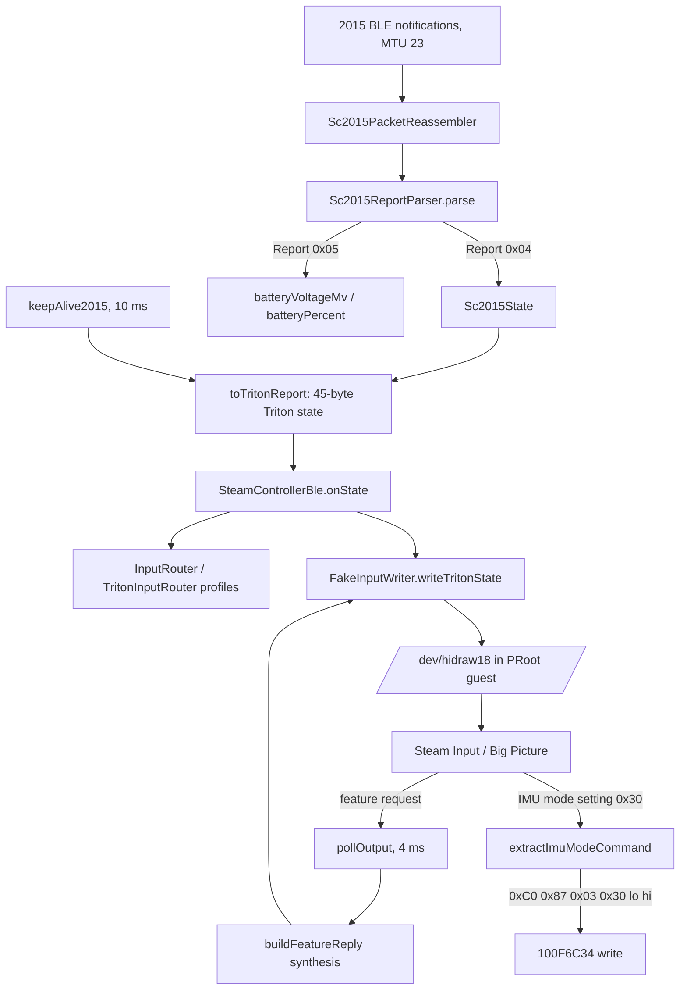

# Steam Controller (2015 Model, "D0G") BLE Support

DroidDeck natively supports the original **2015 Steam Controller** (model 1001, codenamed `"D0G"`, BLE USB/HID ID `28de:1106`) over Bluetooth Low Energy alongside the 2025 Steam Controller (`"Triton"`, `28de:1303`).

Without native support, a 2015 controller paired over BLE stays in "lizard mode" (fallback HID keyboard/mouse emulation): no trackpads, no gyro, no analog triggers and no Steam Input integration. The 2015 BLE protocol is decoded on Android and published through the existing Triton input path, so Steam sees a working controller with no native or guest-side changes.

---

## 1. User Setup & Pairing Guide

### Firmware Requirement (2018 BLE Firmware)
The original 2015 Steam Controller shipped with 2.4 GHz proprietary wireless firmware only. Valve released a Bluetooth Low Energy (BLE) firmware update in May 2018 (`5b02c125` / May 2018 BLE firmware).
- If your controller has never been updated to the BLE firmware, connect it via USB to a PC and flash the official BLE firmware using the community archive tool at **[steamcontroller.tools](https://steamcontroller.tools)** (or the archived Valve `ble.bat` firmware updater).

### Pairing & Switching Modes
The 2015 Steam Controller stores separate wireless pairings for its 2.4 GHz USB receiver and Bluetooth LE:
- **Start BLE Pairing Mode (`Steam + Y`)**: With the controller powered off, hold **`Y`** and press the **`Steam`** button. The Steam LED will blink rapidly and the controller will appear in Android Bluetooth settings as **`SteamController`**.
- **Boot in BLE Mode (`Steam + B`)**: If your controller was previously switched back to its 2.4 GHz dongle mode, hold **`B`** while pressing **`Steam`** to power it on in Bluetooth LE mode (a two-tone ascending chime confirms BLE mode).
- **Boot in 2.4 GHz Dongle Mode (`Steam + A`)**: Hold **`A`** while pressing **`Steam`** to switch back to the 2.4 GHz USB receiver.
- Once in BLE mode, simply pressing the **`Steam`** button powers the controller on in BLE mode and automatically connects to the last paired BLE host.

### BLE vs. 2.4 GHz Wireless Capabilities
| Feature | BLE Mode (`Steam + B` / `Steam + Y`) | 2.4 GHz Dongle (`Steam + A`) |
| :--- | :--- | :--- |
| **Buttons, Stick, Analog Triggers, Rear Grips (`LG`/`RG`)** | Full support | Full support |
| **Dual Trackpads (Touch + Coordinates + Click)** | Full 16-bit absolute coordinates | Full 16-bit absolute coordinates |
| **IMU (Gyroscope + Accelerometer + Orientation)** | Supported (enabled on demand by Steam Input) | Supported |
| **Haptics / Trackpad Pulse** | Suppressed over BLE (output reports dropped to protect actuators) | Full high-frequency audio haptics |
| **Battery Telemetry** | Voltage (mV) and percentage reported via Status Report `0x05` | Voltage and percentage reported |

---

## 2. GATT Architecture & Protocol Summary

Both the 2015 (`D0G`) and 2025 (`Triton`) controllers advertise the custom Valve BLE GATT service `100F6C32-1735-4313-B402-38567131E5F3`, but expose distinct characteristic layouts:

| Characteristic UUID | Model | Properties | Role |
| :--- | :--- | :--- | :--- |
| `100F6C33-1735-4313-B402-38567131E5F3` | **2015 (`ORIGINAL_2015`)** | `0x12` (`READ \| NOTIFY`) | Fragmented 19-byte BLE input/status reports (MTU 23) |
| `100F6C34-1735-4313-B402-38567131E5F3` | **2015 (`ORIGINAL_2015`)** | `0x0A` (`READ \| WRITE`) | Feature / command writes (mode switch, IMU toggle) |
| `100F6C7A-1735-4313-B402-38567131E5F3` | **2025 (`TRITON_2025`)** | `NOTIFY` | 45-byte full state report (`0x45`) |
| `100F6C7C-1735-4313-B402-38567131E5F3` | **2025 (`TRITON_2025`)** | `NOTIFY` | 45-byte simple state report (`0x47`) |

### 2015 vs. 2025 (Triton) at a Glance
| Dimension | Steam Controller (2015) | Steam Controller (2025 / Triton) |
|---|---|---|
| **USB/BLE Vendor & Product ID** | `28de:1106` (`D0G_BLE2_PID`) | `28de:1303` (BLE) / `28de:1302` (Wired) |
| **Input Characteristic** | `100F6C33` | `100F6C7A` (0x45) or `100F6C7C` (0x47) |
| **MTU / Packet Size** | Fixed at 23 bytes (ATT payload ≤ 20 bytes) | Negotiates up to 517 bytes (45-byte payload) |
| **Framing** | Header byte: bit 7 data, bit 6 last, sequence `0..F` | Direct unfragmented frames |
| **Mode Switch Command** | `{0xC0, 0x87, 0x03, 0x08, 0x07, 0x00}` to `100F6C34` | `{0x87, 0x03, 0x09}` to `100F6C34` |
| **Input Report Format** | Variable-length chunked bitmask (Report `0x04`) | Fixed 45-byte state report |
| **Physical Controls** | Dual trackpads, one analog stick, 2 rear grips, gyro | Dual trackpads, dual sticks, 4 rear grips, gyro |

### Connection & Mode Switch Sequence (2015 Model)
1. **MTU Negotiation**: `requestMtu(517)` returns `mtu = 23` (`status = 0`) on the 2015 hardware. `SteamControllerBle` proceeds to service discovery regardless of negotiated MTU.
2. **Characteristic Detection**: `100F6C7C` → Triton `0x47`, else `100F6C7A` → Triton `0x45`, else `100F6C33` → `ORIGINAL_2015` (published as report `0x45`).
3. **CCCD Subscription**: Writes `ENABLE_NOTIFICATION_VALUE` to `00002902-...` on the input characteristic (`ENABLE_INDICATION_VALUE` if the characteristic only supports indications).
4. **ValveMode Handshake**: Immediately after `onDescriptorWrite` succeeds, requests `CONNECTION_PRIORITY_HIGH` and writes `{0xC0, 0x87, 0x03, 0x08, 0x07, 0x00}` to `100F6C34` once per connection. This sets setting `0x08` (right trackpad mode) to `0x0007` (`TRACKPAD_NONE`), disabling mouse emulation and exiting lizard mode. Any previously captured IMU mode command is replayed after the mode switch.
5. **Packet Reassembly & Input Translation**:
   - [`Sc2015PacketReassembler`](../../app/src/main/java/com/droiddeck/launcher/input/steamcontroller/Sc2015PacketReassembler.kt) reassembles multi-fragment BLE notifications (`0x80..0x8F` continuation, `0xC0..0xCF` final segment).
   - [`Sc2015ReportParser`](../../app/src/main/java/com/droiddeck/launcher/input/steamcontroller/Sc2015ReportParser.kt) decodes variable-chunk Report `0x04` (`k_EBLEReportState`) and battery telemetry Report `0x05` (`k_EBLEReportStatus`), adapting state into the 45-byte `FakeInputWriter` ring buffer format.

---

## 3. Implementation

### Module Structure
| Component | Responsibility |
| --- | --- |
| [`SteamControllerBle`](../../app/src/main/java/com/droiddeck/launcher/input/SteamControllerBle.kt) | GATT connection manager: model detection, subscription, keep-alive, output/feature dispatch for both models |
| [`SteamControllerModel.kt`](../../app/src/main/java/com/droiddeck/launcher/input/steamcontroller/SteamControllerModel.kt) | `SteamControllerModel` enum and `SteamControllerUuids` (shared UUIDs, `VALVE_MODE_2015`, device name matching) |
| [`Sc2015PacketReassembler.kt`](../../app/src/main/java/com/droiddeck/launcher/input/steamcontroller/Sc2015PacketReassembler.kt) | Fragment reassembly with sequence validation and overflow guard |
| [`Sc2015ReportParser.kt`](../../app/src/main/java/com/droiddeck/launcher/input/steamcontroller/Sc2015ReportParser.kt) | Report `0x04`/`0x05` decoding, Triton report translation, feature reply synthesis, IMU command extraction, idle-pad expiry |
| [`Sc2015State.kt`](../../app/src/main/java/com/droiddeck/launcher/input/steamcontroller/Sc2015State.kt) | Mutable decoded controller state (buttons, triggers, stick, pads, IMU, battery) |
| [`SteamControllerDebug.kt`](../../app/src/main/java/com/droiddeck/launcher/input/steamcontroller/SteamControllerDebug.kt) | Debug logging gated behind `SteamControllerDebug.enabled` (default off, lazy message evaluation) |

### Data Flow


### Why Translate to Triton Instead of a Native hidraw Node
`app/src/main/cpp/fakeinput_steam.cpp` is SHA-256 pinned in `tools/components/preloads.lock.json`; adding a dedicated `/dev/hidraw22` (`0005:28DE:1106`) node would require rebuilding the Linux/x86/arm64 preload archives in Docker and re-locking them. Translating `Sc2015State` into the 45-byte Triton report on the existing `/dev/hidraw18` keeps the change Kotlin-only and works with the prebuilt `libfakeinput.so`. Every physical 2015 control maps into the Triton state structure; feature replies identify the controller with the Triton BLE product ID (`0x1303`). A native node remains a possible follow-up when the preloads are next regenerated.

### Streaming Behavior
- **Keep-alive (10 ms)**: Steam Input only advances its per-pad filters on new packet numbers, and the 2015 controller goes silent while idle. `keepAlive2015` re-emits the last state with an incrementing packet number so pads and stick stay responsive.
- **Idle-pad expiry (250 ms)**: The 2015 pads can keep reporting a touch after the finger slides off the edge; a real finger always jitters the coordinates. `expireIdlePads` clears a stationary touch after `PAD_IDLE_TIMEOUT_MS` unless the pad is clicked (or the left pad is in joystick mode).
- **Rumble suppression**: Non-feature output reports are dropped for `ORIGINAL_2015` in `sendOutputReport` to protect the voice-coil actuators and keep the change focused on input streaming.
- **Feature reply synthesis**: Steam's feature requests are read from the ring buffer by `pollOutput` and answered directly with `buildFeatureReply` — no GATT round-trip. `GET_ATTRIBUTES_VALUES` (`0x83`) returns product ID, hardware ID (`72`), firmware timestamp and battery voltage; `GET_STRING_ATTRIBUTE` (`0xAE`) and `GET_CHIP_ID` (`0xBA`) return fixed identifiers.
- **Firmware update prompt**: The firmware timestamp reported to Steam is the newer of the built-in default and `TRITON_FW_TS` read from `linuxfs/root/.local/share/Steam/bin/hardwareupdater/hardwareupdater.cfg`, so Steam does not offer a firmware update for the translated controller.
- **IMU mode forwarding**: When Steam writes `SET_SETTINGS_VALUES` (`0x87`) with setting `0x30` (IMU mode), the command is extracted, forwarded to the controller as `{0xC0, 0x87, 0x03, 0x30, lo, hi}` and remembered for replay after reconnects.
- **Battery telemetry**: Report `0x05` carries voltage (u16 at offset 11) and percentage (offset 13). Values are sanity-checked (1500–4500 mV); a missing percentage falls back to a linear voltage estimate. Exposed as `SteamControllerBle.batteryVoltageMv` / `batteryPercent` for future UI use.

### Report Framing & Robustness
- **Reassembler**: header bit 7 marks valid data, bit 6 the final segment, low nibble the sequence `0..F`. Single-fragment packets pass through without buffering. A sequence mismatch resets the buffer (a fresh sequence-0 fragment is still accepted); a 128-byte overflow guard resets runaway reassembly.
- **State report chunks**: the option mask is `(payload[0] & 0xF0) | (payload[1] << 8)`. The expected report length is computed from the mask and validated before any state mutation.

| Chunk | Mask | Bytes | Content |
|---|---|---|---|
| `k_EBLEButtonChunk1` | `0x0010` | 3 | Buttons (A/B/X/Y, bumpers, D-pad, trigger full-pull bits) |
| `k_EBLEButtonChunk2` | `0x0020` | 2 | Analog triggers (0..255) |
| `k_EBLEButtonChunk3` | `0x0040` | 3 | Buttons (Select/Steam/Start, grips, pad clicks/touch, L3) |
| `k_EBLELeftJoystickChunk` | `0x0080` | 4 | Stick X, Y (i16 LE) |
| `k_EBLELeftTrackpadChunk` | `0x0100` | 4 | Left pad X, Y (i16 LE) |
| `k_EBLERightTrackpadChunk` | `0x0200` | 4 | Right pad X, Y (i16 LE) |
| `k_EBLEIMUAccelChunk` | `0x0400` | 6 | Accelerometer X, Y, Z |
| `k_EBLEIMUGyroChunk` | `0x0800` | 6 | Gyroscope X, Y, Z |
| `k_EBLEIMUQuatChunk` | `0x1000` | 8 | Orientation quaternion (decoded, not forwarded) |

### Triton Translation Notes
- Rear grips are reported as always-touched (the 2015 controller has no grip touch sensing); grip buttons map to Triton `L4`/`R4`.
- Trigger click is asserted on the full-pull bit or analog value ≥ 250; analog values scale 0..255 → 0..32767.
- Stick touch is asserted above ±2000 deflection; pad clicks publish full pressure (32767).
- `elapsedUs` is measured from connection time; accelerometer and gyro occupy the Triton IMU fields.

---

## 4. Lifecycle & Threading

```
[Disconnected] → connectGatt(TRANSPORT_LE), retry after 5 s
    → discoverServices → requestMtu(517) → detect model by characteristic
    → CCCD subscribe → CONNECTION_PRIORITY_HIGH + keep-alive + ValveMode
    → [Streaming] notifications → reassemble → parse → publish
    → disconnect / suspend → zero state, release slot, schedule retry
```

- All GATT callbacks, writes and state mutation run on the dedicated `HandlerThread("steam-controller-ble")` Looper; Android delivers `BluetoothGattCallback` on Binder threads, so nothing is mutated directly in a callback.
- Slot ownership guards prevent a stale instance from clearing or publishing into its replacement's slot; `stop()` detaches routed input and zeroes the published state before queued callbacks can run.
- Both `onCharacteristicChanged` overloads are implemented (API 33 deprecated the two-argument form).
- Session integration is unchanged: `SessionService` activates the Triton path when a Steam Controller is paired, and `SessionActivity` refreshes on-screen controls through `SteamControllerBle.listener`.

## 5. Platform Constraints
- **Permissions**: Android 9–11 need `BLUETOOTH`/`BLUETOOTH_ADMIN` + location for BLE; Android 12+ need runtime `BLUETOOTH_SCAN`/`BLUETOOTH_CONNECT` (handled by the existing connection infrastructure).
- **MTU**: the 2015 firmware locks MTU at 23; a failed or short `requestMtu` never blocks the connection.
- **Latency**: BLE polls at ~100 Hz max versus ~500 Hz on the 2.4 GHz dongle; `CONNECTION_PRIORITY_HIGH` keeps the connection interval at ~12 ms.
- **Firmware**: the controller must run the 2018 BLE firmware (see §1); stock 2.4 GHz-only firmware never advertises over BLE.

## 6. Hardware Verification
Verified on a physical Steam Controller (2015, BLE `28de:1106`) paired to Android 15 / Redmi Pad 2 Pro:
- **GATT discovery & MTU**: `requestMtu(517)` → `mtu=23 status=0`; service `100F6C32` exposes `100f6c33 (props=0x12)` and `100f6c34 (props=0x0a)`.
- **Handshake**: CCCD subscription, `CONNECTION_PRIORITY_HIGH` (`interval=12 latency=0`) and ValveMode switch complete in ~350 ms.
- **Input**: buttons, dual trackpads (multi-touch coordinates + clicks), analog triggers, analog stick, rear grips, IMU accel + gyro with 2-fragment reassembly; zero sequence drops observed.
- **Battery**: Status Report `0x05` reports `3432 mV`, `100%`.
- **Steam integration**: controller navigates Big Picture and plays games through Steam Input; no firmware update prompt, no lizard-mode disconnects.

## 7. Debugging & Tests
- Verbose protocol logging is gated behind `SteamControllerDebug.enabled` (default `false`, no settings hook; flip it in a local build or debugger). Logs use tag `SteamControllerBle`: `adb logcat -s SteamControllerBle`.
- Unit tests: `Sc2015PacketReassemblerTest` (framing, sequence resets, overflow), `Sc2015ReportParserTest` (chunk decoding, truncation guards, translation, feature replies, IMU extraction, battery), `SteamControllerBleTest` (Robolectric: lifecycle, slot ownership, fragmented 2015 notification routing). Run with `./gradlew -PskipRust=true :app:testDebugUnitTest`.