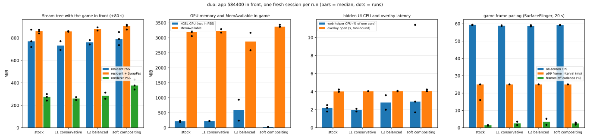
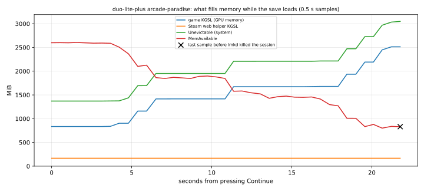

# Steam web helper memory (Steam Lite Runtime research record)

Can DroidDeck make Valve's own Steam web helper (CEF) use less memory and CPU while a game runs,
without replacing or degrading it? This records what was measured on two 8 GB handhelds, which
approaches worked, which did not, and what is left to investigate.

Nothing here changes a default. The tree keeps:

- `droiddeck-steam-lite`, a guest measuring tool: `probe`, `sample`, `record`, and `apply`, which
  runs a single intervention to reproduce the results below.
- `tools/steam_lite_bench.py` and `tools/steam_lite_charts.py`, which drive the devices and draw
  the charts.
- The raw data under `evidence/steam-lite/data`.
- `DD_STEAM_CEF_GPU=0`, a session switch that draws the web helper fully in software.

The opt-in supervisor that ran interventions automatically (`DD_STEAM_LITE` levels 1–3) was
removed after the measurements. Its last version, with its state machine and tests, is commit
`ec802525a` in PR #3301.

## Conclusions

Measured on a Retroid Pocket Duo Lite Plus and a Retroid Pocket Duo (Qualcomm CQ7790S, 7.2 GiB,
6 GiB zRAM, Android 16, kernel 6.6). Both ran without proot, with the native arm64 Steam client
(build 1793740892, CEF Chrome 126.0.6478.183, V8 12.6) and 1280×720 Big Picture.

| Approach | Measured | Verdict |
| --- | --- | --- |
| Software compositing (`DD_STEAM_SOFT_COMPOSITING=1`, existing) | KGSL 239 → 26 MiB in the library, about 190 MiB net after +25 MiB PSS; +0.9 points of one core; +176 MiB `MemAvailable` in game on the Duo (median of 3); game frame pacing unchanged; the UI looks the same | **pursue as the default on ≤8 GB devices**, after the checks below |
| The zRAM preload fix (#3293, merged) | the preload never paged anything out on native userland sessions; with the fix the session's own monitor pages 140–400 MiB of the client out during a game launch | **shipped**; the largest win of the work |
| Cold page-out of the client on demand (supervisor level 2) | 447 MB in one pass, client 674 MiB resident against ~900 for stock, +136 MiB `MemAvailable` | mostly redundant: with #3293 the monitor has usually done it already |
| V8 GC when a game takes focus (level 1) | −27 to −40 MiB right after; the same as stock 80 s later | dropped: V8's idle memory reducer gets there anyway |
| Memory pressure notifications (renderer or browser target) | 0 to −2 MiB; the visible UI regrows | dropped |
| Pausing hidden animations | CPU 2.7–2.8 % before and after | dropped: the hidden UI already does not draw |
| V8 small-heap and GPU-budget flags | renderer 160–200 MiB *larger* | dropped |
| Freezing pages from outside the client (level 3) | no such pages existed in the runs | not enough evidence either way |
| `DD_STEAM_CEF_GPU=0` (full software drawing) | saves the same as software compositing and nothing more | kept as a measuring switch |

Other findings:

- **Where Steam's memory is:** 0.9–1.1 GiB of PSS in the library, plus **190–260 MiB of KGSL GPU
  memory** in the browser process. The GPU runs in-process there. KGSL memory cannot be swapped and
  is not counted in PSS.
  - PSS by process: renderer 320–530 MiB; browser 300–340 MiB, of which about 80 MiB is the
    shared, clean `libcef.so`; client about 220 MiB; network and storage services about 70 MiB.
- **A high-GPU state:** some sessions held 650–1080 MiB of KGSL for the web helper, as untyped
  Vulkan allocations from ANGLE. On the Duo Lite Plus, opening the overlay once released it (3 of
  3 sessions). On the Duo it did not: 936 → 839 → 911 MiB. The state was not reproducible on
  demand.
- **Arcade Paradise's out-of-memory kill is not Steam's:** loading a save made the game allocate
  1.7 GB of KGSL memory in 22 s, and lmkd killed the session on a PSI stall. That happened in every
  arm and also with no tooling at all.

## Next research

1. **Validate software compositing as a default on ≤8 GB devices.** Scroll and animation
   smoothness in the library, store and friends views have not been measured yet. Also measure
   the CPU cost when hidden UI work runs (one in-game run spent 11.4 % of a core), on a Mali or
   vkbridge device, and on a 3–4 GB device.
2. **The 650–1080 MiB ANGLE/Vulkan state:**
   - what allocates it and when;
   - why the overlay releases it on one device and not the other;
   - whether a CEF or ANGLE setting bounds it.
3. **Artwork:** how the library decodes and caches artwork, and whether right-sized assets would
   shrink the renderer. This was not explored.
4. **Arcade Paradise's GPU memory,** independently of Steam. Options include the game's texture
   settings and a cap in the translation layer.

## What the client supports

The probe (`droiddeck-steam-lite probe`) found Chrome 126 / V8 12.6. These methods all answered:

- `Runtime.getHeapUsage`, `Memory.getDOMCounters` and `Performance.getMetrics`
- `HeapProfiler.collectGarbage`
- `Memory.simulatePressureNotification`, on the renderer and on the browser target
- `Animation.*`
- `Emulation.setEmulatedMedia`
- `Page.setWebLifecycleState`

`Browser.getWindowForTarget` answers "Browser window not found" for every client window, because
Steam's CEF windows are not Chrome browser windows.

The client's windows (`Steam Big Picture Mode`, `MainMenu`, `QuickAccess`, notification toasts)
are `about:blank?browserviewpopup…` popups of `SharedJSContext`. They share its renderer and V8
heap. The client starts the web helper itself with `--remote-debugging-address=127.0.0.1`.

## Interventions tried

`droiddeck-steam-lite apply ACTION` runs one of these in a running session:

| Action | Mechanism | Targets | Supervisor level |
| --- | --- | --- | --- |
| `gc` | `HeapProfiler.collectGarbage` | `SharedJSContext` and each page from outside the client | 1 |
| `moderate` | `Memory.simulatePressureNotification` `moderate` | same | 1 |
| `pageout` | zRAM preload request `2 <kB>` (cold pages only, 1 GiB budget); `readback` sends `0` | `steam` and every `steamwebhelper` process | 2 |
| `critical` | `Memory.simulatePressureNotification` `critical` | same as `gc` | 3 |
| `freeze`, `thaw` | `Page.setWebLifecycleState` `frozen` / `active` | only pages outside `steamloopback.host` and the `about:blank` popups | 3 |
| `pause`, `resume` | `Animation.setPlaybackRate` 0 / 1 | client window popups, not `SharedJSContext` | switch only |
| `browser-moderate`, `browser-critical` | pressure on the browser target | browser | — |
| `hide`, `show` | `Browser.setWindowBounds` | client windows | — |
| `motion`, `nomotion` | `prefers-reduced-motion` emulation | client windows | — |

Page-out uses the session's own zRAM protocol:

1. It creates `/tmp/.dd-zram.hold` exclusively and writes the request into it.
2. It sends `SIGURG` to the client's processes.
3. It collects their `.trim.<pid>` answers.

The hold is removed only while it is still the same file with the same content. The app writes
its suspend requests into that file and deletes it itself (`SessionSuspendController`).

The supervisor ran these as follows:

- Passes ran 4 s after a game took focus, and when `MemAvailable` stayed below the monitor's floor
  for 10 s.
- Each pass had a 12 s budget, and it stopped as soon as the client came back in front.
- Pause, freeze and page-out were undone when the client returned.
- Reclaim was skipped when more than 32 MiB of the client was already swapped, because a GC walks
  the whole heap and would read it back.

## Findings

Every number below comes from `evidence/steam-lite/data`, through `tools/steam_lite_charts.py`. The
same script writes the complete tables:
[Duo Lite Plus](evidence/steam-lite/duo-lite-plus-tables.md),
[Duo](evidence/steam-lite/duo-tables.md). Charts start at zero and show every run as a dot beside
the median bar. L1, L2 and L3 are the removed supervisor's levels.

### Where the memory is

Library idle on the Duo Lite Plus, renderer by mapping:

| Mapping | MiB |
| --- | --- |
| V8 heap | 105 |
| `libcef.so` (file, clean, shared with the other helpers) | 79 |
| Other anonymous | 48 |
| malloc heap | 25 |
| PartitionAlloc | 20 |

`Runtime.getHeapUsage` reported 117 MiB used of a 142 MiB JS heap, so most of the renderer is
outside JavaScript. With a game in front the web helper uses 2–3 % of one core, because DroidDeck's
composition already keeps the hidden UI from drawing.

### One intervention at a time


- **With Bully in front:**
  - A GC freed 40 MiB of renderer within 20 s and kept it for the 40 s measured.
  - Moderate and critical pressure afterwards changed nothing.
  - Pausing the hidden windows' animations changed nothing either: CPU was 2.7–2.8 % before and
    after.
- **In the library:**
  - A GC freed 27 MiB, but only after 20 s, because V8 releases pages lazily.
  - After critical pressure, the visible UI grew 23 MiB back.
- **Pressure on the browser target** ([chart](evidence/steam-lite/duo-lite-plus-ablate-bully-browser-target.svg))
  changed nothing, KGSL included.
- **Minimizing the window** ([chart](evidence/steam-lite/duo-lite-plus-ablate-bully-hide.svg)): the
  `Browser.setWindowBounds` call itself failed. The −39 MiB 20 s later is the supervisor's own GC
  from the game launch arriving.
- **`SteamClient.Window.HideWindow`** made the window report `hidden` but freed only 2 MiB of KGSL.
  After `ShowWindow`, the window did not report visible again until the overlay was opened.

### Steady state with a game in front


Nine fresh sessions on the Duo Lite Plus with #3293 in the build, three per profile, interleaved
(stock, L1, L2), Bully in front, sampled 80 s after it took focus.

The session's zRAM monitor pages the client out when a launch makes memory fall fast, so what got
paged out varied from run to run. Resident PSS alone would mix in the monitor's decisions, so the
table lists both.

| Profile | Resident PSS (MiB) | Paged out (MiB) | Renderer (MiB) | Web helper CPU (% of a core) | What the supervisor did |
| --- | --- | --- | --- | --- | --- |
| stock | 849, 723, 902 | 139, 231, 0 (monitor) | 297, 270, 305 | 2.8, 2.9, 2.1 | — |
| L1 | 883, 875, 889 | 0, 0, 0 | 310, 297, 305 | 2.2, 2.6, 2.6 | GC 293–376 ms |
| L2 | 785, 796, 674 | 172, 216 (monitor), 226 (its own) | 283, 283, 235 | 2.4, 2.7, 2.8 | skipped twice (client already in zRAM), once GC + 447 MB page-out in 3.5 s |

Overlay round trips opened and closed in 4.0–4.1 s in every profile. That figure is almost all the
tool (a fresh virtual pad per press and 0.2 s focus polling), so it only shows that no profile
added a delay the tool could see.

The overlay looked the same in every profile ([stock](evidence/steam-lite/overlay-stock.jpg),
[L1](evidence/steam-lite/overlay-l1.jpg), [L2](evidence/steam-lite/overlay-l2.jpg)). Controller
input, notifications and Resume game kept working.

### Frame pacing with a light game (Duo, Sonic Mania)



Ten fresh sessions on the rooted Duo with #3293 in the build. Sonic Mania (584400) was on its
animated title in front, with a 20 s SurfaceFlinger capture 60 s after it took focus:

| Profile | Runs | FPS | p95 / p99 (ms) | Frames off cadence | MemAvailable in game (MiB) | KGSL (MiB) | Web helper CPU (% of a core) |
| --- | --- | --- | --- | --- | --- | --- | --- |
| stock | 3 | 59.4, 59.4, 59.2 | 16 / 16–25 | 1.2–1.6 % | 3058, 3241, 3197 | 193–233 | 1.8–2.5 |
| L1 | 2 | 59.1, 58.7 | 16 / 25 | 1.6–3.5 % | 3176, 3288 | 224–225 | 1.8–2.1 |
| L2 | 2 | 59.2, 58.5 | 16 / 25 | 1.7–5.2 % | 2587 (KGSL 936), 3169 | 239–936 | 2.0–3.6 |
| soft compositing | 3 | 59.3, 59.2, 59.2 | 16 / 25 | 1.8–3.0 % | 3435, 3373, 3367 | 26 | 1.7–2.9, once 11.4 |

- **Frame rate:** no profile changed the game's frame rate or p95. The off-cadence spread is
  run-to-run noise.
- **L1 and L2 runs:** in all four, the supervisor did nothing, because the monitor had already put
  165–404 MB of the client in zRAM.
- **Memory:** soft compositing left the most memory available, a median of 3373 against 3197 MiB
  for stock.
- **CPU:** one soft-compositing run spent 11.4 % of a core in the web helper while the renderer
  grew 43 MiB. Some UI work ran while hidden, and drawing in software makes that cost CPU instead
  of GPU. The other two runs used 1.7 and 2.9 %.

With root, KGSL's per-process `memtype` showed all of the web helper's GPU memory as untyped Vulkan
allocations (`any(0)`, ANGLE on Vulkan): 942 MB in the session that held the high state.
Qualcomm's process reclaim works by marking a process `background` in
`/sys/class/kgsl/kgsl/proc/<pid>/state`. Doing that reclaimed nothing in 15 s: `gpumem_reclaimed`
stayed 0.

### Web helper variants (session restarts)


The Duo, library idle, one fresh session per run. Every run is shown because the renderer size is
bimodal from session to session (319–529 MiB on default flags). Sizes are in MiB, as a median with
the range:

| Variant | Runs | Client tree PSS | Renderer | KGSL |
| --- | --- | --- | --- | --- |
| default | 5 | 941 (913–1104) | 359 (319–529) | 202 (190–262) |
| `DD_STEAM_SOFT_COMPOSITING=1` | 3 | 979 (945–985) | 415 (381–421) | 26 (26–26) |
| `DD_STEAM_CEF_GPU=0` | 3 | 954 (940–965) | 398 (382–406) | 25 (25–25) |
| `--js-flags=--optimize-for-size,--max-semi-space-size=2` | 5 | 1114 (1098–1134) | 519 (497–542) | 202 (194–277) |
| `--force-gpu-mem-available-mb=96 --force-gpu-mem-discardable-limit-mb=32` | 2 | 1157 (1156–1158) | 568 (553–584) | 246 (236–256) |

On the Duo Lite Plus, 90–110 s after start, both pairs of runs gave the same result:

- **CPU:** soft compositing used 2.6 % of one core, against 1.7 % with GPU compositing.
- **GPU memory:** it saved 213–218 MiB of KGSL.
- **Screenshots:** [library, GPU](evidence/steam-lite/library-gpu-compositing.jpg),
  [library, software](evidence/steam-lite/library-soft-compositing.jpg).

### Arcade Paradise's save load


Each trial:

1. started a fresh session and launched the game;
2. loaded the save from its menu;
3. counted only once `MemAvailable` fell 400 MiB or the session died;
4. watched for 90 s.

Every loaded trial was killed 17–33 s after Continue, in every arm (stock, L1, soft compositing,
both). Android recorded `LOW_MEMORY`. lmkd's `killinfo` gave reason 1 (`NOT_RESPONDING`, its PSI
stall trigger), with 13–264 MB free, 3.5–3.8 GB cached and 4.7–5.3 GB of swap free.



Sampling every half second shows why:

- During the load, the game's own KGSL allocation grew from 835 MiB to 2513 MiB.
- System unevictable memory grew with it, from 1.37 to 3.05 GiB.
- The Steam web helper stayed at 167 MiB.

GPU memory can neither be compressed nor reclaimed, so the stall grows until lmkd steps in. This is
the same unevictable/shmem growth that `low-memory.md` records, unattributed, for the Caravan save
load.

### zRAM preload on native userland sessions

On a native session, `SigCgt` showed `SIGURG` unhandled in every Steam and Wine process, although
`libddsession.so` was loaded:

- The preload's constructor looked for `/tmp/.dd-zram` with a raw `openat`.
- The native hook does not map raw system calls, so the preload found nothing and installed no
  handler.
- The monitor's requests were therefore ignored, and the client was never paged out.

#3293 resolves the control files under `DDNATV_ROOT`. With it, on the Duo, every client process
answered:

- A single request paged out 690 MB.
- The Steam tree went from 1,182 to 552 MiB PSS.
- `MemAvailable` rose from 3,251 to 3,660 MiB.
- The read-back request brought it all back.

### Negative results

| Idea | Result | Why it was dropped |
| --- | --- | --- |
| Moderate or critical pressure notification, renderer | 0 to −2 MiB, visible UI regrows | nothing to reclaim that GC does not |
| Pressure notification on the browser target | 0, KGSL unchanged | CEF's browser listener releases no GPU memory here |
| GC on entering a game | gone 80 s later | V8's idle memory reducer does the same |
| Pausing hidden animations | CPU 2.7–2.8 % before and after | the hidden UI already does not draw |
| Minimizing the window (`Browser.setWindowBounds`) | "Browser window not found" | not a Chrome browser window |
| `SteamClient.Window.HideWindow` | −2 MiB KGSL; window stayed `hidden` after `ShowWindow` | private client API, no gain |
| V8 small-heap flags | renderer +160 MiB (median of 5 against 5) | larger, not smaller |
| GPU memory budget flags | renderer +200 MiB, KGSL unchanged (2 runs) | larger, not smaller |
| GC after the monitor paged the client out | read ~200 MiB back in | the walk touches the whole heap |
| KGSL process reclaim (root: `state` = `background`) | 0 bytes reclaimed in 15 s | the Vulkan allocations are not reclaimable this way, and it needs root |

## Measuring

`tools/steam_lite_bench.py` drives a device through `tools/droiddeckctl`. Samples are taken inside
the guest with `droiddeck-steam-lite record` and `sample`.

- **Memory:** per-process `Pss`, `Pss_Anon`, `Pss_File`, `Pss_Shmem` and `SwapPss` from
  `/proc/<pid>/smaps_rollup`, summed over the client tree: `steam` and the web helper's browser,
  renderer and utility processes.
  - PSS is additive; RSS would count shared pages more than once.
  - A process whose `smaps_rollup` cannot be read is reported as unreadable, never as zero.
- **GPU:** `/sys/class/kgsl/kgsl/proc/<pid>/gpumem_{mapped,unmapped}`, reported separately. KGSL
  allocations are system RAM on these SoCs, cannot be swapped, and are not in PSS.
- **System:**
  - `MemAvailable`, `MemFree` and PSI `some`/`full`.
  - `/sys/block/zram0/mm_stat`, which is system-wide and never added to PSS.
  - `pswpin`/`pswpout`.
  - lmkd's `killinfo` and `ApplicationExitInfo` for kills.
- **CPU:** `utime + stime` deltas from `/proc/<pid>/stat`, as percent of one core. The measuring
  tool is listed as `sampler` and left out of the client tree. The removed supervisor appears as
  `steam-lite` in the recorded data.
- **Frames:** `tools/droiddeckctl pacing` (SurfaceFlinger timestats).

An arm is a set of persistent session variables (`ARMS` in the harness): `stock`, `softcomp` and
`cef-software`. Each run starts a fresh session with its arm's variables.

```sh
tools/steam_lite_bench.py info --out results/<device>
tools/steam_lite_bench.py steady --app 584400 --arms stock,softcomp,stock,softcomp,stock,softcomp \
    --out results/<device>/steady
tools/steam_lite_bench.py library --order 1,0,1,0 --out results/<device>/ui
tools/steam_lite_bench.py flags --variants default,soft-compositing,cef-software --repeat 3 \
    --out results/<device>/flags
tools/steam_lite_bench.py oom --app 1388870 --arms stock,softcomp --repeat 4 --out results/<device>
tools/steam_lite_bench.py ablate --actions gc,moderate,critical,pause --waits 3,20,40 \
    --out results/<device> --label ablate-<game>
tools/steam_lite_charts.py results docs/development/evidence/steam-lite
```

What each command does:

- `steady`, per arm:
  1. starts a fresh session and samples the library;
  2. launches the game and samples it 60 and 80 s after it took focus, with a 20 s frame capture
     between the two samples;
  3. times three overlay round trips;
  4. samples the library after quitting.
- `library` starts a fresh session with GPU or software compositing and samples the library 90 and
  110 s later.
- `flags` sets `DD_WEBHELPER_ARGS`, `DD_STEAM_SOFT_COMPOSITING` and `DD_STEAM_CEF_GPU`, starts a
  fresh session per run, and samples the idle library after it settles.
- `oom`, per trial:
  1. starts a fresh session and launches the game;
  2. loads the save;
  3. confirms the load by a ≥400 MiB `MemAvailable` drop or by the session dying;
  4. records whether the session survives 90 s.
- `ablate` applies one action at a time in the running session, with a sample before it and one
  after each wait.
- `cycle` runs a game launch, an overlay round trip and the return to the library in one recorded
  session per arm.

Game inputs need care:

- Each virtual gamepad press creates a new controller; Steam shows "Controller Disconnected" after
  each one.
- The game can miss the first press while it enumerates the new controller.
- Arcade Paradise's title and menu take keyboard Enter reliably.
- The trial matrix therefore used an A hold and a tap on Continue, retried until the load showed in
  `MemAvailable`. The hand-driven control runs used Enter.

Not measured:

- A 3–4 GB device or a Mali/vkbridge device; none was available.
- The x86_64 client.
- Frame pacing with a heavy game; only Sonic Mania was measured.
- Scroll smoothness.
- Suspend and resume, downloads, store pages, and friends and chat.
