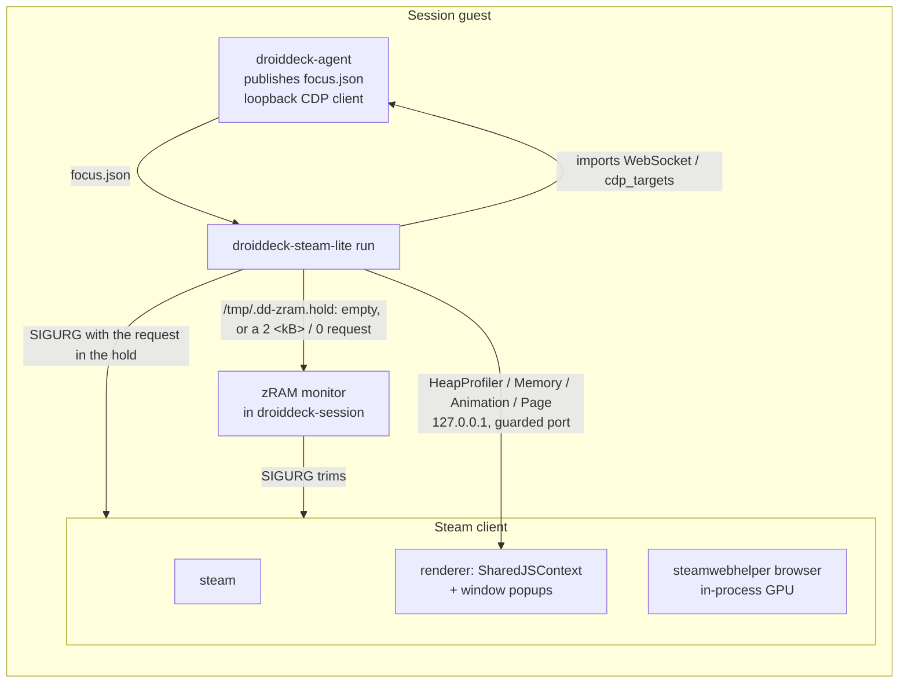
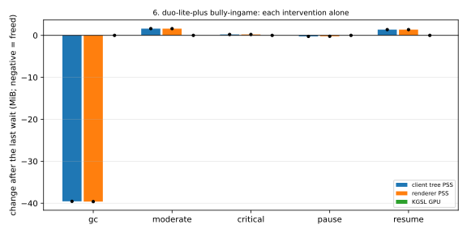
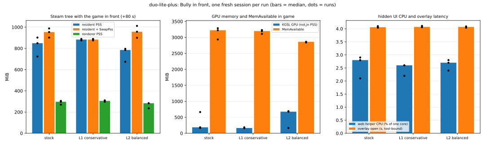
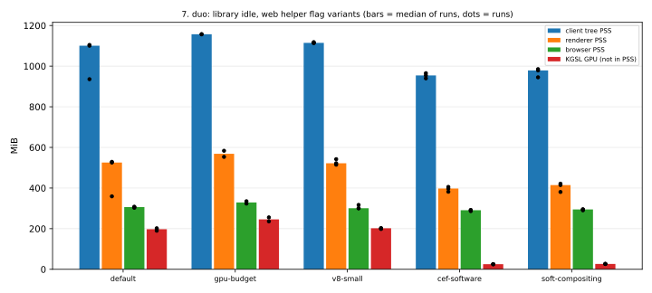
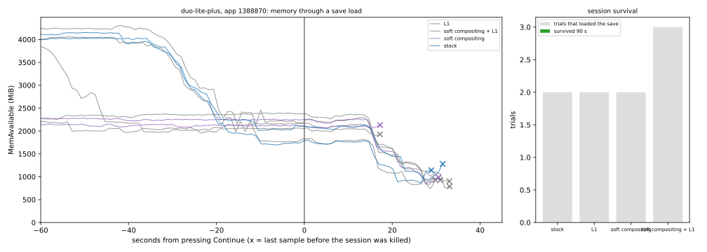

# Steam Lite Runtime (experiment)

An opt-in supervisor, `droiddeck-steam-lite`, that asks Valve's own Steam web helper to give
memory back while a game is in front, through the client's loopback DevTools endpoint and the
session's existing zRAM preload. It adds no UI, edits no Valve files and does nothing unless a
developer turns it on. Stock stays the default.

## Results in short

Measured on two 8 GB handhelds (Retroid Pocket Duo Lite Plus and Retroid Pocket Duo: Qualcomm
CQ7790S, 7.2 GiB, 6 GiB zRAM, Android 16, kernel 6.6), DroidDeck at main `46f99b9` plus this
branch, Run without proot, the native arm64 Steam client (build 1793740892, CEF Chrome
126.0.6478.183, V8 12.6), 1280×720 Big Picture:

- **Where Steam's memory is:** 0.9–1.1 GiB of PSS in the library (renderer 320–530 MiB, browser
  300–340 MiB of which ~80 MiB is the shared, clean `libcef.so`, client ~220 MiB, network and
  storage services ~70 MiB), plus **190–260 MiB of KGSL GPU memory** in the browser process (the GPU
  runs in-process). KGSL is unswappable and not in PSS. Some sessions held 650–1080 MiB of it
  until the overlay was opened once; that state was not reproducible on demand.
- **No profile touched game frame pacing:** Sonic Mania stayed at 58.5–59.4 fps with a 16 ms p95
  under stock, L1, L2 and soft compositing on the Duo.
- **The one large, safe saving is compositing the web helper in software**
  (`DD_STEAM_SOFT_COMPOSITING=1`, already used for the open driver pair): KGSL 239 → 26 MiB in the
  library, for +0.9 points of one core and +25 MiB of PSS, about 190 MiB net, and the UI looks the
  same. Drawing it fully in software (`DD_STEAM_CEF_GPU=0`) saves the same and nothing more.
- **Page-out (level 2) works and is large once the zRAM preload answers:** 447 MB of the client paged
  out in one pass, the client at 674 MiB resident with a game in front against ~900 for stock, and
  +136 MiB `MemAvailable`. With #3293 the session's own monitor usually pages the client out during
  the launch already (140–350 MiB), and level 2 then correctly does nothing.
- **GC (level 1) is not worth having:** −27 to −40 MiB of renderer right after it runs, but 80 s into
  a game level 1 and stock are the same (875–889 vs 902 MiB with nothing paged out): V8's own idle
  memory reducer gets there anyway. Pressure notifications (moderate, critical, on the renderer or
  the browser), pausing hidden animations, minimizing or hiding the window, and the V8 or GPU-budget
  flags gave nothing or made it worse.
- **Arcade Paradise's out-of-memory kill is not Steam's to fix:** loading a save made the game
  allocate **1.7 GB of KGSL memory in 22 s** (unevictable rose 1.37 → 3.05 GiB) and lmkd killed the
  session on a PSI stall with 0.8–1.0 GiB still "available" and 5 GiB of zRAM free. All 9 trials that
  loaded were killed, whatever the arm (stock, level 1, soft compositing, both), and so were two
  runs with no tooling at all. Nothing Steam can give back (40–400 MiB) covers that.
- **The zRAM preload did nothing on native userland sessions** (any process, game or client): it
  opened `/tmp/.dd-zram` with raw system calls the native hook does not map. Fixed in #3293.

| Profile | RAM in game (Lite Plus, Bully) | CPU | Frame or overlay cost | Visual change | Brittleness | Overhead | Recommendation |
| --- | --- | --- | --- | --- | --- | --- | --- |
| Stock | 723–902 MiB resident, 0–231 MiB paged by the monitor | web helper 2.1–2.9 % of one core | — | — | — | — | default |
| L1 conservative | 875–889 MiB resident: no lasting saving | 2.2–2.6 % | overlay unchanged (tool-bound 4.0–4.1 s) | none | low: public `HeapProfiler`/`Memory` | one 0.3–0.45 s pass; supervisor 18 MiB PSS, ~0.15 % CPU | do not promote |
| L2 balanced | 674 MiB resident when it paged out (447 MB); skipped twice because the monitor had already paged 123–353 MB | 2.4–2.8 % | overlay unchanged; read-back on return | none | low: DroidDeck's own preload protocol | 3.5 s pass, off the UI thread | keep as an experiment; only useful with #3293, and then mostly redundant with the monitor |
| L3 aggressive | not measured beyond the ablation: critical pressure freed ~0, no outside pages existed to freeze | — | — | none | medium: `Page.setWebLifecycleState` on store pages | — | do not promote |
| Soft compositing | KGSL −213 to −218 MiB, PSS +23 to +31 MiB (library); +176 MiB `MemAvailable` in game on the Duo (median of 3) | +0.9 points (library idle); one in-game run 11.4 % | game frame pacing unchanged; scrolling smoothness not measured | none seen | low: existing DroidDeck switch | none | best candidate to promote for ≤8 GB devices, after a smoothness check on a scrolling library |

Not run: a 3–4 GB device (none available), a Mali/vkbridge device, the x86_64 client, frame
pacing of a heavy game under each profile (measured with Sonic Mania only), scroll smoothness,
suspend/resume, downloads, store pages and friends/chat under each level. Durability against future Steam builds is unknown.

## Turning it on

| Setting | Where | Effect |
| --- | --- | --- |
| `DD_STEAM_LITE=1` (`conservative`) | `tools/droiddeckctl env set --persistent`, or the `droiddeck-env` file | One V8 GC (and a moderate pressure notification) when a game takes focus, again on sustained memory pressure. |
| `DD_STEAM_LITE=2` (`balanced`) | same | Level 1, then the client's cold memory paged out through the zRAM preload; read back the moment the client is in front. Needs the preload to answer on native userland sessions (#3293). |
| `DD_STEAM_LITE=3` (`aggressive`) | same | Level 2 plus a critical pressure notification and freezing pages from outside the client (store or community views). |
| `DD_STEAM_LITE_SWITCHES=+pause,-gc,...` | same | One intervention on or off on top of the level: `gc`, `moderate`, `pageout`, `critical`, `freeze`, and `pause`, which no level turns on (it measured no effect). |
| `agent/steam-lite.json` in the session folder | written at runtime (`tools/steam_lite_bench.py` does) | `{"level": "...", "switches": "..."}` replaces both while the session runs; `{"level": "stock"}` restores everything held and idles. |

Unset, `0`, `off` or `stock`: `droiddeck-session` does not start the supervisor. That is the kill
switch: remove the variable and start a new session. It only runs in the gamepad Steam session.

`DD_STEAM_CEF_GPU=0` (new) draws the web helper in software on any device, the way low-RAM Mali
bridge devices already do; `DD_STEAM_SOFT_COMPOSITING=1` (existing) composites in software and
keeps GPU raster. Both are measured below as separately controlled variables; neither changes a
default.

## How it works



- **Signals reused:** gamescope focus from `agent/focus.json` (written by `droiddeck-agent`, the
  same file `droiddeck-launcher-cores` and the zRAM monitor read), `/proc/meminfo`, and the
  client's swap from `/proc/<pid>/status`.
- **DevTools reused:** the supervisor loads `droiddeck-agent` as a module and uses its
  loopback-only `WebSocket` and `cdp_targets`, on the port `droiddeck-session` already opens for
  the agent and guards to guest processes. No new port, listener or protocol.
- **States:** `ui` (the client is in front or no game is running: nothing runs), `launching` (a game
  is focusable but not in front), `game` (in front for 4 s: passes may run), `back` (the client came
  in front of a running game: page-out is read back and everything held is restored at once).
- **Passes:** an `enter` pass when a game takes focus, not repeated within 120 s, so opening and
  closing the overlay does not cycle GC, page-out and read-back. A `pressure` pass when
  `MemAvailable` has stayed below the zRAM monitor's floor (one eighth of RAM, 640–1280 MiB) for 10 s,
  at most every 120 s and four times per game. A pass has a 12 s budget and every DevTools call 5 s,
  and before every step it re-reads focus and stops if the client came to the front.
- **zRAM coordination:** a GC walks the whole V8 heap, so after the client has been paged out it
  would read it back. A pass skips reclaim when more than 32 MiB of the client is already in swap,
  and holds the monitor off with an empty `/tmp/.dd-zram.hold` while it runs. Page-out writes its
  request (`2 <kB>`, the monitor's own cold-only trim) into that hold, signals the client's
  processes and collects their `.trim.<pid>` answers. Read-back writes `0` the same way. The hold
  is created exclusively and removed only while it is still the same file with what was written in
  it: the app writes its suspend requests into that file and deletes it itself
  (`SessionSuspendController`).
- **Rollback:** pause, freeze and page-out are undone when the client comes to the front, the game
  exits, the level is switched to stock at runtime, or the supervisor gets SIGTERM, SIGHUP, SIGINT
  or loses its parent. GC and pressure notifications need no undo.
- **No DevTools:** a missing port, target or method makes a pass record an error and change
  nothing. A method the client answers with JSON-RPC `-32601` is remembered and not called again.
  The supervisor never restarts Steam.

## Interventions

| Name | Mechanism | Targets | Level |
| --- | --- | --- | --- |
| `gc` | `HeapProfiler.collectGarbage` | `SharedJSContext` (every client window is one of its popups and shares its renderer) and each page from outside the client | 1 |
| `moderate` | `Memory.simulatePressureNotification` `moderate` | same | 1 |
| `pause` | `Animation.setPlaybackRate 0`, undone with `1` | client window popups, not `SharedJSContext` | switch only |
| `pageout` | zRAM preload request `2 <kB>` (cold pages only, 1 GiB budget), read back with `0` | `steam` and every `steamwebhelper` process | 2 |
| `critical` | `Memory.simulatePressureNotification` `critical` (replaces `moderate`) | same as `gc` | 3 |
| `freeze` | `Page.setWebLifecycleState frozen`, undone with `active` | only pages outside `steamloopback.host` and `about:blank` popups | 3 |

`droiddeck-steam-lite apply` also has one-shot actions that are not part of any level, kept to
reproduce the negative results below: `browser-moderate`, `browser-critical` (pressure on the
browser target), `hide`/`show` (`Browser.setWindowBounds`), `motion`/`nomotion`
(`prefers-reduced-motion` emulation).

The main UI target and the browser process are never frozen or killed: Steam Input, the overlay
and notifications run through them.

## Findings

Every number below comes from `docs/development/evidence/steam-lite/data` (raw JSON and JSONL)
through `tools/steam_lite_charts.py`, which also writes the complete tables
([Duo Lite Plus](evidence/steam-lite/duo-lite-plus-tables.md), [Duo](evidence/steam-lite/duo-tables.md)).
Charts start at zero and show every run as a dot beside the median bar.

### What the client supports

The probe (`droiddeck-steam-lite probe`) found Chrome 126 / V8 12.6 with `Runtime.getHeapUsage`,
`Memory.getDOMCounters`, `Performance.getMetrics`, `HeapProfiler.collectGarbage`,
`Memory.simulatePressureNotification` (renderer and browser target), `Animation.*`,
`Emulation.setEmulatedMedia` and `Page.setWebLifecycleState` all answering. `Browser.getWindowForTarget`
answers "Browser window not found" for every client window: Steam's CEF windows are not Chrome
browser windows. The client's windows (`Steam Big Picture Mode`, `MainMenu`, `QuickAccess`,
notification toasts) are `about:blank?browserviewpopup…` popups of `SharedJSContext` and share its
renderer and V8 heap. The client starts the web helper itself with
`--remote-debugging-address=127.0.0.1`.

### Where the memory is

Library idle on the Duo Lite Plus, renderer by mapping: V8 heap 105 MiB, `libcef.so` 79 MiB (file,
clean, shared with the other helpers), other anonymous 48 MiB, malloc heap 25 MiB, PartitionAlloc
20 MiB. `Runtime.getHeapUsage` reported 117 MiB used of a 142 MiB JS heap, so most of the renderer
is outside JavaScript. With a game in front the web helper uses 2–3 % of one core: DroidDeck's
composition already keeps the hidden UI from drawing.

### One intervention at a time



With Bully in front, a GC freed 40 MiB of renderer within 20 s and kept it for the 40 s measured;
moderate and critical pressure afterwards changed nothing, and neither did pausing the hidden
windows' animations (CPU 2.7–2.8 % before and after). In the library a GC freed 27 MiB only after
20 s (V8 releases pages lazily), and critical pressure was followed by the visible UI growing 23 MiB
back. Pressure on the browser target ([chart](evidence/steam-lite/duo-lite-plus-ablate-bully-browser-target.svg))
changed nothing, KGSL included. In the `hide` ablation ([chart](evidence/steam-lite/duo-lite-plus-ablate-bully-hide.svg))
the `Browser.setWindowBounds` call itself failed; the −39 MiB 20 s later is the supervisor's own
GC from the game launch arriving. `SteamClient.Window.HideWindow` made the window report
`hidden` but freed 2 MiB of KGSL, and `ShowWindow` did not report it visible again until the
overlay was opened, so it was not pursued.

### Steady state with a game in front



Nine fresh sessions on the Duo Lite Plus with #3293 in the build, three per profile, interleaved
(stock, L1, L2), Bully in front, sampled 80 s after it took focus. What paged the client out varied
run to run: the session's monitor pages the client out when the launch makes memory fall fast, so
resident PSS alone mixes in the monitor's decisions; the table lists both.

| Profile | Resident PSS (MiB) | Paged out (MiB) | Renderer (MiB) | Web helper CPU (% of a core) | What the supervisor did |
| --- | --- | --- | --- | --- | --- |
| stock | 849, 723, 902 | 139, 231, 0 (monitor) | 297, 270, 305 | 2.8, 2.9, 2.1 | — |
| L1 | 883, 875, 889 | 0, 0, 0 | 310, 297, 305 | 2.2, 2.6, 2.6 | GC 293–376 ms |
| L2 | 785, 796, 674 | 172, 216 (monitor), 226 (its own) | 283, 283, 235 | 2.4, 2.7, 2.8 | skipped twice (client already in zRAM), once GC + 447 MB page-out in 3.5 s |

Overlay round trips opened and closed in 4.0–4.1 s in every profile; that figure is almost all the
tool (a fresh virtual pad per press and 0.2 s focus polling), so it only shows that no profile added
a delay the tool could see. The overlay looked the same in every profile
([stock](evidence/steam-lite/overlay-stock.jpg), [L1](evidence/steam-lite/overlay-l1.jpg),
[L2](evidence/steam-lite/overlay-l2.jpg)), and controller input, notifications and Resume game kept
working.

### Frame pacing with a light game (Duo, Sonic Mania)


Ten fresh sessions on the rooted Duo with #3293 in the build, Sonic Mania (584400) on its animated
title in front, a 20 s SurfaceFlinger capture 60 s after it took focus:

| Profile | Runs | FPS | p95 / p99 (ms) | Frames off cadence | MemAvailable in game (MiB) | KGSL (MiB) | Web helper CPU (% of a core) |
| --- | --- | --- | --- | --- | --- | --- | --- |
| stock | 3 | 59.4, 59.4, 59.2 | 16 / 16–25 | 1.2–1.6 % | 3058, 3241, 3197 | 193–233 | 1.8–2.5 |
| L1 | 2 | 59.1, 58.7 | 16 / 25 | 1.6–3.5 % | 3176, 3288 | 224–225 | 1.8–2.1 |
| L2 | 2 | 59.2, 58.5 | 16 / 25 | 1.7–5.2 % | 2587 (KGSL 936), 3169 | 239–936 | 2.0–3.6 |
| soft compositing | 3 | 59.3, 59.2, 59.2 | 16 / 25 | 1.8–3.0 % | 3435, 3373, 3367 | 26 | 1.7–2.9, once 11.4 |

No profile changed the game's frame rate or p95; the off-cadence spread is run-to-run noise (in all
four L1 and L2 runs the supervisor did nothing, because the monitor had already put 165–404 MB of the
client in zRAM before the game took focus). Soft compositing left the most memory available
(median 3373 against 3197 MiB for stock). One soft-compositing run spent 11.4 % of a core in the web
helper while the renderer grew 43 MiB: some UI work ran while hidden, and drawing in software makes
that cost CPU instead of GPU; the other two runs used 1.7 and 2.9 %.

With root, KGSL's per-process `memtype` showed all of the web helper's GPU memory as untyped Vulkan
allocations (`any(0)`, ANGLE on Vulkan), 942 MB in the session that held the high state. Marking the
process `background` in `/sys/class/kgsl/kgsl/proc/<pid>/state`, which Qualcomm's process reclaim
uses, reclaimed nothing in 15 s (`gpumem_reclaimed` stayed 0).

### Web helper variants (session restarts)



The Duo, library idle, one fresh session per run. The renderer is bimodal from session to session
(319–529 MiB on default flags), which is why every run is shown:

| Variant | Runs | Client tree PSS | Renderer | KGSL |
| --- | --- | --- | --- | --- |
| default | 5 | 941 (913–1104) | 359 (319–529) | 202 (190–262) |
| `DD_STEAM_SOFT_COMPOSITING=1` | 3 | 979 (945–985) | 415 (381–421) | 26 (26–26) |
| `DD_STEAM_CEF_GPU=0` | 3 | 954 (940–965) | 398 (382–406) | 25 (25–25) |
| `--js-flags=--optimize-for-size,--max-semi-space-size=2` | 5 | 1114 (1098–1134) | 519 (497–542) | 202 (194–277) |
| `--force-gpu-mem-available-mb=96 --force-gpu-mem-discardable-limit-mb=32` | 2 | 1157 (1156–1158) | 568 (553–584) | 246 (236–256) |

On the Duo Lite Plus, 90–110 s after start, soft compositing cost 2.6 against 1.7 % of one core in
both pairs of runs and saved 213–218 MiB of KGSL ([library, GPU](evidence/steam-lite/library-gpu-compositing.jpg),
[library, software](evidence/steam-lite/library-soft-compositing.jpg)).

### Arcade Paradise's save load



Each trial started a fresh session, launched the game, loaded the save from its menu and watched
for 90 s; a trial counted only once `MemAvailable` fell 400 MiB or the session died. Every loaded
trial was killed 17–33 s after Continue, in every arm. Android recorded `LOW_MEMORY`; lmkd's
`killinfo` gave reason 1 (`NOT_RESPONDING`, its PSI stall trigger) with 13–264 MB free,
3.5–3.8 GB cached and 4.7–5.3 GB of swap free.


Sampling every half second shows why: during the load the game's own KGSL allocation grew from
835 MiB to 2513 MiB, and system unevictable memory with it, while the Steam web helper stayed at
167 MiB. GPU memory can neither be compressed nor reclaimed, so the stall grows until lmkd steps
in. This is the same unevictable/shmem growth `low-memory.md` records for the Caravan save load, there left unattributed.
The fix belongs with the game's GPU memory (its texture settings, or a cap in the translation
layer), not with Steam.

### zRAM preload on native userland sessions

`SigCgt` showed `SIGURG` unhandled in every Steam and Wine process of a native session although
`libddsession.so` was loaded: its constructor looked for `/tmp/.dd-zram` with a raw `openat` that the
native hook does not map, found nothing and installed no handler. The monitor's requests were
ignored and the client was never paged out. #3293 resolves the control files under `DDNATV_ROOT`;
with it every client process answered (690 MB paged out in one request, all read back).

### Negative results kept

| Idea | Result | Why it was dropped |
| --- | --- | --- |
| Moderate or critical pressure notification, renderer | 0 to −2 MiB, visible UI regrows | nothing to reclaim that GC does not |
| Pressure notification on the browser target | 0, KGSL unchanged | CEF's browser listener releases no GPU memory here |
| Pausing hidden animations | CPU 2.7–2.8 % before and after | the hidden UI already does not draw |
| Minimizing the window (`Browser.setWindowBounds`) | "Browser window not found" | not a Chrome browser window |
| `SteamClient.Window.HideWindow` | −2 MiB KGSL; window stayed `hidden` after `ShowWindow` | private client API, no gain |
| V8 small-heap flags | renderer +160 MiB (median of 5 against 5) | larger, not smaller; not investigated further |
| GPU memory budget flags | renderer +200 MiB, KGSL unchanged (2 runs) | larger, not smaller |
| GC after the monitor paged the client out | read ~200 MiB back in | the supervisor skips reclaim when >32 MiB of the client is swapped |
| KGSL process reclaim (root: `state` = `background`) | 0 bytes reclaimed in 15 s | the Vulkan allocations are not reclaimable this way, and it needs root |

## Failure modes and rollback

- Every intervention is off unless `DD_STEAM_LITE` names a level; `droiddeck-session` does not start
  the supervisor otherwise. `{"level": "stock"}` in `agent/steam-lite.json` undoes pause, freeze and
  page-out in the running session.
- No DevTools port, target or method: the pass records the error in
  `agent/steam-lite-status.json` and the session log and changes nothing.
- The preload not answering (any build without #3293 on a native session): page-out returns 0 kB
  and nothing else changes.
- A Steam update that renames `SharedJSContext`, changes the popup URLs or drops a DevTools method
  would make passes do less, not break the client: the targets are found by title and URL every
  pass, and errors are recorded, not retried. That cannot be noticed without reading the status
  file, so it should stay an experiment.
- What is safe to promote: software compositing on 8 GB devices (an existing switch), after a
  smoothness check. What should stay experimental: all three levels.

## Measuring

`tools/steam_lite_bench.py` drives a device through `tools/droiddeckctl`; samples are taken inside
the guest with `droiddeck-steam-lite record`/`sample`.

- **Memory:** per-process `Pss`, `Pss_Anon`, `Pss_File`, `Pss_Shmem` and `SwapPss` from
  `/proc/<pid>/smaps_rollup`, summed over the client tree (`steam`, the web helper browser, renderer
  and utility processes). PSS is additive; RSS would count shared pages more than once. A process
  whose `smaps_rollup` cannot be read is reported as unreadable, never as zero.
- **GPU:** `/sys/class/kgsl/kgsl/proc/<pid>/gpumem_{mapped,unmapped}`, reported separately. KGSL
  allocations are system RAM on these SoCs, cannot be swapped, and are not in PSS.
- **System:** `MemAvailable`, `MemFree`, PSI `some`/`full`, `/sys/block/zram0/mm_stat` (system-wide,
  never added to PSS), `pswpin`/`pswpout`; lmkd's `killinfo` and `ApplicationExitInfo` for kills.
- **CPU:** `utime + stime` deltas from `/proc/<pid>/stat` as percent of one core. The sampler and
  the supervisor are listed as `steam-lite` and excluded from the client tree.
- **Frames:** `tools/droiddeckctl pacing` (SurfaceFlinger timestats).

```sh
tools/droiddeckctl env set --persistent DD_STEAM_LITE=1   # any level, so the supervisor runs
tools/droiddeckctl start steam --wait
tools/steam_lite_bench.py info --out results/<device>
tools/steam_lite_bench.py ablate --actions gc,moderate,critical,pause --waits 3,20,40 \
    --out results/<device> --label ablate-<game>
tools/steam_lite_bench.py flags --variants default,soft-compositing,cef-software --repeat 3 \
    --out results/<device>/flags
tools/steam_lite_bench.py oom --app 1388870 --arms stock,l1,softcomp,softcomp+l1 --repeat 4 \
    --out results/<device>
tools/steam_lite_bench.py steady --app 12200 --levels stock,1,2,stock,1,2,stock,1,2 --out results/<device>/steady
tools/steam_lite_bench.py library --order 1,0,1,0 --out results/<device>/ui
tools/steam_lite_charts.py results docs/development/evidence/steam-lite
```

- `ablate` applies one intervention at a time with a sample before it and after each wait.
- `flags` sets the session environment (`DD_WEBHELPER_ARGS`, `DD_STEAM_SOFT_COMPOSITING`,
  `DD_STEAM_CEF_GPU`), starts a fresh session per run and samples the idle library after it settles.
- `oom` starts a fresh session per trial, launches the game, loads the save, confirms the load by
  a ≥400 MiB `MemAvailable` drop or the session dying, and records whether it survives 90 s.
- `steady` starts a fresh session per level, samples the library, launches the game, samples it 60
  and 80 s after it took focus, times three overlay round trips and samples the library after quitting.
- `library` starts a fresh session with GPU or software compositing and samples the library 90 and
  110 s later.
- `cycle` switches the profile at runtime within one session instead; it was not used for the
  numbers above because a device set to leave Steam when a game exits ends the session after
  every run.

Game inputs: virtual gamepad presses create a new controller each time (Steam shows "Controller
Disconnected" after each) and the game can miss the first press while it enumerates it; Arcade
Paradise's title and menu take keyboard Enter reliably. The trial matrix used an A hold and a tap on
Continue, retried until the load showed in `MemAvailable`; the hand-driven control runs used Enter.
