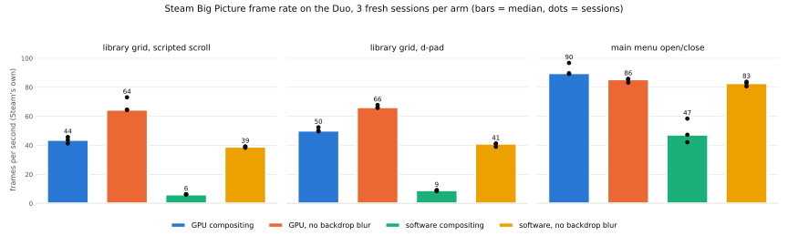
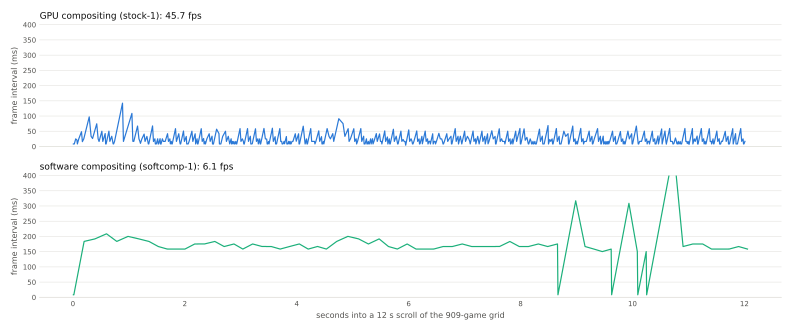
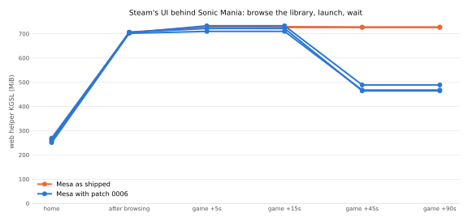
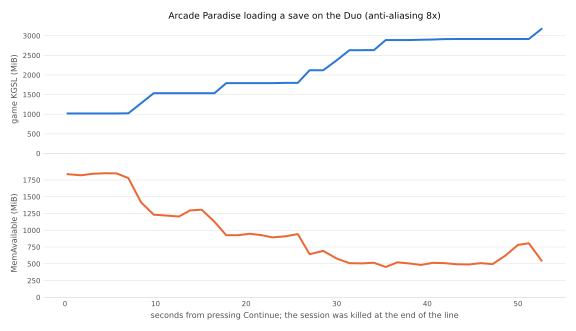

# Steam web helper: UI smoothness and GPU memory

Follow-up to [steam-lite-runtime.md](steam-lite-runtime.md). All measurements are on the rooted
Retroid Pocket Duo:

- Qualcomm CQ7790S with an Adreno 722, 7.2 GiB of RAM, Android 16;
- the native arm64 Steam client (CEF Chrome 126);
- Big Picture at 1280×720 on a 120 Hz panel.

It answers four questions:

1. Is software compositing usable as a default?
2. What are the 650–1080 MiB of KGSL memory the web helper sometimes holds?
3. Does library artwork matter?
4. What fills memory when Arcade Paradise loads a save?

Raw data is under `evidence/steam-webhelper/data`. `tools/steam_webhelper_charts.py` draws the
charts. The measurements come from:

- `tools/steam_lite_bench.py smooth`;
- the scripts in `evidence/steam-webhelper/data/zink`.

## Results in short

- **Software compositing breaks scrolling.** Library grid scrolling fell from 44 fps (GPU
  compositing) to 6 fps, with 300+ ms frames, and gamepad scrolling fell from 50 to 9 fps.
  - The cause is Big Picture's frosted-glass bars and panels (`backdrop-filter: blur()`), which the
    software compositor redraws on one CPU thread every frame.
  - It cannot be the default as Steam ships its UI. Even with every backdrop blur removed it
    reaches 39 fps, below the GPU path.
- **Most of the large KGSL state is GPU memory that Mesa's zink driver never gives back once the
  UI goes idle.**
  - Browsing the library raises the web helper from 250 to 700+ MiB of KGSL.
  - With a game in front, the stock driver held 726–728 MiB for as long as it was watched (90 s).
    The UI makes no allocation, and zink reclaims what Chrome freed only during its next
    allocation.
  - `tools/ubuntu/patches/mesa/0006` reclaims once a second while the process is idle. With it
    the web helper dropped to 465–489 MiB 45 s into the game, and stayed there. That is about
    250 MiB more `MemAvailable` behind every game launched after browsing, with no change in UI
    smoothness or game frame pacing.
  - Sitting idle in the library, it falls to 204 MiB within 40 s; stock was still at 713 MiB after
    50 s.
- **The web helper does not run on the Vulkan backend DroidDeck asks for.** Steam does not
  forward `-cef-use-angle=vulkan`, so Chrome uses ANGLE on OpenGL, which runs through zink and
  then Turnip.
  - Forcing ANGLE onto Vulkan makes Chrome fall back to software compositing on X11, at 6 fps.
- **Artwork is decoded about 4.6× larger than it is drawn.** That memory is transient and
  released when scrolling stops.
- **Arcade Paradise genuinely needs 2.8–3.2 GB of GPU memory to load a save.** DXVK reports 90 %
  of its heap in use. Nothing below the game can shrink that, so on an 8 GB device everything else
  has to stay small.

## Software compositing and smoothness

Six fresh sessions, alternating GPU compositing (stock) and software compositing (softcomp).
Steam's own frame cadence comes from `requestAnimationFrame` timestamps in the Big Picture window.
The scrolling scenarios ran on the All Games grid (909 games, 37,000 CSS px tall):

- **scroll:** a 12 s scroll at 1500 CSS px/s.
- **pad:** 40 d-pad presses through the grid (Steam's own focus scrolling).
- **menu:** the main menu opened and closed three times.

Each session ran every scenario twice: with Steam's styles as shipped, and with every
`backdrop-filter` removed by an injected stylesheet. Figures are the median (range) of 3 sessions:

| Arm | Styles | Grid scroll fps | p95 ms | Pad scroll fps | p95 ms | Menu fps | p95 ms |
| --- | --- | --- | --- | --- | --- | --- | --- |
| GPU compositing | shipped | 43.7 (41.3–45.7) | 58.7 | 50.1 (49.6–52.4) | 59.7 | 89.7 | 16.7 |
| GPU compositing | no backdrop blur | 64.5 (64.4–73.1) | 41.9 | 66.2 (65.8–67.8) | 39.8 | 85.5 | 16.9 |
| software compositing | shipped | **6.1** (6.1–6.3) | 309 | **9.0** (8.3–9.0) | 342 | 47.3 (42.1–58.4) | 167 |
| software compositing | no backdrop blur | 39.0 (38.3–39.2) | 50.1 | 41.1 (39.0–41.2) | 58.4 | 82.8 | 25.1 |

During a software-compositing scroll, the browser's `VizCompositorThread` used 97 % of a core while
the raster threads were nearly idle.

`simpleperf` showed half of that thread in one loop of `libcef.so`. The loop reads RGBA pixels into
three running-sum ring buffers, which is Skia's software box blur. It is the blur behind the
frosted header, tab bar and footer ([as shipped](evidence/steam-webhelper/grid-shipped.jpg),
[without it](evidence/steam-webhelper/grid-no-backdrop-blur.jpg)), redone every frame over the
moving grid.

What each style variant gave, in one software-compositing session:

| Variant | Grid scroll fps |
| --- | --- |
| shipped | 5.4–6.3 |
| hide the 57 invisible (opacity 0) backdrop layers | 6.6–6.7 |
| no `::before` backdrop blur (the frosted header and tab bar) | 9.8 |
| no element filters | 10.3 |
| backdrop blur radius forced to 32 / 16 / 8 / 4 px | 10.9 / 12.1 / 13.0 / 15.3 |
| hidden layers off and no blur on the bars | 26.5 |
| no backdrop blur at all | 39.2–40.9 |
| no filters at all | 35.5 |

The blur radius barely matters: the software compositor pays for every blurred layer's render
pass. Removing the blur also changes how Steam looks, because the bars become plain 50 % black.
The GPU path gains from it too (44 → 64 fps).

Two corrections to the first report:

- Software compositing's memory saving is real, but so is this cost.
- Measurements need Steam's screensaver off. It starts after 5 idle minutes and covers the UI,
  which made two early runs look like 45–57 fps. `smooth` sets
  `system_idle_screensaver_ac_sec` to 0 through `SteamClient.Settings.SetSetting` (field 24009).

## GPU memory

### Where it is

KGSL's debugfs (`/sys/kernel/debug/kgsl/proc/<pid>/mem`, root) lists every allocation of the
browser process, which runs the GPU in-process. In one stock session:

| State | KGSL (MiB) | 2 MiB allocations |
| --- | --- | --- |
| Home, settled | 252 | 73 |
| Library grid | 277 | 82 |
| After a 12 s grid scroll | 768 | 333 |
| 50 s idle in the grid | 713 | 308 |
| After critical memory pressure (browser and renderer) | 725 | 308 |
| Back to Home | 195 | 40 |

The growth is all in allocations of exactly 2 MiB. That is zink's slab size: entries up to 1 MiB
are packed into 2 MiB slabs (`max_slab_order = 20` in `zink_bo.c`).

`SystemInfo.getInfo` names the stack:

> ANGLE (Mesa, zink Vulkan 1.4 (Adreno 722 (MESA_TURNIP)), OpenGL 4.6 Mesa 26.0.8-1ubuntu0.3+droiddeck1)

So the chain is Chrome → ANGLE on OpenGL → zink → Turnip → KGSL.

A `memory-infra` dump through DevTools at 765 MiB of KGSL showed Chrome accounting for only:

| Component | MiB |
| --- | --- |
| `cc/tile_memory` | 20 |
| `cc/image_memory` (decoded artwork, before it was released) | 182 |
| `global` (shared images) | 177–403 |

### Why it stays

Two layers hold it:

1. **Chrome** frees its GPU caches 20–40 s after the UI goes idle.
2. **zink** reclaims the slab entries and buffers Chrome frees only lazily:
   - `pb_slab_free` only queues an entry.
   - A slab is returned only when all its entries are reclaimed.
   - Reclaim runs only inside a later allocation from the same slab group, and
     `pb_slabs_reclaim` stops at the first two entries still in use.
   - Freed whole buffers wait in `pb_cache` until the next buffer is cached or reclaimed.
   - Nothing runs while the process is idle.

With a game in front, Steam's UI is exactly that idle process.

Each trial was a fresh session: browse the grid, launch Sonic Mania offline, then sample:

| Web helper KGSL (MiB) | After browsing | Game +15 s | Game +45 s | Game +90 s | MemAvailable at +90 s |
| --- | --- | --- | --- | --- | --- |
| Mesa as shipped (5 trials; +90 s in 2) | 705–718 | 726–752 | 726–750 | 726–728 | 2904–2999 |
| with patch 0006 (3 trials) | 702–707 | 710–733 | 465–489 | 465–489 | 3184–3228 |

One earlier stock session already held 1153 MiB on the home screen and 2093 MiB with the game in
front, which left 1.5 GiB available.

Opening the overlay releases the memory on the stock driver, because the overlay draws and therefore
allocates: 726 → 213 MiB. A scripted poke can do the same: make the hidden UI draw one new tile
(an almost transparent element, then a full-window `Page.captureScreenshot`). But it only works
in that exact form: a 256 px screenshot, or one without a style change, did nothing. It confirms
the mechanism; it is not a fix.

### The fix

`tools/ubuntu/patches/mesa/0006` starts one thread per zink screen. Once a second, if the process
has made no allocation since the last tick, it:

- runs `pb_slabs_reclaim_all` on every slab manager. This is a new locked wrapper of the existing
  `pb_slabs_reclaim_all_locked`, which skips busy entries instead of stopping at them.
- releases zink's buffer cache (`pb_cache_release_all_buffers`).

Both are calls zink already makes when an allocation fails. A process that keeps drawing keeps its
caches; a process that goes idle gives the memory back.

The first build used `pb_slabs_reclaim` and reclaimed almost nothing, because it stopped at the
same busy entries every second. With `pb_slabs_reclaim_all`:

| Patched build | Result |
| --- | --- |
| Idle library grid | 702 → 416 → 204 MiB within 41 s, then flat. Stock was at 713 MiB after 50 s. |
| UI frame rate (2 sessions) | grid 41.6–45.6 fps, pad 48.1–50.8, menu 93.7–95.1, the same as stock |
| Game frame pacing | 59.3–59.7 fps, p95 16 ms, the same as stock |

About 260 MiB stays above baseline with a game in front. It is still in use from zink's point of
view: entries whose last use is in a batch the hidden UI never flushed. The overlay or the poke
releases it.

### Web helper GPU backend

`droiddeck-session` passes `-cef-use-gl=angle -cef-use-angle=vulkan` to Steam. The web helper's
command line has neither flag, and ANGLE runs on its OpenGL backend through zink.

Passing `--use-gl=angle --use-angle=vulkan` through `DD_WEBHELPER_ARGS` reaches Turnip directly,
but Chrome then reports `gpu_compositing: disabled_software`. That gives the same 6 fps scroll as
software compositing, also with `+Vulkan +VulkanFromANGLE +DefaultANGLEVulkan`, because Vulkan
stays `disabled_off`. Only ANGLE on OpenGL gives GPU compositing under X11 here.

Neither GPU memory budget flag bounds this memory, both tested under scrolling:

| Flag | KGSL after the gamepad scroll (MiB) |
| --- | --- |
| none (control) | 735 |
| `--force-gpu-mem-available-mb=256` | 945 |
| `--force-gpu-mem-discardable-limit-mb=64` | 889 |

## Arcade Paradise

Arcade Paradise is a Unity 2019.4 game, running on Direct3D 11 through DXVK onto Turnip. It ran on
the Duo with `DXVK_HUD=devinfo,memory,fps` while root sampled its KGSL allocations every second as
it loaded a 31-hour save:

| Time after Continue | Game KGSL (MiB) | DXVK heap allocated / used (MB) | MemAvailable (MiB) | Unevictable (MiB) |
| --- | --- | --- | --- | --- |
| menu | 1019 | 580 / 261 | 1820 | 1670 |
| 10 s | 1536 | 1092 / 1001 | 1232 | 2186 |
| 30 s | 2376 | — | 578 | 3030 |
| 38–50 s | 2891–2917 | 2436 / 2188 ([HUD](evidence/steam-webhelper/arcade-paradise-dxvk-hud-peak.jpg)) | 505–781 | 3544–3570 |
| 52.6 s | 3174 | | 548 | 3827 |
| 54 s | killed | | 4201 | 673 |

KGSL grows in 256 MiB steps, which are DXVK's chunk size. DXVK's heap was 90 % used, so the
chunks are not waste. KGSL memory is unevictable, which is why `Unevictable` follows it exactly.

Turning the game's 8× anti-aliasing off changed nothing: the load reached 2838 MiB and was killed
again ([chart](evidence/steam-webhelper/arcade-paradise-load-aa-off.svg)). The game has:

- no texture quality setting ([its video options](evidence/steam-webhelper/arcade-paradise-video-options.jpg));
- no Unity quality settings in its registry;
- a Unity log reporting 5549 MB of VRAM.

Nothing below the game can shrink its texture memory either: GPU memory cannot be compressed or
paged out. On an 8 GB device the game needs everything else small. Patch 0006 brings Steam's web
helper back toward its 250 MiB baseline instead of holding 0.7–2 GiB, which is the margin this
game is short of.

## Artwork

On the home screen and in the grid, `` elements decode at their natural size:

- **Covers:** 300×450 or 600×900, drawn at about 178×267 device pixels.
- **Hero:** 1920×620, drawn at 1369×700.

The 56 covers in the grid decode to 38 MiB where 8.3 MiB would do, about 4.6×. Chrome's decoded
image cache peaked at 182 MiB (GPU) or about 460 MiB of discardable memory (software compositing)
during a full grid scroll, and is released once scrolling stops. Right-sized artwork would lower
that peak, but it is transient. The images Steam requests and caches are outside DroidDeck's
control, short of rewriting Steam's library cache.

## Side finding: uncapped game debug logs

With Setup's "Game debug logs" on, Proton writes `steam-<appid>.log` with no size limit. Sonic Mania
logs a nested-exception loop on every run, 2.3–3.5 GB per session. A day of testing filled the
Duo's 103 GB `/data`, after which the app could not write its `droiddeckctl` answers and every call
timed out. The desktop program logs in the same script are capped at 1 MiB. The Proton log should
be capped too.

## Next

- Ship patch 0006 in the next runtime, and consider sending it to Mesa: on unified-memory devices
  every zink client that goes idle holds memory it freed.
- The last 260 MiB is held by work the hidden UI never flushed. A zink-side flush of idle contexts
  cannot be done from another thread, so it needs either the UI to draw once after it is hidden,
  or Chrome to flush when it hides.
- Software compositing stays off by default.
- Scrolling would gain about 45 % on the GPU path without Big Picture's backdrop blur, but that is
  Valve's styling.
