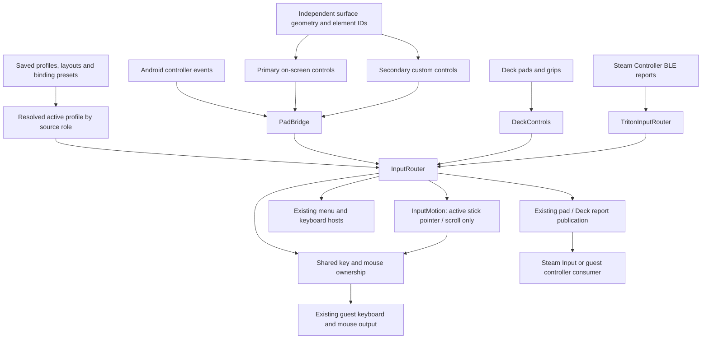

# Shared input profiles and configurable control surfaces

This change implements a shared routing model for physical controllers and local
screen controls. It is intended for review of the architectural direction, with
a functional configuration UI and hardware validation on AYN Thor. The related
maintainer discussions motivate this work; they are not approval of this
implementation.

The configuration UI keeps the existing Setup tabs. Controller contains mode
defaults, one profile list and device settings. Reusable layouts and actions are
stored separately but are managed within each profile source. Direct editing on
the target display has been exercised on AYN Thor, including editing above a live
Steam session and keeping the secondary canvas separate from the main-screen
tools. Revision-specific checks and remaining limits are recorded in the
validation report.

## Why a shared system

Desktop sessions need mouse, keyboard and application actions from a controller.
A dual-screen device may already have a comfortable lower-screen mouse, leaving
its physical sticks available for other actions. The same logical button or pad
can appear on the main screen, lower screen or a physical device; its location
should not dictate which actions it can perform.

The model separates three concerns:

- **Source role:** physical controller, game overlay (primary) or auxiliary panel
  (secondary). Swapping the game and auxiliary panel between displays preserves
  the panel's role and bindings.
- **Profile:** references to a physical binding preset and a layout/binding pair
  for each touch role. Game and Desktop are editable bases; named profiles can
  share parts. Auto has separate Steam and Desktop assignments. Opening a profile
  for editing does not activate it.
- **Surface layout:** stable element IDs, types, names, positions and sizes.
  Named custom layouts can be used on either touch role. Actions belong to a
  separate binding preset associated with that layout. Two desktop profiles can
  share their physical bindings and layout while using different touch actions.

A binding selects native controller output, a DroidDeck action, or disabled.
Native output continues through the existing game/Steam path, optionally with a
compatible gamepad remap. A local action consumes that control so, for example,
R3 assigned to Ctrl+F does not also press the guest's R3 button.

These are routing relationships, not additional asynchronous queues. Native
publication is performed by the existing source adapters and writers.

## Implementation

| Component | Responsibility |
| --- | --- |
| `InputProfile` | Logical controls, source roles and supported actions |
| `InputLibraries` / `InputLibrary` | Versioned reusable parts, validated references, selection and migration |
| `InputProfiles` | Compatibility API for the compiled active profile and legacy migration |
| `InputSurfaceLayout` | Bounded normalized touch geometry and legacy layout migration |
| `InputSurfaceSource` | Independently owned per-element routing through existing pad/Deck publishers |
| `InputRouter` | Resolve channels on profile changes, route events, track held outputs |
| `PadBridge` | Existing player slots plus independently owned local touch sources |
| `DeckControls` | Source ownership for Deck grips, contacts, coordinates and clicks |
| `TritonInputRouter` | Apply routing before Steam Controller BLE report publication |
| `PhysicalInputBindings` | Capture additional Android keys with device identity |
| `HeldInput` | Coordinate router outputs with existing keyboard and gesture outputs |
| `InputMotion` | Frame callback for active synthesized stick pointer/scroll movement |
| `InputTiming` | Optional bounded dispatch-to-publication diagnostics |

Supported actions are native output, compatible native remapping, disabled,
keyboard keys/combinations, mouse buttons, pointer movement, scrolling, four
keyboard directions, and existing menu/keyboard/Steam/quick-access commands.
Analog controls used as buttons have separate activation and release thresholds.
Key combinations press modifiers first and release in reverse order.

Standard controller assignments are shared by the physical role. Additional
captured keys match a device identity plus Android keycode/scancode, rather than
persisting a transient Android device ID. System-reserved keys remain with
Android. This is not a per-device calibration system.

### Controller navigation

Setup keeps its existing top-level tabs. Controller starts with Desktop and Game
mode defaults, followed by one profile list and inline device settings. Opening
or editing a profile does not activate it; the session menu owns the active
profile override. Quick-menu overrides are called out beside the default selectors.

Each profile opens Physical controller, Main screen or Second screen. Control
cards and touch element rows open the same large properties editor. Layout
editing uses the full-size canvas and one draggable, expandable Tools palette. Back
returns to the source and profile being edited, rather than the library root.
Saved layouts and reuse commands live inside the relevant source editor; there
are no parallel top-level layout, binding and profile catalogs.

New profiles copy actions and custom geometry independently by default. Users
can explicitly keep physical controls shared at creation, or copy/link a source
from another profile later. Reusing a saved layout can link geometry without
linking actions. Make independent copies both geometry and actions for that
source. Reset actions affects only the selected profile, preserving its layouts
and detaching shared actions before resetting them.

Main-screen visibility remains a global device setting. Color and opacity belong
to each saved touch layout. The standard gamepad is an ordinary editable layout:
its legacy positions, appearance and stick options are migrated into elements.
Other saved resolutions remain selectable layouts. The previous fixed gamepad
renderer and its separate editor are removed; only its placement calculation is
retained for migration. Vibration, radial stick dead zone, Joy-Con VR, global
shortcuts and timing diagnostics are inline below the profile list. This adds no
settings reads or queues to input dispatch.

### Session profile composition

Both the session drawer and launcher controls sheet expose Profile, Physical
controller, Main screen and Second screen. Choosing a profile loads its three
saved parts; choosing one part creates a mode-specific override without editing
the source profile. Game and Desktop remember their choices separately. Auto
resolves the corresponding default profile. Selecting a complete profile clears
part overrides. Save as new profile creates independent copies of all three
parts, including geometry, appearance and actions.

Fixed lower-screen tabs, side selectors and click bars are removed. Deck pads
and grips, one or two Deck pads, grips alone, the mouse trackpad with keyboard,
and a compact gamepad are ordinary editable layout/binding presets. Their menu,
keyboard and click buttons are ordinary elements too. The compact gamepad reuses
the previous panel geometry calculation. Existing fixed-panel selections migrate
to profile controls on first use. Schema 4 also preserves version-3 custom
layouts and converts legacy fixed layout references without changing physical
mappings. Active quick-menu parts cannot be deleted.

Mouse touchpad gestures reuse `TouchpadGestures` for relative movement, tap,
hold-drag, two-finger scrolling and secondary clicks. A tap uses the element's
configured click action; it does not reposition the pointer. Gesture outputs use
owned router channels and are suppressed while input is suspended or until a
held contact returns to neutral after a profile change. Native Deck pad mode
retains contact/position reporting and click behavior for Steam Input.

### Reuse and migration

Existing `FakeInputWriter` transports, player assignment, guest keyboard/mouse
output, `KeyboardHost` and second-screen presentation are reused. The existing
button, stick, d-pad and trackpad views now live in `InputSurfaceView`; there is
no parallel fixed controller panel. The custom editor arranges the existing button, stick, d-pad and trackpad
views; it does not create another emulated controller. Trigger elements provide
press/release input. A new element is unassigned until an action is explicitly
saved. Native sticks and pads retain their existing click gestures.
Movement/contact and click are separate assignments for sticks and trackpads.
Both use the same properties editor and router ownership rules; migrated click
bindings remain editable, and a custom mouse pad can assign its click separately.

The editor uses the target display at actual size. On a dual-screen device,
Add, Undo, Snap, Save and element properties stay on the activity display; the
auxiliary display is a full-size canvas with no toolbar inset. On one display,
a draggable Tools bubble expands into those same tools, including element
properties, and collapses to leave the canvas accessible. Properties replace the
canvas and return to the same draft. Snapping aligns centers and edges with
other elements and the display, including during resize. Done persists geometry and actions together; Cancel discards the
draft after confirmation. The preview has no input sources and cannot send
input to the running session.

Primary custom layouts follow the existing on-screen-controls visibility setting;
Steam's touch-controller mode retains priority. Secondary layouts use Profile controls mode. Terminal, desktop and dashboard
remain separate panel modes. Steam-managed touch controls keep their own editor; a new editable layout
can start empty or copy a saved custom layout.

Legacy Game/Desktop mappings, key captures, active selection and lower-screen
geometry migrate to the library together. Legacy element IDs preserve their
existing logical bindings. New elements use stable independent IDs, so two
buttons can have different actions or hold the same output without releasing
one another. Referenced parts cannot be deleted, and editing an unsupported
library version cannot overwrite it. Shared edits show their scope; copying a
binding preset from a profile relinks only that profile's selected role.

Library decoding, validation and preset resolution happen during configuration
or profile activation. Dispatch uses preconfigured router channels, with no
preference reads, profile lookups or new asynchronous queues. The physical native
identity path and frame-based stick motion remain in place. These properties do
not substitute for a fresh latency comparison on hardware.

The old touch-only mapping and Select-as-Steam settings migrate once into Game's
primary-screen and physical bindings respectively. Their redundant UI is removed.
`PadBridge` retains raw SELECT state; only the profile maps it to GUIDE. The old
flag is read for migration, not applied again during event handling, so explicit
native/disabled/local bindings and profile resets remain authoritative. Attaching
or removing a router cannot change which raw button a SELECT release clears.
Invalid stored entries fall back to defaults. The global settings reset clears
both profile and surface settings without reimporting the old mappings.

The shared PC-key definitions are adapted from kingokksa's
[#1305](https://github.com/Droid-Deck/DroidDeck/pull/1305) at `76fc9b31`.
Device capture and identity handling build on the approach in jmarti326's
[#1202](https://github.com/Droid-Deck/DroidDeck/pull/1202) at `42db788f`.
The initial implementation adapted these parts rather than merging either PR
wholesale. Upstream subsequently merged #1202; the October 30 integration retains
its global physical shortcuts, saved assignments and configuration UI alongside
the profile bindings.

The November 4 integration reuses upstream's common bottom-screen bar, extracted
trackpad/terminal panels and screen-swap presentation. Custom controls coexist
with the dashboard and KDE desktop panels. Routed on-screen stick updates retain
upstream's throttled visual redraws without deferring pad publication. Upstream
hardware-key translation and mouse capture use the existing output ownership and
release capture while the input-profile editor is open.

Explicit captured bindings in the active profile take precedence over a global
physical shortcut for the same key. Otherwise the global shortcut precedes the
default Back/QAM handling and logical controller routing. A consumed shortcut
does not also reach the guest, and its release remains consumed across menu
changes. Shortcut capture remains available from Input profiles, the session
menu and mode settings. Profile editing gates execution of these shortcuts.

### Ownership and lifecycle

Each source retains its own contribution. Releasing a physical mouse button does
not release an identical button still held on the lower screen. Closing a surface
releases that surface, including the final release on the existing Epic launcher
mouse route. Existing gesture and keyboard outputs participate in shared key and
mouse-button ownership.

Native pad merging uses OR for buttons, the maximum trigger value, and the
strongest complete stick vector. A native Deck trackpad retains one source's
coordinates until that contact ends, then accepts a waiting contact. Concurrent
surfaces do not overwrite its coordinates during the same contact.

Profile changes, suspension and menu entry release old local outputs. Held
controls must return to neutral before activating their new bindings. Device
removal and surface disposal remove their owned state. The existing menu
navigation path remains available independently of gameplay assignments.

When an adapter attaches retained input state to a replacement router, it seeds
the new channels without emitting presses and requires held controls to return
to neutral. Already-open pad rings receive the released state immediately;
attaching a router, changing a profile or enabling input does not open an unused
ring. Steam-menu and VR stick-switch requests use separate system-owned button
pulses, so primary-surface bindings cannot suppress or remap those commands.

The menu and keyboard commands currently open their respective UI; they are not
toggles. Back/B closes the menu. This can be reconsidered with the UX work.

### Hot path and scheduling

Profile JSON, preferences and layout geometry are processed outside event
routing. Channels resolve their actions when configuration changes. The current
router uses mutable per-source state under one synchronized monitor; it is not an
immutable compiled plan. This keeps shared ownership consistent, but contention
with simultaneous BLE input has not yet been measured on hardware.

For an unchanged Game binding, `PadSource` returns the original `PadState`.
The BLE identity route returns its original report array. Modified reports use
reusable buffers and preserve unrelated timestamp, motion, pressure and extension
fields. Normal controller events do not wait for a frame, coroutine or timer.

Only synthesized stick-to-pointer/scroll motion uses `Choreographer`, because a
held stick must keep moving without new device events. Trackpad deltas and button
changes publish synchronously on the normal UI input path. Pointer output arriving
from an off-main-thread adapter is marshalled to the existing UI cursor path;
application commands also use the main handler. Neither schedules native forwarding.

The mapped cursor reuses the existing compositor coordinates and Android cursor
layer. Trackpad contact starts from the current pointer position, preventing
jumps when switching sources. Publishing pending Compose snapshot notifications
before drawing avoids the observed every-other-frame cursor update without
changing the stick response curve or adding smoothing.

See [validation](unified-input-validation.md) for measurements and their limits.
The evidence supports no clear typical latency regression in the tested native
path, not zero overhead or a complete input-to-display latency guarantee.

## Steam ownership and boundaries

Steam remains responsible for game mappings, action sets, layers, radial menus
and its cloud profiles. Native/Steam-managed here means forwarding the controller
through the existing path; it is not a new integration with Steam's profile API.
Steam Mobile Touch retains its own Steam-managed layout and protocol. Its widgets
do not pass through this local remapper. The VR-specific input path also remains
separate. Existing gestures retain their recognizers and share output ownership.

The local UI revision includes named profiles, reusable binding presets and
custom layouts edited on either display. Import/export, automatic per-app
selection, macros, configurable tap/hold behavior and multi-button activation
chords remain deferred. One button emitting Ctrl+F is supported; pressing
multiple buttons to activate a new binding is not implemented. Built-in Steam
touch layouts retain their separate Steam-managed editor.

Physical native remaps stay within compatible report families. Generic custom
buttons choose a supported button output explicitly. Additional hardware
adapters must join before publishing consumed controls; an Activity-only
interceptor cannot cover every raw device. Future adapters should use this
contract without replacing device-specific calibration or protocol handling.

## Related upstream work

Reviewed on 2026-10-24. Several related proposals remain open; this is not a claim
that no other controller work exists or that this implementation supersedes it.

- [#1202](https://github.com/Droid-Deck/DroidDeck/pull/1202): physical shortcuts and
  capture. The maintainer's
  [centralization feedback](https://github.com/Droid-Deck/DroidDeck/pull/1202#issuecomment-6299647180)
  motivates one shared assignment model. Questions there about overlapping
  actions inform consumption/ownership; multi-button activation remains deferred.
- [#1305](https://github.com/Droid-Deck/DroidDeck/pull/1305): screen key mappings,
  combinations and layout management. This change shares the action model across
  physical and screen sources, but does not implement that PR's full layout UX.
- [#1414](https://github.com/Droid-Deck/DroidDeck/pull/1414): external-controller
  button and touchpad-press capture, including devices exposing a touchpad press
  as pointer input. Our key capture does not yet implement that pointer-contact
  adapter. It is a concrete area for coordination.
- [#860](https://github.com/Droid-Deck/DroidDeck/issues/860) and
  [#1356](https://github.com/Droid-Deck/DroidDeck/issues/1356): desktop controller
  input. This implements controller-driven pointer/keyboard actions, not every
  gesture or automatic keyboard behavior requested in #1356.
- [#581](https://github.com/Droid-Deck/DroidDeck/pull/581): hardware calibration and
  device profiles remain a separate responsibility from action profiles.
- [#1226](https://github.com/Droid-Deck/DroidDeck/pull/1226): keyboard host selection;
  the local action reuses the existing host rather than implementing another IME.
- [#1150](https://github.com/Droid-Deck/DroidDeck/pull/1150): raw DualSense input.
  That proposed adapter will need integration before publication; it is not
  covered merely by the current Android key capture.

## Review focus

The main questions are whether source roles and profile boundaries match the
project's direction, whether adapters join at the right point, and whether the
shared ownership/lifecycle contract is suitable for future input sources. The
validation document distinguishes device-tested behavior, host regressions and
remaining coverage. UX/UI refinement can follow agreement on those decisions.

### Settings polish and display targeting

The session Profile row expands to show the three saved parts and the editor.
Choosing the profile remains a separate selector. Session editing opens its
settings on the spare display, when available; element properties and editor
commands stay on the activity display. Main-screen placement over a running
session uses a transparent canvas so controls can be arranged around game UI.
Existing visible controls are suspended while editing.

Schema 5 adds an explicit main/secondary/both target to saved layouts. Migration
infers the target from existing profile and quick-menu references, preserving
layouts already used on both screens. Layout rows render a miniature with the
same `InputSurfaceView` renderer; unused legacy copies are retained under Other
saved layouts. Newly created layouts belong to the source being edited.

Action editing retains a draft for each route and action type. Sticks assigned
to a digital action press above 55% on either axis and release below 35%; a
trackpad holds a digital action during contact. These semantics are explained
next to the action. Horizontal scroll uses the same router and existing evdev
REL_HWHEEL / Wayland axis transport, with independent fractional accumulation.
No additional event thread or queue is introduced.

### Screen-key consolidation

Schema 6 imports the retired screen-key overlay into normal saved profiles,
layouts and element bindings. The active old set and each named saved set become
separate imported profiles. Current Game/Desktop defaults and quick selections
remain unchanged; the settings page explains where to find the imported profiles.
The old editor, overlay View, guest-key dispatch path and session-menu entries
are removed. Only a one-time reader of the old preferences remains.

Migration converts normalized centers and density-based sizes into the shared
layout geometry. Key chords, four-way directions, separate eight-way stick
bindings, toggle buttons, built-in symbols, custom image references, shape and
opacity are retained. Blank stick diagonals keep their previous behavior of
pressing neighboring cardinal directions. Imported images are decoded once per
view, sampled to at most 512 pixels, and read only from the app's existing image
directory. New buttons can choose text or an existing built-in key symbol.

A converted library and the original raw preferences are committed together
before old preference entries are removed. Invalid data or capacity failures do
not erase the old library or keys, and settings show a pending-import notice.
The backup is recovery data, not a second runtime input configuration.

Toggle buttons use `InputSurfaceSource` and the same router ownership as every
other element. Releasing one owner cannot release another owner's held key.
Menu suspension, profile changes, cancellation and detach release latched output.
Physical native input continues through its existing fast path; no queue, timer
or additional event thread is introduced for these features.
