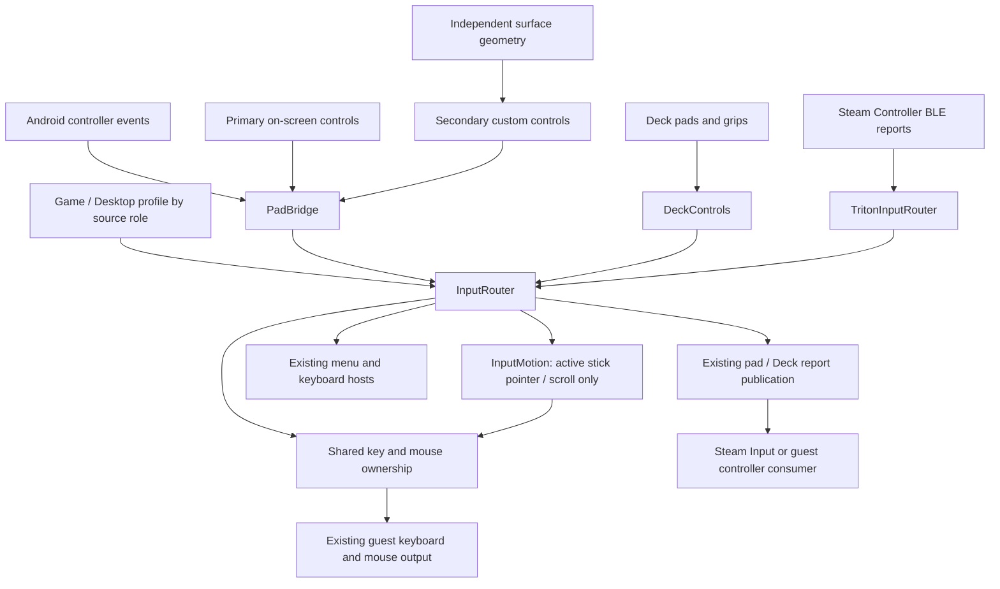

# Shared input profiles and configurable control surfaces

This change implements a shared routing model for physical controllers and local
screen controls. It is intended for review of the architectural direction, with
a functional configuration UI and hardware validation on AYN Thor. The related
maintainer discussions motivate this work; they are not approval of this
implementation.

The configuration UI is intentionally basic. If maintainers accept the
architecture, I am happy to refine the UX/UI in the same PR before merge, or in a
follow-up PR, whichever they prefer. Navigation, binding discovery, layout
editing, accessibility and localization need further attention. The current UI
makes the architecture usable and testable rather than establishing its final
interaction design.

## Why a shared system

Desktop sessions need mouse, keyboard and application actions from a controller.
A dual-screen device may already have a comfortable lower-screen mouse, leaving
its physical sticks available for other actions. The same logical button or pad
can appear on the main screen, lower screen or a physical device; its location
should not dictate which actions it can perform.

The model separates three concerns:

- **Source role:** physical, primary screen or secondary screen.
- **Profile:** the actions assigned to controls in each role. Game and Desktop are
  the two editable built-in profiles. Auto selects by session mode; explicit
  selection supports a game running inside a desktop session.
- **Surface layout:** the placement and size of local screen controls. The custom
  second-screen layout is stored independently for each built-in profile.

A binding selects native controller output, a DroidDeck action, or disabled.
Native output continues through the existing game/Steam path, optionally with a
compatible gamepad remap. A local action consumes that control so, for example,
R3 assigned to Ctrl+F does not also press the guest's R3 button.

These are routing relationships, not additional asynchronous queues. Native
publication is performed by the existing source adapters and writers.

## Implementation

| Component | Responsibility |
| --- | --- |
| `InputProfile` | Logical controls, source roles and supported actions |
| `InputProfiles` | Versioned persistence, selection, validation and migration |
| `InputSurfaceLayout` | Bounded custom lower-screen geometry, separate from actions |
| `InputRouter` | Resolve channels on profile changes, route events, track held outputs |
| `PadBridge` | Existing player slots plus independently owned local touch sources |
| `DeckControls` | Source ownership for Deck grips, contacts, coordinates and clicks |
| `TritonInputRouter` | Apply routing before Steam Controller BLE report publication |
| `PhysicalInputBindings` | Capture additional Android keys with device identity |
| `HeldInput` | Coordinate router outputs with existing keyboard and gesture outputs |
| `InputMotion` | Frame callback for active synthesized stick pointer/scroll movement |
| `InputTiming` | Optional bounded dispatch-to-publication diagnostics |

Supported actions are native output, compatible native remapping, disabled,
keyboard keys/combinations, mouse buttons, pointer movement, scrolling, four
keyboard directions, and existing menu/keyboard/Steam/quick-access commands.
Analog controls used as buttons have separate activation and release thresholds.
Key combinations press modifiers first and release in reverse order.

Standard controller assignments are shared by the physical role. Additional
captured keys match a device identity plus Android keycode/scancode, rather than
persisting a transient Android device ID. System-reserved keys remain with
Android. This is not a per-device calibration system.

### Reuse and migration

Existing `FakeInputWriter` transports, player assignment, guest keyboard/mouse
output, `KeyboardHost`, second-screen presentation and `DeckControlsPanel` are
reused. The custom lower-screen editor arranges the existing buttons, sticks,
trackpads and grips; it does not create another emulated controller.

The old touch-only mapping and Select-as-Steam settings migrate once into Game's
primary-screen and physical bindings respectively. Their redundant UI is removed.
`PadBridge` retains raw SELECT state; only the profile maps it to GUIDE. The old
flag is read for migration, not applied again during event handling, so explicit
native/disabled/local bindings and profile resets remain authoritative. Attaching
or removing a router cannot change which raw button a SELECT release clears.
Invalid stored entries fall back to defaults. The global settings reset clears
both profile and surface settings without reimporting the old mappings.

The shared PC-key definitions are adapted from kingokksa's
[#1305](https://github.com/Droid-Deck/DroidDeck/pull/1305) at `76fc9b31`.
Device capture and identity handling build on the approach in jmarti326's
[#1202](https://github.com/Droid-Deck/DroidDeck/pull/1202) at `42db788f`.
The initial implementation adapted these parts rather than merging either PR
wholesale. Upstream subsequently merged #1202; the October 30 integration retains
its global physical shortcuts, saved assignments and configuration UI alongside
the profile bindings.

Explicit captured bindings in the active profile take precedence over a global
physical shortcut for the same key. Otherwise the global shortcut precedes the
default Back/QAM handling and logical controller routing. A consumed shortcut
does not also reach the guest, and its release remains consumed across menu
changes. Shortcut capture remains available from Input profiles, the session
menu and mode settings. Profile editing gates execution of these shortcuts.

### Ownership and lifecycle

Each source retains its own contribution. Releasing a physical mouse button does
not release an identical button still held on the lower screen. Closing a surface
releases that surface, including the final release on the existing Epic launcher
mouse route. Existing gesture and keyboard outputs participate in shared key and
mouse-button ownership.

Native pad merging uses OR for buttons, the maximum trigger value, and the
strongest complete stick vector. A native Deck trackpad retains one source's
coordinates until that contact ends, then accepts a waiting contact. Concurrent
surfaces do not overwrite its coordinates during the same contact.

Profile changes, suspension and menu entry release old local outputs. Held
controls must return to neutral before activating their new bindings. Device
removal and surface disposal remove their owned state. The existing menu
navigation path remains available independently of gameplay assignments.

When an adapter attaches retained input state to a replacement router, it seeds
the new channels without emitting presses and requires held controls to return
to neutral. Already-open pad rings receive the released state immediately;
attaching a router, changing a profile or enabling input does not open an unused
ring. Steam-menu and VR stick-switch requests use separate system-owned button
pulses, so primary-surface bindings cannot suppress or remap those commands.

The menu and keyboard commands currently open their respective UI; they are not
toggles. Back/B closes the menu. This can be reconsidered with the UX work.

### Hot path and scheduling

Profile JSON, preferences and layout geometry are processed outside event
routing. Channels resolve their actions when configuration changes. The current
router uses mutable per-source state under one synchronized monitor; it is not an
immutable compiled plan. This keeps shared ownership consistent, but contention
with simultaneous BLE input has not yet been measured on hardware.

For an unchanged Game binding, `PadSource` returns the original `PadState`.
The BLE identity route returns its original report array. Modified reports use
reusable buffers and preserve unrelated timestamp, motion, pressure and extension
fields. Normal controller events do not wait for a frame, coroutine or timer.

Only synthesized stick-to-pointer/scroll motion uses `Choreographer`, because a
held stick must keep moving without new device events. Trackpad deltas and button
changes publish synchronously on the normal UI input path. Pointer output arriving
from an off-main-thread adapter is marshalled to the existing UI cursor path;
application commands also use the main handler. Neither schedules native forwarding.

The mapped cursor reuses the existing compositor coordinates and Android cursor
layer. Trackpad contact starts from the current pointer position, preventing
jumps when switching sources. Publishing pending Compose snapshot notifications
before drawing avoids the observed every-other-frame cursor update without
changing the stick response curve or adding smoothing.

See [validation](unified-input-validation.md) for measurements and their limits.
The evidence supports no clear typical latency regression in the tested native
path, not zero overhead or a complete input-to-display latency guarantee.

## Steam ownership and boundaries

Steam remains responsible for game mappings, action sets, layers, radial menus
and its cloud profiles. Native/Steam-managed here means forwarding the controller
through the existing path; it is not a new integration with Steam's profile API.
Steam Mobile Touch retains its own Steam-managed layout and protocol. Its widgets
do not pass through this local remapper. The VR-specific input path also remains
separate. Existing gestures retain their recognizers and share output ownership.

The two built-in profiles and the bounded custom lower-screen editor are the
implemented scope. Named profile libraries, import/export, per-app selection,
macros, tap/hold behavior, multi-button activation chords and a complete freeform
multi-display editor are deferred. One button emitting Ctrl+F is supported;
pressing multiple buttons to activate a new binding is not implemented.

Native remaps stay within compatible report families. Additional hardware
adapters must join before publishing consumed controls; an Activity-only
interceptor cannot cover every raw device. Future adapters should use this
contract without replacing device-specific calibration or protocol handling.

## Related upstream work

Reviewed on 2026-10-24. Several related proposals remain open; this is not a claim
that no other controller work exists or that this implementation supersedes it.

- [#1202](https://github.com/Droid-Deck/DroidDeck/pull/1202): physical shortcuts and
  capture. The maintainer's
  [centralization feedback](https://github.com/Droid-Deck/DroidDeck/pull/1202#issuecomment-6299647180)
  motivates one shared assignment model. Questions there about overlapping
  actions inform consumption/ownership; multi-button activation remains deferred.
- [#1305](https://github.com/Droid-Deck/DroidDeck/pull/1305): screen key mappings,
  combinations and layout management. This change shares the action model across
  physical and screen sources, but does not implement that PR's full layout UX.
- [#1414](https://github.com/Droid-Deck/DroidDeck/pull/1414): external-controller
  button and touchpad-press capture, including devices exposing a touchpad press
  as pointer input. Our key capture does not yet implement that pointer-contact
  adapter. It is a concrete area for coordination.
- [#860](https://github.com/Droid-Deck/DroidDeck/issues/860) and
  [#1356](https://github.com/Droid-Deck/DroidDeck/issues/1356): desktop controller
  input. This implements controller-driven pointer/keyboard actions, not every
  gesture or automatic keyboard behavior requested in #1356.
- [#581](https://github.com/Droid-Deck/DroidDeck/pull/581): hardware calibration and
  device profiles remain a separate responsibility from action profiles.
- [#1226](https://github.com/Droid-Deck/DroidDeck/pull/1226): keyboard host selection;
  the local action reuses the existing host rather than implementing another IME.
- [#1150](https://github.com/Droid-Deck/DroidDeck/pull/1150): raw DualSense input.
  That proposed adapter will need integration before publication; it is not
  covered merely by the current Android key capture.

## Review focus

The main questions are whether source roles and profile boundaries match the
project's direction, whether adapters join at the right point, and whether the
shared ownership/lifecycle contract is suitable for future input sources. The
validation document distinguishes device-tested behavior, host regressions and
remaining coverage. UX/UI refinement can follow agreement on those decisions.
