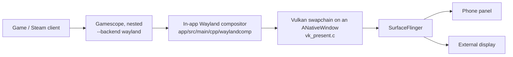

# External display: how the session reaches a screen (ED-00)

Static reading of the source at `2d59f03e`. Nothing here was checked on hardware.

## Output pipeline

- Gamescope runs inside proot as a Wayland client of the app's compositor: `--backend wayland --expose-wayland -f -W -H -w -h -r` (`tools/linuxfs/overlay/usr/local/bin/droiddeck-session:235-241`). It never opens DRM/KMS.
- `BL_WIDTH`, `BL_HEIGHT` and `BL_REFRESH` come from `SessionState.outputSize` and `SessionState.refreshHz` when the guest starts (`session/SessionService.kt:450-459`). The size changes later only in follow-screen mode (`BL_FOLLOW_OUTPUT=1`, `nativeResizeOutput`).
- The compositor presents into whichever Android `Surface` it is given: `CompositorHost.startOrAttach` / `resize` / `detach` (`wayland/CompositorHost.kt`), then `nativeSetSurface`, then `vk_present_set_window`, which rebuilds the swapchain (`vk_present.c:218-283`).
- The swapchain uses `VK_PRESENT_MODE_FIFO_KHR` with `minImageCount + 1 (+extra)` images (`vk_present.c:712-726`).
- Compositor frames are paced by `Choreographer.getInstance()` on the main thread (`CompositorHost.kt:17`), which ticks on the phone panel's vsync whichever display shows the output.

## Who owns which surface

| Surface | Owner | Shown on |
|---|---|---|
| `SessionActivity.surfaceView` | SessionActivity | the activity's display, normally the phone |
| `GlassesScreen.surfaceView` | `GlassesScreen` Presentation | smart glasses (`glasses/GlassesScreen.kt`) |
| `ExternalOutputScreen.surfaceView` (prototype) | `ExternalOutputScreen` Presentation | another presentation display |
| `SecondScreenPresentation` | SessionActivity | controls/terminal only, never the game |

`SessionActivity.outputHolder()` picks the one the compositor draws into: glasses, then the external screen, then the phone. `surfaceCreated`/`surfaceChanged`/`surfaceDestroyed` ignore every other holder.

## Before the prototype

- A wired monitor gets the game only when `Glasses.selectGlassesDisplay` (`glasses/Glasses.kt:677`) treats it as glasses, by glasses name/product or as an unnamed panel while USB glasses are present. Any other monitor shows whatever Android does with the activity's display, presumably mirroring. That still needs confirming on hardware with `dumpsys display`.
- Touch input always comes from the phone `surfaceView`. Its layout is kept while it is hidden, and `InputSpace` maps it proportionally onto the output (`SessionActivity.drawnRect`, `input/InputSpace.kt`).

## Integration seam

Strategy A from the handoff: reuse the existing presentation-surface path. The generic parts of the glasses handoff are:
- `outputHolder`
- `onOutputAttached`
- the restore-to-phone logic
- `refreshHz` / `followPanelRefresh` / `HdrSupport.probe` following the output display
- the second-screen exclusion

Everything that keys off `glassesScreen != null` is glasses-only: cardboard, head tracking, SteamVR, tracking recovery and the side-by-side handling. The prototype therefore adds a separate `externalScreen` rather than reusing `glassesScreen`.

## Unknown

- Whether a given phone exposes the monitor as a `FLAG_PRESENTATION` display, or only as a mirror, or through DeX/desktop mode.
- The negotiated mode (30 vs 60 Hz) on the target adapter and monitor.
- How much latency the phone-vsync pacing and the FIFO queue depth add on a monitor with a different refresh rate.
