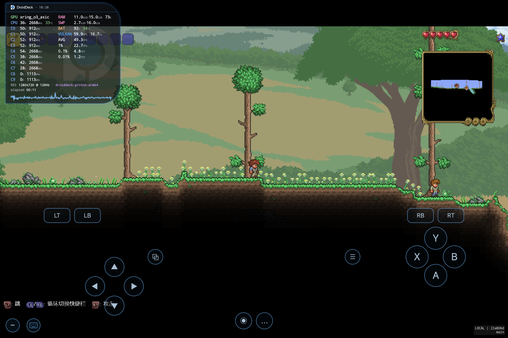

# openMali 工作区记录

> 本文件记录 2026-10-31 ~ 2026-11-01 在本机与小米平板上的 MaliBridge + DroidDeck 0.6.7 合并、构建、调试和性能测试结果。  
> 这是本地工程记录，不是上游发布文档。未特别说明的 APK 均为 testkey 签名。

## 1. 目标与结论

- 目标：把 MaliBridge v0.5.4.2 的 Mali GPU 支持合并进 DroidDeck 0.6.7 主线，构建可安装 APK，并在平板上进入桌面、跑通 Steam 和性能测试。
- 已做到：
  - 0.6.7 + MaliBridge v0.5.4.2 的合并包可安装。
  - Ubuntu rc4 运行时 + 内置最新 proot + KWin Zink/Mali 桥接，成功进入 KDE 桌面。
  - Steam 客户端下载/更新 100% 完成，进入 Steam 大屏幕登录页（二维码/账号密码）。
  - 完成 CPU、GPU、IO、内存、温度基线测试。
- 关键结论：Mali 桥接本身没有成为瓶颈；真正的问题集中在 **运行时 DNS、proot 与 KWin 渲染栈**。当前 rc4 + packaged proot + render-node 是已验证可用的组合。

## 2. 设备与环境

- 设备：Xiaomi M367FC，SoC xring_o3_asic，GPU Mali-G2-Ultra-NX MC16，Android 17，内核 6.18.21。
- CPU：10 核；内存 15.7 GB；存储 229 GB；屏幕 3408x2272；120 Hz。
- Mali 驱动：ARM proprietary，Vulkan 1.4.345；桥接暴露 1.4.341。
- 新 App：com.droiddeck.launcher，DroidDeck 0.6.7，versionCode 25（0.6.7-dnsfix-v25），testkey。
- 旧 App：com.droiddeck.launcher.mali，DroidDeck-MaliBridge v0.5.4.2，versionCode 5042；保留用于对比，桌面可用。

## 3. 关键路径

- 新工程：/home/g/openMali/DroidDeck
- MaliBridge 子模块：/home/g/openMali/DroidDeck/external/MaliBridge，v0.5.4.2，提交 95a1e60
- 合并基线：main 69ffc096，tag mali-0.6.7-v0.5.4.2
- 旧版源码：/home/g/openMali/reference/mali0542-src
- 旧版 APK：/home/g/openMali/reference/DroidDeck-MaliBridge-v0.5.4.2.apk
- 最终 APK：/home/g/openMali/output/DroidDeck-0.6.7-Mali-rc4.apk
- 基准/参考工具：/home/g/openMali/reference/vkbridge-bench，/home/g/openMali/reference/oldapk

## 4. 已验证的修改

### 4.1 运行时与 proot

- 运行时 catalog 从 Debian linuxfs.json(r9) 切到 Ubuntu：
  - app/src/main/java/com/droiddeck/launcher/runtime/LinuxRuntimeInstaller.java
  - CATALOG_URL = .../linuxfs-ubuntu.json
- 实际安装：ubuntu-r1-rc4；运行时约 3 GB；桌面栈另下载约 898 MB。
- APK 不再排除 proot，改为内置最新官方 pack：
  - pack-proot-172bb48b00150b42
  - 压缩包 SHA-256：172bb48b00150b4292ba171089abecdf7243c06edddd68bf42dddb8c5bb24e4e
  - app/src/main/jniLibs/arm64-v8a/libproot.so（246,512 B）
  - app/src/main/jniLibs/arm64-v8a/libproot-loader.so（18,136 B）
  - app/build.gradle 移除 libproot.so / libproot-loader.so 的 excludes
- LinuxRuntime：
  - 优先使用 nativeLibraryDir 中的 packaged proot/loader。
  - 新增 PROOT_PACKAGED 来源；isInstalled 接受 packaged proot。
  - prootSource 显示 packaged；ProotFastPath 只允许 PROOT_PACK，因此当前 fast path 关闭。
- 旧 r9 + 旧 session/helper/host 的 0.6.7 组合已尝试但放弃：
  - KWin 曾能打开 3408x2272 窗口，但新 host 不显示、会话不稳定。
  - 该路线不作为最终方案。

### 4.2 proot fast path 实验

- 临时允许 packaged proot 走 fast path，实测反而更慢：
  - fast path off（当前）：sha256 256 MB 207 ms，gzip -1 405 ms，read 3.9 GB/s。
  - fast path on：sha256 259 ms，gzip 461 ms，read 3.8 GB/s。
- 结论：该 pack 的 fast path 对 CPU/IO 是负优化，已恢复默认关闭；源码 ProotFastPath 也恢复为只允许 PROOT_PACK。

### 4.3 桌面 / KWin / Mali 桥接

- tools/linuxfs/desktop/droiddeck-desktop 的 KWin OpenGL 分支：
  - 设置 KWIN_COMPOSE=O2、MESA_LOADER_DRIVER_OVERRIDE=zink、GALLIUM_DRIVER=zink、LIBGL_KOPPER_DRI2=true。
  - KWIN_RENDER_NODES 自动选择 /dev/dri/renderD0、/dev/dri/renderD307 或任意 /dev/dri/renderD*。
  - 在平板上实际使用 /dev/dri/renderD307（由 /dev/mali0 绑定）。
- /usr/share/droiddeck/kwin-compositor 为 opengl。
- 效果：
  - DroidDeckWayland 日志出现 [window] opened KDE Wayland Compositor 1280x720。
  - host 统计出现 GPU frames，不再出现 kwin software fallback / black picture。
  - KDE 桌面、任务栏、应用菜单正常。
- 分辨率：
  - displayResolution.lxqt 设为 720p（1280x720）。
  - 720p 与 900p 的 vkgears 都是约 119.8 FPS，说明 GPU 已到 120 Hz 上限；720p 只减少缩放/带宽。
- Steam 大屏幕模式：
  - app 的“游玩 Steam”使用 gamescope/Big Picture。
  - DroidDeckWayland 日志：Steam 大屏幕模式 1280x720，86.4 fps，875 GPU frames。
  - 可用 Steam 登录页。

### 4.4 UI / 桥接文案

- GpuInfo 恢复 bridge-aware supportText(bridge)，新增 gpuinfo_bridge / gpuinfo_bridge_off 字符串。
- DeviceInfo / DeviceReport / DriverMenus 使用当前 Mali 桥接状态显示支持文案。
- LinuxRuntime 恢复 bridgeStandIn 的 DRM render node 回退逻辑。
- 注意：Setup 顶部仍可能显示“GPU 不受支持”的旧标签（GpuDriversState 的 unsupported 标志），但下方已显示“实验性 Vulkan 桥接已开启”，桥接实际工作正常。

## 5. DNS 与 Steam

### 5.1 根因

- guest /etc/resolv.conf 被写成：
  - 1.1.1.1
  - 8.8.8.8
  - 2001:4860:4860::8888
- 当前网络下这些公共 DNS 解析超时：
  - curl: (28) Resolving timed out after 10001 milliseconds
- 设备实际 WiFi DNS 是 192.168.1.1；guest 改用该 DNS 后：
  - getent 能解析 client-update.steamstatic.com。
  - curl -I https://client-update.steamstatic.com/steam_client_linuxarm64 返回 200。
- 结论：Steam 下载失败是 DNS，不是 Steam/GPU/代理。

### 5.2 已修复：App 自动获取本地 DNS

- 修改 app/src/main/java/com/droiddeck/launcher/runtime/LinuxNetworkLinkComponent.kt：
  - 新增 localDnsServers()，用 ConnectivityManager.allNetworks 遍历 WiFi/Ethernet 网络（排除 VPN）。
  - 收集这些网络的 DNS，并把默认路由 gateway 作为本地 DNS 兜底。
  - 私有地址（192.168/10.x）和 IPv4 优先。
  - writeResolver 的顺序：localDnsServers() + 当前 active network DNS + 公共 DNS 兜底。
- 验证（2026-11-01，dnsfix APK）：
  - logcat：LinuxNetworkLink: resolver: 192.168.1.1 8.8.8.8 1.1.1.1 2001:4860:4860::8888
  - guest /etc/resolv.conf 第一行是 nameserver 192.168.1.1。
  - getent hosts store.steampowered.com 正常；curl -I https://store.steampowered.com 返回 200。
  - 旧 guest DNS 守护 /root/.config/plasma-workspace/env/01-dns-guard.sh 已删除；没有守护进程仍正常。
- 说明：只取 WiFi/Ethernet 的本地 DNS；没有 WiFi/Ethernet 时回退到 active network/公共 DNS。VPN 的 10.10.14.1 不会被误当 DNS。

### 5.3 Steam 客户端修复

- Steam 主程序下载后权限为 666：
  - /root/.local/share/Steam/steamrtarm64/steam
  - 需 chmod +x；更新后变为 700 也可执行。
- 需要数据目录软链接：
  - /root/.steam/steam -> /root/.local/share/Steam
  - /root/.steam/root -> /root/.local/share/Steam
- stale pid：
  - /root/.steam/steam.pid 可能残留已死 PID，导致 “Steam is already running”；启动前删除。
- 不要在 Konsole 里用桌面 UI 方式启动 steam：
  - 会走 Xwayland/CEF，遇到 XRRGetOutputInfo() is not available / 无窗口。
  - 应从 DroidDeck 的“游玩 Steam”启动 Big Picture/gamescope。
- 已验证（2026-11-01）：
  - Steam 客户端更新 575,927 KB 到 100%。
  - Big Picture 已登录，库中显示 Shadow of the Tomb Raider 等游戏。
  - 32 位 steamrtarm32/steam-runtime-launcher-service 缺失的日志仍会出现，但 Big Picture 可用；游戏启动尚未验证。

## 6. 性能测试

### 6.1 存储 IO

| 路径 | 写 | 读 |
|---|---:|---:|
| Android /data/local/tmp | 1.0 GB/s | 4.7 GB/s |
| Android /sdcard | 0.94 GB/s | 4.3 GB/s |
| Guest proot（fast path off） | 1.2 GB/s | 3.9 GB/s |

Guest 读取比 host 低约 17%，是 proot 路径开销；写入不慢。

### 6.2 CPU

| 项目 | Host | Guest |
|---|---:|---:|
| sha256 256 MB 单线程 | 267 ms | 207 ms |
| sha256 4x256 MB 4 线程 | 256 ms（约 4 GB/s 聚合） | 216 ms（约 4.7 GB/s 聚合） |
| gzip -1 256 MB | 307 ms | 405 ms（+32%） |

注意：host/guest 的 sha256 实现不同，不能直接比较；gzip 更接近，proot 下约慢 30%。

### 6.3 GPU

- vkgears：119.86 FPS（600 帧/5 秒），720p 与 900p 基本一致，已到 120 Hz 上限。
- 早期桥接基准：128 MiB copy 20.5 GB/s；空 submit 约 70 µs；4 KiB copy+submit 约 285 µs。
- Steam Big Picture：1280x720，约 86.4 fps，875 GPU frames。
- vkcube 在纹理路径触发断言（demo_prepare_texture_image），属于桥接兼容性问题，不是性能问题。

### 6.4 温度 / 内存

- CPU 29–33 °C，GPU 31–46.5 °C，Thermal Status 0，无节流。
- 电池约 28 °C，64%。
- 内存：15.7 GB 总，约 8.3 GB 已用，7.1 GB 可用，swap 约 2.6 GB。
- 没有内存告急，但 swap 偏高；游戏前可重启/关闭后台。

### 6.5 v25 复测（2026-11-01 18:32）

环境：DroidDeck v25；GPU/IO 在 lxqt 桌面 1920x1080@120 测，CPU 分别测桌面和 Steam 会话；游戏 FPS 取自 Terraria 世界内 HUD。Thermal Status 0，CPU 32.8 °C，GPU max 34.8–46.5 °C，电池 31.8 °C / 92%。

| 项目 | v25 实测 | 说明 |
|---|---:|---|
| sha256 256 MB 单线程 | 桌面 283–322 ms；Steam 219–241 ms | Steam 会话约 230 ms，接近此前 207 ms |
| gzip -1 256 MB | 桌面 514–534 ms；Steam 355–357 ms | Steam 会话约 356 ms；此前约 405 ms |
| sha256 4×256 MB | Steam 222–269 ms；桌面 262–275 ms | 4 线程 |
| Host /data/local/tmp O_DIRECT | 写 1060 / 读 1450 MB/s | 绕过 page cache |
| Guest /root ext4 | 写 876 / 读 2337 MB/s | fdatasync；O_DIRECT 写 1270 MB/s |
| Guest /root/Storage | 写 920 / 读 3029 MB/s | 读受 page cache 影响 |
| vkgears 1280x720 | 115.8 FPS，p50 111.1，p99 25 ms | 4 秒采样 |
| vkgears 1920x1080 | 113.2 FPS，p99 31 ms | 2 秒采样 |
| Terraria 1280x720@120 | 59.9 FPS，AVG 49.3，1% 22.7 | HUD；CPU 36% / 2668 MHz / 33 °C，GPU 1% |
| 内存 | 总 15.7 GB，可用 8.7 GB | Guest 已用 6.7 GB，swap 2.2 GB |

结论：GPU 与之前 119.86 FPS 基本一致（低约 3–4%），Terraria 稳定 60 FPS；IO 正常；测试期间无热节流。CPU 在 Steam 会话约 230 ms / 356 ms，接近或优于此前 207 ms / 405 ms；桌面会话因升频状态较低，v25 无 CPU 回归。

## 7. 构建与安装

- 构建：
  - cd /home/g/openMali/DroidDeck
  - ./gradlew :app:assembleRelease -PndkVersion=27.3.13750724
- 修改 runtime inputs 后先记录：
  - python3 tools/release/runtime_inputs.py record
- APK（DNS 自动修复 + GPU 状态文案 + HUD/CPU 温度 + mscoree 兜底，当前安装）：
  - /home/g/openMali/output/DroidDeck-0.6.7-Mali-rc4-dnsfix-v25.apk
  - 76 MB；versionCode 25；versionName 0.6.7-dnsfix-v25
  - SHA-256 9808a8ab17f2d9a39e0b3abc9a05c2ee1c07ec7f4ac7cfa77866b2229fb6eb82
  - 上一版保留：v24（SHA-256 56b0ab03c0120c2a7a6ad0e4ed8d30a748021d7fe9e99a13b60f62a41e13b5e0）、v23（SHA-256 b0fadc5c...）、v22（SHA-256 69cd4f5f...）、v21（SHA-256 508294a6...）、v20（SHA-256 afd1ce12...）、v19（SHA-256 f63f4eae...）、v18（SHA-256 cc469703...）、v16 DroidDeck-0.6.7-Mali-rc4-dnsfix.apk（SHA-256 6c5f8c1f...）和 DroidDeck-0.6.7-Mali-rc4.apk（无 App 内 DNS 修复，SHA-256 c58fcc58...）。
  - testkey 签名；官方 release 私钥不在本机。
- MIUI 安装：
  - 对已安装的旧包，adb push + adb shell pm install -r 可更新。
  - 对全新安装，MIUI 会报 INSTALL_FAILED_USER_RESTRICTED；需用文件管理器打开 APK，走 PackageInstaller，并在“是否允许 Shell 安装应用”点允许。
  - 官方 0.6.9 是 release key，testkey 包不能就地升级/降级；必须完整卸载，App 数据会被清空。

## 8. 当前安装状态

- com.droiddeck.launcher：0.6.7-dnsfix-v25（versionCode 25，testkey），2026-11-01 18:25 就地更新安装，App 数据保留。
- GPU 状态：Setup 概览显示“GPU 通过 Mali 桥接”，绿色通过；不再显示“GPU 不受支持”。实现为 FrontEndSetup 的 gpuOk 包含 s.vkBridge，并新增 setup_gpu_bridged 文案。
- 修复“清数据重启后 GPU 菜单消失”：showChecks 默认值从 false 改为 s.vkBridge；桥接开启时详情默认展开，GPU 行直接可见。已在 pm clear 后重新启动验证。
- HUD：XRing/Mali 的 GPU load/clock/temp/thermal sysfs 对普通 App 拒绝访问，日志为 thermal zones 0、gpu load none、kgsl gpubusy refused。v21 在无数据时隐藏 GPU 统计行、VRAM=0 时隐藏 VRAM，只保留 GPU 型号；真正 GPU% / 温度 / 共享显存需要 root 或厂商遥测。
- HUD 分辨率/卡死：v22 的 RES 不再用 Android displayMetrics 兜底，改用会话逻辑分辨率；桌面模式隐藏游戏 HUD，Steam/游戏模式显示。实测 Steam 下 HUD 为 RES 1280x720 @ 120Hz、FPS 42.8 / AVG 53.0。
- CPU 温度/频率：v23 增加 USB/adb 辅助的 CPU 温度输入（/sdcard/DroidDeck/cpu-temp，由 update_cpu_temp.sh 每 2 秒写 cpu_therm）；v24 把 HUD 的 CPU 行顺序改为“占用 → 频率 → 温度”，Full/Mega/Tiles 三种布局都生效。
- 安装方式：官方 0.6.9（release key）与 testkey 不兼容，完整卸载 0.6.9 后通过 PackageInstaller 安装；App 数据已被清空，当前是全新状态（首次启动显示配置页）。
- DNS 自动修复已在 APK 内；运行时 ubuntu-r1-rc4、Mali 桥接、proot、桌面需要重新下载/配置；此前 Steam Big Picture 和 1280x720 KWin 已验证，但当前新数据需重新登录。
- com.droiddeck.launcher.mali：旧 0.5.4.2 仍安装，桌面可用，用于对比。
- 注意：Steam chmod/软链接/pid 清理仍是 guest 运行时修改；清除 App 数据或重装运行时会丢失。
- Terraria 1.4.5.8 启动修复（2026-11-01）：`dotnet40` 组件把 `WINEDLLOVERRIDES` 设为 `mscoree=n`，但该组件没有原生 `mscoree.dll`，Wine 报 `mscoree.dll not found` 后直接退出。v25 的 `droiddeck-wincomponents` 对 `mscoree=n` 自动追加 builtin 回退（`mscoree=n,b`）；`dotnet40` 仍启用时，Terraria 已稳定进入世界并显示 HUD。

## 9. 已知问题 / 下一步

1. DNS 自动修复已完成（见 5.2）；仍需在不同 WiFi/无 WiFi 环境下回归，确认 localDnsServers 的回退行为。
2. Steam 桌面 UI 在 Xwayland 下仍可能无窗口；继续使用“游玩 Steam”/Big Picture，不要用 Konsole 直接 steam。
3. Steam 32 位组件 steamrtarm32 / steam-runtime-launcher-service 缺失；Big Picture 可用。Terraria 1.4.5.8 已进入世界，其他游戏仍待验证。
4. vkcube 纹理断言是桥接兼容性 bug，可单独排查。
5. 真实游戏帧率/Proton/DXVK 尚未测试；当前性能数据主要是桌面、vkgears、IO/CPU。
6. 仍是 testkey；如需官方升级安装，需要官方 release keystore。
7. 官方 0.6.9 与 testkey 不兼容：只能完整卸载后安装，App 数据会丢；官方 APK 备份在 /tmp/installed-069.apk（宿主）和 /sdcard/Download/DroidDeck-0.6.9.apk（平板），回滚同样要先卸载。
8. HUD 的 Mali GPU load/temp/VRAM 受驱动 sysfs 权限限制；除非 root/厂商接口，普通 App 无法获取。v21 已移除误导性的 GPU - 和 VRAM 0.0，保留 GPU 型号。

## 10. 已放弃 / 不再使用

- r9 + 旧 session/helper/host 组合：KWin 窗口不稳定/黑屏，放弃。
- proot fast path：实测负优化，关闭。
- 代理强制给 Steam：本地 DNS 直连更稳定；Steam 更新器对 proxy 环境并不可靠。

## 截图

Terraria 1.4.5.8 在 DroidDeck v25 + Mali 桥接 + Wine Mono 下进入世界。HUD 的 CPU 行是“占用 → 频率 → 温度”：

