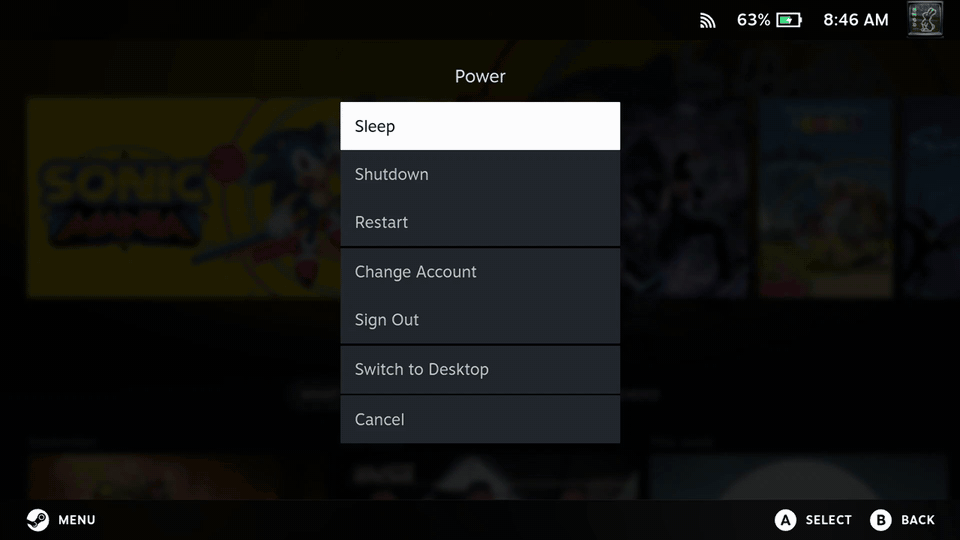
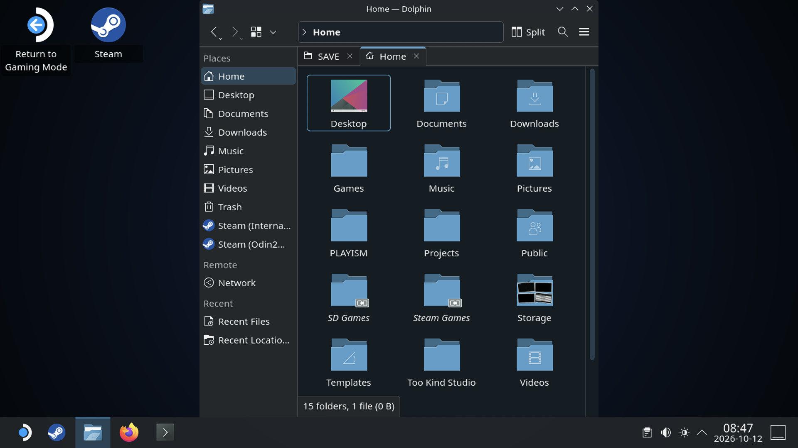
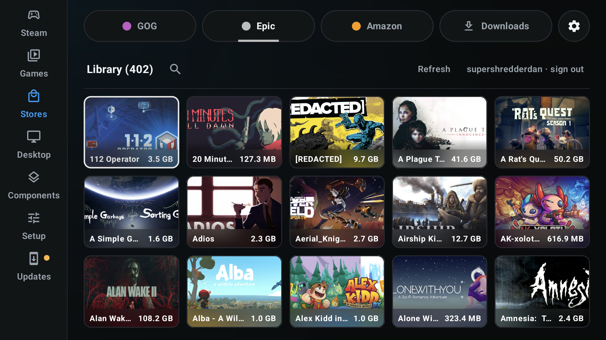
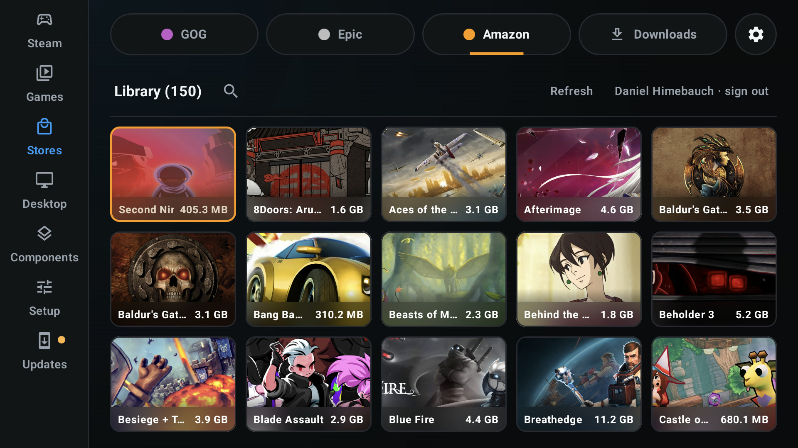
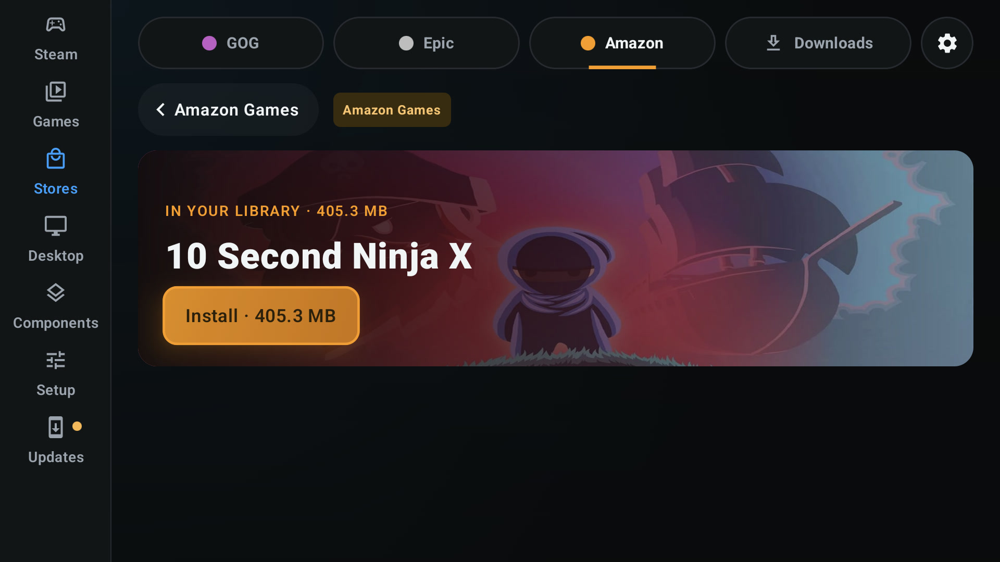
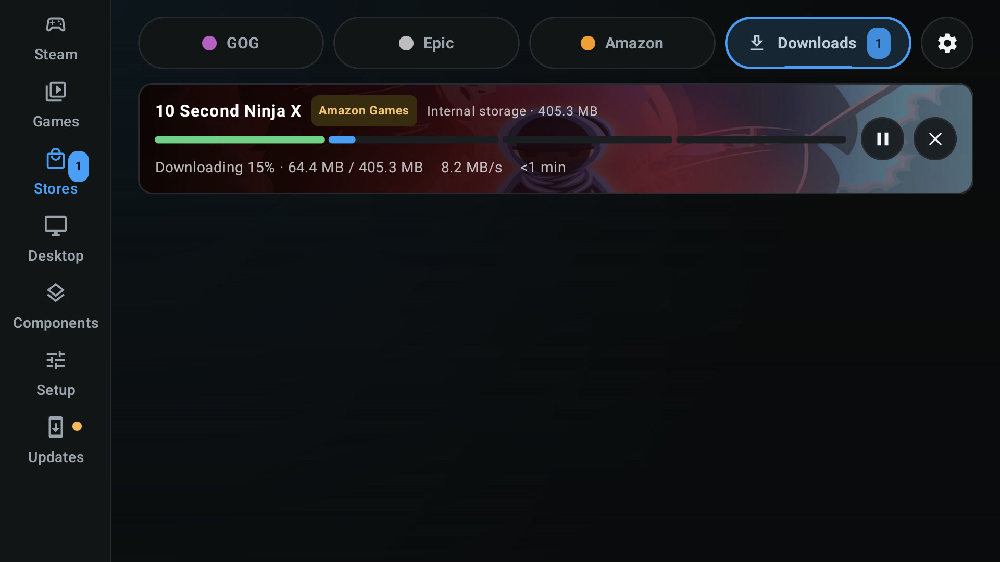

# DroidDeck 0.4.0

### Features

- Replaced LXQt with **SteamOS-style KDE Plasma 6.7**, including the familiar desktop layout, Dolphin, Firefox, Konsole and Return to Gaming Mode. (@xXJSONDeruloXx, [#473](https://github.com/Droid-Deck/DroidDeck/pull/473))

  
  
- Added **GOG, Epic Games and Amazon Games** integration with account sign-in, game libraries, downloads and launching through Steam. GOG and Epic games also support cloud saves. (@The412Banner, [#476](https://github.com/Droid-Deck/DroidDeck/pull/476))

  

  
  
  
- Added **Steam's native touch controller (beta)**, with per-game Steam Input layouts, community configurations, an on-screen layout editor and Steam Cloud syncing. (@xXJSONDeruloXx, [#431](https://github.com/Droid-Deck/DroidDeck/pull/431))

  
  

  

  
Steam Input layouts and touch settings

  
  
  
  

  

- Added **multi-controller support for up to 4 players**, allowing connected Android gamepads to work independently for local co-op and split-screen multiplayer through Steam Input. (@xXJSONDeruloXx, @maxjivi05, @Neolyum, [#431](https://github.com/Droid-Deck/DroidDeck/pull/431), [#614](https://github.com/Droid-Deck/DroidDeck/pull/614))
- Added **Bluetooth LE Steam Controller (2025)** support, including trackpads, back grips and motion controls. (@SG3xHERO, [#404](https://github.com/Droid-Deck/DroidDeck/pull/404))
- The built-in controller can now emulate a **Steam Deck, Steam Controller, Xbox 360, DualShock 4 or DualSense**, with live switching from the session menu without restarting Steam. (@xXJSONDeruloXx, [#545](https://github.com/Droid-Deck/DroidDeck/pull/545), [#558](https://github.com/Droid-Deck/DroidDeck/pull/558), [#559](https://github.com/Droid-Deck/DroidDeck/pull/559))

  
- Added persistent **per-game compatibility profiles** for Proton, FEX, DXVK, VKD3D-Proton, Windows components, environment variables and texture filtering, with inheritance from your default settings. (@jmarti326, [#449](https://github.com/Droid-Deck/DroidDeck/pull/449))
- Completely revamped **adding and managing non-Steam games**, with automatic game detection, artwork, bulk imports and editing directly from the Games tab. (@The412Banner, [#492](https://github.com/Droid-Deck/DroidDeck/pull/492))
- Added **Follow screen** resolution for foldables, automatically resizing Steam and games when folding, unfolding or rotating the device. (@SG3xHERO, [#403](https://github.com/Droid-Deck/DroidDeck/pull/403))
- Added an optional **touch gamepad below the game on unfolded foldables**, with Steam Deck-style controls, configurable sticks and trackpads. (@SG3xHERO, [#407](https://github.com/Droid-Deck/DroidDeck/pull/407))
- Added **DroidDeck-Proton** as an installable Proton source alongside GE-Proton and CachyOS Proton, with update notifications for all three. (@The412Banner, [#588](https://github.com/Droid-Deck/DroidDeck/pull/588))
- Added support for installing **Flatpak apps directly from .flatpak bundles**, including apps no longer available through Flathub. (@xXJSONDeruloXx, [#446](https://github.com/Droid-Deck/DroidDeck/pull/446))
- Added a manual **landscape orientation** setting, including reverse landscape. (@Kobtul, [#441](https://github.com/Droid-Deck/DroidDeck/pull/441))
- Added an optional controller setting to open the Steam menu with the physical **Select** button. (@0x1428571429, [#384](https://github.com/Droid-Deck/DroidDeck/pull/384))

### Improvements

- Major **launcher UI redesign** across Steam settings, Components, Setup, Stores, Flathub and Desktop, with smoother transitions, animated navigation, redesigned settings panels and improved controller focus. (@xXJSONDeruloXx, [#482](https://github.com/Droid-Deck/DroidDeck/pull/482), [#548](https://github.com/Droid-Deck/DroidDeck/pull/548), [#605](https://github.com/Droid-Deck/DroidDeck/pull/605))

  
- **Store downloads now survive app restarts**, preserving queued and paused downloads and allowing interrupted installs to resume from the Downloads page. (@xXJSONDeruloXx, [#608](https://github.com/Droid-Deck/DroidDeck/pull/608))

  
- Store game removal now shows **confirmation and uninstall progress** before returning the game to its installable state. (@xXJSONDeruloXx, [#609](https://github.com/Droid-Deck/DroidDeck/pull/609))
- Expanded **PRoot fast paths**, with performance improvements of up to 57% in measured workloads, alongside further reductions in filesystem and process overhead. (@maxjivi05, @xXJSONDeruloXx, [#466](https://github.com/Droid-Deck/DroidDeck/pull/466), [#494](https://github.com/Droid-Deck/DroidDeck/pull/494))
- Significantly reduced launcher idle CPU usage, controller input overhead and session log processing time, with additional game startup and performance optimizations. (@maxjivi05, [#529](https://github.com/Droid-Deck/DroidDeck/pull/529))
- **Windows components are now selected automatically** using each game's Steam, GOG, Epic or Amazon dependency information, while preserving manual overrides. (@The412Banner, [#554](https://github.com/Droid-Deck/DroidDeck/pull/554))
- Expanded Windows component installation to support **VC++ redistributables, .NET Framework and more installer formats**, without needing to run the original Windows setup programs. (@The412Banner, [#480](https://github.com/Droid-Deck/DroidDeck/pull/480), [#495](https://github.com/Droid-Deck/DroidDeck/pull/495))
- KDE Desktop can now launch **Windows executables, Linux programs, AppImages and scripts** directly from the file manager or terminal. (@maxjivi05, [#549](https://github.com/Droid-Deck/DroidDeck/pull/549))
- Added safer **Desktop uninstall and legacy LXQt cleanup**, preserving user data while reclaiming storage from older desktop installations. (@xXJSONDeruloXx, [#493](https://github.com/Droid-Deck/DroidDeck/pull/493))
- Improved **Proton and component management**, with newest versions shown first, update detection, clearer installed-version information and streamlined settings. (@The412Banner, @xXJSONDeruloXx, [#588](https://github.com/Droid-Deck/DroidDeck/pull/588), [#606](https://github.com/Droid-Deck/DroidDeck/pull/606))
- Improved **DirectAudio compatibility**, including CachyOS Proton support and direct audio output from the Steam client. (@The412Banner, [#439](https://github.com/Droid-Deck/DroidDeck/pull/439))
- Reduced unnecessary motion sensor polling, reading the device's gyro and accelerometer only when Steam requests them. (@muazkadan, [#534](https://github.com/Droid-Deck/DroidDeck/pull/534))
- Added alignment guides and snapping when dragging buttons in the **on-screen controller editor**. (@willie-yao, [#490](https://github.com/Droid-Deck/DroidDeck/pull/490))
- Improved security by **encrypting store credentials with Android Keystore** and keeping logs in private app storage until explicitly shared as a sanitized ZIP. (@The412Banner, [#484](https://github.com/Droid-Deck/DroidDeck/pull/484), [#486](https://github.com/Droid-Deck/DroidDeck/pull/486))
- Steam now consistently uses **Steam Deck mode and the Steam Deck beta branch**, removing the legacy client and mode switches. (@xXJSONDeruloXx, [#546](https://github.com/Droid-Deck/DroidDeck/pull/546))

### Fixed

- Fixed **Red Dead Redemption 2** failing to launch, and reduced resource usage from the Rockstar launcher while playing. (@maxjivi05, [#585](https://github.com/Droid-Deck/DroidDeck/pull/585))
- Fixed Steam's screensaver appearing over running games after prolonged controller inactivity. (@maxjivi05, [#585](https://github.com/Droid-Deck/DroidDeck/pull/585))
- Fixed **black Steam output with FSR 1** image scaling enabled. (@xXJSONDeruloXx, [#597](https://github.com/Droid-Deck/DroidDeck/pull/597))
- Fixed some **Epic Games downloads failing** because of older JSON-format manifests. (@Gustash, [#578](https://github.com/Droid-Deck/DroidDeck/pull/578))
- Fixed **Amazon Games libraries appearing empty** for signed-in accounts. (@xXJSONDeruloXx, [#500](https://github.com/Droid-Deck/DroidDeck/pull/500))
- Fixed some Store games launching the wrong executable instead of the game's declared entry point. (@maxjivi05, [#400](https://github.com/Droid-Deck/DroidDeck/pull/400))
- Fixed **touch and mouse input landing away from the displayed position** when the session resolution and device screen have different aspect ratios. (@maxjivi05, [#389](https://github.com/Droid-Deck/DroidDeck/pull/389))
- Fixed the **Odin 3 unexpectedly rebooting** when its Wi-Fi firmware enters low-latency mode. (@kmnkv1, [#512](https://github.com/Droid-Deck/DroidDeck/pull/512))
- Fixed **Linux runtime removal getting stuck** on files that Android's SELinux policy would not allow the app to delete. (@xXJSONDeruloXx, [#463](https://github.com/Droid-Deck/DroidDeck/pull/463))
- Fixed **Android 12 and older devices crashing during audio initialization**, and restored Firefox compatibility on affected Android 16 devices. (@kolmant, @The412Banner, [#531](https://github.com/Droid-Deck/DroidDeck/pull/531), [#460](https://github.com/Droid-Deck/DroidDeck/pull/460))
- Fixed **Bluetooth keyboards with combined keyboard, mouse and controller interfaces** losing ordinary keyboard input. (@kaosjammo, [#435](https://github.com/Droid-Deck/DroidDeck/pull/435))
- Fixed repeated force-feedback packets unnecessarily restarting the device vibrator. (@kmnkv1, [#514](https://github.com/Droid-Deck/DroidDeck/pull/514))
- Fixed **CPU temperature showing 0°C** in the Steam performance overlay on affected devices. (@muazkadan, [#516](https://github.com/Droid-Deck/DroidDeck/pull/516))
- Fixed older **NativeAOT games failing to start** because of an incompatible .NET garbage collector setting. (@Arthur031221, [#385](https://github.com/Droid-Deck/DroidDeck/pull/385))
- Fixed **Steam's desktop client failing under KDE**, including repeated launches and switching back to Big Picture. (@xXJSONDeruloXx, [#610](https://github.com/Droid-Deck/DroidDeck/pull/610))
- Fixed fullscreen layout issues around display cutouts, clipped settings, and several controller navigation and focus problems. (@kaosjammo, @xXJSONDeruloXx, [#432](https://github.com/Droid-Deck/DroidDeck/pull/432), [#596](https://github.com/Droid-Deck/DroidDeck/pull/596), [#600](https://github.com/Droid-Deck/DroidDeck/pull/600))
- Fixed the touchpad cursor remaining visible after switching from Touchpad to Direct touch mode. (@KingHacker9000, [#424](https://github.com/Droid-Deck/DroidDeck/pull/424))

### New contributors

- @SG3xHERO made their first contribution in [#403](https://github.com/Droid-Deck/DroidDeck/pull/403).
- @Arthur031221 made their first contribution in [#385](https://github.com/Droid-Deck/DroidDeck/pull/385).
- @KingHacker9000 made their first contribution in [#424](https://github.com/Droid-Deck/DroidDeck/pull/424).
- @kaosjammo made their first contribution in [#432](https://github.com/Droid-Deck/DroidDeck/pull/432).
- @Kobtul made their first contribution in [#441](https://github.com/Droid-Deck/DroidDeck/pull/441).
- @willie-yao made their first contribution in [#490](https://github.com/Droid-Deck/DroidDeck/pull/490).
- @muazkadan made their first contribution in [#516](https://github.com/Droid-Deck/DroidDeck/pull/516).
- @kolmant made their first merged contribution in [#531](https://github.com/Droid-Deck/DroidDeck/pull/531).
- @Gustash made their first contribution in [#578](https://github.com/Droid-Deck/DroidDeck/pull/578).
- @Neolyum contributed multi-controller discovery improvements in [#614](https://github.com/Droid-Deck/DroidDeck/pull/614).

[Full changelog](https://github.com/Droid-Deck/DroidDeck/compare/0.3.2...main)
