# DroidDeck 0.5.0

### Features

- Added **SteamVR on Meta Quest 3 and 3S** from the standard APK. Quest headsets are detected automatically and get their own driver defaults. Immersive SteamVR runs through a native OpenXR activity with headset tracking, Touch controllers and haptics, and SteamVR's dashboard and Steam library work in VR. (@xXJSONDeruloXx, @Jagger15, [#642](https://github.com/Droid-Deck/DroidDeck/pull/642), [#910](https://github.com/Droid-Deck/DroidDeck/pull/910), [#733](https://github.com/Droid-Deck/DroidDeck/pull/733), [#853](https://github.com/Droid-Deck/DroidDeck/pull/853), [#905](https://github.com/Droid-Deck/DroidDeck/pull/905))

  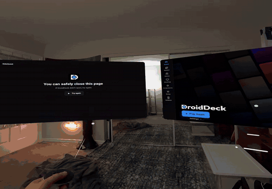

  

  
Flat games on Quest with hand tracking

  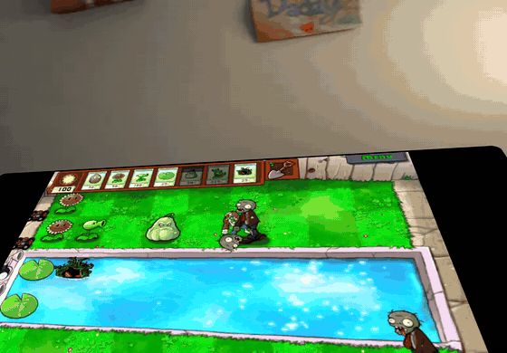

  

- Added experimental **Meta Quest 2** support. (@Jagger15, [#676](https://github.com/Droid-Deck/DroidDeck/pull/676))
- Added **XR glasses support for VITURE, RayNeo and XREAL**. Games play straight on the glasses at their own refresh rate while the phone becomes the controller, and the glasses' refresh rate, 3D mode, brightness, volume and sunblock can be changed from the app or the session menu. **Play SteamVR** appears beside Play Steam when supported glasses are connected, with head tracking from the glasses. Joy-Cons work as SteamVR hands, and the phone's camera can track bare hands with Quest-style pinch gestures. Supports VITURE Pro XR, RayNeo Air and GT glasses, and XREAL 1S (experimental). Glasses with head tracking can also show a **head-tracked virtual screen** everywhere in DroidDeck, in its menus, desktop sessions and games, without starting SteamVR, set up from the new **Setup → Smart glasses** page. (@maxjivi05, @informalTechCode, [#732](https://github.com/Droid-Deck/DroidDeck/pull/732), [#907](https://github.com/Droid-Deck/DroidDeck/pull/907), [#1035](https://github.com/Droid-Deck/DroidDeck/pull/1035))

  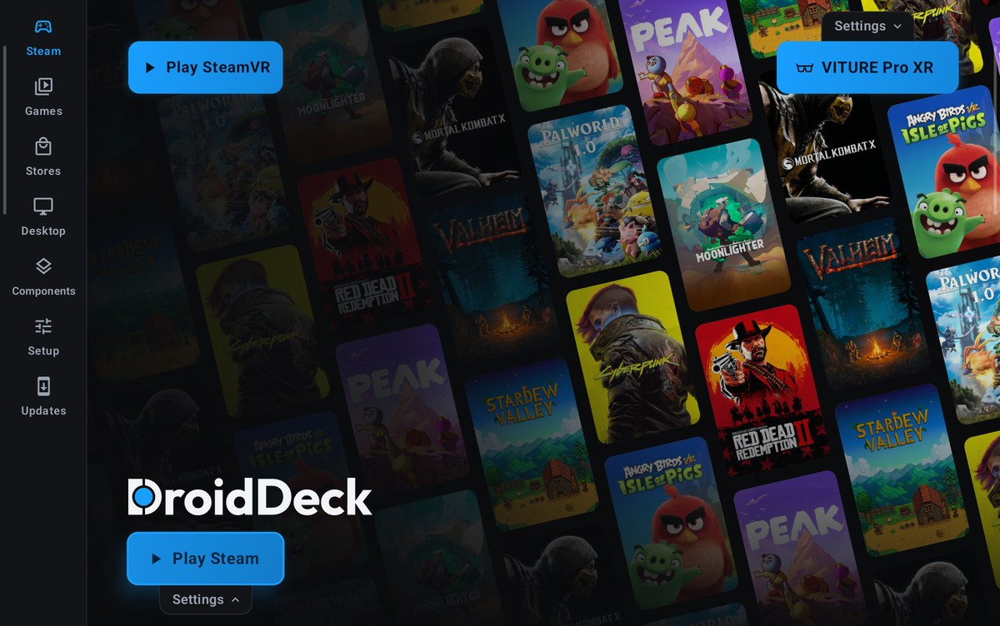
  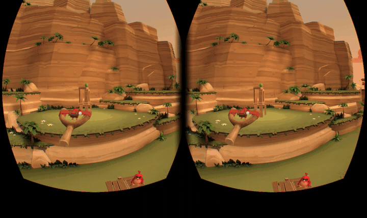

  

  
On the glasses, and gamepad hands in SteamVR

  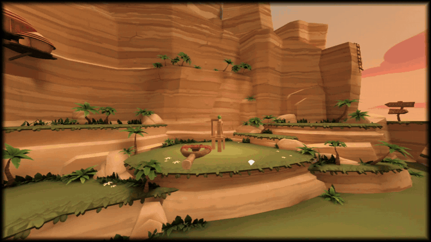
  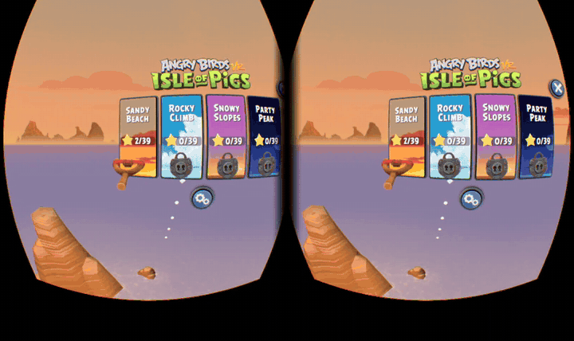

  

- Added **Cardboard VR mode** with Valve's ARM64 SteamVR, splitting the screen into two lens-corrected eyes with head tracking. Windows VR games such as Thumper and The Thrill of the Fight run through Proton. SteamVR and Cardboard share one **VR** tab in the session menu. (@xXJSONDeruloXx, [#704](https://github.com/Droid-Deck/DroidDeck/pull/704), [#959](https://github.com/Droid-Deck/DroidDeck/pull/959))

  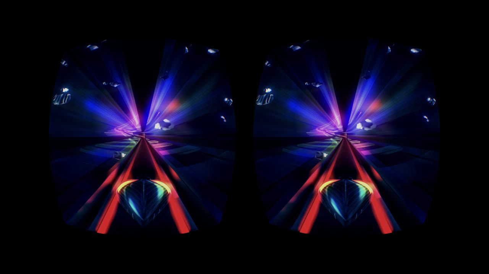
  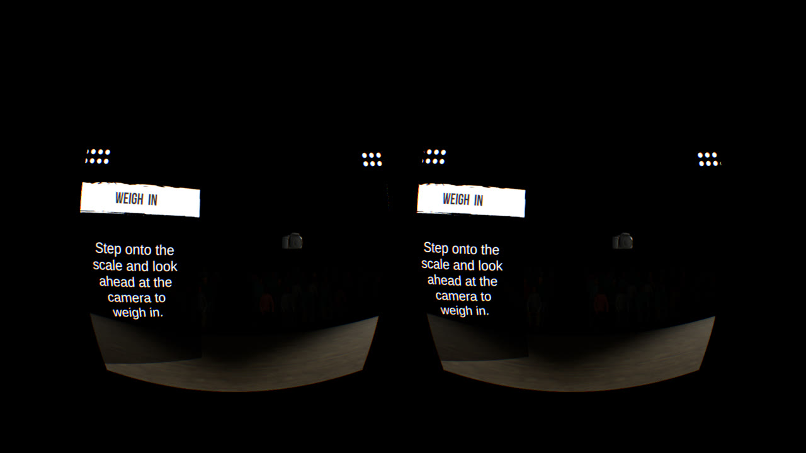
  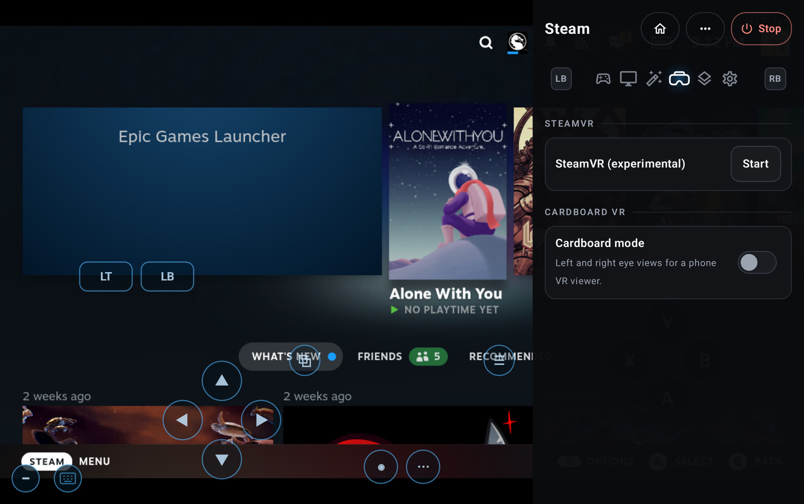
- Added **Epic Games Launcher for Linux**, Epic's own client, running under FEX and signed in automatically with your linked Epic account. Every Epic game now starts through Steam and the launcher, so games get the same sign-in and online services as on a PC, along with Steam Input and the performance overlay. The launcher can be driven with a gamepad or touch. Games installed from inside the launcher appear in the Games tab automatically, and your Steam games can be started from the launcher's library. (@maxjivi05, [#928](https://github.com/Droid-Deck/DroidDeck/pull/928))

  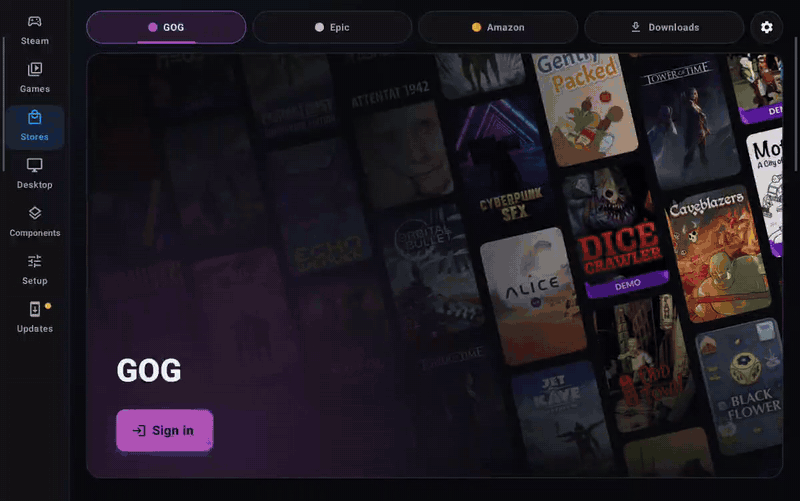
  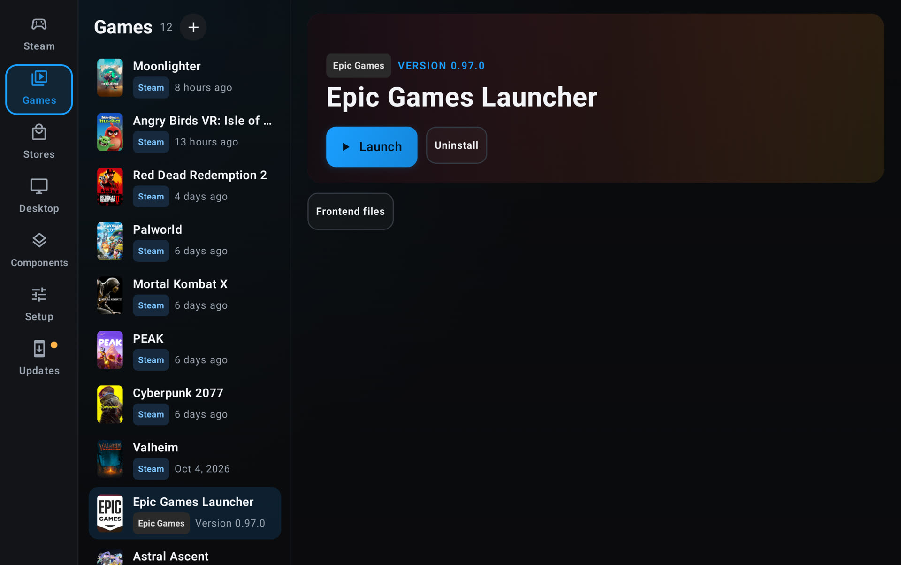

  

  
Gamepad navigation and launching through Steam

  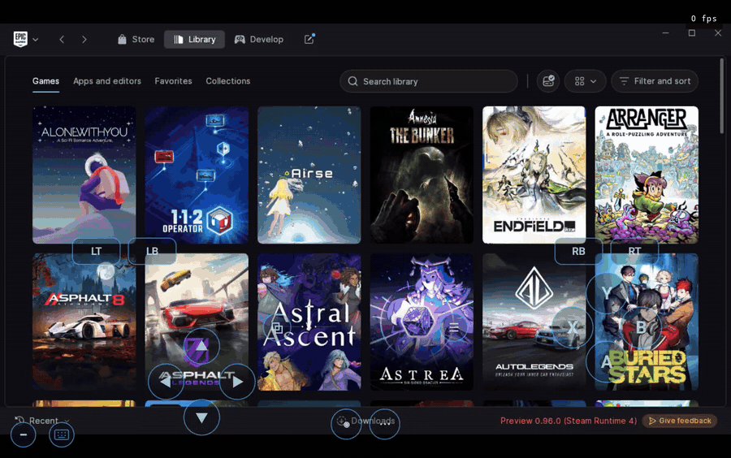
  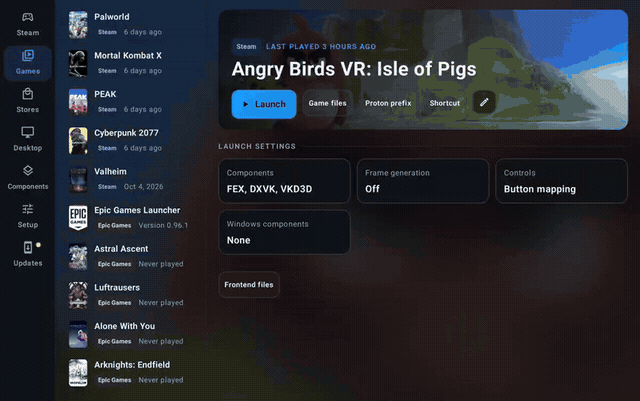
  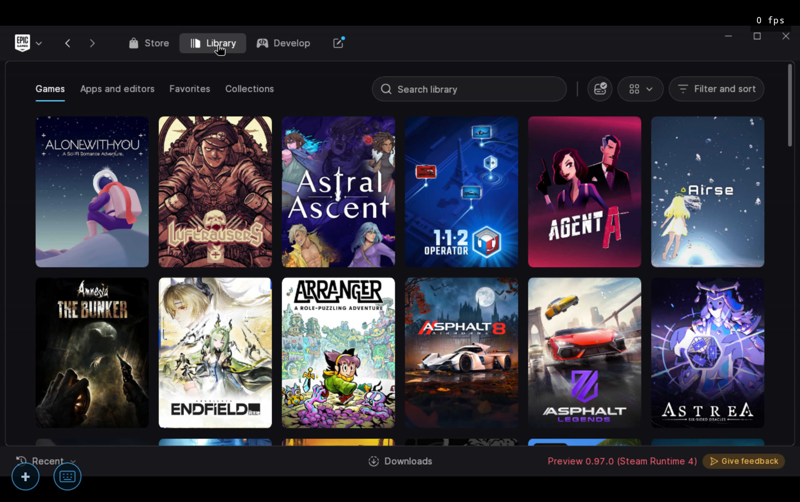

  

- Added an optional **x86-64 Steam client**: Valve's own Linux client, running under FEX beside the default ARM64 one. Choose it under **Steam client** in Steam settings; it applies at the next session. It has its own game library and shares your sign-in. Games with a Linux version, such as Team Fortress 2 and Half-Life, run their Linux builds on it, and Windows games use DroidDeck-Proton as before. New FEX builds reach it without an app update. (@The412Banner, [#152](https://github.com/Droid-Deck/DroidDeck/pull/152), [#1050](https://github.com/Droid-Deck/DroidDeck/pull/1050), [#1053](https://github.com/Droid-Deck/DroidDeck/pull/1053))
- **Linux games run under FEX out of the box.** Proton Experimental ARM64, FEX and the Steam Linux Runtimes now download on the first Steam start instead of waiting as pending downloads. x86 Linux games start, keep running and take the controller under FEX, including Unity games, which used to crash or ignore the gamepad. Games that also have a Windows version stay on Proton by default, because the Windows build often runs better. To run a game's Linux build instead, choose **Linux x86 (FEX)** in its compatibility settings. (@maxjivi05, [#1045](https://github.com/Droid-Deck/DroidDeck/pull/1045))
- Store game pages now show **HowLongToBeat times, Metacritic scores**, developer, publisher and release date for GOG and Epic games, along with an **achievements** card with filters for unlocked, locked and hidden achievements. (@phobos665, @xXJSONDeruloXx, [#641](https://github.com/Droid-Deck/DroidDeck/pull/641), [#712](https://github.com/Droid-Deck/DroidDeck/pull/712), [#775](https://github.com/Droid-Deck/DroidDeck/pull/775))

  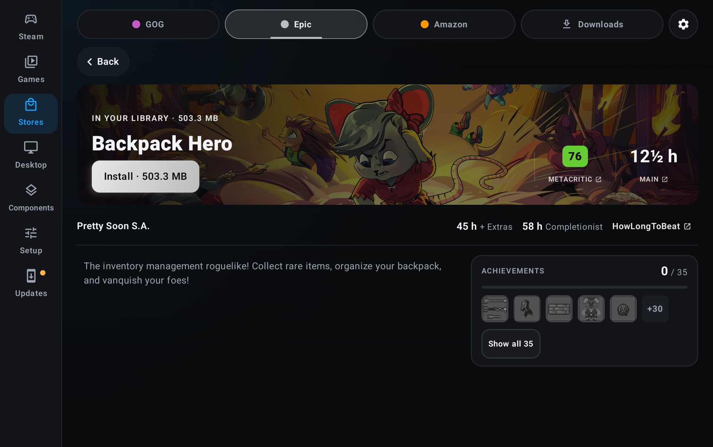
- Added opt-in **GOG achievements** syncing through Comet, with unlock notifications while you play. (@xXJSONDeruloXx, [#651](https://github.com/Droid-Deck/DroidDeck/pull/651))
- Added **sorting and a list view** for the store Library and Installed tabs: sort by recently played, recently installed, title, size or release date, and switch between cards and a compact list. (@kingokksa, [#798](https://github.com/Droid-Deck/DroidDeck/pull/798))

  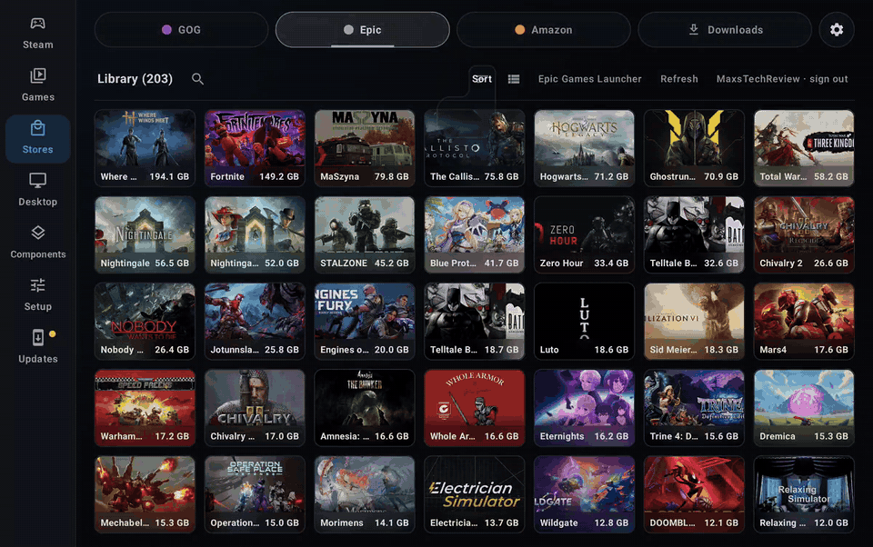
- Added a **Storage** page to Setup that shows where DroidDeck's storage goes and frees what is safe to remove: unused Steam runtimes, leftovers from uninstalled games, old logs, shader caches, unused components and Flatpak runtimes. Starting Steam with less than 10 GB free offers to free up space. (@xXJSONDeruloXx, [#913](https://github.com/Droid-Deck/DroidDeck/pull/913))

  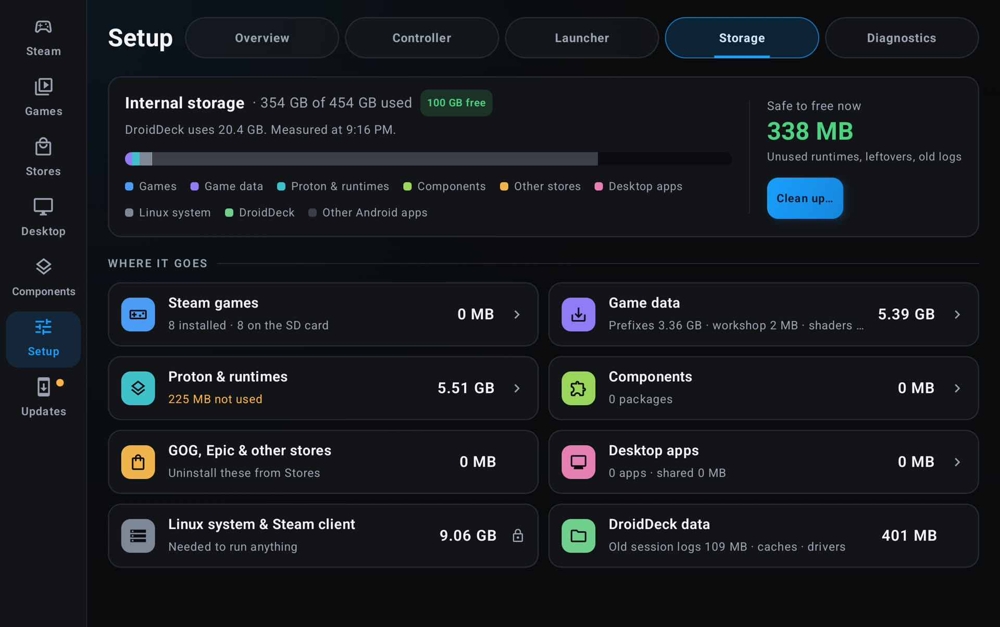
  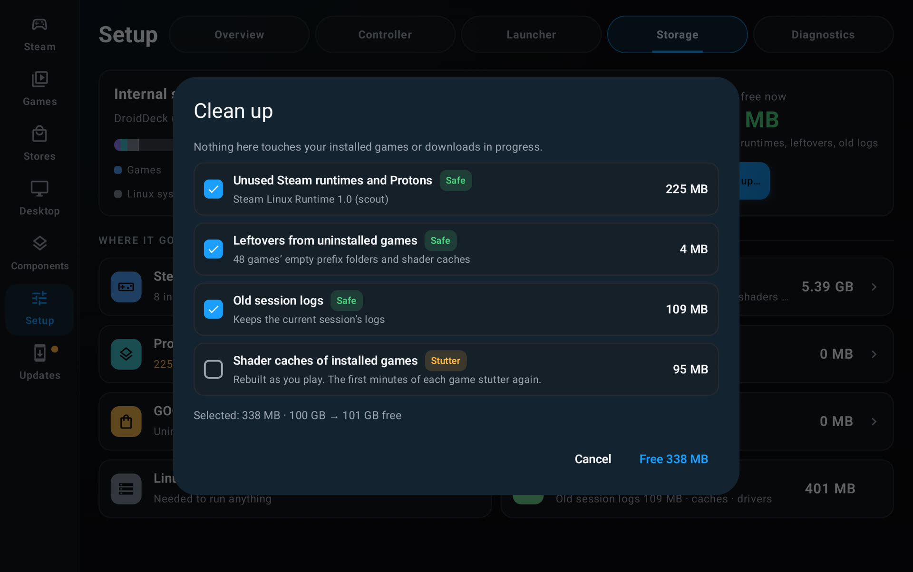
- Added **artwork changing for Steam games and GOG, Epic and Amazon games**, matching added games, with a SteamGridDB search in the art chooser. **Adjust logo** sets where a game's logo sits on its background and how big it is. Chosen art and logo positions are applied in Steam too. (@FX192, [#876](https://github.com/Droid-Deck/DroidDeck/pull/876), [#939](https://github.com/Droid-Deck/DroidDeck/pull/939), [#948](https://github.com/Droid-Deck/DroidDeck/pull/948), [#976](https://github.com/Droid-Deck/DroidDeck/pull/976), [#1004](https://github.com/Droid-Deck/DroidDeck/pull/1004))

  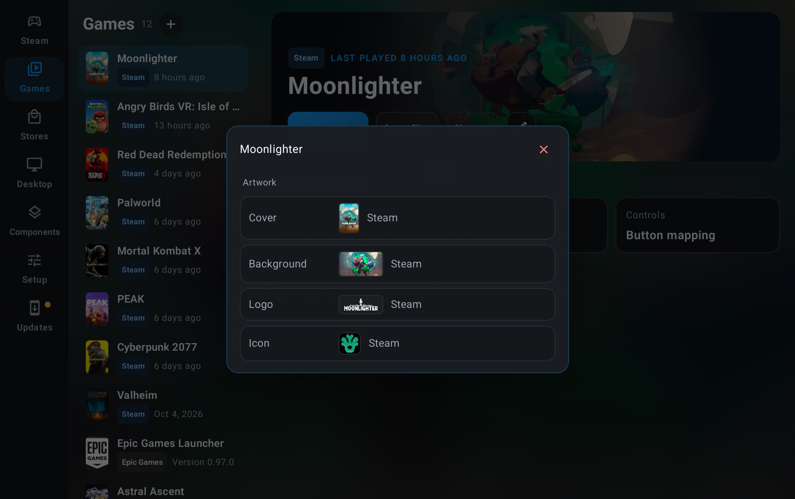
- Redesigned the **GPU drivers** page with three modes: **Auto**, **Matched pair**, or **Mix and match** display and runtime drivers. It also shows which drivers are in use now. Auto checks for new drivers when the app opens, and if a new pair never starts a session, it rolls back to the last pair that worked. (@xXJSONDeruloXx, [#858](https://github.com/Droid-Deck/DroidDeck/pull/858), [#972](https://github.com/Droid-Deck/DroidDeck/pull/972))

  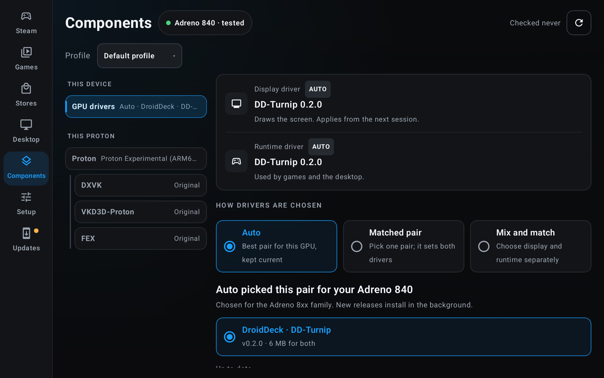
- Added **Boot movie** settings: the DroidDeck movie at 30 or 60 fps, with or without sound, or import your own video, which is converted on the device. (@xXJSONDeruloXx, [#969](https://github.com/Droid-Deck/DroidDeck/pull/969))

  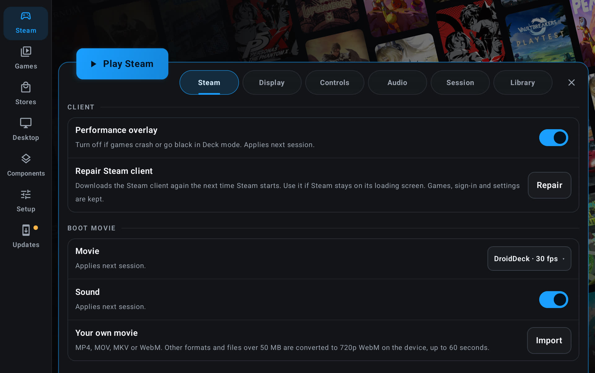
- Added a per-game **Start without Steam** switch for games that close right away because of Proton's Steam setup. (@The412Banner, [#659](https://github.com/Droid-Deck/DroidDeck/pull/659))
- Added **Low-latency controller** and **Low-latency touch** toggles to the session menu, which apply immediately while Steam is running. (@xXJSONDeruloXx, [#808](https://github.com/Droid-Deck/DroidDeck/pull/808))

  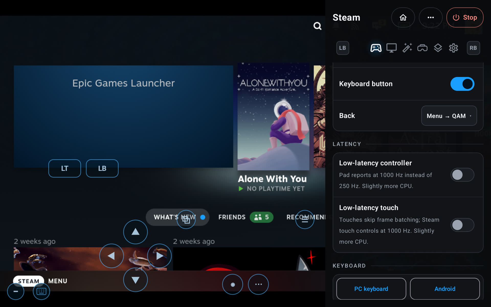
- A **three-finger tap** opens and closes Steam's on-screen keyboard in game. (@xXJSONDeruloXx, [#782](https://github.com/Droid-Deck/DroidDeck/pull/782))
- Added **Picture position** (Top, Bottom or Center) for Steam sessions, so fixed-aspect games can sit away from on-screen controls on tall screens. (@asdf17128, [#871](https://github.com/Droid-Deck/DroidDeck/pull/871))

  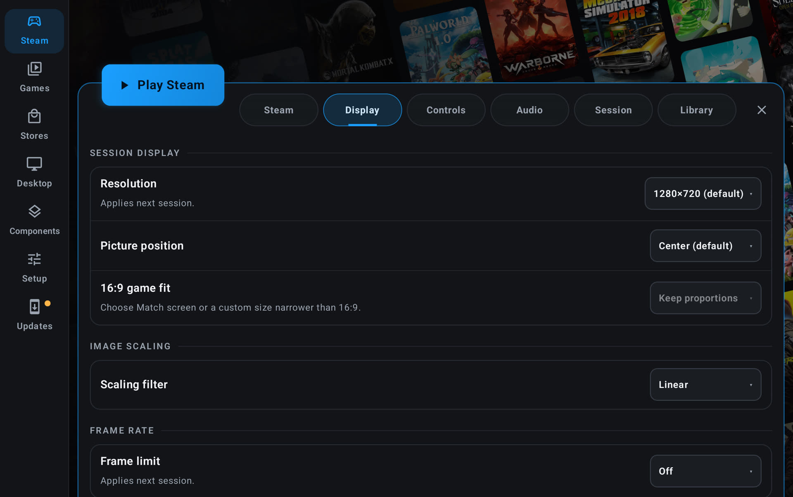
- FEX, DXVK and VKD3D-Proton versions can be **downloaded from the session menu**. (@xXJSONDeruloXx, [#679](https://github.com/Droid-Deck/DroidDeck/pull/679))
- Added opt-in **zRAM compression** for the Steam client while a game runs, freeing about 0.5–0.8 GB of memory in testing. (@maxjivi05, [#442](https://github.com/Droid-Deck/DroidDeck/pull/442))
- Added **23 more languages**, for 32 in total besides English, selectable in the app or in Android's per-app language settings. Steam follows the chosen language. (@maxjivi05, [#669](https://github.com/Droid-Deck/DroidDeck/pull/669))
- Downloads now **resume where they stopped** and fall back to mirrors, with a download source setting that picks the fastest source automatically. This helps especially in mainland China. (@kingokksa, [#623](https://github.com/Droid-Deck/DroidDeck/pull/623))
- Added **Reset all settings** in Setup > Diagnostics. It keeps your games, sign-ins and downloads. (@0x1Nawaf, [#696](https://github.com/Droid-Deck/DroidDeck/pull/696))
- Store installs can go to **internal storage, any SD card or your second library**. (@maxjivi05, [#928](https://github.com/Droid-Deck/DroidDeck/pull/928))
- Controllers with two back paddles (such as the 8BitDo Mobile Controller) map them to the Deck's **L4 and R4**. (@Vynex, [#797](https://github.com/Droid-Deck/DroidDeck/pull/797))
- The second screen's Deck controls now include the **Gamepad** tab. On foldables, the unfolded controls hide while a controller is connected. (@ovurrsl, @Gustash, [#895](https://github.com/Droid-Deck/DroidDeck/pull/895), [#829](https://github.com/Droid-Deck/DroidDeck/pull/829))
- Added experimental **Android Auto** support. DroidDeck is only available while the car is parked, and needs Android Auto's developer mode with unknown sources enabled. (@zekena2, [#952](https://github.com/Droid-Deck/DroidDeck/pull/952))

### Improvements

- **Rewrote the Epic and Amazon store modules**, with byte-exact download verification and proper controller focus on store game pages. Existing sign-ins and installs carry over. (@The412Banner, [#802](https://github.com/Droid-Deck/DroidDeck/pull/802), [#804](https://github.com/Droid-Deck/DroidDeck/pull/804))
- **Epic installs need far less free space.** Files are assembled as they download instead of caching the whole game first, so a 71 GB game no longer needs about 142 GB free. Store installs also check for space first and recover better when they run short. (@jmarti326, [#710](https://github.com/Droid-Deck/DroidDeck/pull/710))
- **Fewer background processes.** An idle Steam session went from about 41 processes to about 30, keeping it further under Android's child-process limit, and Steam's web helper uses about 250 MB less memory. (@xXJSONDeruloXx, [#566](https://github.com/Droid-Deck/DroidDeck/pull/566), [#575](https://github.com/Droid-Deck/DroidDeck/pull/575))
- **Smoother frame pacing.** The session respects Android's peak refresh rate setting, frames are timed to the display's vsync, Steam's frame limiter paces each game by time, and frame generation follows the game's real frame rate. On a 60 Hz Thor, distinct frames on screen rose from about 49.5 to 59.4 a second. (@xXJSONDeruloXx, [#715](https://github.com/Droid-Deck/DroidDeck/pull/715), [#717](https://github.com/Droid-Deck/DroidDeck/pull/717), [#731](https://github.com/Droid-Deck/DroidDeck/pull/731), [#753](https://github.com/Droid-Deck/DroidDeck/pull/753), [#927](https://github.com/Droid-Deck/DroidDeck/pull/927))
- The game's busiest threads are boosted onto the **prime cores on the Odin 3**, and Snapdragon 8 Gen 2 devices get default core assignments for games and Steam. (@kmnkv1, @xXJSONDeruloXx, [#682](https://github.com/Droid-Deck/DroidDeck/pull/682), [#654](https://github.com/Droid-Deck/DroidDeck/pull/654))
- Games on **SD-card libraries launch faster**, about 46% faster in testing. (@xXJSONDeruloXx, [#757](https://github.com/Droid-Deck/DroidDeck/pull/757))
- The Steam home wall now fills from **your own Steam library**, and the store sign-in screens show each store's featured art. (@xXJSONDeruloXx, [#835](https://github.com/Droid-Deck/DroidDeck/pull/835), [#878](https://github.com/Droid-Deck/DroidDeck/pull/878))
- **Older and less common devices:** sessions start on kernels that drop fork events (such as the Xiaomi Pad 5), Flatpak installs work on older kernels, the Linux runtime installs on 16 KB page-size devices, and USB drives that only appear as raw storage can be granted All files access. (@xXPOLYGONXx, @xXJSONDeruloXx, @ovurrsl, @Imgau, [#457](https://github.com/Droid-Deck/DroidDeck/pull/457), [#752](https://github.com/Droid-Deck/DroidDeck/pull/752), [#900](https://github.com/Droid-Deck/DroidDeck/pull/900), [#760](https://github.com/Droid-Deck/DroidDeck/pull/760))
- Controller-driven cursors now show in nested Wayland sessions. (@xXJSONDeruloXx, [#759](https://github.com/Droid-Deck/DroidDeck/pull/759))
- An interrupted Linux runtime download resumes instead of starting again. (@ovurrsl, [#847](https://github.com/Droid-Deck/DroidDeck/pull/847))
- Native Linux and FEX compatibility choices are kept instead of being reset to Proton. (@xXJSONDeruloXx, [#749](https://github.com/Droid-Deck/DroidDeck/pull/749))
- DroidDeck-Proton releases now come from the [Droid-Deck/DroidDeck-Proton](https://github.com/Droid-Deck/DroidDeck-Proton) repo. (@The412Banner, [#875](https://github.com/Droid-Deck/DroidDeck/pull/875))
- Folding or unfolding no longer restarts the front end, file manager or store sign-in. (@ovurrsl, [#832](https://github.com/Droid-Deck/DroidDeck/pull/832), [#886](https://github.com/Droid-Deck/DroidDeck/pull/886))
- Session reports include the memory page size, why the app's last processes ended, the panel's refresh modes and the device's thermal state. Logs are synced to storage every 2 seconds, so a hard reset keeps them, and only the 3 newest session log folders are kept. (@ovurrsl, @kmnkv1, @xXJSONDeruloXx, [#897](https://github.com/Droid-Deck/DroidDeck/pull/897), [#513](https://github.com/Droid-Deck/DroidDeck/pull/513), [#852](https://github.com/Droid-Deck/DroidDeck/pull/852), [#990](https://github.com/Droid-Deck/DroidDeck/pull/990))
- The store sign-in page can no longer read local files. (@ovurrsl, [#890](https://github.com/Droid-Deck/DroidDeck/pull/890))
- Expanded and refreshed translations, including Chinese, Japanese, Turkish, German, French, Spanish, Italian, Portuguese, Russian, Korean and Hungarian. Every language now has every string, including the new Storage, GPU drivers and artwork pages, and Latin American Spanish is complete. (@Dantalian-dev, @ovurrsl, @kingokksa, [#539](https://github.com/Droid-Deck/DroidDeck/pull/539), [#826](https://github.com/Droid-Deck/DroidDeck/pull/826), [#849](https://github.com/Droid-Deck/DroidDeck/pull/849), [#850](https://github.com/Droid-Deck/DroidDeck/pull/850), [#884](https://github.com/Droid-Deck/DroidDeck/pull/884), [#1013](https://github.com/Droid-Deck/DroidDeck/pull/1013))

### Fixed

- Fixed **Android UI flickering** during games on Adreno 740 devices such as the AYN Thor and Odin 2 Portal. (@xXJSONDeruloXx, [#963](https://github.com/Droid-Deck/DroidDeck/pull/963))
- Fixed **game rumble stopping after one second** under Proton. (@TideGear, [#938](https://github.com/Droid-Deck/DroidDeck/pull/938))
- Fixed **Shut Down and Restart** in Steam's power menu. Shut Down now ends the session, and Restart restarts the client. (@muazkadan, [#629](https://github.com/Droid-Deck/DroidDeck/pull/629))
- Fixed the **Quick Access button** doing nothing when the pad is set to Xbox 360, DualShock 4 or DualSense. (@muazkadan, [#631](https://github.com/Droid-Deck/DroidDeck/pull/631))
- Fixed **store games becoming Steam installs** when you also own them on Steam. (@xXJSONDeruloXx, [#816](https://github.com/Droid-Deck/DroidDeck/pull/816))
- Fixed **added games sometimes never starting** on a cold launch with large Steam libraries. (@xXJSONDeruloXx, @ovurrsl, [#758](https://github.com/Droid-Deck/DroidDeck/pull/758), [#914](https://github.com/Droid-Deck/DroidDeck/pull/914), [#973](https://github.com/Droid-Deck/DroidDeck/pull/973))
- Fixed games that never started after a long pause, and "Steam is paused" staying up after the first Resume tap. (@maxjivi05, [#928](https://github.com/Droid-Deck/DroidDeck/pull/928))
- Fixed the session ending the third time Steam restarted, for example after changing language. (@KirkPatrickJunsay, [#754](https://github.com/Droid-Deck/DroidDeck/pull/754))
- Fixed Steam touch controls ignoring the layout chosen in Steam, including community layouts. (@xXJSONDeruloXx, [#840](https://github.com/Droid-Deck/DroidDeck/pull/840))
- Fixed **Batman: Arkham City** crashing at startup and getting stuck on "Running install script". (@TjebbeKerstens, [#792](https://github.com/Droid-Deck/DroidDeck/pull/792), [#793](https://github.com/Droid-Deck/DroidDeck/pull/793))
- Fixed **.NET Desktop and .NET Core runtimes** failing to install from Windows components, which blocked MelonLoader mods and Baldur's Gate 3. (@The412Banner, [#740](https://github.com/Droid-Deck/DroidDeck/pull/740))
- Fixed the microphone in DirectAudio games. (@xXJSONDeruloXx, [#747](https://github.com/Droid-Deck/DroidDeck/pull/747))
- Fixed FEX games failing with "Couldn't connect to FEXServer socket". (@angelrenefm, [#841](https://github.com/Droid-Deck/DroidDeck/pull/841))
- Fixed wired **PowerA and PDP** Xbox controllers' right stick and triggers. (@Raidennrl, [#692](https://github.com/Droid-Deck/DroidDeck/pull/692))
- Fixed touchpad taps not registering in some games, and the touchpad not moving a game's own cursor when it locks the pointer. (@KirkPatrickJunsay, @Gustash, [#644](https://github.com/Droid-Deck/DroidDeck/pull/644), [#772](https://github.com/Droid-Deck/DroidDeck/pull/772))
- Fixed native touch taps snapping the cursor to the top-left corner in some games. (@asdf17128, [#803](https://github.com/Droid-Deck/DroidDeck/pull/803))
- Fixed the Android keyboard needing two taps to open after it was dismissed. (@KirkPatrickJunsay, [#665](https://github.com/Droid-Deck/DroidDeck/pull/665))
- Fixed Shift staying held after typing capitals on a physical keyboard in the desktop. (@The412Banner, [#766](https://github.com/Droid-Deck/DroidDeck/pull/766))
- Fixed an unfolded Follow screen session no longer turning to portrait. (@Gustash, [#626](https://github.com/Droid-Deck/DroidDeck/pull/626))
- Fixed battery estimates showing thousands of hours on phones that report current in mA. (@muazkadan, [#820](https://github.com/Droid-Deck/DroidDeck/pull/820))
- Fixed blurry home-screen shortcuts for Steam games. (@KirkPatrickJunsay, [#825](https://github.com/Droid-Deck/DroidDeck/pull/825))
- Fixed SteamGridDB art staying "no match" after a failed lookup. (@FX192, [#876](https://github.com/Droid-Deck/DroidDeck/pull/876))
- Fixed Steam crashes returning to the launcher silently. They now show DroidDeck's error screen, and Steam no longer crashes on Quest when a SteamVR runtime is installed. (@xXJSONDeruloXx, [#905](https://github.com/Droid-Deck/DroidDeck/pull/905))
- Fixed the in-session achievements page staying on "Reading…". (@xXJSONDeruloXx, [#961](https://github.com/Droid-Deck/DroidDeck/pull/961))
- Fixed crashes from failed store background jobs and cloud save recovery, and a memory error in the directory cache. (@KirkPatrickJunsay, @ovurrsl, @wallentx, [#846](https://github.com/Droid-Deck/DroidDeck/pull/846), [#898](https://github.com/Droid-Deck/DroidDeck/pull/898), [#685](https://github.com/Droid-Deck/DroidDeck/pull/685))
- Fixed expired Epic and Amazon sign-ins failing with a generic error instead of asking you to sign in again. (@The412Banner, [#804](https://github.com/Droid-Deck/DroidDeck/pull/804))
- Fixed the child-process limit check on Android 12, and its switch name now matches Android's wording. (@ovurrsl, [#955](https://github.com/Droid-Deck/DroidDeck/pull/955), [#848](https://github.com/Droid-Deck/DroidDeck/pull/848))
- Fixed the launcher offering its own display as a second screen. (@ovurrsl, [#889](https://github.com/Droid-Deck/DroidDeck/pull/889))
- Fixed Windows component detection being confused by folder names above the game folder. (@xXJSONDeruloXx, [#859](https://github.com/Droid-Deck/DroidDeck/pull/859))
- Fixed FEX dropdown scaling and Flathub search focus. (@xXJSONDeruloXx, [#681](https://github.com/Droid-Deck/DroidDeck/pull/681))

### New contributors

- @xXPOLYGONXx made their first contribution in [#457](https://github.com/Droid-Deck/DroidDeck/pull/457).
- @phobos665 made their first contribution in [#637](https://github.com/Droid-Deck/DroidDeck/pull/637).
- @Jagger15 made their first contribution in [#642](https://github.com/Droid-Deck/DroidDeck/pull/642).
- @KirkPatrickJunsay made their first contribution in [#644](https://github.com/Droid-Deck/DroidDeck/pull/644).
- @wallentx made their first contribution in [#685](https://github.com/Droid-Deck/DroidDeck/pull/685).
- @Raidennrl made their first contribution in [#692](https://github.com/Droid-Deck/DroidDeck/pull/692).
- @0x1Nawaf made their first contribution in [#696](https://github.com/Droid-Deck/DroidDeck/pull/696).
- @Producdevity made their first contribution in [#748](https://github.com/Droid-Deck/DroidDeck/pull/748).
- @Imgau made their first contribution in [#760](https://github.com/Droid-Deck/DroidDeck/pull/760).
- @TjebbeKerstens made their first contribution in [#792](https://github.com/Droid-Deck/DroidDeck/pull/792).
- @Vynex made their first contribution in [#797](https://github.com/Droid-Deck/DroidDeck/pull/797).
- @kingokksa made their first contribution in [#798](https://github.com/Droid-Deck/DroidDeck/pull/798).
- @asdf17128 made their first contribution in [#803](https://github.com/Droid-Deck/DroidDeck/pull/803).
- @ovurrsl made their first contribution in [#831](https://github.com/Droid-Deck/DroidDeck/pull/831).
- @FX192 made their first contribution in [#876](https://github.com/Droid-Deck/DroidDeck/pull/876).
- @angelrenefm made their first contribution in [#894](https://github.com/Droid-Deck/DroidDeck/pull/894).
- @informalTechCode made their first contribution in [#907](https://github.com/Droid-Deck/DroidDeck/pull/907).
- @TideGear made their first contribution in [#938](https://github.com/Droid-Deck/DroidDeck/pull/938).
- @zekena2 made their first contribution in [#952](https://github.com/Droid-Deck/DroidDeck/pull/952).

[Full changelog](https://github.com/Droid-Deck/DroidDeck/compare/0.4.0...0.5.0)
