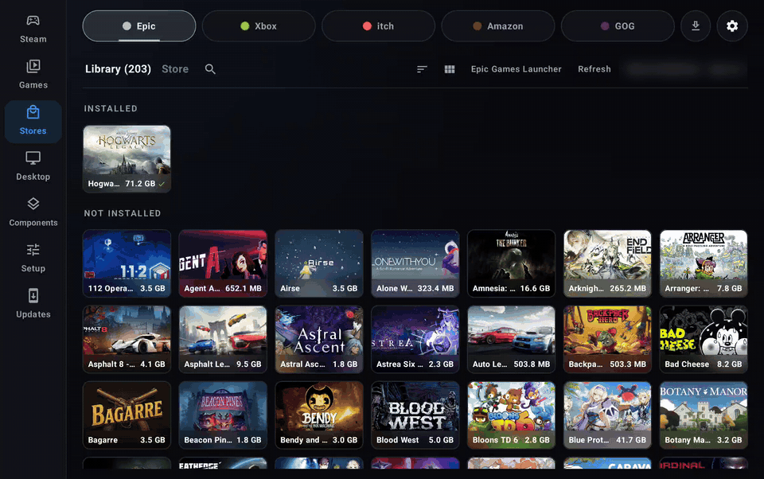
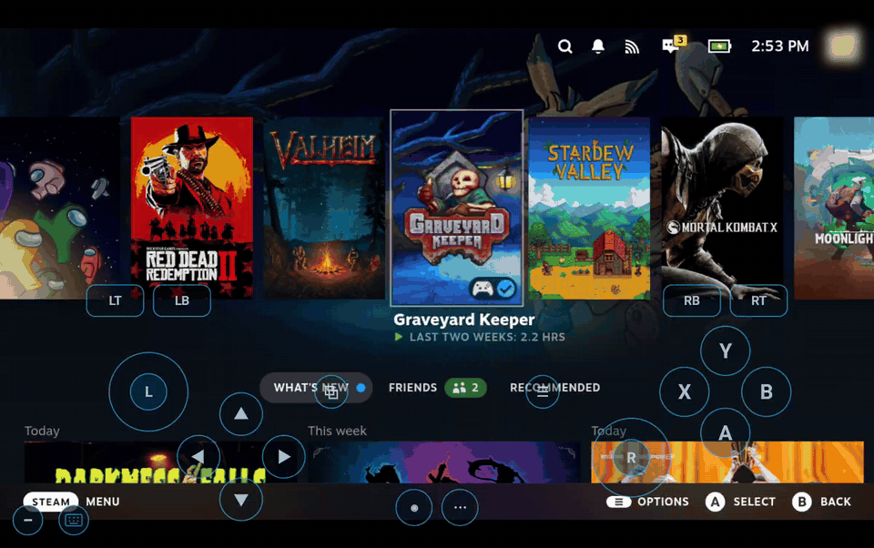
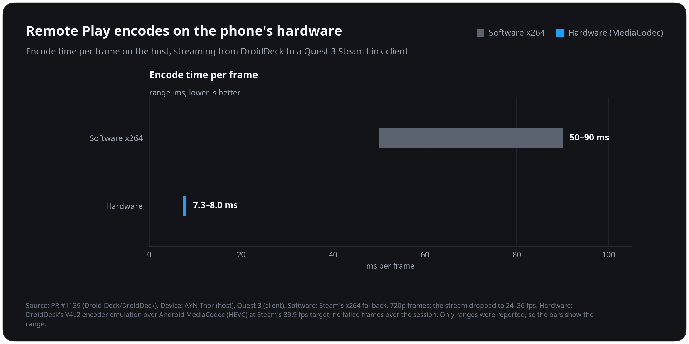
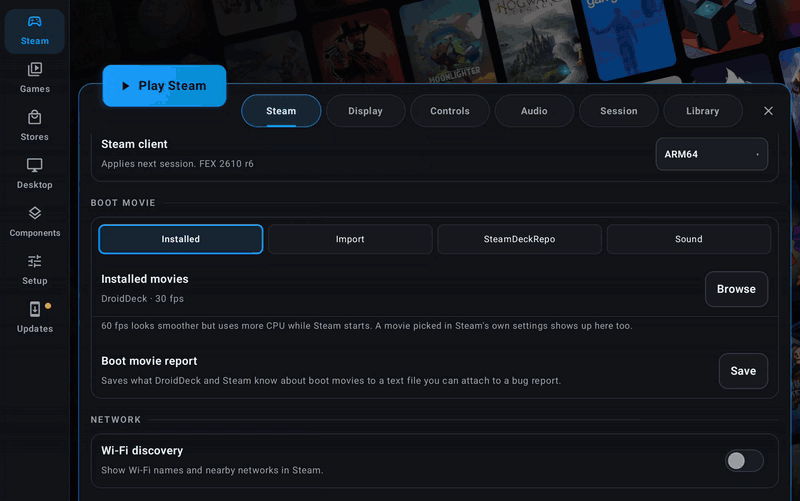
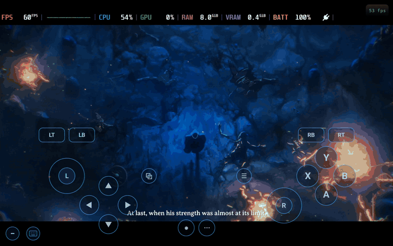
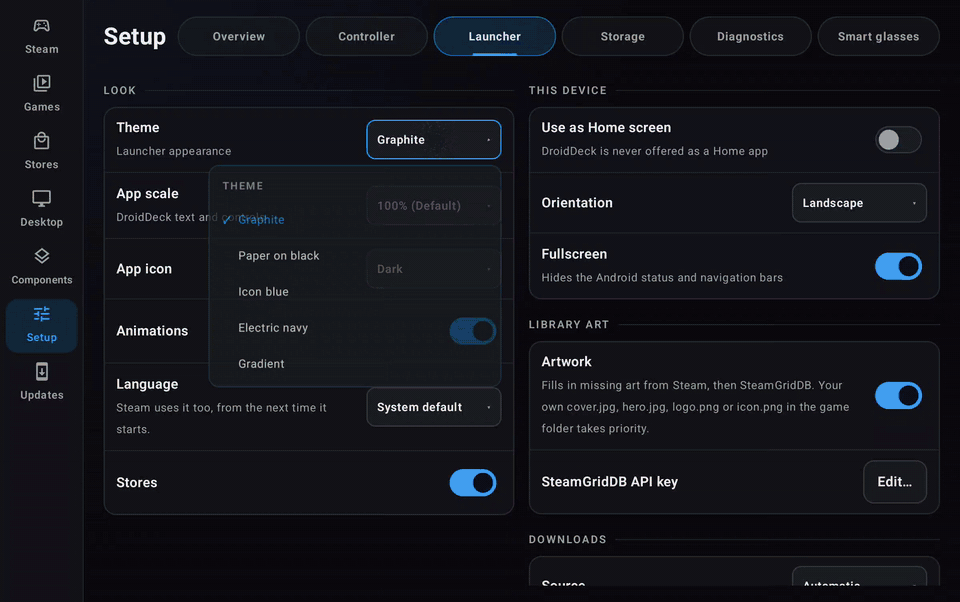
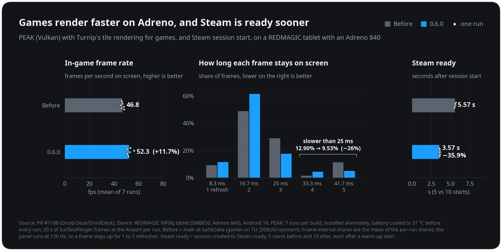
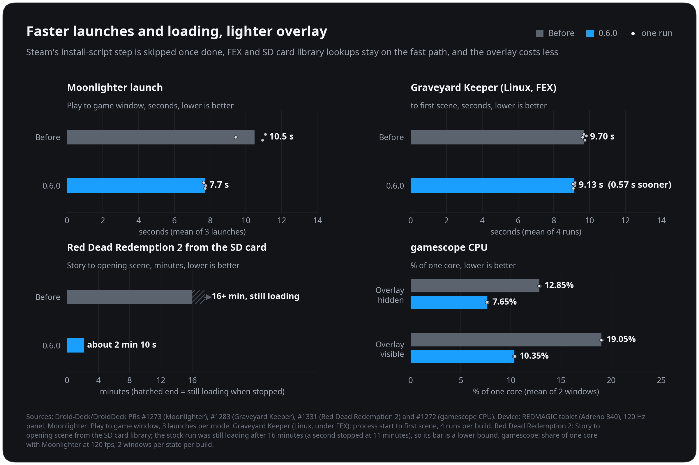
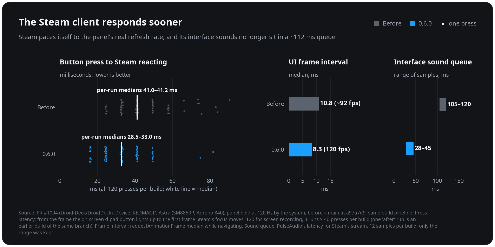
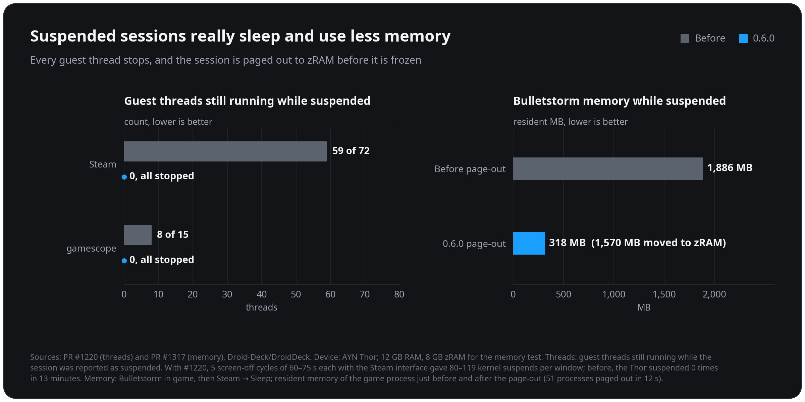

# DroidDeck 0.6.0

<!-- Maintainer check: Steam, Proton downloads and the games themselves come from Valve and the stores and are not part of DroidDeck; the intro below only claims DroidDeck's own code and the packs it builds. -->

> **DroidDeck is 100% open source. No ads. No telemetry. No source withheld.**
>
> DroidDeck is a community project in the truest sense. Because all of its code is public, the people who use it can read it, fix it and improve it, and in 0.6.0 you all sure did:
>
> **153 pull requests · 23 contributors · 10 first-timers · 73% of the pull requests came from the community.**
>
> Thank you to everyone who sent code, translations, device testing and bug reports. Here’s everything we did together for this release:

### Features

<!-- GIF: stores-capsules -->

- Added experimental **Xbox and PC Game Pass** as a store. Sign in with your Microsoft account to see your owned and Game Pass games, then download them with pause and resume, update, verify and manage add-on content. Games launch through Proton or FEX from the Games tab or straight from Steam. Search results open with their artwork and details, and Game Pass titles you have not installed yet can be installed from their page. (@xXJSONDeruloXx, @moronigranja, [#1156](https://github.com/Droid-Deck/DroidDeck/pull/1156), [#1164](https://github.com/Droid-Deck/DroidDeck/pull/1164), [#1170](https://github.com/Droid-Deck/DroidDeck/pull/1170), [#1193](https://github.com/Droid-Deck/DroidDeck/pull/1193), [#1279](https://github.com/Droid-Deck/DroidDeck/pull/1279))
- Added an **itch.io** store. Sign in with your itch.io API key to see your library, then search the store or browse the newest, on-sale, free and top-rated shelves. DRM-free Windows builds install and launch through Steam like games from the other stores. (@kingokksa, [#1064](https://github.com/Droid-Deck/DroidDeck/pull/1064))
- **Redesigned store pages.** Each store has **Library** and **Store** tabs, and the library lists installed games first. A new **capsule view** shows portrait DVD-case art in every store. LB and RB switch between stores, and installed games get a **Play** button on their page. You can reorder and hide store tabs in the stores settings, and stores you are not signed in to are dimmed. (@xXJSONDeruloXx, @kingokksa, [#1116](https://github.com/Droid-Deck/DroidDeck/pull/1116), [#1117](https://github.com/Droid-Deck/DroidDeck/pull/1117), [#1121](https://github.com/Droid-Deck/DroidDeck/pull/1121), [#1125](https://github.com/Droid-Deck/DroidDeck/pull/1125), [#1236](https://github.com/Droid-Deck/DroidDeck/pull/1236))

<!-- GIF: touch-gestures -->

- Added configurable **touchscreen gestures**: taps, double taps, holds, one-, two- and three-finger drags and pinch zoom. Each one can be mapped to an action from a searchable list, with defaults and per-game overrides. (@Nightwalker743, @kingokksa, [#940](https://github.com/Droid-Deck/DroidDeck/pull/940), [#1214](https://github.com/Droid-Deck/DroidDeck/pull/1214))
- **Steam Remote Play from DroidDeck** now streams video as well as audio and input. The picture is captured through PipeWire, as on SteamOS, and encoded by the phone's hardware encoder. On a Thor that takes 7.3–8.0 ms per frame, down from 50–90 ms with software encoding. Touch on the client can tap and drag, and games are heard on the stream. (@xXJSONDeruloXx, [#1139](https://github.com/Droid-Deck/DroidDeck/pull/1139))

  <!-- Chart: remote-play-encode -->
  

<!-- GIF: boot-movies -->

- **Boot movies from SteamDeckRepo.** Search SteamDeckRepo, filter by device and browse the Trending, Most downloaded, Most liked and Newest tabs, then install a movie and use it. Installed movies are listed with covers. Imported movies go into Steam's own movie folder, and the sound has volume and length sliders. (@FX192, [#1036](https://github.com/Droid-Deck/DroidDeck/pull/1036), [#1229](https://github.com/Droid-Deck/DroidDeck/pull/1229))

<!-- GIF: performance-hud -->

- The **performance HUD** can show a colored frame-time graph and the battery temperature. Each part can be shown or hidden, and its colors and opacity can be changed. (@0x1Nawaf, [#1256](https://github.com/Droid-Deck/DroidDeck/pull/1256))

<!-- GIF: gradient-theme -->

- Added a custom **Gradient theme**, with primary and secondary colors chosen from a color wheel, sliders or a hex code, and a **light app icon** option. (@FX192, @xXJSONDeruloXx, [#1309](https://github.com/Droid-Deck/DroidDeck/pull/1309), [#1104](https://github.com/Droid-Deck/DroidDeck/pull/1104))
- **SteamVR controller types.** Without VR controllers, the gamepad can act as Valve Index controllers (the default), Meta Quest 3 Touch Plus, HTC Vive wands, or a regular gamepad. The sticks move you in the game by default, and pressing both sticks switches them to moving the hands. The type can be changed while SteamVR runs. With glasses, the phone becomes a control panel with Recenter, the SteamVR menu, the keyboard, brightness and battery. Flat games started from VR open as a SteamVR panel. (@xXJSONDeruloXx, [#1268](https://github.com/Droid-Deck/DroidDeck/pull/1268))
- Added **Rokid Max and Air** glasses, with 3DoF head tracking, SBS modes, 120 Hz on the Max and brightness control, and experimental head tracking for **VITURE Pro 2** without the vendor SDK. (@xXJSONDeruloXx, @informalTechCode, @kingokksa, [#1266](https://github.com/Droid-Deck/DroidDeck/pull/1266), [#1115](https://github.com/Droid-Deck/DroidDeck/pull/1115))
- **Easy Anti-Cheat games with an offline mode** start without the anti-cheat bootstrapper. This is on by default and can be turned off per game. Online modes that need Easy Anti-Cheat stay unavailable. (@xXJSONDeruloXx, [#1039](https://github.com/Droid-Deck/DroidDeck/pull/1039))
- The **built-in controller can be turned off** (Steam settings > Controller > None), so a connected controller becomes player 1 for games that only read the first pad. (@kingokksa, [#1207](https://github.com/Droid-Deck/DroidDeck/pull/1207), [#1304](https://github.com/Droid-Deck/DroidDeck/pull/1304))
- On foldables, the **unfolded controls can stay while a controller is connected**, for players who use a telescopic controller and still want the trackpads and back buttons. (@ovurrsl, [#996](https://github.com/Droid-Deck/DroidDeck/pull/996))
- The component manager offers **nightly DXVK, VKD3D-Proton and FEX builds** from DroidDeck-Components, with a **Stable | Nightly** switch on each row. (@The412Banner, [#1284](https://github.com/Droid-Deck/DroidDeck/pull/1284))
- When a game started from the Games tab closes, DroidDeck **returns you to where you launched it** instead of leaving you in Big Picture. (@The412Banner, [#395](https://github.com/Droid-Deck/DroidDeck/pull/395))
- **Decky Loader** installs from the upstream SteamDeckHomebrew release, has a Stable or Prerelease update channel, and shows Decky's own third-party warning before a plugin ZIP is installed. (@xXJSONDeruloXx, [#1090](https://github.com/Droid-Deck/DroidDeck/pull/1090), [#1263](https://github.com/Droid-Deck/DroidDeck/pull/1263), [#1264](https://github.com/Droid-Deck/DroidDeck/pull/1264))
- **Desktop mode can be uninstalled** from beside Open desktop, including a desktop install that was interrupted. Games, Steam, added apps and settings are kept. (@xXJSONDeruloXx, [#1311](https://github.com/Droid-Deck/DroidDeck/pull/1311))
- **GOG and Epic installs can use your language.** The install dialog has a **Game language** choice, which follows the app's language by default, and the stores settings can pin a default. GOG games no longer download only their English files. (@LooLL, [#1199](https://github.com/Droid-Deck/DroidDeck/pull/1199))
- Games can be **uninstalled or removed from their page in the Games tab**. Store games use their store's uninstaller. Steam games delete their install but keep their saves and Proton prefix. Added games only lose their shortcut, so their files stay. (@kingokksa, [#1190](https://github.com/Droid-Deck/DroidDeck/pull/1190))

### Improvements

- **Performance**
  - **Faster games and session starts on Adreno.** Games now use Turnip's tile rendering while the Steam interface keeps system memory. In PEAK on an Adreno 840 tablet, the frame rate rose 11.7% and frames slower than 25 ms dropped by 26%. Steam is ready 35.9% sooner after a session starts (5.57 s to 3.57 s). (@maxjivi05, [#1188](https://github.com/Droid-Deck/DroidDeck/pull/1188))

    <!-- Chart: adreno-peak-and-steam-start -->
    
  - **Faster game launches.** Steam's install-script step is skipped once it has finished for a game. In testing, Moonlighter went from 10.5 s to 7.7 s from Play to the game window. FEX's file lookups skip proot, so Graveyard Keeper reaches its first scene 0.57 s sooner with 48% fewer proot stops. (@maxjivi05, [#1273](https://github.com/Droid-Deck/DroidDeck/pull/1273), [#1283](https://github.com/Droid-Deck/DroidDeck/pull/1283))
  - **Games on an SD card library load far faster.** proot's fast path now names files and follows links inside a library the same way proot does, instead of handing every lookup back to proot. In testing, Red Dead Redemption 2's Story mode went from still loading after 16 minutes to the opening scene in about 2 minutes 10 seconds. (@maxjivi05, [#1331](https://github.com/Droid-Deck/DroidDeck/pull/1331))
  - **Less overhead from the performance overlay.** gamescope's CPU use dropped from about 12.9% to 7.7% of a core with the overlay hidden, and a 60 fps game on a 120 Hz panel no longer gets extra composites while the overlay is shown. Wine's network queries also cost less. (@maxjivi05, [#1272](https://github.com/Droid-Deck/DroidDeck/pull/1272), [#1274](https://github.com/Droid-Deck/DroidDeck/pull/1274), [#1275](https://github.com/Droid-Deck/DroidDeck/pull/1275))

    <!-- Chart: speed-launch-load-overlay -->
    
  - The **Steam client responds sooner**: it paces itself to the panel's real refresh rate, and its interface sounds no longer queue about 112 ms of audio. The DirectAudio sink is now built from @The412Banner's [DirectAudio](https://github.com/The412Banner/directaudio) source. (@maxjivi05, [#1094](https://github.com/Droid-Deck/DroidDeck/pull/1094))

    <!-- Chart: steam-client-responsiveness -->
    
  - The **GOG tab opens in seconds**, because the whole library comes from one listing instead of a request per game. (@kingokksa, [#786](https://github.com/Droid-Deck/DroidDeck/pull/786))
- **Reduced the APK size** from 124.4 MB to 66.4 MB. (@xXJSONDeruloXx, [#1198](https://github.com/Droid-Deck/DroidDeck/pull/1198), [#1204](https://github.com/Droid-Deck/DroidDeck/pull/1204), [#1265](https://github.com/Droid-Deck/DroidDeck/pull/1265))
- **Better battery life while a session is suspended.** The device can now really sleep: every guest thread stops and the audio stream is stopped. Before, a Thor did not suspend once in 13 minutes. Steam downloads keep running with the Manual policy, including downloads to SD-card libraries, and a switched-off Steam Controller no longer wakes Bluetooth all night. (@xXJSONDeruloXx, @Detinator10, [#1220](https://github.com/Droid-Deck/DroidDeck/pull/1220), [#1262](https://github.com/Droid-Deck/DroidDeck/pull/1262), [#1312](https://github.com/Droid-Deck/DroidDeck/pull/1312))
- **zRAM is always on** where supported, and a session is paged out to zRAM before it is suspended, so Android is less likely to close it overnight. In testing, Bulletstorm's resident memory went from 1,886 MB to 318 MB while suspended, with the rest moved to zRAM. The zRAM setting has been removed. (@xXJSONDeruloXx, [#1317](https://github.com/Droid-Deck/DroidDeck/pull/1317))

  <!-- Chart: suspend-sleep-and-memory -->
  
- Sessions on an **external display or DeX** keep running while the phone's screen is off. (@maxjivi05, @xXJSONDeruloXx, [#1211](https://github.com/Droid-Deck/DroidDeck/pull/1211), [#1320](https://github.com/Droid-Deck/DroidDeck/pull/1320))
- **Game cores** now apply to games started with **Linux x86 (FEX)** too. (@coffeemeist3r, [#1294](https://github.com/Droid-Deck/DroidDeck/pull/1294))
- **GPU drivers:** Auto's picks come from a manifest in Drivers-CI, so a default can change without an app update. The Snapdragon SM8975 is recognized and Adreno 850 support is marked experimental. A trial driver that crashes at startup now rolls back automatically. (@xXJSONDeruloXx, @Danbro007, @ovurrsl, [#977](https://github.com/Droid-Deck/DroidDeck/pull/977), [#1249](https://github.com/Droid-Deck/DroidDeck/pull/1249), [#1031](https://github.com/Droid-Deck/DroidDeck/pull/1031))
- The KDE desktop is updated to **KWin 6.8.0**. (@xXJSONDeruloXx, [#1328](https://github.com/Droid-Deck/DroidDeck/pull/1328), [#1330](https://github.com/Droid-Deck/DroidDeck/pull/1330))
- New sessions default to **landscape**, and the Deck controls open on **both trackpads**. (@xXJSONDeruloXx, [#1287](https://github.com/Droid-Deck/DroidDeck/pull/1287), [#1295](https://github.com/Droid-Deck/DroidDeck/pull/1295))
- **Accessibility:** buttons, tiles and list rows are announced as buttons by screen readers, the Electric theme's buttons meet WCAG contrast, and section headings are capitalized correctly in the app's language. (@ovurrsl, [#891](https://github.com/Droid-Deck/DroidDeck/pull/891), [#1149](https://github.com/Droid-Deck/DroidDeck/pull/1149), [#1145](https://github.com/Droid-Deck/DroidDeck/pull/1145), [#1148](https://github.com/Droid-Deck/DroidDeck/pull/1148))
- **Translations:** Turkish covers every new screen, every language has the plural forms it needs, and English left in the translations is translated. New features in this release ship in all 32 languages. The KDE desktop's translations are now built as per-language packs, ready for a translated desktop. (@ovurrsl, @maxjivi05, @kingokksa, [#989](https://github.com/Droid-Deck/DroidDeck/pull/989), [#1102](https://github.com/Droid-Deck/DroidDeck/pull/1102), [#942](https://github.com/Droid-Deck/DroidDeck/pull/942))
- **Building and testing DroidDeck yourself** is easier: local builds find Java 17 installed with mise, reuse add-on packs a CI build installed, and `tools/device-smoke.sh` checks a build on a real device over plain adb. Session logs time each setup step to the millisecond. (@ugreg, @xXJSONDeruloXx, @ovurrsl, @maxjivi05, [#1231](https://github.com/Droid-Deck/DroidDeck/pull/1231), [#1265](https://github.com/Droid-Deck/DroidDeck/pull/1265), [#911](https://github.com/Droid-Deck/DroidDeck/pull/911), [#993](https://github.com/Droid-Deck/DroidDeck/pull/993), [#1091](https://github.com/Droid-Deck/DroidDeck/pull/1091), [#1151](https://github.com/Droid-Deck/DroidDeck/pull/1151))

### Fixed

- Fixed **Ubisoft games** stopping with "Error at hooking API" (for example Immortals Fenyx Rising), and other programs that patch their own code under FEX. (@maxjivi05, [#1163](https://github.com/Droid-Deck/DroidDeck/pull/1163))
- Fixed **Steam going back to sleep** right after a long-paused session resumed. (@maxjivi05, [#1162](https://github.com/Droid-Deck/DroidDeck/pull/1162))
- Fixed **controllers in Rewired (Unity) games** such as Drova and Graveyard Keeper, and in **Factorio**'s ARM64 build. (@Delete228, @maxjivi05, [#1195](https://github.com/Droid-Deck/DroidDeck/pull/1195), [#1222](https://github.com/Droid-Deck/DroidDeck/pull/1222), [#1227](https://github.com/Droid-Deck/DroidDeck/pull/1227))
- Fixed **Linux games under FEX**: games such as Stardew Valley start again, have sound, find OpenSSL 3 and reach FEXServer. CJK text shows in x86 apps such as the Epic Games Launcher, and clearing a game's compatibility tool in Steam keeps its Linux build. x86 Proton runs in the Steam runtime it requires. (@maxjivi05, @xXJSONDeruloXx, [#1100](https://github.com/Droid-Deck/DroidDeck/pull/1100), [#1166](https://github.com/Droid-Deck/DroidDeck/pull/1166), [#1167](https://github.com/Droid-Deck/DroidDeck/pull/1167), [#1213](https://github.com/Droid-Deck/DroidDeck/pull/1213), [#1168](https://github.com/Droid-Deck/DroidDeck/pull/1168), [#1250](https://github.com/Droid-Deck/DroidDeck/pull/1250), [#1034](https://github.com/Droid-Deck/DroidDeck/pull/1034))
- Fixed the **x86-64 Steam client** staying on a blank screen, asking for the password again and listing games twice. (@maxjivi05, [#1096](https://github.com/Droid-Deck/DroidDeck/pull/1096))
- Fixed **garbled Chinese, Japanese and Korean text** in Steam's interface. (@zooluis, @xXJSONDeruloXx, [#1319](https://github.com/Droid-Deck/DroidDeck/pull/1319))
- Fixed **flicker and green flashes on Samsung One UI devices with a Snapdragon 8 Gen 2** (Galaxy S23 series, Tab S9). (@xXJSONDeruloXx, [#1128](https://github.com/Droid-Deck/DroidDeck/pull/1128))
- Fixed the **GPU load reading 0%** in the performance overlay on Adreno phones. (@angelrenefm, @xXJSONDeruloXx, [#1326](https://github.com/Droid-Deck/DroidDeck/pull/1326), [#1327](https://github.com/Droid-Deck/DroidDeck/pull/1327))
- Fixed gamescope running out of file handles in long sessions with lots of touch input. (@asdf17128, [#1189](https://github.com/Droid-Deck/DroidDeck/pull/1189))
- Fixed **GOG games missing their registry entries**, such as Fallout: New Vegas saying it is not installed, and the "already installed" markers of Windows redistributables never reaching the user registry. (@maxjivi05, @kaosjammo, [#1159](https://github.com/Droid-Deck/DroidDeck/pull/1159), [#1286](https://github.com/Droid-Deck/DroidDeck/pull/1286))
- Fixed a store game's **first launch missing its cloud saves**, and manual cloud-save Upload and Download reporting success when nothing was synced. (@maxjivi05, @ovurrsl, [#1215](https://github.com/Droid-Deck/DroidDeck/pull/1215), [#1068](https://github.com/Droid-Deck/DroidDeck/pull/1068))
- Fixed the **on-screen pad covering Steam's keyboard** and DroidDeck's PC keyboard. (@maxjivi05, @ovurrsl, [#1217](https://github.com/Droid-Deck/DroidDeck/pull/1217), [#956](https://github.com/Droid-Deck/DroidDeck/pull/956), [#1221](https://github.com/Droid-Deck/DroidDeck/pull/1221))
- Fixed **Steam touch layouts**: third-party and added games load their own layout, layouts of non-Steam shortcuts such as the Epic Games Launcher can be edited and saved, and held controls stay pressed across action-set and layer changes. Labels with quotes no longer break the config. (@kingokksa, @maxjivi05, @ovurrsl, [#1058](https://github.com/Droid-Deck/DroidDeck/pull/1058), [#1171](https://github.com/Droid-Deck/DroidDeck/pull/1171), [#1143](https://github.com/Droid-Deck/DroidDeck/pull/1143), [#1017](https://github.com/Droid-Deck/DroidDeck/pull/1017))
- Fixed touch input: long-press right-click in Direct touch, the saved touch mode coming back when Steam Touch is turned off, and the touchpad cursor jumping after a two-finger scroll. (@xXJSONDeruloXx, @ovurrsl, [#677](https://github.com/Droid-Deck/DroidDeck/pull/677), [#1142](https://github.com/Droid-Deck/DroidDeck/pull/1142))
- Fixed controller input: moving a stick no longer releases a held D-pad direction or trigger, Xiaomi HyperOS's virtual input device no longer takes player 1, and back-to-back reports to a Bluetooth Steam Controller are no longer dropped. (@ovurrsl, [#1060](https://github.com/Droid-Deck/DroidDeck/pull/1060), [#954](https://github.com/Droid-Deck/DroidDeck/pull/954), [#1032](https://github.com/Droid-Deck/DroidDeck/pull/1032))
- Fixed Steam's **"Steam Controller detected!" tour** opening at every start, and the emulated Steam Controller looking out of date to Steam. (@xXJSONDeruloXx, [#1321](https://github.com/Droid-Deck/DroidDeck/pull/1321), [#1323](https://github.com/Droid-Deck/DroidDeck/pull/1323))
- Fixed **SteamVR starting in a normal Steam session** after a VR session had been used. (@xXJSONDeruloXx, [#1137](https://github.com/Droid-Deck/DroidDeck/pull/1137))
- Fixed **adding games from an SD card**, both a whole games folder and a single EXE, and adding a game whose folder sits inside another added game's folder. (@The412Banner, @maxjivi05, [#1153](https://github.com/Droid-Deck/DroidDeck/pull/1153), [#1173](https://github.com/Droid-Deck/DroidDeck/pull/1173), [#1155](https://github.com/Droid-Deck/DroidDeck/pull/1155))
- Fixed the games-folder scan hiding games such as Reach, Breach, Crashday and Observer, and Unreal Engine games being named "BootstrapPackagedGame". (@ovurrsl, @charan-rathore, [#1023](https://github.com/Droid-Deck/DroidDeck/pull/1023), [#1020](https://github.com/Droid-Deck/DroidDeck/pull/1020))
- Added games start sooner on large Steam libraries, and game files keep the full game name. (@ovurrsl, @maxjivi05, [#994](https://github.com/Droid-Deck/DroidDeck/pull/994), [#1230](https://github.com/Droid-Deck/DroidDeck/pull/1230))
- Fixed a game's **Components** button opening the default profile instead of the game's own. (@jmarti326, [#1146](https://github.com/Droid-Deck/DroidDeck/pull/1146))
- Fixed **desktop apps and emulators**: RPCS3 opens from the emulator rail, RetroArch fills the screen, Chromium browsers start, browsers added as non-Steam games show their window, Flatpak apps open in the renamed app variants, user apps open at the Desktop's resolution, and programs that need an executable stack start. Apps started from the front end show their own cursor, and Steam shortcuts are kept out of the desktop's controls. (@maxjivi05, @Delete228, @xXJSONDeruloXx, [#1191](https://github.com/Droid-Deck/DroidDeck/pull/1191), [#1194](https://github.com/Droid-Deck/DroidDeck/pull/1194), [#1280](https://github.com/Droid-Deck/DroidDeck/pull/1280), [#1243](https://github.com/Droid-Deck/DroidDeck/pull/1243), [#1192](https://github.com/Droid-Deck/DroidDeck/pull/1192), [#1172](https://github.com/Droid-Deck/DroidDeck/pull/1172), [#1208](https://github.com/Droid-Deck/DroidDeck/pull/1208), [#1154](https://github.com/Droid-Deck/DroidDeck/pull/1154), [#1318](https://github.com/Droid-Deck/DroidDeck/pull/1318))
- Fixed **store sign-in**: GOG lets you sign in with a different account, and one failing image or script no longer replaces the Epic sign-in page with an SSL error. (@maxjivi05, [#1235](https://github.com/Droid-Deck/DroidDeck/pull/1235), [#1238](https://github.com/Droid-Deck/DroidDeck/pull/1238))
- Fixed the **file manager**: copy and move keep symbolic links, Cancel really stops a paste, a double tap no longer starts two pastes, selection follows the search filter, and a slow folder no longer replaces the one you moved to. (@ovurrsl, [#1027](https://github.com/Droid-Deck/DroidDeck/pull/1027), [#1029](https://github.com/Droid-Deck/DroidDeck/pull/1029), [#1025](https://github.com/Droid-Deck/DroidDeck/pull/1025), [#1021](https://github.com/Droid-Deck/DroidDeck/pull/1021), [#1028](https://github.com/Droid-Deck/DroidDeck/pull/1028))
- Fixed an interrupted desktop or package install breaking the Linux runtime, which used to need an app reinstall. (@xXJSONDeruloXx, [#1078](https://github.com/Droid-Deck/DroidDeck/pull/1078))
- A failed Steam client download now says your network or VPN may be blocking Steam and offers Retry, instead of silently ending the session. (@ovurrsl, [#997](https://github.com/Droid-Deck/DroidDeck/pull/997))
- Fixed **in-app updates on Android 9 and 10**. (@ovurrsl, [#1066](https://github.com/Droid-Deck/DroidDeck/pull/1066))
- Fixed crashes with a full disk while fetching cover art and with an empty App ID in the game environment editor. (@ovurrsl, [#1030](https://github.com/Droid-Deck/DroidDeck/pull/1030), [#1014](https://github.com/Droid-Deck/DroidDeck/pull/1014))
- Fixed DirectAudio setup changing a game's audio choice during Steam's path queries and install scripts. (@xXJSONDeruloXx, [#1044](https://github.com/Droid-Deck/DroidDeck/pull/1044), [#1046](https://github.com/Droid-Deck/DroidDeck/pull/1046))
- Hidden and private Steam games no longer show on the Steam home art wall. (@xXJSONDeruloXx, [#1097](https://github.com/Droid-Deck/DroidDeck/pull/1097))
- Storage asks before bulk-removing unused components, and store search no longer reopens the keyboard when you scroll back up. (@ovurrsl, [#1140](https://github.com/Droid-Deck/DroidDeck/pull/1140), [#1141](https://github.com/Droid-Deck/DroidDeck/pull/1141))
- Moving a mouse no longer redraws the whole session overlay. (@maxjivi05, [#1253](https://github.com/Droid-Deck/DroidDeck/pull/1253))

### Community

DroidDeck is built in the open by the people who use it. These are everyone whose code is in 0.6.0:

| Contributor | Pull requests |
|---|---|
| @xXJSONDeruloXx | 48: Xbox and Game Pass, store redesign, Remote Play, add-on packs, SteamVR controller types, Rokid glasses, suspend and zRAM, Decky, KWin 6.8 and more |
| @maxjivi05 | 41: performance, FEX and Linux games, Steam client, Ubisoft and GOG fixes, Rewired pads, desktop apps and emulators |
| @ovurrsl | 33: file manager, controller and touch fixes, security, accessibility, Turkish, cloud saves, device smoke tests |
| @kingokksa | 10: itch.io store, uninstall from Games, store tab order, controller off, GOG speed-up, Steam touch layouts |
| @The412Banner | 3: return to launcher, SD-card games folders, nightly components (and the DirectAudio sink) |
| @FX192 | 3: SteamDeckRepo boot movies, Gradient theme |
| @Nightwalker743 | [#940](https://github.com/Droid-Deck/DroidDeck/pull/940): touchscreen gestures |
| @0x1Nawaf | [#1256](https://github.com/Droid-Deck/DroidDeck/pull/1256): performance HUD graph and options |
| @LooLL | [#1199](https://github.com/Droid-Deck/DroidDeck/pull/1199): game language for GOG and Epic |
| @moronigranja | [#1279](https://github.com/Droid-Deck/DroidDeck/pull/1279): Xbox search results and Game Pass installs |
| @informalTechCode | [#1115](https://github.com/Droid-Deck/DroidDeck/pull/1115): VITURE Pro 2 head tracking |
| @Delete228 | [#1195](https://github.com/Droid-Deck/DroidDeck/pull/1195), [#1318](https://github.com/Droid-Deck/DroidDeck/pull/1318): Factorio controller input, second-screen controls in the desktop |
| @Danbro007 | [#1249](https://github.com/Droid-Deck/DroidDeck/pull/1249): SM8975 and Adreno 850 detection |
| @coffeemeist3r | [#1294](https://github.com/Droid-Deck/DroidDeck/pull/1294): Game cores for FEX games |
| @angelrenefm | [#1326](https://github.com/Droid-Deck/DroidDeck/pull/1326): GPU load in the overlay |
| @asdf17128 | [#1189](https://github.com/Droid-Deck/DroidDeck/pull/1189): gamescope cursor buffer leak |
| @kaosjammo | [#1286](https://github.com/Droid-Deck/DroidDeck/pull/1286): Windows redistributable registry markers |
| @jmarti326 | [#1146](https://github.com/Droid-Deck/DroidDeck/pull/1146): Components opens the game's profile |
| @charan-rathore | [#1020](https://github.com/Droid-Deck/DroidDeck/pull/1020): Unreal Engine game names |
| @wallentx | [#1063](https://github.com/Droid-Deck/DroidDeck/pull/1063): readable library names in logs |
| @ugreg | [#1231](https://github.com/Droid-Deck/DroidDeck/pull/1231): Java 17 through mise for local builds |
| @zooluis | [#1319](https://github.com/Droid-Deck/DroidDeck/pull/1319): CJK fonts in Steam |
| @Detinator10 | [#1220](https://github.com/Droid-Deck/DroidDeck/pull/1220): full session freeze for sleep |

<!-- Full PR lists per contributor are in contributors.md. -->

### New contributors

- @Nightwalker743 made their first contribution in [#940](https://github.com/Droid-Deck/DroidDeck/pull/940).
- @charan-rathore made their first contribution in [#1020](https://github.com/Droid-Deck/DroidDeck/pull/1020).
- @Delete228 made their first contribution in [#1195](https://github.com/Droid-Deck/DroidDeck/pull/1195).
- @LooLL made their first contribution in [#1199](https://github.com/Droid-Deck/DroidDeck/pull/1199).
- @Detinator10 made their first contribution in [#1220](https://github.com/Droid-Deck/DroidDeck/pull/1220).
- @ugreg made their first contribution in [#1231](https://github.com/Droid-Deck/DroidDeck/pull/1231).
- @Danbro007 made their first contribution in [#1249](https://github.com/Droid-Deck/DroidDeck/pull/1249).
- @moronigranja made their first contribution in [#1279](https://github.com/Droid-Deck/DroidDeck/pull/1279).
- @coffeemeist3r made their first contribution in [#1294](https://github.com/Droid-Deck/DroidDeck/pull/1294).
- @zooluis made their first contribution in [#1319](https://github.com/Droid-Deck/DroidDeck/pull/1319).

[Full changelog](https://github.com/Droid-Deck/DroidDeck/compare/0.5.0...0.6.0)
