# DroidDeck 0.6.7

<!-- Maintainer check: Steam, Proton downloads and the games themselves come from Valve and the stores and are not part of DroidDeck; the intro below only claims DroidDeck's own code and the packs it builds. -->

**DroidDeck is 100% open source. No ads. No telemetry. No source withheld.**

Since 0.6.0, **28 people** sent **210 pull requests**, and **15 of them were first-timers**. 68% of the pull requests came from the community. Thank you to everyone who sent code, translations, device testing and bug reports.

**0.6.7 in 30 seconds**

- **One Library** for every game you own, with a new game page and art-first cards

  

- **Handhelds that feel like a native SteamOS install:** Steam’s brightness and volume sliders control the device, volume buttons show Steam’s indicator, and holding Back works as QAM for Steam Input chords

  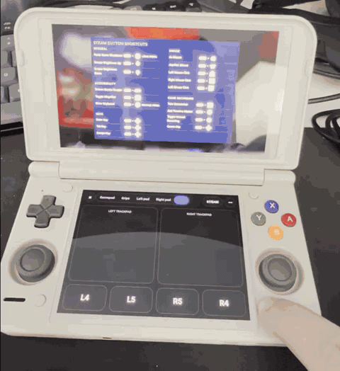

- **Sleep that actually sleeps:** in overnight testing, a game left suspended lost only **2%** battery

  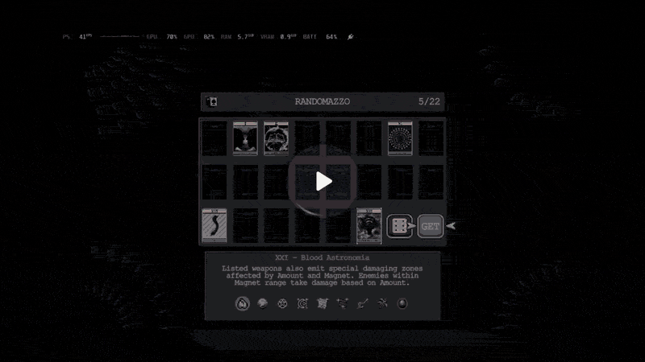

- **Xbox Cloud Gaming:** stream a game straight from its page, with no install, and an optional native player with DroidDeck’s frame generation

  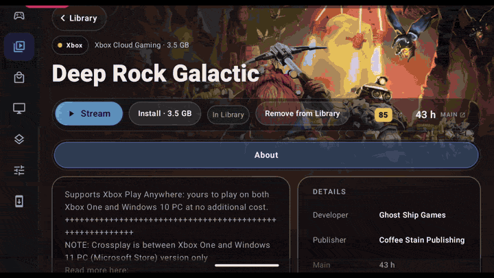

- **Battle.net** as a store, with games installing straight from Stores

  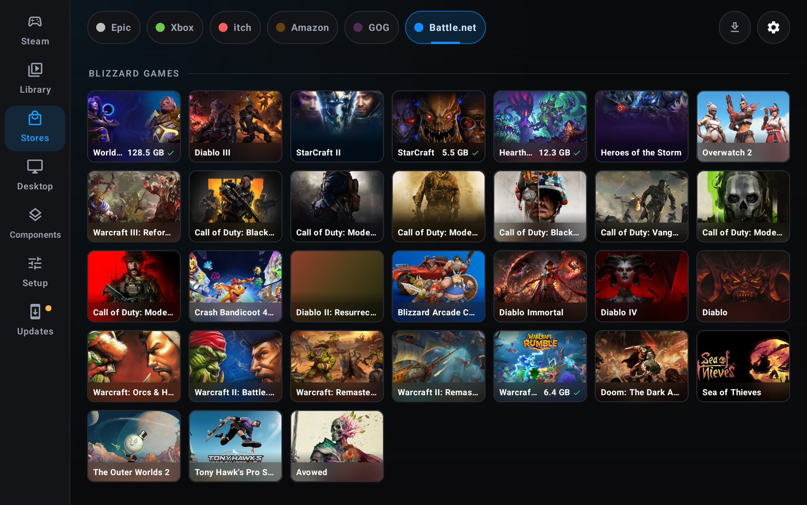

- **The full Ubuntu desktop experience:** Ubuntu 26.04 LTS with Kubuntu’s Plasma, Discover, `apt`, Flatpak and Snap. Your Android keyboard and your Android Downloads and Documents folders work right on the desktop

  
  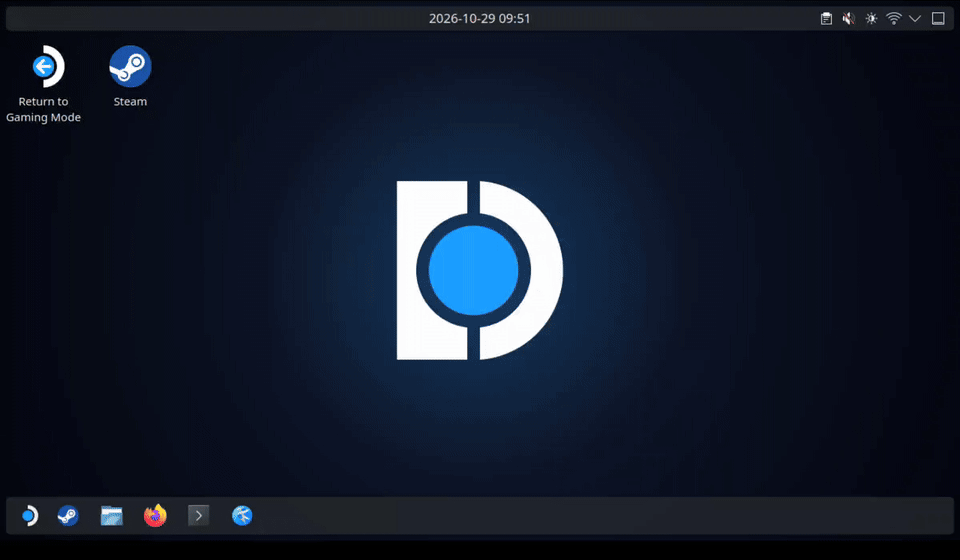

- **Dual-screen handhelds** like the Retroid Pocket Duo and AYN Thor now use their second screen: the launcher’s menu and the keyboard move to the bottom screen while the top screen updates live, and the in-game menu can open there too

  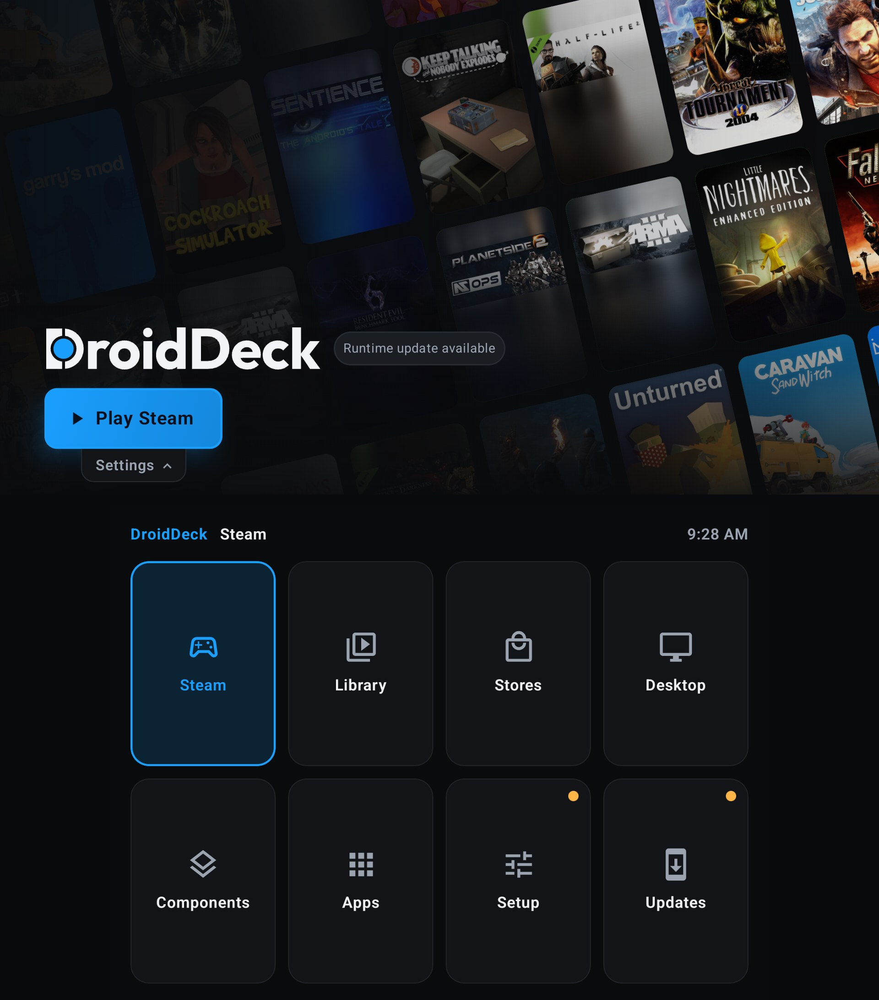
  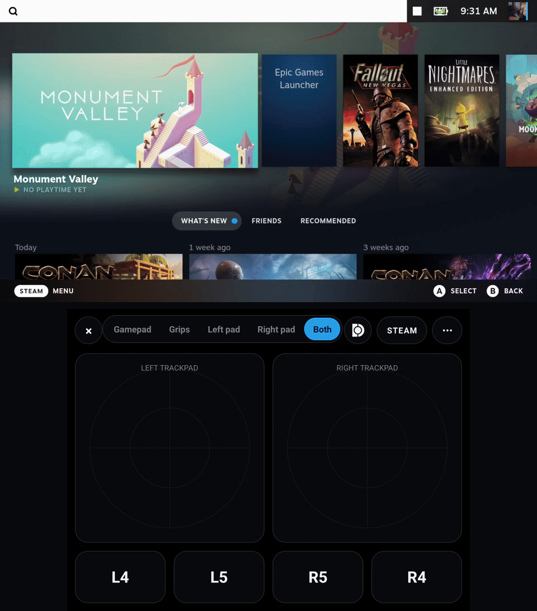

- A much bigger **itch.io** store, and **GOG** updates, repair and offline patches

- **DroidDeck HUD**, a new custom HUD to complement MangoHud, with lots of customizability

  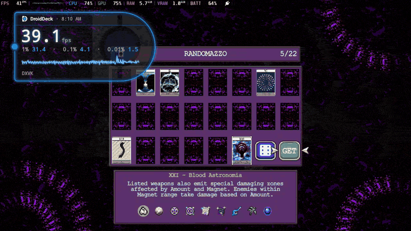

- **Portrait mode** for the launcher and for sessions, plus a much improved **Android app and widget launcher**: search, sorting, filters, folders and resizable widgets

  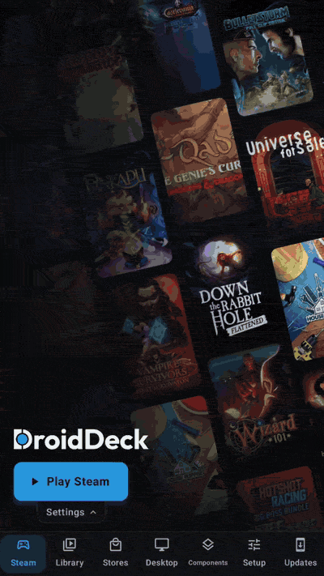
  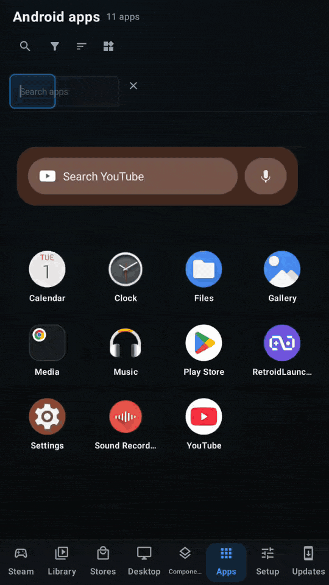

- **Increased performance**, **lower power draw when you cap the frame rate**, and **reduced heat**

  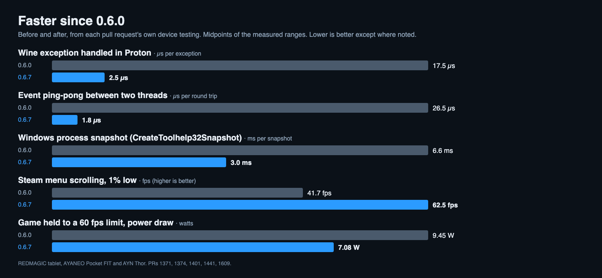

### Features

- Merged **Games and the store libraries into one Library**, with **one game page for every source**. The Library lists the games you have installed and, in the same grid, the games you own in each store you are signed in to, split into **Installed** and **Not installed**. Source chips (Steam, GOG, Epic, Amazon, Xbox, itch, Added) filter the list, and LB and RB switch between them. A **Filter** menu next to Sort picks **Installed only** or **All owned games** and remembers the choice, and the source tabs follow the order set in Stores. Stores is now only for getting games. The game page has About, Achievements, Launch, Saves & cloud and Install tabs, works fully with a d-pad, and takes Xbox installs and content management with it. Store games show their download size and installed size again, and the filter stays available when the Stores tab is turned off. (@xXJSONDeruloXx, [#1460](https://github.com/Droid-Deck/DroidDeck/pull/1460), [#1586](https://github.com/Droid-Deck/DroidDeck/pull/1586), [#1591](https://github.com/Droid-Deck/DroidDeck/pull/1591), [#1700](https://github.com/Droid-Deck/DroidDeck/pull/1700))

  
  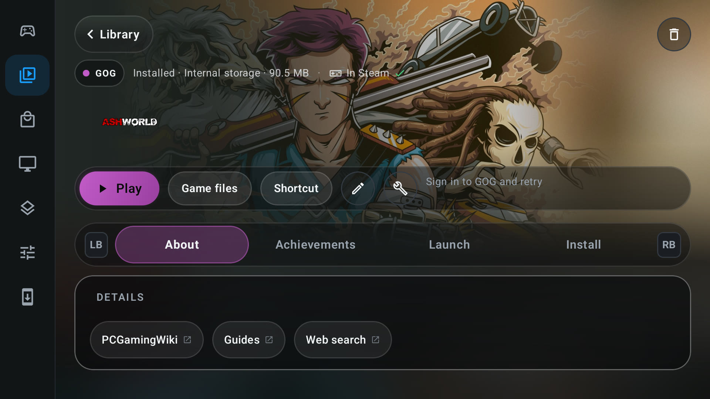
  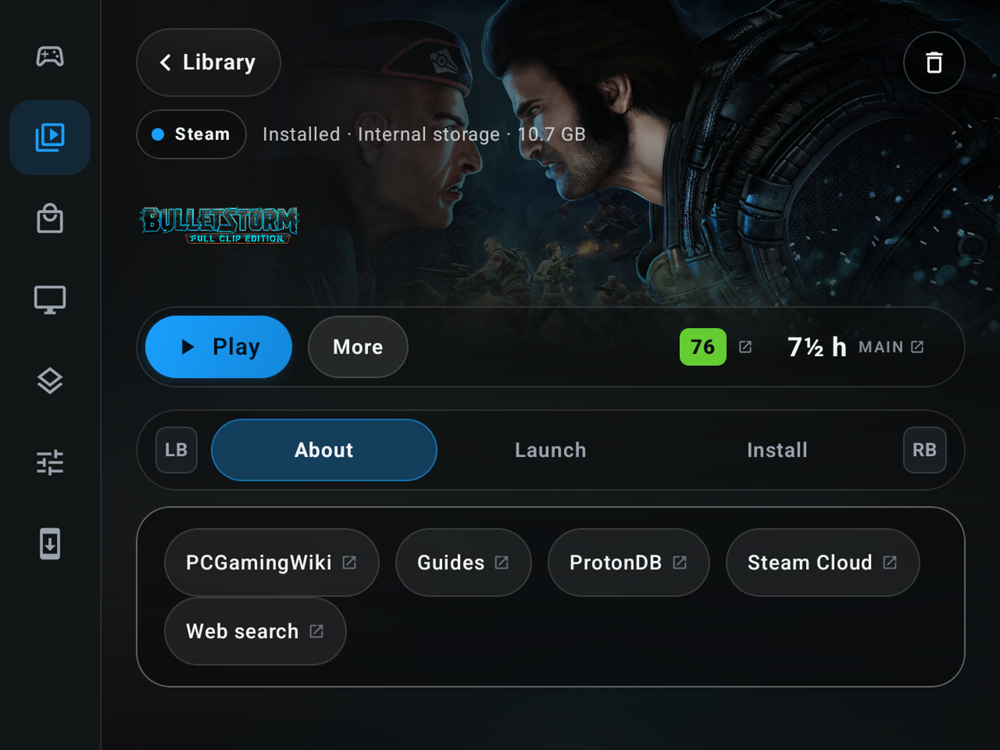
  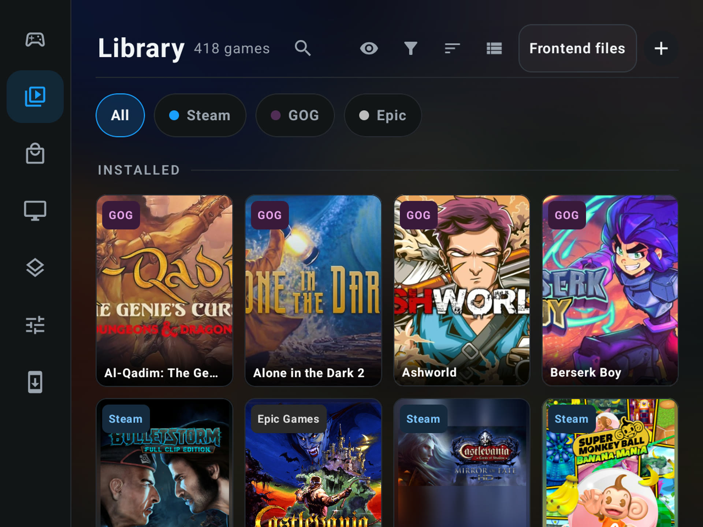

- **Making your handheld feel like a native SteamOS install.** This is a whole group of changes with one goal. **Steam’s brightness and volume sliders now control the device’s real brightness and media volume**, and changes you make on the device show up in Steam. The volume buttons show **Steam’s volume indicator instead of Android’s**, and holding a volume key moves the slider in steady steps. **Native Steam Input chords** work too: holding the **Back** button acts like the QAM button on a real Steam Deck, with Steam’s own shortcut list on screen. Left bumper zooms, right bumper takes a screenshot, the left stick up or down changes the brightness, and holding B force quits the running game. A tap of Back still opens the session menu, and a double tap still swaps it, with a **Double-tap window** setting from 100 to 800 ms. It is all set up in one place, a **Steam integration** group in Setup > Overview (and in the Steam settings sheet), with switches for Wi-Fi names, brightness, DroidDeck as Home and Home button shortcuts. Holding Home sends the Steam Guide button, including on Retroid Nova pads, and the AYN button on the Thor keeps opening AYN’s panel. (@xXJSONDeruloXx, [#1621](https://github.com/Droid-Deck/DroidDeck/pull/1621), [#1628](https://github.com/Droid-Deck/DroidDeck/pull/1628), [#1632](https://github.com/Droid-Deck/DroidDeck/pull/1632), [#1637](https://github.com/Droid-Deck/DroidDeck/pull/1637), [#1643](https://github.com/Droid-Deck/DroidDeck/pull/1643), [#1674](https://github.com/Droid-Deck/DroidDeck/pull/1674), [#1689](https://github.com/Droid-Deck/DroidDeck/pull/1689), [#1704](https://github.com/Droid-Deck/DroidDeck/pull/1704), [#1731](https://github.com/Droid-Deck/DroidDeck/pull/1731))

  
  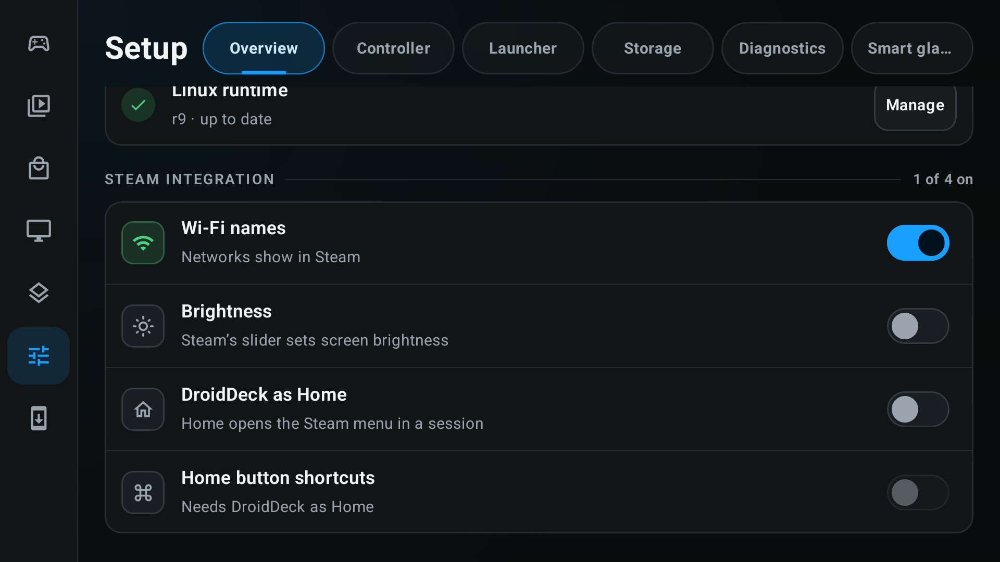 Overview with the Steam integration group: Wi-Fi names, Brightness, DroidDeck as Home and Home button shortcuts">

- **Art-first cards.** Library and store cards are now just the game's art, with the name and size on a slim fade across the bottom and a corner chip for updates, resumes and download percent. A new **Display** menu in both headers sets the card size in five steps and shows or hides the title and the size. Banner art is trimmed at the sides and portrait art sits over a blurred fill, so nothing is cropped to a near match. (@xXJSONDeruloXx, [#1744](https://github.com/Droid-Deck/DroidDeck/pull/1744), [#1747](https://github.com/Droid-Deck/DroidDeck/pull/1747))
- The **game page now uses the game's art as its backdrop**, with frosted capsules for Install, Play and the game's other actions, Metacritic and HowLongToBeat beside them, and a full-width tab bar. On the 4:3 layout Game files, Proton prefix, Shortcut and Edit art collapse into a **More** menu. (@xXJSONDeruloXx, [#1738](https://github.com/Droid-Deck/DroidDeck/pull/1738))
- Game pages in the Library and in Stores get a row of **resource links**: PCGamingWiki, guides and a web search, plus ProtonDB and Steam Cloud for Steam games. The links work with a controller. (@xXJSONDeruloXx, [#1630](https://github.com/Droid-Deck/DroidDeck/pull/1630))
- A new **Sidebar labels** toggle in Setup > Launcher. It is off by default, which gives the slim icon-only rail, and turning it on shows names under the icons. (@xXJSONDeruloXx, [#1749](https://github.com/Droid-Deck/DroidDeck/pull/1749))

  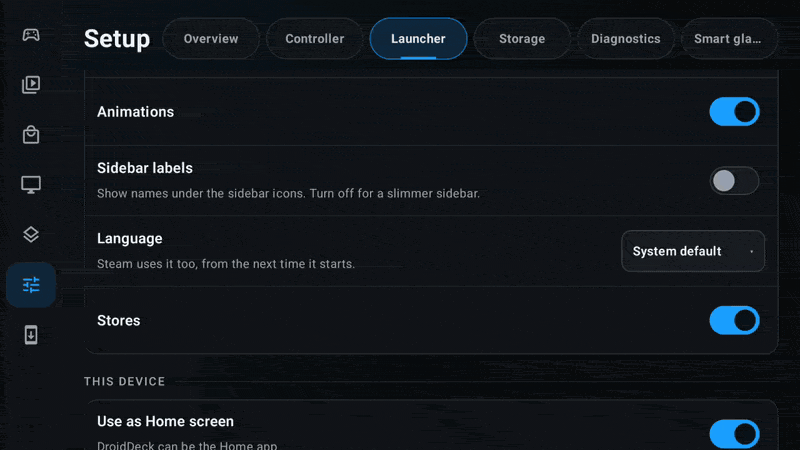 Launcher, the rail widening to show names">

- Added **Xbox Cloud Gaming**. Stream Xbox games from their store page or the Games tab, with the web player by default and an opt-in **native player** on Android 10 and up that runs DroidDeck's own frame generation on the stream (DD-FG 2x and LSFG 2x, 3x and 4x), with a frame-rate target from 10 to 165 fps. The Xbox library gets a Cloud filter next to All, Owned and Game Pass. Xbox games also run with the 0.2.12 Xbox backend. You do not need to install a game to play it: add it to your Library from its page and press **Stream**. The in-stream menu has screen effects, stream quality and a performance overlay with fps, ping, bitrate and decode time. (@The412Banner, @devSharaku, [#1531](https://github.com/Droid-Deck/DroidDeck/pull/1531), [#1729](https://github.com/Droid-Deck/DroidDeck/pull/1729))

  
  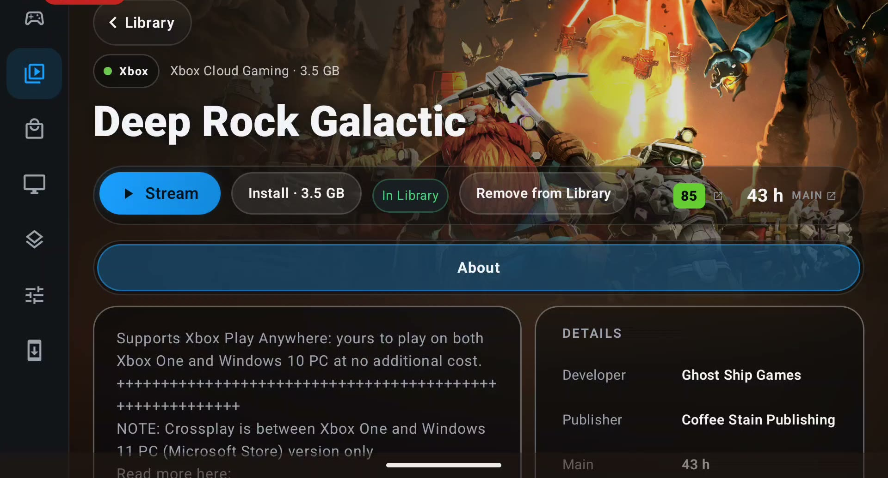
  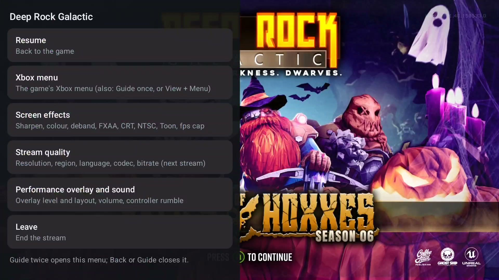
  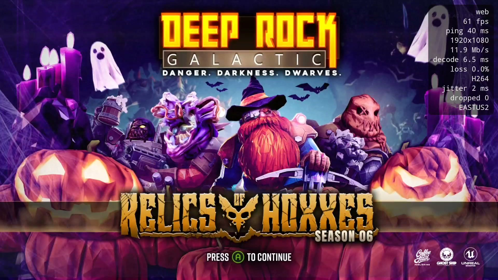

- Added **Battle.net** as a store. It runs Blizzard’s real client in its own Proton prefix, with its games in the Library, Steam and the desktop, and the memory options Diablo IV and Diablo II: Resurrected need on an 11 GB phone. Games then **install straight from Stores**, with a location picker, downloads in the Downloads tab, pause and resume, updates and uninstall, and no Battle.net window to babysit. The catalog shows as a grid that scrolls, and games the Battle.net Agent no longer tracks stay out of the Library. (@kayakyakr, @maxjivi05, [#979](https://github.com/Droid-Deck/DroidDeck/pull/979), [#1602](https://github.com/Droid-Deck/DroidDeck/pull/1602), [#1610](https://github.com/Droid-Deck/DroidDeck/pull/1610), [#1611](https://github.com/Droid-Deck/DroidDeck/pull/1611))

  

- **GOG updates, repair and offline patches.** Installed GOG games get automatic update checks, depot updates, repair that reuses verified chunks, Galaxy delta patches that fall back to verified chunks, recovery journals, and standalone patches run through Proton. Saves, prefixes, shortcuts and settings are kept, and DLC you newly own is not installed on its own. (@xXJSONDeruloXx, [#1722](https://github.com/Droid-Deck/DroidDeck/pull/1722))
- The **itch.io store is much bigger**. The Store tab browses by sort and price with paging and a disk cache, filters by platform and tag, and opens a version picker when you install, which also installs free games you do not own yet. Collections filter the Library, and installed games are checked for updates, which install safely into a staging folder first. (@FX192, [#1473](https://github.com/Droid-Deck/DroidDeck/pull/1473), [#1497](https://github.com/Droid-Deck/DroidDeck/pull/1497), [#1503](https://github.com/Droid-Deck/DroidDeck/pull/1503), [#1597](https://github.com/Droid-Deck/DroidDeck/pull/1597), [#1665](https://github.com/Droid-Deck/DroidDeck/pull/1665))
- A **new custom DroidDeck HUD to complement MangoHud**, with lots of customizability. Tap it to cycle Full, Tiles, Pill, Minimal and Mega, drag it to move it and long-press to lock it. The Performance HUD page in the in-game menu sets size, opacity, colors, outline, which readouts show and °C or °F, and exports a diagnostics report. It reads the same numbers as Steam’s MangoHud overlay, so the two agree. (@The412Banner, [#1743](https://github.com/Droid-Deck/DroidDeck/pull/1743))

  
  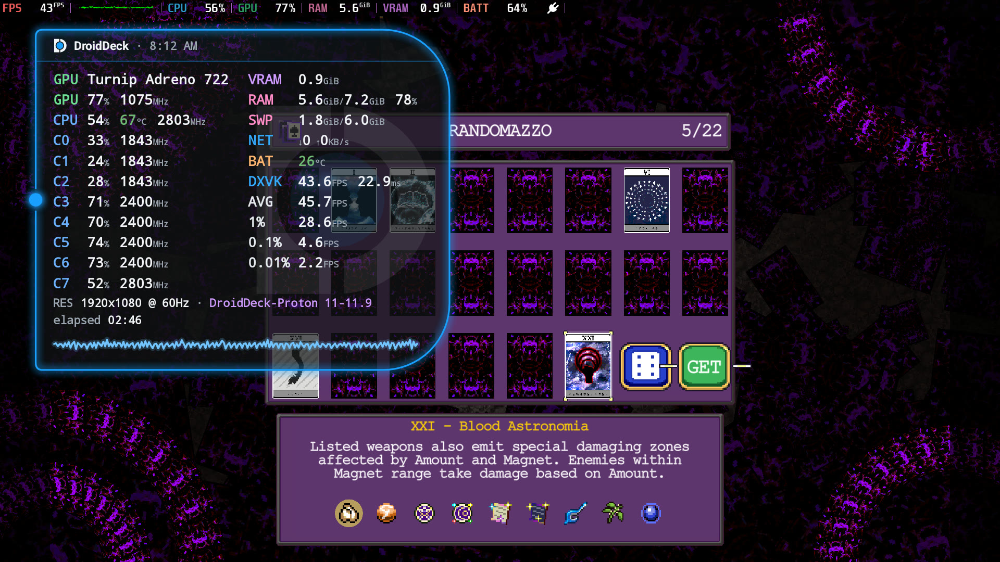

- **DroidDeck-Proton is now the default Proton.** It is downloaded once the runtime is set up, kept up to date, and each update replaces the older build without losing prefixes, game profiles or pinned choices. Picking Proton Experimental again afterwards sticks. **Other installed Proton builds also update themselves** when the app opens, while the device is idle on an unmetered connection, and older builds and pinned selections are kept. (@maxjivi05, @xXJSONDeruloXx, [#1540](https://github.com/Droid-Deck/DroidDeck/pull/1540), [#1510](https://github.com/Droid-Deck/DroidDeck/pull/1510))
- The **Apps page is now a launcher home**, with search, filters and sorting, an A–Z scroller, folders, widgets, app shortcuts, hidden apps, swiping between pages, and pin requests from other apps. It lists work-profile apps too. (@xXJSONDeruloXx, [#1686](https://github.com/Droid-Deck/DroidDeck/pull/1686))

  
- **Portrait is now supported** in two independent places. The launcher can follow device rotation or stay in portrait, with navigation along the bottom edge. Steam, game and desktop sessions can use Portrait or follow device rotation on their own, and **Controls below the game** places a landscape game above the touch controls on portrait phones and handhelds. (@xXJSONDeruloXx, [#1606](https://github.com/Droid-Deck/DroidDeck/pull/1606), [#1612](https://github.com/Droid-Deck/DroidDeck/pull/1612), [#1677](https://github.com/Droid-Deck/DroidDeck/pull/1677))

  
  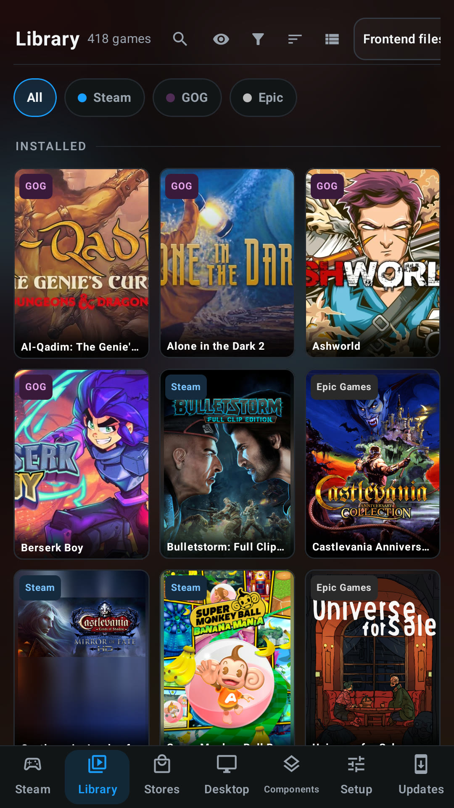
  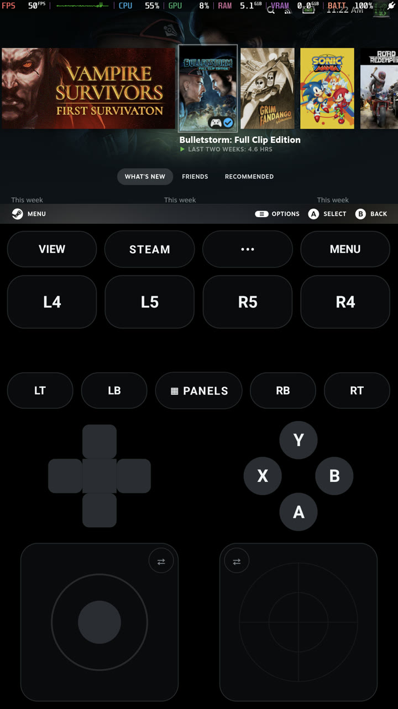

- **Dual-screen handhelds** such as the Retroid Pocket Duo and AYN Thor use their second screen. The launcher’s sections move to a menu on the bottom screen, and L2 and R2 switch them. Text fields type on the bottom screen while the top updates live. In a session, the trackpad and keyboard or the Deck controls open on the bottom screen, and **Bottom screen menu** opens the in-game menu there, so the game keeps the whole top screen. Steam’s text fields open the Android keyboard on the bottom screen instead of covering the game. Setup > Launcher has **Dual screen** (Automatic, On, Off) and the bottom screen switches; devices with one screen are unchanged. (@maxjivi05, [#1734](https://github.com/Droid-Deck/DroidDeck/pull/1734))

  
  

- **The Linux runtime is now Ubuntu 26.04 LTS**, with **Kubuntu’s Plasma desktop as a separate download** that adds only the files it needs; removing it puts the runtime back. `sudo`, `apt` and Discover work, with apt, Flatpak and Snap, and the packages and sources you add come back after a runtime update. DroidDeck’s Mesa, KWin and gamescope are held, so `apt full-upgrade` cannot replace them. Tapping a text field on the desktop opens the Android keyboard, and `~/Downloads` and `~/Documents` are Android’s folders. (@maxjivi05, @kingokksa, [#1733](https://github.com/Droid-Deck/DroidDeck/pull/1733))

  
  

- The Kubuntu desktop’s default layout is now **one bottom panel** with Kickoff, the task manager and the system tray, instead of a top bar. Existing desktops keep the layout they have. (@maxjivi05, [#1772](https://github.com/Droid-Deck/DroidDeck/pull/1772))

- The **child-process limit is fixed with a guide**. “Fix it for me” opens a floating pairing guide over Android Settings that ticks off each Wireless debugging step as it happens, and with developer options off a shorter guide turns them on first. (@xXJSONDeruloXx, [#1682](https://github.com/Droid-Deck/DroidDeck/pull/1682), [#1726](https://github.com/Droid-Deck/DroidDeck/pull/1726))

  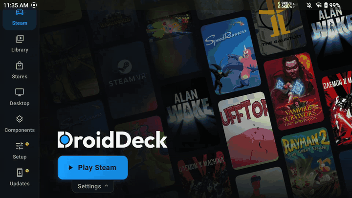
- **Suspend and sleep are far more efficient.** In overnight testing, a game left suspended lost only **2%** battery. The microphone is released before a session freezes, so the device can really sleep (before, a Thor held the audio-input wake lock for 9 hours with no kernel suspend and a flat 120 mA draw), controller rumble stops when the device sleeps, the Steam logs are no longer re-read after every stop (that kept a core busy for about 45 s), and the zRAM step waits until the game window is focused. A **Pause** button and a paused-frame card, below, let you hold a session on purpose. (@xXJSONDeruloXx, @maxjivi05, @0x1Nawaf, [#1389](https://github.com/Droid-Deck/DroidDeck/pull/1389), [#1668](https://github.com/Droid-Deck/DroidDeck/pull/1668), [#1505](https://github.com/Droid-Deck/DroidDeck/pull/1505), [#1406](https://github.com/Droid-Deck/DroidDeck/pull/1406))

- Added a **Pause button to the session menu**. It pauses in every Background behavior and holds until you press Resume, even if you leave the app and return. The paused session is now shown as a grey card of the last frame with a glass Resume button. (@xXJSONDeruloXx, [#1701](https://github.com/Droid-Deck/DroidDeck/pull/1701), [#1403](https://github.com/Droid-Deck/DroidDeck/pull/1403))

  

- Added a **microphone toggle** to the session menu for sessions started with microphone support. While it is off, Steam’s voice capture stops. (@xXJSONDeruloXx, [#1506](https://github.com/Droid-Deck/DroidDeck/pull/1506))
- Added **on-screen keys for any key or key combo** such as Ctrl+C, F5 or Tab, placed anywhere over the session. They work in Steam and non-Steam sessions with either on-screen pad. (@kingokksa, [#1305](https://github.com/Droid-Deck/DroidDeck/pull/1305))

  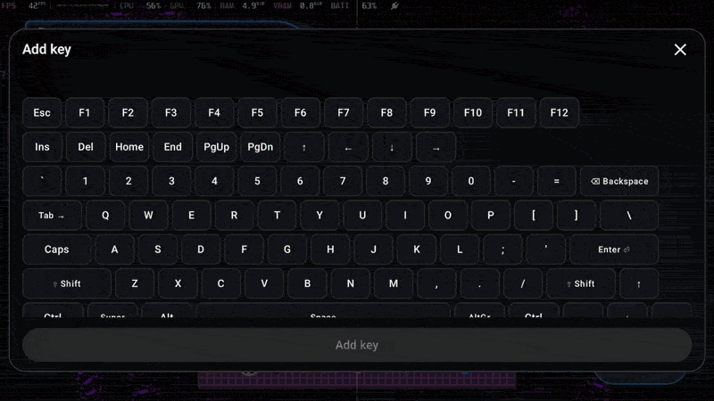

- Added an **Inner Gamer** RGB theme whose accent walks around the color wheel, with a Speed slider. The color picker’s hex box also stays above the keyboard now. (@FX192, [#1365](https://github.com/Droid-Deck/DroidDeck/pull/1365))

  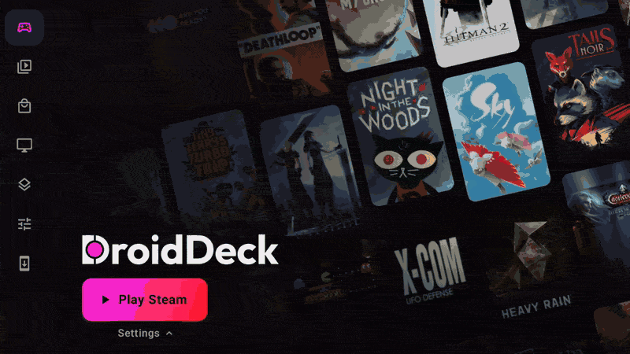

- **Per-game CPU cores.** A game profile can set `DROIDDECK_GAME_CORES` (for example `0-4`), so a light game does not wake every core. Windows games now see only the cores they are pinned to, and **Windows CPU 0 is a fast core**, which doubled GTA IV from 32 to 64 fps in testing. (@xXJSONDeruloXx, @maxjivi05, @The412Banner, [#1566](https://github.com/Droid-Deck/DroidDeck/pull/1566), [#1635](https://github.com/Droid-Deck/DroidDeck/pull/1635), [#1697](https://github.com/Droid-Deck/DroidDeck/pull/1697))
- Added **Performance > Memory** sliders for a **RAM cap** and a **VRAM cap**, and a switch to **keep Steam uncompressed while a game runs** for phones that kill the session after the zRAM step. (@jazzyjamesgames, @xXJSONDeruloXx, [#1537](https://github.com/Droid-Deck/DroidDeck/pull/1537), [#1565](https://github.com/Droid-Deck/DroidDeck/pull/1565))

  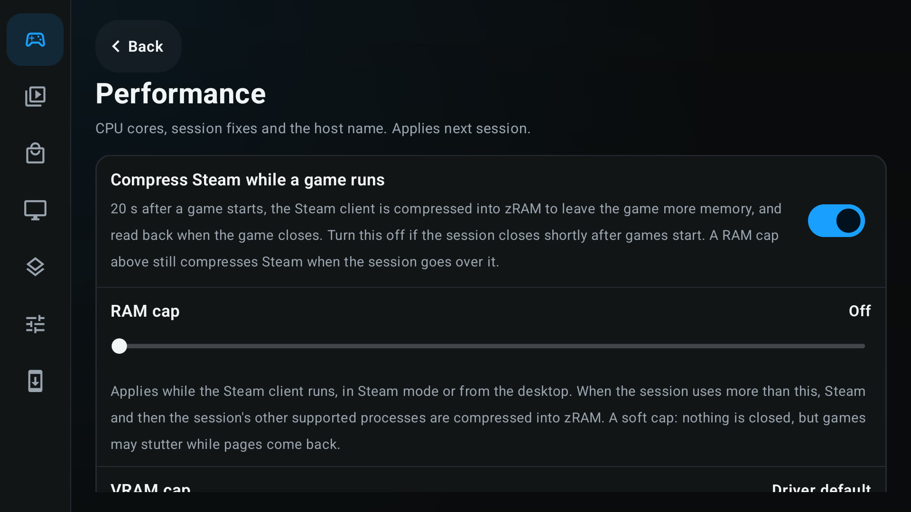 Memory with the Compress Steam switch and the RAM cap slider">

- A **Shader pre-caching** switch in the Steam settings turns Steam’s shader downloads on or off without a trip to the desktop. (@xXJSONDeruloXx, [#1400](https://github.com/Droid-Deck/DroidDeck/pull/1400))
- Added **Game debug logs** in Setup > Diagnostics. The next Proton game launch collects Wine, DXVK and VKD3D logs in the session folder, and shared logs are redacted in bounded steps. (@wallentx, [#1061](https://github.com/Droid-Deck/DroidDeck/pull/1061))

  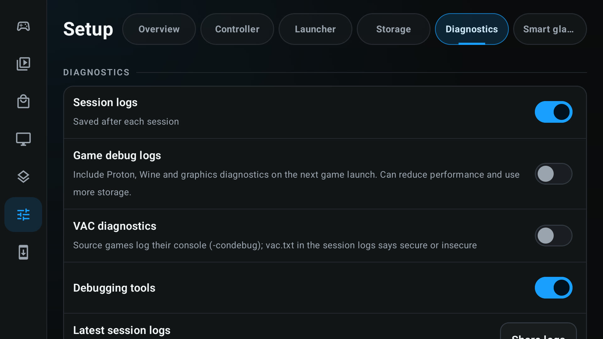 Diagnostics with the Game debug logs switch">

- **Default storage for new installs.** Setup > Storage remembers where store installs go, and USB, SD card and SSD drives that Android hides from apps are detected and offered. (@dwicao, [#1520](https://github.com/Droid-Deck/DroidDeck/pull/1520))

  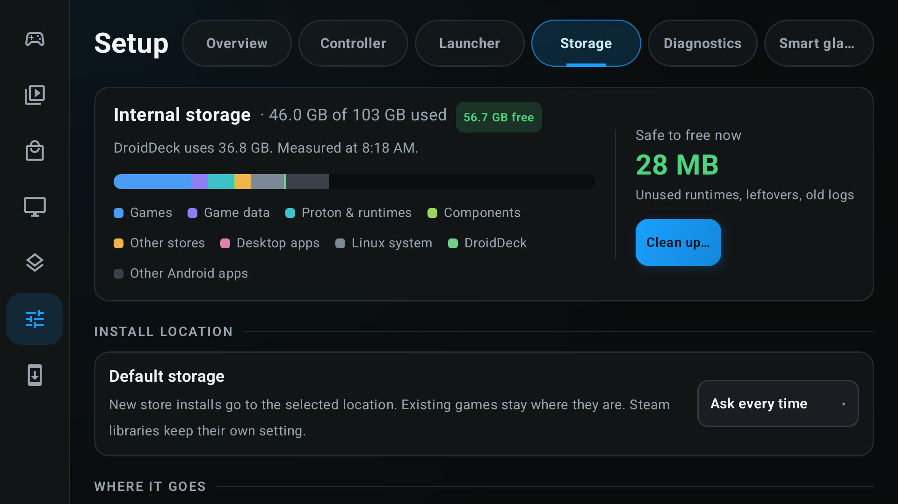 Storage with the Default storage choice">

- A **Reset prefix** button on each installed game in Storage > Game data deletes its Wine prefix so Steam recreates it on the next launch. (@xXJSONDeruloXx, [#1724](https://github.com/Droid-Deck/DroidDeck/pull/1724))

  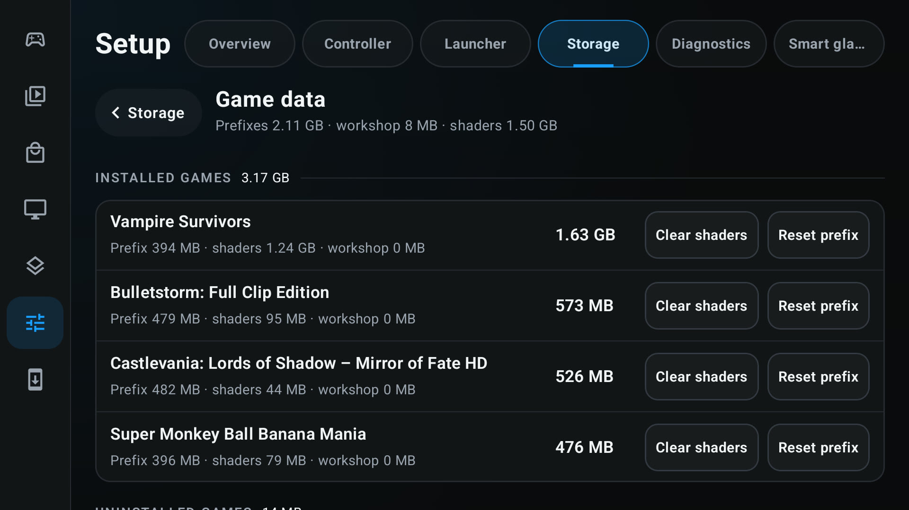 Game data with a Clear shaders and a Reset prefix button on each game">

- DroidDeck **warns when a game library drive is linked at USB 2.0 speed**, names the drive and its real-world speed, and suggests a USB 3 cable. (@maxjivi05, [#1746](https://github.com/Droid-Deck/DroidDeck/pull/1746))
- The **file manager** has Return to start and Exit buttons, and Back returns to the folder you came from, keeping up to 50 steps of history across drives. The Add Games picker can show dot-prefixed folders. (@K11MCH1, @xXJSONDeruloXx, @ZiYan416, [#1301](https://github.com/Droid-Deck/DroidDeck/pull/1301), [#1562](https://github.com/Droid-Deck/DroidDeck/pull/1562), [#1363](https://github.com/Droid-Deck/DroidDeck/pull/1363))
- An optional **HTTP proxy for downloads** in Setup > Download, for networks where GitHub’s catalogs and release downloads are reset. (@VIIII4, [#1474](https://github.com/Droid-Deck/DroidDeck/pull/1474))

  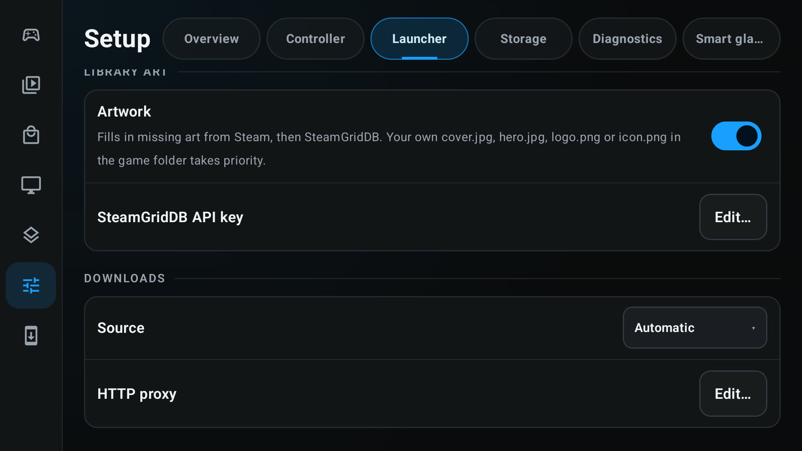

- Games can **stretch 16:9 to screens wider than 16:9** such as 20:9 phones, instead of showing black bars. (@xXJSONDeruloXx, [#1558](https://github.com/Droid-Deck/DroidDeck/pull/1558))
- The **arm64 and x86-64 Steam clients share installed games**, so a game installed in one shows as installed in the other. **Remote Play from a PC now decodes on the arm64 client.** (@maxjivi05, [#1509](https://github.com/Droid-Deck/DroidDeck/pull/1509), [#1638](https://github.com/Droid-Deck/DroidDeck/pull/1638))
- Steam’s **Browse buttons open a file chooser** for Add a Non-Steam Game, a shortcut’s target and library folders, on both the arm64 and x86-64 clients. (@maxjivi05, @xXJSONDeruloXx, [#1498](https://github.com/Droid-Deck/DroidDeck/pull/1498), [#1557](https://github.com/Droid-Deck/DroidDeck/pull/1557), [#1560](https://github.com/Droid-Deck/DroidDeck/pull/1560))
- Games the Steam client installs on Windows with an install script now **install the redistributables the script runs**, such as OpenAL for DiRT 3. (@xXJSONDeruloXx, [#1561](https://github.com/Droid-Deck/DroidDeck/pull/1561))
- **Desktop games run on the GPU** in a window of their own, and the performance HUD shows their real frame rate. (@maxjivi05, [#1584](https://github.com/Droid-Deck/DroidDeck/pull/1584), [#1608](https://github.com/Droid-Deck/DroidDeck/pull/1608))
- Launching a game while a Proton build installs now **keeps the launch on the loading screen with the installer’s progress** and continues by itself. (@xXJSONDeruloXx, [#1629](https://github.com/Droid-Deck/DroidDeck/pull/1629), [#1666](https://github.com/Droid-Deck/DroidDeck/pull/1666))
- **Low latency mode** is one switch for controller and touch input, on by default. A gamescope cursor option, off by default, is available in Performance. (@xXJSONDeruloXx, @0x1Nawaf, [#1604](https://github.com/Droid-Deck/DroidDeck/pull/1604), [#1407](https://github.com/Droid-Deck/DroidDeck/pull/1407))
- **GPU drivers:** an Adreno 740 UBWC override under GPU drivers > Advanced, and an Auto driver choice that no longer picks a Turnip build for non-Adreno GPUs. **Rokid Max 2** glasses are recognized. (@Vabian124, @Danbro007, @informalTechCode, [#1099](https://github.com/Droid-Deck/DroidDeck/pull/1099), [#1380](https://github.com/Droid-Deck/DroidDeck/pull/1380), [#1535](https://github.com/Droid-Deck/DroidDeck/pull/1535))

### Improvements

- **Performance**
  - The **latest benchmark scores**, with every performance fix since 0.6.0, are on [@The412Banner’s performance page](https://the412banner.github.io/DroidDeck/performance-mode/).
  - **Faster x86 games under FEX.** Wine’s arm64 context switches no longer go through a kernel signal, so an x86 `RaiseException` handled in Proton costs 2.2–2.7 µs instead of 14.7–20.3 µs and RDR2 makes about 47% fewer proot stops during launch. Wine’s process list reads memory counters straight from `/proc`, which cut a Windows process snapshot from 5.9–7.6 ms to 2.4–3.4 ms and RDR2’s status-file copies from about 7,000 a minute to 9. (@maxjivi05, [#1371](https://github.com/Droid-Deck/DroidDeck/pull/1371), [#1374](https://github.com/Droid-Deck/DroidDeck/pull/1374))
  - **`ntsync` is the default Wine sync and is far faster.** Event ping-pong between two threads takes 1.7–2.0 µs instead of 24–29 µs, and semaphore and mutex waits take about 0.12 µs. (@maxjivi05, [#1401](https://github.com/Droid-Deck/DroidDeck/pull/1401))
  - **Fewer syscalls through proot.** glibc’s own file calls and FEX’s raw `stat`, `readlink` and `statx` calls now use the fast path, and the fast path works on kernels older than 4.11. A session no longer starts on the slow built-in proot when the add-on pack is missing. (@xXJSONDeruloXx, @maxjivi05, @RewCrew, @0x1Nawaf, [#1687](https://github.com/Droid-Deck/DroidDeck/pull/1687), [#1757](https://github.com/Droid-Deck/DroidDeck/pull/1757), [#947](https://github.com/Droid-Deck/DroidDeck/pull/947), [#1395](https://github.com/Droid-Deck/DroidDeck/pull/1395))
  - **Smoother frame pacing.** Steam’s Frame Limit is the only frame limit and gamescope and the limit follow the screen’s refresh rate, a new frame is drawn the moment it arrives, the screen tick runs on its own thread, and gamescope repeats less work for every frame. A game held to a 60 fps limit drew 7.1 W instead of 9.5 W in testing. (@The412Banner, @xXJSONDeruloXx, @0x1Nawaf, [#1650](https://github.com/Droid-Deck/DroidDeck/pull/1650), [#1663](https://github.com/Droid-Deck/DroidDeck/pull/1663), [#1609](https://github.com/Droid-Deck/DroidDeck/pull/1609), [#1563](https://github.com/Droid-Deck/DroidDeck/pull/1563), [#1616](https://github.com/Droid-Deck/DroidDeck/pull/1616), [#1707](https://github.com/Droid-Deck/DroidDeck/pull/1707), [#1678](https://github.com/Droid-Deck/DroidDeck/pull/1678), [#1672](https://github.com/Droid-Deck/DroidDeck/pull/1672), [#1706](https://github.com/Droid-Deck/DroidDeck/pull/1706), [#1405](https://github.com/Droid-Deck/DroidDeck/pull/1405))
  - OpenGL and DirectDraw games no longer wait for each screen refresh, Steam’s D3D driver query no longer starts Wine in `compatdata/0`, and the Steam home page’s ambient motion keeps going. (@The412Banner, @xXJSONDeruloXx, [#1715](https://github.com/Droid-Deck/DroidDeck/pull/1715), [#1708](https://github.com/Droid-Deck/DroidDeck/pull/1708), [#1550](https://github.com/Droid-Deck/DroidDeck/pull/1550), [#1592](https://github.com/Droid-Deck/DroidDeck/pull/1592))
  - **Snapdragon 8 Gen 2 no longer pins Steam to one core by default**, which lifted the Steam menu’s 1% low from 41.7 fps to 62.5 fps in testing. (@maxjivi05, [#1441](https://github.com/Droid-Deck/DroidDeck/pull/1441))
  - DD-FG skips the flow images it never uses, **saving 9 to 37 MiB**, the Steam artwork scan lists each directory once, GPU stats keep working while clocks are pinned, and Steam’s shader setting is read off the main thread. (@ddd-ms, @xXJSONDeruloXx, [#1556](https://github.com/Droid-Deck/DroidDeck/pull/1556), [#1466](https://github.com/Droid-Deck/DroidDeck/pull/1466), [#1416](https://github.com/Droid-Deck/DroidDeck/pull/1416), [#1482](https://github.com/Droid-Deck/DroidDeck/pull/1482))
  - Adding games to Steam is quicker because the launch no longer rescans the whole library. (@kingokksa, [#1595](https://github.com/Droid-Deck/DroidDeck/pull/1595))
  - The hidden **Epic Games Launcher** kept open for sign-in no longer loads its Store and Fab pages while an Epic game runs, which had used about a core each and grown past 1 GB, and it is compressed while games run. (@maxjivi05, [#1764](https://github.com/Droid-Deck/DroidDeck/pull/1764))
- **Steam client download** resumes, retries, shows megabytes and no longer pauses out of sight, which finishes the first Steam setup on a slow connection. (@maxjivi05, [#587](https://github.com/Droid-Deck/DroidDeck/pull/587))
- **Focus glide** is consistent across primary buttons, dialogs, popup menus and more controls, grid scrolling moves one row at a time, and Nova layouts have scrolling store tabs and full portrait art. (@xXJSONDeruloXx, [#1588](https://github.com/Droid-Deck/DroidDeck/pull/1588), [#1750](https://github.com/Droid-Deck/DroidDeck/pull/1750), [#1574](https://github.com/Droid-Deck/DroidDeck/pull/1574))
- Steam’s battery reading is **100% while charging** instead of 99%. (@xXJSONDeruloXx, [#1577](https://github.com/Droid-Deck/DroidDeck/pull/1577))
- New sessions **follow automatic rotation, Native background behavior and automatic Picture-in-Picture** by default. (@maxjivi05, @xXJSONDeruloXx, [#1420](https://github.com/Droid-Deck/DroidDeck/pull/1420), [#1727](https://github.com/Droid-Deck/DroidDeck/pull/1727))
- Sessions started without Steam **show the game’s settings in the menu** and use the launch options set in Steam’s Properties. (@kingokksa, @xXJSONDeruloXx, [#1113](https://github.com/Droid-Deck/DroidDeck/pull/1113), [#1552](https://github.com/Droid-Deck/DroidDeck/pull/1552))
- A **failed Steam client start** now explains itself: the arm64 client falls back to Valve’s stable build when the beta one keeps failing, and Illegal-instruction and Vulkan failures say what to do. (@ovurrsl, @Danbro007, [#1340](https://github.com/Droid-Deck/DroidDeck/pull/1340), [#1380](https://github.com/Droid-Deck/DroidDeck/pull/1380))
- **Translations:** Arabic text that mixes in English words reads right to left. (@maxjivi05, [#1568](https://github.com/Droid-Deck/DroidDeck/pull/1568))
- **Building and testing DroidDeck** is faster and safer. CI runs its checks in parallel, reuses verified runtime components, avoids history blobs and the release-note GIFs, and retries network flakes. Contributors listed in `.github/trusted-test-builds.txt` get release-signed test builds for their fork PRs, and `tools/deploy_fast.py` grafts session helper changes into the latest main APK. A PRoot profiler can test fast-path libraries without an APK rebuild, Podman and x86 hosts can build, and the LICENSE notice names DroidDeck. (@xXJSONDeruloXx, @maxjivi05, @angelrenefm, @superboo07, @The412Banner, [#1409](https://github.com/Droid-Deck/DroidDeck/pull/1409), [#1412](https://github.com/Droid-Deck/DroidDeck/pull/1412), [#1417](https://github.com/Droid-Deck/DroidDeck/pull/1417), [#1719](https://github.com/Droid-Deck/DroidDeck/pull/1719), [#1725](https://github.com/Droid-Deck/DroidDeck/pull/1725), [#1735](https://github.com/Droid-Deck/DroidDeck/pull/1735), [#1737](https://github.com/Droid-Deck/DroidDeck/pull/1737), [#1739](https://github.com/Droid-Deck/DroidDeck/pull/1739), [#1646](https://github.com/Droid-Deck/DroidDeck/pull/1646), [#1721](https://github.com/Droid-Deck/DroidDeck/pull/1721), [#1528](https://github.com/Droid-Deck/DroidDeck/pull/1528), [#1527](https://github.com/Droid-Deck/DroidDeck/pull/1527), [#1440](https://github.com/Droid-Deck/DroidDeck/pull/1440), [#1741](https://github.com/Droid-Deck/DroidDeck/pull/1741), [#1690](https://github.com/Droid-Deck/DroidDeck/pull/1690), [#1694](https://github.com/Droid-Deck/DroidDeck/pull/1694), [#1423](https://github.com/Droid-Deck/DroidDeck/pull/1423), [#1435](https://github.com/Droid-Deck/DroidDeck/pull/1435), [#1545](https://github.com/Droid-Deck/DroidDeck/pull/1545), [#1767](https://github.com/Droid-Deck/DroidDeck/pull/1767))

### Fixed

- Fixed **Steam on ROMs that refuse the Android ID read**, the Android 14 Redmi K70 bug where tapping Steam dropped back to the main screen. (@maxjivi05, [#1421](https://github.com/Droid-Deck/DroidDeck/pull/1421))
- Fixed **other apps recording game audio** (DroidDeck now opts in to playback capture). (@maxjivi05, [#1430](https://github.com/Droid-Deck/DroidDeck/pull/1430))
- Fixed **the app staying in one landscape side** since 0.6.0 even with auto-rotate on. (@maxjivi05, [#1420](https://github.com/Droid-Deck/DroidDeck/pull/1420))
- Fixed **Ubisoft games**: Ubisoft Connect installs again from Steam’s install script, and its overlay is turned off so games stop crashing about 12 seconds after launch. (@maxjivi05, [#1449](https://github.com/Droid-Deck/DroidDeck/pull/1449), [#1463](https://github.com/Droid-Deck/DroidDeck/pull/1463))
- Fixed games that need **D3D12 feature level 12_1**: Caravan SandWitch starts, Cyberpunk 2077 gets past ray tracing setup, and RoboCop: Rogue City and ReSkate run. (@maxjivi05, @xXJSONDeruloXx, [#1431](https://github.com/Droid-Deck/DroidDeck/pull/1431), [#1553](https://github.com/Droid-Deck/DroidDeck/pull/1553), [#1641](https://github.com/Droid-Deck/DroidDeck/pull/1641))
- Fixed **Unity and Godot games**: FEX’s TSO stays on for Unity games, and Godot games that are not .NET keep Sentry. (@coffeemeist3r, @maxjivi05, [#1415](https://github.com/Droid-Deck/DroidDeck/pull/1415), [#1626](https://github.com/Droid-Deck/DroidDeck/pull/1626))
- Fixed more **game-specific starts**: Skyrim’s voice lines play with XACT audio, World of Warcraft starts on DirectX 11, StarCraft starts its 32-bit client and keeps your FEX and DXVK choices on later Proton builds, Black Ops III and Dark Souls Remastered skip umu-protonfixes, The Crew 2 no longer shows a black screen because of D3DGear, and Forza Horizon 6 gets a short Xbox install path. (@xXJSONDeruloXx, @maxjivi05, @The412Banner, [#1554](https://github.com/Droid-Deck/DroidDeck/pull/1554), [#1576](https://github.com/Droid-Deck/DroidDeck/pull/1576), [#1564](https://github.com/Droid-Deck/DroidDeck/pull/1564), [#1653](https://github.com/Droid-Deck/DroidDeck/pull/1653), [#1508](https://github.com/Droid-Deck/DroidDeck/pull/1508), [#1627](https://github.com/Droid-Deck/DroidDeck/pull/1627), [#1625](https://github.com/Droid-Deck/DroidDeck/pull/1625))
- Fixed **x86 Linux programs under FEX**: names in `LD_PRELOAD` are kept, x86 AppImages packed with sharun start, and x86 programs use DroidDeck’s own FEX build. (@maxjivi05, [#1419](https://github.com/Droid-Deck/DroidDeck/pull/1419), [#1622](https://github.com/Droid-Deck/DroidDeck/pull/1622))
- Fixed **Xbox**: sign-in on phones with a slow StrongBox keystore, Xodus on external and SD storage, Minecraft for Windows starting, and a plain “sign in again” message when Microsoft rejects the download’s licenses. (@The412Banner, @xXJSONDeruloXx, @maxjivi05, [#1521](https://github.com/Droid-Deck/DroidDeck/pull/1521), [#1429](https://github.com/Droid-Deck/DroidDeck/pull/1429), [#1492](https://github.com/Droid-Deck/DroidDeck/pull/1492), [#1483](https://github.com/Droid-Deck/DroidDeck/pull/1483))
- Fixed **GOG**: Galaxy SDK cloud saves are found and written to the right folder, the offline-installer fallback extracts natively on ARM, and sign-in pages use the browser’s own user agent so Cloudflare’s check passes. (@FanGoH, @moronigranja, @diegodru, [#970](https://github.com/Droid-Deck/DroidDeck/pull/970), [#1178](https://github.com/Droid-Deck/DroidDeck/pull/1178), [#1174](https://github.com/Droid-Deck/DroidDeck/pull/1174), [#1500](https://github.com/Droid-Deck/DroidDeck/pull/1500))
- Fixed **Epic** paused installs, which keep what they downloaded and resume the rest instead of starting over. (@maxjivi05, [#1504](https://github.com/Droid-Deck/DroidDeck/pull/1504))
- Fixed **Steam Input mouse clicks, scrolling and pointer moves** not reaching games since 0.6.0. (@maxjivi05, [#1485](https://github.com/Droid-Deck/DroidDeck/pull/1485))
- Fixed **input**: on-screen controls work while the touchpad finger is down, a still Direct touch stays held unless Long press is on, Back chords no longer leak the partner’s input, Retroid Nova M1 and M2 map correctly, and queued chords are dropped when a controller disconnects. (@maxjivi05, @xXJSONDeruloXx, [#1633](https://github.com/Droid-Deck/DroidDeck/pull/1633), [#1578](https://github.com/Droid-Deck/DroidDeck/pull/1578), [#1628](https://github.com/Droid-Deck/DroidDeck/pull/1628), [#1571](https://github.com/Droid-Deck/DroidDeck/pull/1571), [#1632](https://github.com/Droid-Deck/DroidDeck/pull/1632))
- Fixed **Steam’s compatibility tool** going back to the default after you changed it in Steam, and Proton’s EasyAntiCheat and BattlEye runtimes showing up as games. (@The412Banner, @maxjivi05, [#1347](https://github.com/Droid-Deck/DroidDeck/pull/1347), [#1457](https://github.com/Droid-Deck/DroidDeck/pull/1457))
- Fixed Steam’s **Default startup movie** being replaced by DroidDeck’s animation, and **the signed-in Steam account** not being found with two accounts. (@maxjivi05, @l4nr3, [#1459](https://github.com/Droid-Deck/DroidDeck/pull/1459), [#1398](https://github.com/Droid-Deck/DroidDeck/pull/1398))
- Fixed the **desktop and KDE Steam client**: games present through software WSI and no longer close on launch, the library helper stops when the client exits, and the Desktop page no longer overlaps on phones. (@maxjivi05, [#1518](https://github.com/Droid-Deck/DroidDeck/pull/1518), [#1519](https://github.com/Droid-Deck/DroidDeck/pull/1519), [#1494](https://github.com/Droid-Deck/DroidDeck/pull/1494))
- Fixed the **performance HUD** measuring a different surface from Steam’s overlay, and the desktop-window fps. (@maxjivi05, [#1617](https://github.com/Droid-Deck/DroidDeck/pull/1617), [#1608](https://github.com/Droid-Deck/DroidDeck/pull/1608))
- Fixed **stored components** that could not be deleted after a Proton update, left their originals behind when a Proton was removed, or were refused as in use. (@maxjivi05, @ovurrsl, [#1434](https://github.com/Droid-Deck/DroidDeck/pull/1434), [#1481](https://github.com/Droid-Deck/DroidDeck/pull/1481), [#1144](https://github.com/Droid-Deck/DroidDeck/pull/1144))
- Fixed **Flatpak**, which now runs on the Ubuntu runtime: apps see the device’s network so WebRTC streams connect, `flatpak ps` and `flatpak kill` see running apps and stop their whole sandbox, sandboxed shortcuts are focused in gaming mode, setup clears a package lock left by an interrupted run, and it says why setup failed. (@maxjivi05, @xXJSONDeruloXx, [#1548](https://github.com/Droid-Deck/DroidDeck/pull/1548), [#1524](https://github.com/Droid-Deck/DroidDeck/pull/1524), [#1619](https://github.com/Droid-Deck/DroidDeck/pull/1619), [#1580](https://github.com/Droid-Deck/DroidDeck/pull/1580), [#1733](https://github.com/Droid-Deck/DroidDeck/pull/1733))
- Fixed **Battle.net**: shared logs carry Battle.net’s and Blizzard’s own logs. (@maxjivi05, [#1573](https://github.com/Droid-Deck/DroidDeck/pull/1573))
- Fixed the **last-played time** of added and store games, Fill scaling and Steam magnification turning the picture black, and the Android volume panel showing over Steam’s. (@xXJSONDeruloXx, [#1551](https://github.com/Droid-Deck/DroidDeck/pull/1551), [#1634](https://github.com/Droid-Deck/DroidDeck/pull/1634), [#1689](https://github.com/Droid-Deck/DroidDeck/pull/1689))
- Fixed a **session that would not start** when the agent environment could not be prepared, and a first-run desktop or Proton install that kept downloading after Cancel. (@xXJSONDeruloXx, @ovurrsl, [#1579](https://github.com/Droid-Deck/DroidDeck/pull/1579), [#1042](https://github.com/Droid-Deck/DroidDeck/pull/1042))
- Fixed **updates and security**: Stable users are no longer moved to Nightly by a channel guess, and the update status receiver only acts on DroidDeck’s own install session. (@ovurrsl, [#1067](https://github.com/Droid-Deck/DroidDeck/pull/1067), [#1015](https://github.com/Droid-Deck/DroidDeck/pull/1015))
- Fixed **settings and storage**: chosen game art survives a Steam account switch, the session report keeps its thermal lines when one query is refused, and the prefix a Steam client made for a shortcut is reused. (@ovurrsl, @kingokksa, [#1026](https://github.com/Droid-Deck/DroidDeck/pull/1026), [#991](https://github.com/Droid-Deck/DroidDeck/pull/991), [#1107](https://github.com/Droid-Deck/DroidDeck/pull/1107))
- Fixed UI details: the Stores and Library search closes with its X or Back, a store game’s description fills the free height, the Storage summary stacks in narrow panes, the navigation highlight follows the scrolled bar and Android app icons are sharp, and the compatibility tools screen blooms in. (@maxjivi05, @xXJSONDeruloXx, [#1567](https://github.com/Droid-Deck/DroidDeck/pull/1567), [#1493](https://github.com/Droid-Deck/DroidDeck/pull/1493), [#1736](https://github.com/Droid-Deck/DroidDeck/pull/1736), [#1677](https://github.com/Droid-Deck/DroidDeck/pull/1677), [#1666](https://github.com/Droid-Deck/DroidDeck/pull/1666))
- Fixed the Steam download monitor stalling the main thread on a long content log. (@maxjivi05, [#1456](https://github.com/Droid-Deck/DroidDeck/pull/1456))
- A Linux runtime update keeps imported AppImages, script apps and catalog emulators. (@ovurrsl, [#1062](https://github.com/Droid-Deck/DroidDeck/pull/1062))
- Fixed the launch log pointing at a drawer switch that does not exist, and gesture settings showing outside gesture mode. (@DrummingBird1, @xXJSONDeruloXx, [#1354](https://github.com/Droid-Deck/DroidDeck/pull/1354), [#1654](https://github.com/Droid-Deck/DroidDeck/pull/1654))
- Games started from another launcher return to it when they close. (@maxjivi05, [#1438](https://github.com/Droid-Deck/DroidDeck/pull/1438))
- Fixed **updating Steam from Big Picture** ending the session. (@maxjivi05, [#1733](https://github.com/Droid-Deck/DroidDeck/pull/1733))
- Fixed the **DroidDeck HUD**: the Pill size shows battery level, temperature and watts on one row, and a locked HUD lets on-screen controls under it work. New HUDs start locked, and the Performance HUD settings lose an extra line of explanatory text. (@The412Banner, @xXJSONDeruloXx, [#1763](https://github.com/Droid-Deck/DroidDeck/pull/1763), [#1768](https://github.com/Droid-Deck/DroidDeck/pull/1768))
- On the **Retroid Pocket Duo**, a double press of Home opens Retroid’s quick menu during a Steam session, and its Adreno 722 shows as Supported. (@maxjivi05, [#1734](https://github.com/Droid-Deck/DroidDeck/pull/1734))

- Fixed **Steam exiting within a second on the Ubuntu runtime**, which was missing a library DD-Turnip needs to load. (@xXJSONDeruloXx, [#1773](https://github.com/Droid-Deck/DroidDeck/pull/1773))
- Fixed the **Ubuntu desktop**: Electron and Chromium apps installed from apt, such as VS Code, Discord, Obsidian, Signal and Chrome, start instead of closing right away, and desktop apps can save read-only game files such as Fallout: New Vegas’s INI. (@maxjivi05, [#1775](https://github.com/Droid-Deck/DroidDeck/pull/1775), [#1781](https://github.com/Droid-Deck/DroidDeck/pull/1781))

### Community

DroidDeck is built in the open by the people who use it. These are everyone whose code is in 0.6.7:

| Contributor | Pull requests |
|---|---|
| @xXJSONDeruloXx | 79: Library and game page, portrait, QAM sync, Steam integration, GOG maintenance, pause, mic, CI and more |
| @maxjivi05 | 67: Battle.net, DroidDeck-Proton, Ubuntu runtime, dual screens, FEX and Wine performance, game fixes and more |
| @The412Banner | 19: Xbox Cloud Gaming, DroidDeck HUD, frame pacing, gamescope performance, game fixes |
| @ovurrsl | 8: updates and security, runtime and storage fixes, Steam fallback |
| @FX192 | 6: itch.io store, Inner Gamer theme |
| @kingokksa | 4: on-screen keys, game settings without Steam, prefix reuse |
| @0x1Nawaf | 4: slow proot, frame pacing, zRAM and gamescope cursor |
| @moronigranja | 2: GOG installer fallback, GOG cloud saves |
| @ddd-ms | 2: artwork scans, DD-FG memory |
| @RewCrew | [#947](https://github.com/Droid-Deck/DroidDeck/pull/947): fast proot path on old kernels |
| @FanGoH | [#970](https://github.com/Droid-Deck/DroidDeck/pull/970): GOG Galaxy SDK cloud saves |
| @kayakyakr | [#979](https://github.com/Droid-Deck/DroidDeck/pull/979): Battle.net |
| @wallentx | [#1061](https://github.com/Droid-Deck/DroidDeck/pull/1061): game debug logs |
| @Vabian124 | [#1099](https://github.com/Droid-Deck/DroidDeck/pull/1099): Adreno 740 UBWC override |
| @K11MCH1 | [#1301](https://github.com/Droid-Deck/DroidDeck/pull/1301): file manager Return and Exit |
| @DrummingBird1 | [#1354](https://github.com/Droid-Deck/DroidDeck/pull/1354): zero-copy launch log |
| @ZiYan416 | [#1363](https://github.com/Droid-Deck/DroidDeck/pull/1363): hidden folders in the game picker |
| @Danbro007 | [#1380](https://github.com/Droid-Deck/DroidDeck/pull/1380): Turnip choice and Steam startup errors |
| @l4nr3 | [#1398](https://github.com/Droid-Deck/DroidDeck/pull/1398): signed-in Steam account |
| @coffeemeist3r | [#1415](https://github.com/Droid-Deck/DroidDeck/pull/1415): TSO for Unity games |
| @superboo07 | [#1440](https://github.com/Droid-Deck/DroidDeck/pull/1440): Xbox backend cross compilation |
| @VIIII4 | [#1474](https://github.com/Droid-Deck/DroidDeck/pull/1474): HTTP proxy for downloads |
| @diegodru | [#1500](https://github.com/Droid-Deck/DroidDeck/pull/1500): GOG sign-in user agent |
| @dwicao | [#1520](https://github.com/Droid-Deck/DroidDeck/pull/1520): default storage |
| @angelrenefm | [#1527](https://github.com/Droid-Deck/DroidDeck/pull/1527): Podman image build |
| @informalTechCode | [#1535](https://github.com/Droid-Deck/DroidDeck/pull/1535): Rokid Max 2 |
| @jazzyjamesgames | [#1537](https://github.com/Droid-Deck/DroidDeck/pull/1537): RAM and VRAM caps |
| @devSharaku | [#1729](https://github.com/Droid-Deck/DroidDeck/pull/1729): Xbox backend 0.2.12 |

<!-- Full PR lists per contributor are in contributors.md. -->

### New contributors

- @ddd-ms made their first contribution in [#1466](https://github.com/Droid-Deck/DroidDeck/pull/1466).
- @RewCrew made their first contribution in [#947](https://github.com/Droid-Deck/DroidDeck/pull/947).
- @FanGoH made their first contribution in [#970](https://github.com/Droid-Deck/DroidDeck/pull/970).
- @kayakyakr made their first contribution in [#979](https://github.com/Droid-Deck/DroidDeck/pull/979).
- @Vabian124 made their first contribution in [#1099](https://github.com/Droid-Deck/DroidDeck/pull/1099).
- @K11MCH1 made their first contribution in [#1301](https://github.com/Droid-Deck/DroidDeck/pull/1301).
- @DrummingBird1 made their first contribution in [#1354](https://github.com/Droid-Deck/DroidDeck/pull/1354).
- @ZiYan416 made their first contribution in [#1363](https://github.com/Droid-Deck/DroidDeck/pull/1363).
- @l4nr3 made their first contribution in [#1398](https://github.com/Droid-Deck/DroidDeck/pull/1398).
- @superboo07 made their first contribution in [#1440](https://github.com/Droid-Deck/DroidDeck/pull/1440).
- @VIIII4 made their first contribution in [#1474](https://github.com/Droid-Deck/DroidDeck/pull/1474).
- @diegodru made their first contribution in [#1500](https://github.com/Droid-Deck/DroidDeck/pull/1500).
- @dwicao made their first contribution in [#1520](https://github.com/Droid-Deck/DroidDeck/pull/1520).
- @jazzyjamesgames made their first contribution in [#1537](https://github.com/Droid-Deck/DroidDeck/pull/1537).
- @devSharaku made their first contribution in [#1729](https://github.com/Droid-Deck/DroidDeck/pull/1729).

[Full changelog](https://github.com/Droid-Deck/DroidDeck/compare/0.6.0...0.6.7)
