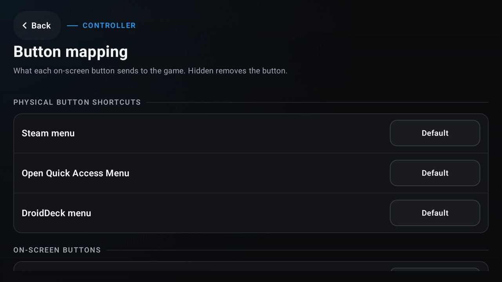

# DroidDeck 0.6.9

<!-- Maintainer check: Steam, Proton downloads and the games themselves come from Valve and the stores and are not part of DroidDeck; the intro below only claims DroidDeck's own code and the packs it builds. -->

**DroidDeck is 100% open source. No ads. No telemetry. No source withheld.**

Since 0.6.7, **4 people** sent **57 pull requests**. 26% of the pull requests came from the community. Thank you to everyone who sent code, translations, device testing and bug reports. This is a bug fix release: most of it fixes what you reported after 0.6.7. Fittingly for 0.6.9, the top and bottom screens on the Pocket Duo and AYN Thor have finally stopped fighting for dominance and learned to work together.

**0.6.9 in 30 seconds**

- **Dual-screen handhelds** like the Retroid Pocket Duo and AYN Thor no longer show “DroidDeck isn’t responding”, no longer jump back over other apps, and keep the bottom-screen panel you picked
- **Steam stops restarting at every start** to import added games, and asks first
- **Steam’s UI runs at the full refresh rate again**, with the heat fix kept, and a session left in picture-in-picture drops to **30 fps** to save battery
- **Cutscenes play again** with DroidDeck-Proton, and the **x86-64 Steam client** starts again on the Ubuntu runtime
- **Windows components survive runtime updates**, and the **Linux runtime updates by itself**
- **Xbox games run from their own folder** again, so Doom 64 and Unity games start
- **Banking apps** open again: Android listed DroidDeck’s optional Home button accessibility service even while it was off, which some banking apps block. It never reads your screen
- New: **controller button shortcuts**, a **frame limit for games started without Steam**, and a **DroidDeck HUD** you can pinch to resize and dock as an FPS tab

### Features

- Added **controller button shortcuts**: physical buttons can open Steam, Quick Access or DroidDeck’s menus, set per controller, with a reset. Buttons you leave unassigned work as before. Find them in Setup > Controller > Button mapping. (@jmarti326, [#1202](https://github.com/Droid-Deck/DroidDeck/pull/1202))

  
- Added a **Frame limit** for games started without Steam, on the Display page of the session drawer: Off, 30, 40, 45, 60, 90 or 120 fps. It applies live and lasts for the session. Steam games keep Steam’s own Frame Limit. (@xXJSONDeruloXx, [#1813](https://github.com/Droid-Deck/DroidDeck/pull/1813))
- The HUD is now **DroidDeck HUD**. **Pinch with two fingers to resize it** from 50% to 200%, and **drag it past a screen edge to dock it as a small FPS tab**. (@xXJSONDeruloXx, [#1868](https://github.com/Droid-Deck/DroidDeck/pull/1868))
- **x86_64 Flatpak apps run through FEX**. The r2modman bundle starts and loads its list of 334 games on a RedMagic Astra 2, and Flathub installs fall back to an app’s x86_64 build when it has no ARM one. A bundle built for an architecture DroidDeck cannot run is refused with a clear message before it downloads. (@maxjivi05, [#1875](https://github.com/Droid-Deck/DroidDeck/pull/1875), [#1873](https://github.com/Droid-Deck/DroidDeck/pull/1873))
- The **Linux runtime updates by itself** when a new one is out, never during a game or desktop session. (@maxjivi05, [#1787](https://github.com/Droid-Deck/DroidDeck/pull/1787))
- **itch.io updates download as patches** for games with butler builds, instead of the whole game again. (@FX192, [#1829](https://github.com/Droid-Deck/DroidDeck/pull/1829))
- The desktop’s fastfetch shows the **DroidDeck mark** as its logo. (@xXJSONDeruloXx, [#1778](https://github.com/Droid-Deck/DroidDeck/pull/1778))

### Improvements

- **.NET games start faster**: they keep the FEX preset’s multiblock setting, so Stardew Valley starts in **45 s instead of 85 s** on the Retroid Pocket Duo. (@maxjivi05, [#1880](https://github.com/Droid-Deck/DroidDeck/pull/1880))
- On low-memory devices, **Battle.net is compressed with the Steam client** while one of its games runs. Battle.net.exe alone used 345 MB on the Retroid Pocket Duo. (@maxjivi05, [#1882](https://github.com/Droid-Deck/DroidDeck/pull/1882))
- Steam’s **Sleep after** timers start every session as Disabled, since Android decides when the device sleeps. New Steam installs start with **shader pre-caching off**. (@xXJSONDeruloXx, [#1848](https://github.com/Droid-Deck/DroidDeck/pull/1848), [#1861](https://github.com/Droid-Deck/DroidDeck/pull/1861))
- The Library starts with **portrait covers** on new installs, and the Steam home drops its “Runtime installs on first Play” chip. Your saved layout is kept. (@xXJSONDeruloXx, [#1857](https://github.com/Droid-Deck/DroidDeck/pull/1857), [#1854](https://github.com/Droid-Deck/DroidDeck/pull/1854))
- A **USB drive that is mounted but unreadable**, as on some Samsung phones, now explains itself and opens the All files access page, from the side rail too. (@maxjivi05, [#1872](https://github.com/Droid-Deck/DroidDeck/pull/1872))
- **Translations:** every string added since the last pass is in all 32 languages. (@maxjivi05, [#1855](https://github.com/Droid-Deck/DroidDeck/pull/1855))
- **Building and testing DroidDeck:** test and local builds show a faint PR, commit and title watermark, and the required-check tests match the CI gate. (@xXJSONDeruloXx, @maxjivi05, [#1863](https://github.com/Droid-Deck/DroidDeck/pull/1863), [#1864](https://github.com/Droid-Deck/DroidDeck/pull/1864), [#1866](https://github.com/Droid-Deck/DroidDeck/pull/1866), [#1874](https://github.com/Droid-Deck/DroidDeck/pull/1874))

### Fixed

- Fixed **“DroidDeck isn’t responding” on dual-screen handhelds** when input reached the bottom screen or the bottom screen took focus, which stopped controller navigation and RB/LB on the Stores tab. Seen on the AYN Thor and Retroid Pocket Duo. (@maxjivi05, [#1806](https://github.com/Droid-Deck/DroidDeck/pull/1806), [#1871](https://github.com/Droid-Deck/DroidDeck/pull/1871))
- Fixed **dual-screen handhelds** taking over other apps: DroidDeck no longer jumps back over apps opened from outside it, such as iisu, an app sent to the Primary screen stays in front, the update install prompt survives a bottom-screen tap, and the home launcher stays out of Recents. (@maxjivi05, @xXJSONDeruloXx, [#1828](https://github.com/Droid-Deck/DroidDeck/pull/1828), [#1797](https://github.com/Droid-Deck/DroidDeck/pull/1797), [#1893](https://github.com/Droid-Deck/DroidDeck/pull/1893))
- Fixed the **bottom screen**: it keeps the panel you picked, such as Trackpad or Terminal, across games, keeps DroidDeck’s controls up while a game loads, keeps the manual second-screen option when Dual screen is Off, and the Stop button no longer wraps letter by letter on the AYN Thor. (@maxjivi05, @xXJSONDeruloXx, [#1803](https://github.com/Droid-Deck/DroidDeck/pull/1803), [#1840](https://github.com/Droid-Deck/DroidDeck/pull/1840), [#1777](https://github.com/Droid-Deck/DroidDeck/pull/1777), [#1805](https://github.com/Droid-Deck/DroidDeck/pull/1805))
- Fixed the **AYN Odin 2, Odin 2 Mini and Odin 2 Portal** losing their side rail and Back menu: Automatic dual screen now needs a real second touchscreen. On Meta Quest the launcher opens as a landscape window. (@maxjivi05, [#1801](https://github.com/Droid-Deck/DroidDeck/pull/1801), [#1893](https://github.com/Droid-Deck/DroidDeck/pull/1893))
- Fixed **games launched from a frontend** such as Cocoon or iisu sitting on the home screen instead of starting. (@maxjivi05, @xXJSONDeruloXx, [#1789](https://github.com/Droid-Deck/DroidDeck/pull/1789), [#1844](https://github.com/Droid-Deck/DroidDeck/pull/1844))
- Fixed **Steam restarting within seconds of every start** to import added games, which cut off game shortcuts. DroidDeck now asks with Restart now or Later. (@maxjivi05, [#1795](https://github.com/Droid-Deck/DroidDeck/pull/1795))
- Fixed **Steam’s UI lag and heat** since 0.6.7 while keeping it at the panel’s full refresh rate, and a session left in **picture-in-picture** now draws at 30 fps, which saved about 1 W on a RedMagic Astra 2. (@maxjivi05, [#1809](https://github.com/Droid-Deck/DroidDeck/pull/1809), [#1841](https://github.com/Droid-Deck/DroidDeck/pull/1841), [#1842](https://github.com/Droid-Deck/DroidDeck/pull/1842))
- Fixed the **performance HUD** turning itself on: it is off by default again, and your own choice is kept. (@maxjivi05, [#1807](https://github.com/Droid-Deck/DroidDeck/pull/1807))
- Fixed **cutscenes and in-game videos** with DroidDeck-Proton: Resident Evil Revelations no longer waits forever on a loading screen and Kingdom Hearts HD 1.5+2.5 no longer crashes at cutscenes. (@maxjivi05, [#1823](https://github.com/Droid-Deck/DroidDeck/pull/1823))
- Fixed the **Ubuntu runtime** without the desktop installed: the x86-64 Steam client starts again and survives its first self-update, ARMSX2, melonDS and Cemu start, and Steam’s Browse buttons, smart-card and speech support and GPU info in Steam work. (@maxjivi05, [#1825](https://github.com/Droid-Deck/DroidDeck/pull/1825), [#1793](https://github.com/Droid-Deck/DroidDeck/pull/1793), [#1802](https://github.com/Droid-Deck/DroidDeck/pull/1802))
- Fixed **Windows components** (DirectX, Visual C++, XAudio, PhysX and more) disappearing after a runtime update. Lost ones are downloaded again, missing parts of bundles are reinstalled, and a launch waits for the restore. (@maxjivi05, [#1786](https://github.com/Droid-Deck/DroidDeck/pull/1786), [#1788](https://github.com/Droid-Deck/DroidDeck/pull/1788))
- Fixed **Xbox games** running from the drive root: Doom 64, Unity games and AI: The Somnium Files start again. (@maxjivi05, [#1804](https://github.com/Droid-Deck/DroidDeck/pull/1804))
- Fixed **Battle.net**: games install to Android storage, microSD cards and USB SSDs without the “logging on as an administrator” error, and its windows scale to screens above 1080p instead of opening tiny. (@maxjivi05, [#1791](https://github.com/Droid-Deck/DroidDeck/pull/1791), [#1832](https://github.com/Droid-Deck/DroidDeck/pull/1832))
- Fixed **Mortal Kombat 11** and other games with a launch-option picker being closed while the picker was open. (@maxjivi05, [#1869](https://github.com/Droid-Deck/DroidDeck/pull/1869))
- Fixed **DirectAudio crackling** on devices where Android refuses low-latency output, such as the AYN Thor. (@maxjivi05, [#1862](https://github.com/Droid-Deck/DroidDeck/pull/1862))
- Fixed **banking apps** such as UBS refusing to open while DroidDeck 0.6.7 was installed. Nothing was wrong with your device or your accounts. 0.6.7 added an optional **accessibility service for Home button shortcuts** (Setup > Steam integration > Home button shortcuts), which lets you hold Home for Steam Guide chords. It only listens for button presses, and it cannot see your screen or read anything in other apps. Even when you never turned it on, Android listed it as installed, and some banking apps block any app outside the Play Store that has an accessibility service able to read button presses, to be safe. DroidDeck now only lists the service while you have it turned on in Android’s Accessibility settings, so banking apps open normally. If you use Home button shortcuts, the service stays on and those banking apps will still see it, because that is how accessibility services work. (@maxjivi05, [#1824](https://github.com/Droid-Deck/DroidDeck/pull/1824))
- Fixed **folders of games on game storage**, such as Rance 01, showing as one combined game, and adding a game changing another game’s exe. (@maxjivi05, [#1810](https://github.com/Droid-Deck/DroidDeck/pull/1810), [#1822](https://github.com/Droid-Deck/DroidDeck/pull/1822))
- Fixed **Linux games on an NTFS USB drive** closing after about 14 seconds on their first start. (@maxjivi05, [#1850](https://github.com/Droid-Deck/DroidDeck/pull/1850))
- Fixed **itch.io games** whose download is an archive inside an archive, such as Voices of the Void. (@maxjivi05, [#1800](https://github.com/Droid-Deck/DroidDeck/pull/1800))
- Fixed the **Steam and desktop clock** staying on GMT instead of the Android time zone, and **Teardown** dropping to 30 fps under a Steam frame limit. (@maxjivi05, [#1790](https://github.com/Droid-Deck/DroidDeck/pull/1790))
- Fixed Steam’s **Add a Non-Steam Game > Browse** button in the desktop session when another app holds port 8080 and Decky is on. (@maxjivi05, [#1798](https://github.com/Droid-Deck/DroidDeck/pull/1798))
- Fixed **desktop video wallpapers** racing ahead after DroidDeck comes back from the background, and the Library’s Filter, Sort, Display and Collections menus being cut off in portrait. (@maxjivi05, [#1833](https://github.com/Droid-Deck/DroidDeck/pull/1833), [#1827](https://github.com/Droid-Deck/DroidDeck/pull/1827))

### Community

DroidDeck is built in the open by the people who use it. These are everyone whose code is in 0.6.9:

| Contributor | Pull requests |
|---|---|
| @maxjivi05 | 42: dual screens, Steam restarts and refresh rate, Ubuntu runtime, Windows components, Xbox, Battle.net, Flatpak through FEX and more |
| @xXJSONDeruloXx | 13: DroidDeck HUD, frame limit without Steam, frontend launches, Steam defaults, Library covers and more |
| @jmarti326 | [#1202](https://github.com/Droid-Deck/DroidDeck/pull/1202): controller button shortcuts |
| @FX192 | [#1829](https://github.com/Droid-Deck/DroidDeck/pull/1829): itch.io patch updates |

[Full changelog](https://github.com/Droid-Deck/DroidDeck/compare/0.6.7...0.6.9)
