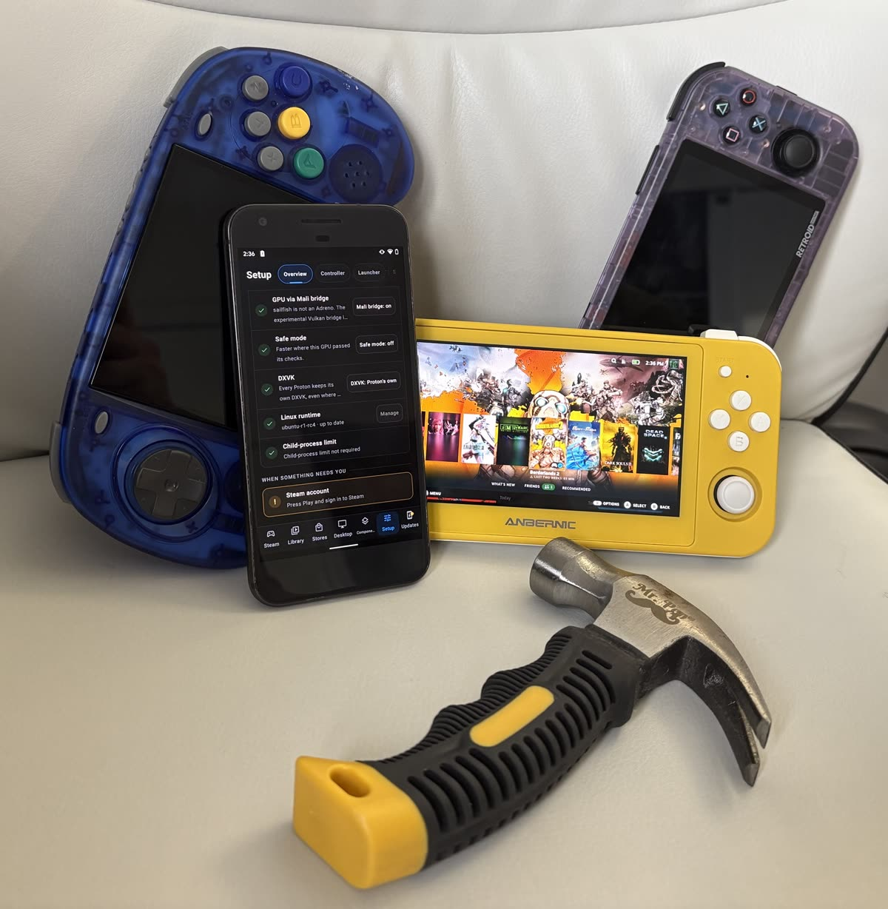
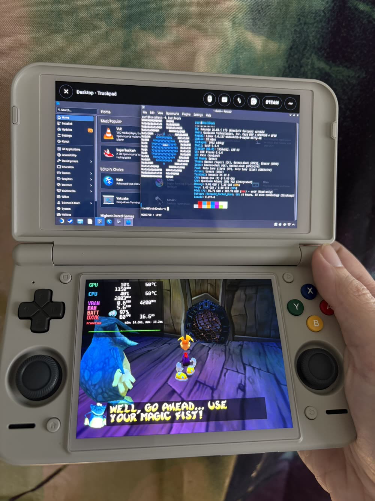
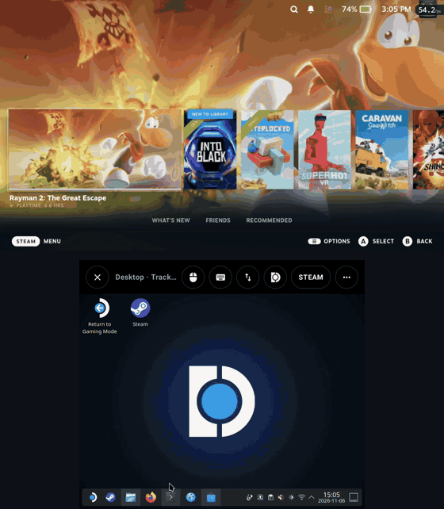
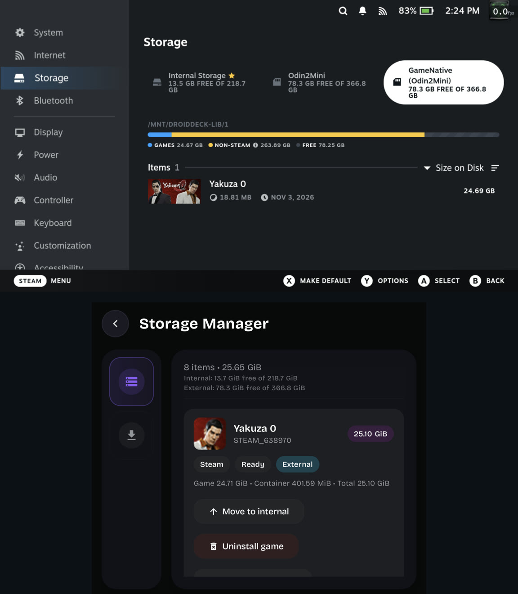
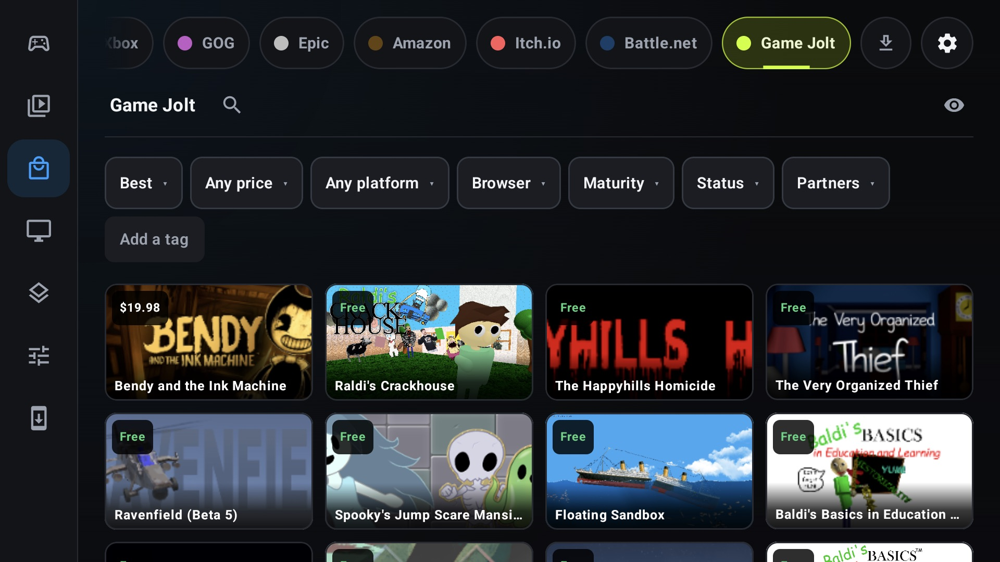
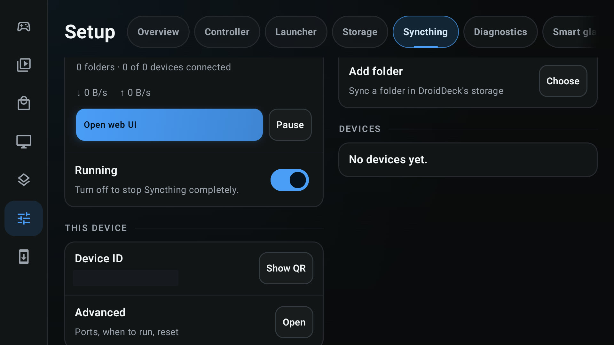
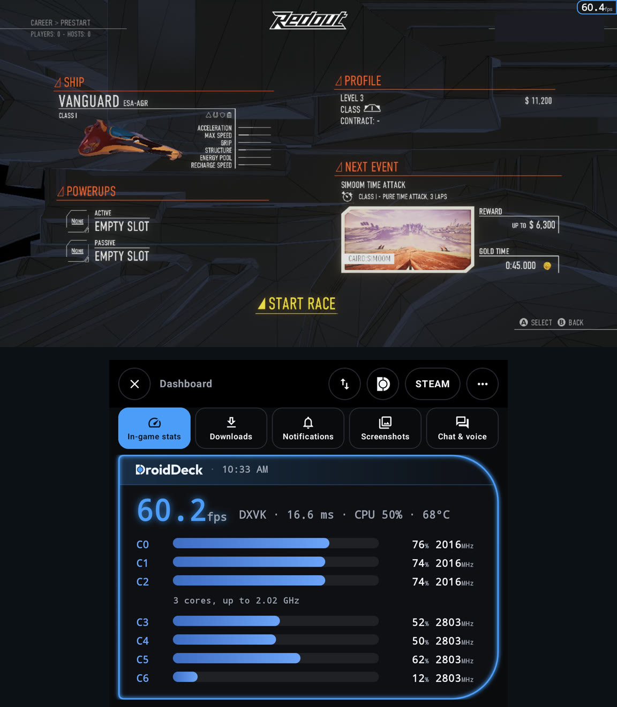
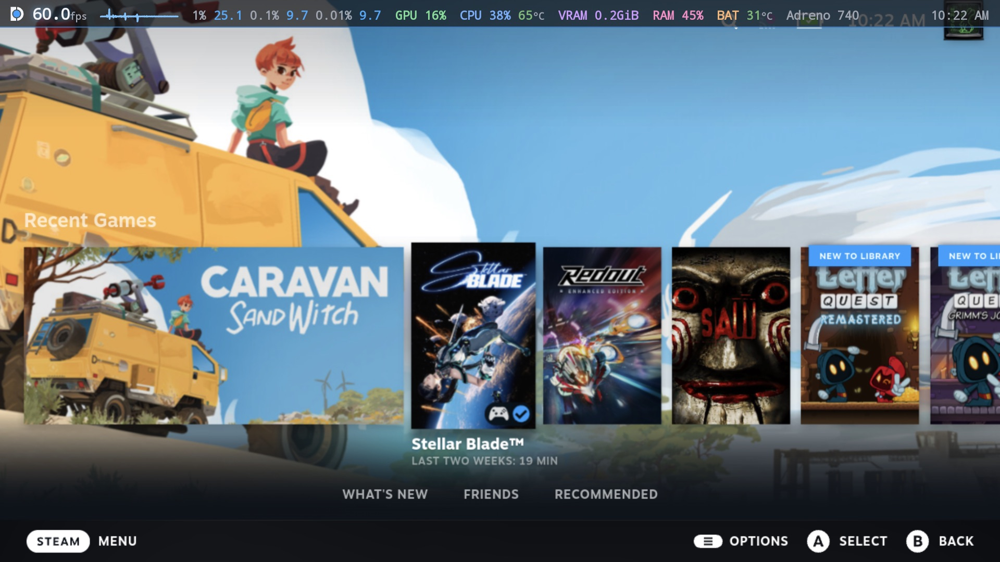
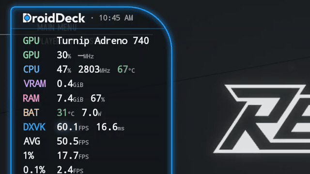
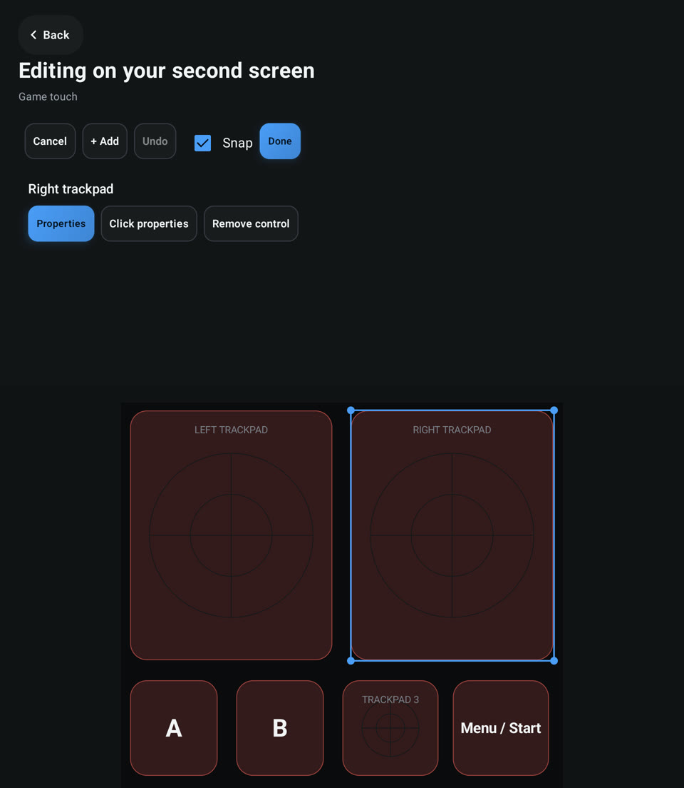

# DroidDeck 0.7.0

  
  

**DroidDeck is 100% open source. No ads. No telemetry. No proprietary components. No source withheld.**

Since 0.6.9, **39 people** sent **194 pull requests**, and **20 of them are first-time contributors**. Our community is strongest when we can build together, and with DroidDeck 0.7.0, our community is about to get A LOT bigger!

0.7.0 introduces preliminary support for **Mali, PowerVR and Xclipse** GPUs! In addition, we now have GameJolt library and store, dual screen game mode + KDE Desktop, Syncthing integration, improvements for devices with low ram, customizable controller profiles and presets, hardware mouse & keyboard support, live wallpapers, and even more. Click the link in the comments below to... I mean scroll down to learn more:

### Features

- Initial **Mali, PowerVR and Xclipse support**. DroidDeck detects the GPU and picks a driver for it, so these devices can run sessions, with MaliBridge and Venus on Mali and open driver pairs elsewhere. (@ASEbrahim, @mr-abccc, @The412Banner, @wallentx, @Leask, @stefanz92, @DavidCimo, @maxjivi05, @K11MCH1, @xXJSONDeruloXx, [#1587](https://github.com/Droid-Deck/DroidDeck/pull/1587), [#2027](https://github.com/Droid-Deck/DroidDeck/pull/2027), [#1950](https://github.com/Droid-Deck/DroidDeck/pull/1950), [#2029](https://github.com/Droid-Deck/DroidDeck/pull/2029), [#2157](https://github.com/Droid-Deck/DroidDeck/pull/2157))

 

- Added the **KDE desktop on the bottom screen** beside a Steam session or a game, next to Dashboard, Keyboard + trackpad, Terminal and Deck grips. (@xXJSONDeruloXx, [#1966](https://github.com/Droid-Deck/DroidDeck/pull/1966))
- Added **swap screens**: play on the bottom screen while the top screen shows the Dashboard or the desktop. Use the swap button in the panel bar or **Show the game on** in the session menu. (@The412Banner, [#2006](https://github.com/Droid-Deck/DroidDeck/pull/2006))

- Added **shared Steam libraries with other pc gaming apps**. DroidDeck can now **find Steam libraries that other apps already made** on your internal storage or card and suggests them, each with its game count, so one install of a game can serve both apps. You can add up to four more libraries beside internal storage and the card, rename them, and remove them any time. (@xXJSONDeruloXx, [#1967](https://github.com/Droid-Deck/DroidDeck/pull/1967), [#2023](https://github.com/Droid-Deck/DroidDeck/pull/2023), [#2054](https://github.com/Droid-Deck/DroidDeck/pull/2054))

- Added the **Game Jolt store**: browse, search, install, update and keep a library, in the same style as itch.io. (@FX192, [#1986](https://github.com/Droid-Deck/DroidDeck/pull/1986), [#1989](https://github.com/Droid-Deck/DroidDeck/pull/1989))

- Added built-in **Syncthing**, so you can sync saves and games from DroidDeck’s own storage without another app. (@superboo07, [#1442](https://github.com/Droid-Deck/DroidDeck/pull/1442))

- Added **bottom-screen Dashboard** for dual-screen handhelds like the Retroid Pocket Duo and AYN Thor: downloads, notifications, screenshots, Steam chat with voice controls, and **In-game stats** that draw a racing game’s own speed, gear, rpm and pedals from its data output. (@The412Banner, [#1920](https://github.com/Droid-Deck/DroidDeck/pull/1920), [#1933](https://github.com/Droid-Deck/DroidDeck/pull/1933), [#1968](https://github.com/Droid-Deck/DroidDeck/pull/1968))

- Added a **Horizontal DroidDeck HUD Style**: one line across the top or bottom edge with FPS, frame-time graph, lows, GPU, CPU, VRAM, RAM, battery and the clock. All DD HUDs can now **shrinks into its tab as you drag it off an edge** and snaps to the sides. The Strip is lighter to draw. (@xXJSONDeruloXx, @The412Banner, @KeegantheVeganat0r, [#1935](https://github.com/Droid-Deck/DroidDeck/pull/1935), [#1937](https://github.com/Droid-Deck/DroidDeck/pull/1937), [#1982](https://github.com/Droid-Deck/DroidDeck/pull/1982), [#2194](https://github.com/Droid-Deck/DroidDeck/pull/2194), [#2235](https://github.com/Droid-Deck/DroidDeck/pull/2235))
- A **hardware mouse and keyboard work like a PC**: the camera no longer freezes in games that hide the cursor, the cursor shows in Steam sessions, and clicks land where you point. (@maxjivi05, [#2053](https://github.com/Droid-Deck/DroidDeck/pull/2053), [#2133](https://github.com/Droid-Deck/DroidDeck/pull/2133), [#2139](https://github.com/Droid-Deck/DroidDeck/pull/2139))

- Added **unified controller profiles** for Game and Desktop sessions: named profiles combine a physical controller layout with main and second screen layouts, with one full-size editor for both screens and a profile picker in the session menu. (@Delete228, @maxjivi05, @xXJSONDeruloXx, [#1439](https://github.com/Droid-Deck/DroidDeck/pull/1439), [#2215](https://github.com/Droid-Deck/DroidDeck/pull/2215), [#2221](https://github.com/Droid-Deck/DroidDeck/pull/2221), [#2238](https://github.com/Droid-Deck/DroidDeck/pull/2238), [#2242](https://github.com/Droid-Deck/DroidDeck/pull/2242))
- Added **Startup** choices: Never, Steam or Desktop.  (@xXJSONDeruloXx, [#1993](https://github.com/Droid-Deck/DroidDeck/pull/1993))
- Added a **low-storage warning** switch, and an **Android keyboard for game text fields** setting for dual-screen sessions, off by default so Steam keeps its own keyboard. (@xXJSONDeruloXx, [#2244](https://github.com/Droid-Deck/DroidDeck/pull/2244), [#2236](https://github.com/Droid-Deck/DroidDeck/pull/2236))
- Added **live wallpapers** to Android’s wallpaper picker. (@xXJSONDeruloXx, [#2012](https://github.com/Droid-Deck/DroidDeck/pull/2012))

### Improvements

- **Auto picks DD-Turnip on Adreno 7xx**, and the **upstream RADV pair on Xclipse 950 and 960**. Auto follows the published table on Adreno 6xx and 8xx, and a driver source that is down no longer changes the pick. (@maxjivi05, @xXJSONDeruloXx, [#1978](https://github.com/Droid-Deck/DroidDeck/pull/1978), [#2158](https://github.com/Droid-Deck/DroidDeck/pull/2158), [#2151](https://github.com/Droid-Deck/DroidDeck/pull/2151), [#2233](https://github.com/Droid-Deck/DroidDeck/pull/2233), [#2255](https://github.com/Droid-Deck/DroidDeck/pull/2255), [#2226](https://github.com/Droid-Deck/DroidDeck/pull/2226))
- A **configurable stick dead zone** for physical controllers, 0 to 25%. (@vitamin663-sys, [#1780](https://github.com/Droid-Deck/DroidDeck/pull/1780))
- The drawer’s **frame limit works in desktop mode**, up to 165 fps. (@K11MCH1, [#1885](https://github.com/Droid-Deck/DroidDeck/pull/1885))
- **Faster Steam**: compatibility mapping and app info load in batches, and Steam shows cached library art when it starts without a connection. SD and USB libraries answer missing-file checks from a directory cache. (@ddd-ms, @xXJSONDeruloXx, [#1755](https://github.com/Droid-Deck/DroidDeck/pull/1755), [#1756](https://github.com/Droid-Deck/DroidDeck/pull/1756), [#1985](https://github.com/Droid-Deck/DroidDeck/pull/1985), [#2212](https://github.com/Droid-Deck/DroidDeck/pull/2212), [#2203](https://github.com/Droid-Deck/DroidDeck/pull/2203))
- Added **Enhanced diagnostics**, a one-session setting that bundles redacted session, graphics and game logs for bug reports, plus **session log management** in Setup. (@wallentx, @xXJSONDeruloXx, [#2129](https://github.com/Droid-Deck/DroidDeck/pull/2129), [#2099](https://github.com/Droid-Deck/DroidDeck/pull/2099), [#2131](https://github.com/Droid-Deck/DroidDeck/pull/2131))
- Added **auto updates for FEX, DXVK and VKD3D-Proton in DroidDeck-Proton**, so it gets the newest builds without a new DroidDeck release. Other Protons keep the components they ship with, old DroidDeck-Proton builds are removed, and a game set to a removed build moves to the newest one. (@maxjivi05, @xXJSONDeruloXx, [#2156](https://github.com/Droid-Deck/DroidDeck/pull/2156), [#2190](https://github.com/Droid-Deck/DroidDeck/pull/2190), [#2193](https://github.com/Droid-Deck/DroidDeck/pull/2193), [#2223](https://github.com/Droid-Deck/DroidDeck/pull/2223))
- An installed **DroidDeck-Proton becomes the default** for Steam games and added shortcuts when nobody picked Proton Experimental. A Proton you choose in DroidDeck or in Steam is kept, and both stay in sync. (@maxjivi05, [#2266](https://github.com/Droid-Deck/DroidDeck/pull/2266))

- **Little Nightmares** keeps its render thread, **+12.7% FPS** on the Retroid Pocket Duo, and **Adreno 722** has fewer DXVK stalls. (@maxjivi05, [#1930](https://github.com/Droid-Deck/DroidDeck/pull/1930), [#2066](https://github.com/Droid-Deck/DroidDeck/pull/2066))
- A resumed session reads its memory back from zram at once, which ends minutes of stutter in heavy games like Yakuza. DroidDeck also frees launcher memory earlier under pressure, and idle game memory is compressed before low-RAM devices run out. (@l4nr3, @xXJSONDeruloXx, [#1839](https://github.com/Droid-Deck/DroidDeck/pull/1839), [#2138](https://github.com/Droid-Deck/DroidDeck/pull/2138), [#2187](https://github.com/Droid-Deck/DroidDeck/pull/2187))
- On-screen sticks are lighter to hold, and **Low latency off** is honored. (@maxjivi05, [#2048](https://github.com/Droid-Deck/DroidDeck/pull/2048))
- The HUD cycles colors with the Inner Gamer theme, the docked FPS tab and bottom-screen frame graph look better, and the watermark is gone with the wordmark in headers. (@xXJSONDeruloXx, [#1932](https://github.com/Droid-Deck/DroidDeck/pull/1932), [#1976](https://github.com/Droid-Deck/DroidDeck/pull/1976), [#2013](https://github.com/Droid-Deck/DroidDeck/pull/2013), [#2011](https://github.com/Droid-Deck/DroidDeck/pull/2011), [#2003](https://github.com/Droid-Deck/DroidDeck/pull/2003), [#1983](https://github.com/Droid-Deck/DroidDeck/pull/1983))
- Every session log now records **CPU clocks, thermal status and battery temperature**, and `droiddeckctl` gained `thermal` and `wait cool`. (@angelrenefm, [#2060](https://github.com/Droid-Deck/DroidDeck/pull/2060), [#2061](https://github.com/Droid-Deck/DroidDeck/pull/2061), [#2062](https://github.com/Droid-Deck/DroidDeck/pull/2062))
- Added games scan **one at a time and keep what they found** across launches, and imported Steam games with no known build update only when launched. (@K11MCH1, [#2067](https://github.com/Droid-Deck/DroidDeck/pull/2067), [#2064](https://github.com/Droid-Deck/DroidDeck/pull/2064))
- Steam’s **VRAM budget** is applied through Vulkan without rejecting allocations, and the **download monitor** no longer freezes a session on slow storage. D3D12 support is detected per device. (@xXJSONDeruloXx, [#2014](https://github.com/Droid-Deck/DroidDeck/pull/2014), [#2020](https://github.com/Droid-Deck/DroidDeck/pull/2020), [#2134](https://github.com/Droid-Deck/DroidDeck/pull/2134))
- Every bottom-screen panel now has the **same bar**, and X or Back opens the in-session menu there instead of dropping you on the Android launcher. (@xXJSONDeruloXx, [#2084](https://github.com/Droid-Deck/DroidDeck/pull/2084), [#2110](https://github.com/Droid-Deck/DroidDeck/pull/2110))
- On the Duo and Thor, DroidDeck switches to **single-screen mode** while another window holds the bottom screen, such as Retroid’s performance panel, and back when it is free, including when docked. The trackpad and Deck panels are back on the second screen, and the bottom-screen menu and layout editor stay open when the screen turns off. (@maxjivi05, [#1979](https://github.com/Droid-Deck/DroidDeck/pull/1979), [#2232](https://github.com/Droid-Deck/DroidDeck/pull/2232), [#2229](https://github.com/Droid-Deck/DroidDeck/pull/2229), [#2247](https://github.com/Droid-Deck/DroidDeck/pull/2247))
- The HUD shows **GPU load and clock without root** on phones where Android blocks them, such as the Retroid Pocket Duo and Adreno 8xx, and in Steam’s overlay. (@The412Banner, @angelrenefm, [#1969](https://github.com/Droid-Deck/DroidDeck/pull/1969), [#1981](https://github.com/Droid-Deck/DroidDeck/pull/1981), [#2059](https://github.com/Droid-Deck/DroidDeck/pull/2059))
- Added independent **1% and 0.1% low** toggles to the HUD. (@KeegantheVeganat0r, [#2127](https://github.com/Droid-Deck/DroidDeck/pull/2127))
- **EA games install the EA app** through Steam, and the EA sign-in stays in front of the launcher’s splash screen. (@K11MCH1, [#2036](https://github.com/Droid-Deck/DroidDeck/pull/2036), [#2037](https://github.com/Droid-Deck/DroidDeck/pull/2037), [#2045](https://github.com/Droid-Deck/DroidDeck/pull/2045))
- The **desktop session follows the app language**, so Plasma and its apps are no longer English only. (@xXJSONDeruloXx, [#1971](https://github.com/Droid-Deck/DroidDeck/pull/1971))
- The desktop shows **programs installed by Windows installers** in its menu and as icons. (@K11MCH1, [#2146](https://github.com/Droid-Deck/DroidDeck/pull/2146))
- **Follow screen** resolution can be scaled down: ÷1.5, ÷2, ÷2.5, ÷3, ÷4 or your own factor. (@xXJSONDeruloXx, [#1964](https://github.com/Droid-Deck/DroidDeck/pull/1964))
- Added a **Hold Back for Steam shortcuts** switch, for people who map a held Back with another app. (@xXJSONDeruloXx, [#1955](https://github.com/Droid-Deck/DroidDeck/pull/1955))
- Added **size, opacity and hidden keys** settings for the on-screen PC keyboard. (@Dantalian-dev, [#1897](https://github.com/Droid-Deck/DroidDeck/pull/1897))
- Added **World of Warcraft addon import** from a zip, plus **voice type and a keyboard chat bar**. Addons also download from WoWInterface, and CurseForge opens in the browser. (@maxjivi05, [#2111](https://github.com/Droid-Deck/DroidDeck/pull/2111), [#2171](https://github.com/Droid-Deck/DroidDeck/pull/2171), [#2175](https://github.com/Droid-Deck/DroidDeck/pull/2175), [#2219](https://github.com/Droid-Deck/DroidDeck/pull/2219))
- **UBWC compatibility** moved from Components to Settings, and FEX’s **Use Default** shows which preset it resolves to. (@xXJSONDeruloXx, [#2008](https://github.com/Droid-Deck/DroidDeck/pull/2008), [#2225](https://github.com/Droid-Deck/DroidDeck/pull/2225))
- **Steam launch options** show on the Launch tab. (@wallentx, [#2163](https://github.com/Droid-Deck/DroidDeck/pull/2163))
- **GOG achievements** are on by default. (@xXJSONDeruloXx, [#2168](https://github.com/Droid-Deck/DroidDeck/pull/2168))
- **Translations:** every missing string is translated, with a fresh Russian pass. (@maxjivi05, @flexeykinDev, [#1965](https://github.com/Droid-Deck/DroidDeck/pull/1965), [#2116](https://github.com/Droid-Deck/DroidDeck/pull/2116))

### Fixed

- Fixed **“DroidDeck isn’t responding”** on dual-screen handhelds after the bottom screen sat idle, and opening DroidDeck from iisu on the AYN Thor no longer bounces back. (@maxjivi05, @0x1428571429, [#1917](https://github.com/Droid-Deck/DroidDeck/pull/1917), [#1901](https://github.com/Droid-Deck/DroidDeck/pull/1901))
- Fixed **lag and heat on the Galaxy S26** from switching between display modes with the same refresh rate, which started in 0.6.7. (@maxjivi05, [#2192](https://github.com/Droid-Deck/DroidDeck/pull/2192))
- Fixed **Steam starting on Quest 3**, and the gamescope abort at start on Quest. (@xXJSONDeruloXx, @Mi-Yomi, [#2050](https://github.com/Droid-Deck/DroidDeck/pull/2050), [#1938](https://github.com/Droid-Deck/DroidDeck/pull/1938))
- Fixed **Steam libraries** with installs but no app manifest not being found, and **a stale session’s startup failure** stopping the newer session. (@xXJSONDeruloXx, [#2054](https://github.com/Droid-Deck/DroidDeck/pull/2054), [#1984](https://github.com/Droid-Deck/DroidDeck/pull/1984))
- Fixed an **unplugged game drive**: installs fall back to internal storage instead of failing. (@maxjivi05, [#1913](https://github.com/Droid-Deck/DroidDeck/pull/1913))
- Fixed **GOG**: an install launches the game and not its config tool, cloud saves upload in Galaxy’s format, and a game whose installer cannot run gets its install registry. (@moronigranja, [#1644](https://github.com/Droid-Deck/DroidDeck/pull/1644), [#1952](https://github.com/Droid-Deck/DroidDeck/pull/1952), [#2022](https://github.com/Droid-Deck/DroidDeck/pull/2022))
- Fixed **Battle.net**: Flathub installs outside a session, World of Warcraft: Forever in the Library, the right artwork for each game, games installed inside its folder, Chinese servers and installs, and launching store games from any game page tab. Its pages no longer play videos on the CPU. (@maxjivi05, @visail, [#1923](https://github.com/Droid-Deck/DroidDeck/pull/1923), [#2018](https://github.com/Droid-Deck/DroidDeck/pull/2018), [#2092](https://github.com/Droid-Deck/DroidDeck/pull/2092), [#2087](https://github.com/Droid-Deck/DroidDeck/pull/2087), [#1660](https://github.com/Droid-Deck/DroidDeck/pull/1660), [#1662](https://github.com/Droid-Deck/DroidDeck/pull/1662), [#2185](https://github.com/Droid-Deck/DroidDeck/pull/2185), [#2195](https://github.com/Droid-Deck/DroidDeck/pull/2195))
- Fixed **game-specific problems**: Codemasters EGO games, DOOM (2016), Project Zomboid, Supergiant games and Ubisoft Connect. (@The412Banner, @xXJSONDeruloXx, [#1936](https://github.com/Droid-Deck/DroidDeck/pull/1936), [#1987](https://github.com/Droid-Deck/DroidDeck/pull/1987), [#2016](https://github.com/Droid-Deck/DroidDeck/pull/2016), [#2143](https://github.com/Droid-Deck/DroidDeck/pull/2143), [#2090](https://github.com/Droid-Deck/DroidDeck/pull/2090))
- Fixed the **Linux desktop** disappearing after a runtime update, language packs, a game’s window following its own window mode, and Steam’s own header moving its windows. (@maxjivi05, [#2021](https://github.com/Droid-Deck/DroidDeck/pull/2021), [#2096](https://github.com/Droid-Deck/DroidDeck/pull/2096), [#2094](https://github.com/Droid-Deck/DroidDeck/pull/2094), [#2097](https://github.com/Droid-Deck/DroidDeck/pull/2097))
- Fixed **repaired components** not reaching prefixes that already had them, and a native-only override breaking a prefix with no native DLL. (@maxjivi05, [#2121](https://github.com/Droid-Deck/DroidDeck/pull/2121), [#2142](https://github.com/Droid-Deck/DroidDeck/pull/2142))
- Fixed **Windows installs on a natively mounted card** asking for an administrator. (@maxjivi05, [#2100](https://github.com/Droid-Deck/DroidDeck/pull/2100))
- Fixed the **Home screen setting** so DroidDeck stays in RedMagic Game Space, and the right click acting as Back in RedMagic cast mode. (@maxjivi05, @OmarAlTaki1, [#2083](https://github.com/Droid-Deck/DroidDeck/pull/2083), [#1870](https://github.com/Droid-Deck/DroidDeck/pull/1870))
- Fixed **Steam’s UI crashing on PowerVR** when scrolling the Home shelf fast. (@coffeemeist3r, [#2107](https://github.com/Droid-Deck/DroidDeck/pull/2107))
- Fixed **the side menu freezing the launcher** while moving through the Stores tab, and **controller focus** not moving into an opened folder. (@kmnkv1, @danielnoam, [#2105](https://github.com/Droid-Deck/DroidDeck/pull/2105), [#1962](https://github.com/Droid-Deck/DroidDeck/pull/1962))
- Fixed **VPN and network** problems: links without a gateway, and network queries inside a session. (@uubooster-team, @xXJSONDeruloXx, [#2038](https://github.com/Droid-Deck/DroidDeck/pull/2038), [#2141](https://github.com/Droid-Deck/DroidDeck/pull/2141))
- Fixed **picture-in-picture** output being cropped after a resize and not scaling to full size, and the **glasses pointer** not reaching the full screen or drawing in the picture. (@xXJSONDeruloXx, @moronigranja, [#2125](https://github.com/Droid-Deck/DroidDeck/pull/2125), [#2145](https://github.com/Droid-Deck/DroidDeck/pull/2145), [#1925](https://github.com/Droid-Deck/DroidDeck/pull/1925), [#2174](https://github.com/Droid-Deck/DroidDeck/pull/2174))
- Fixed **World of Warcraft and other added games sorting last** in the Library. Battle.net and added games now sort by when they were played and installed, like Steam games. (@maxjivi05, [#2256](https://github.com/Droid-Deck/DroidDeck/pull/2256))
- Fixed the **Linux runtime showing as not installed after an app update** that brings a new PRoot pack. Only the changed add-on packs download now. (@maxjivi05, [#2270](https://github.com/Droid-Deck/DroidDeck/pull/2270))
- Fixed **desktop apps that would not start**: RPCS3 and other catalog AppImages from the desktop menu, D-Bus programs such as melonDS, x86 programs that a native script starts, and Flatpak apps that Flatpak no longer has now uninstall cleanly. Add from GitHub installs **the AppImage you linked** instead of the release’s first one. (@maxjivi05, [#2274](https://github.com/Droid-Deck/DroidDeck/pull/2274), [#2275](https://github.com/Droid-Deck/DroidDeck/pull/2275), [#2217](https://github.com/Droid-Deck/DroidDeck/pull/2217), [#2216](https://github.com/Droid-Deck/DroidDeck/pull/2216), [#2273](https://github.com/Droid-Deck/DroidDeck/pull/2273))
- Fixed **controller navigation** across the Controller tab and profile menus. (@xXJSONDeruloXx, [#2231](https://github.com/Droid-Deck/DroidDeck/pull/2231))
- Fixed **games listed with a bundled arm64 Linux build** defaulting to the wrong runner. They now start with FEX. (@phj1081, [#2126](https://github.com/Droid-Deck/DroidDeck/pull/2126))
- Fixed smaller things: left adaptive stick activation at the screen edge, game buffers upscaled before composition, the Steam applying-update stage, apps pinned when all cores are selected, runtime PATH kept for guest binaries, Xwayland orphans, GPU environment values with spaces, the navigation bar staying dark, the Android pointer showing after hovering session menus, touch sticks clicking without a fast double tap, wall scrims leaving edge pixels unshaded, the PowerVR bundled PPSSPP install, L2 and R2 keys overriding analog triggers, taps outside the PC keyboard not reaching the game, direct-touch drags in games that hide the cursor, library scan and download cancel crashes on Android 10, and a Second library on a raw media path or an unmounted volume state. (@sanogueralorenzo, @cphillam, @HCOOKIEie, @w1novnik, @asdf17128, @LingWindT, @Systina12, @KirkPatrickJunsay, @realRurichan, @maxjivi05, @xXJSONDeruloXx, [#1455](https://github.com/Droid-Deck/DroidDeck/pull/1455), [#1367](https://github.com/Droid-Deck/DroidDeck/pull/1367), [#1614](https://github.com/Droid-Deck/DroidDeck/pull/1614), [#1759](https://github.com/Droid-Deck/DroidDeck/pull/1759), [#1826](https://github.com/Droid-Deck/DroidDeck/pull/1826), [#1716](https://github.com/Droid-Deck/DroidDeck/pull/1716), [#1931](https://github.com/Droid-Deck/DroidDeck/pull/1931), [#1975](https://github.com/Droid-Deck/DroidDeck/pull/1975), [#2113](https://github.com/Droid-Deck/DroidDeck/pull/2113), [#2176](https://github.com/Droid-Deck/DroidDeck/pull/2176), [#2173](https://github.com/Droid-Deck/DroidDeck/pull/2173), [#1994](https://github.com/Droid-Deck/DroidDeck/pull/1994), [#2205](https://github.com/Droid-Deck/DroidDeck/pull/2205), [#2257](https://github.com/Droid-Deck/DroidDeck/pull/2257), [#2220](https://github.com/Droid-Deck/DroidDeck/pull/2220), [#2204](https://github.com/Droid-Deck/DroidDeck/pull/2204), [#2224](https://github.com/Droid-Deck/DroidDeck/pull/2224), [#2245](https://github.com/Droid-Deck/DroidDeck/pull/2245), [#2258](https://github.com/Droid-Deck/DroidDeck/pull/2258))

### DroidDeck-Proton, DD-Turnip and components

These ship on their own and update in the app, so 0.7.0 users get them too.

- **DroidDeck-Proton 11-12** moves to GE-Proton11-12 and Valve’s newer Wine: XInput rescans only when a controller could have changed, DualSense haptics and adaptive triggers together over USB, MSFS 2024 and other intro videos play normally, an ntsync fix stops waiters blocking forever on an abandoned mutex, plus DXVK 3.1.1, VKD3D-Proton 3.1 and newer FEX. (@The412Banner, @maxjivi05, with GloriousEggroll, Valve and the GE contributors upstream)
- **Faster loads in 32-bit and ARM64EC games**: FEX keeps its translated code on empty reads and stays off Wine’s memory lock. Entering the world in Dungeons & Dragons Online went from 50 s to 4 s. (@K11MCH1, [DroidDeck-Proton#9](https://github.com/Droid-Deck/DroidDeck-Proton/pull/9))
- **32-bit games load at the address they were built for**, so game and mod loaders that patch them at start work again. (@maxjivi05, [DroidDeck-Proton#10](https://github.com/Droid-Deck/DroidDeck-Proton/pull/10))
- **DiRT 3 and DiRT Showdown** keep running with their telemetry on, for the In-game stats dash. (@The412Banner)
- About 3,000 system functions no longer look **hooked** to x64 games and launchers that check for that, while ARM64EC callers still skip the emulator (11-12.2). Text fields in Wine programs now tell DroidDeck when they have focus, which brings up the keyboard for World of Warcraft chat (11-12.3). (@maxjivi05)
- **DD-Turnip 0.4.0**: newer Mesa, and indirect draws no longer read their arguments too early on Adreno 8xx, which fixes the black or over-shadowed ground in **Mortal Shell 2** and other UE5 games through VKD3D-Proton. (@K11MCH1, [Drivers#14](https://github.com/Droid-Deck/Drivers/pull/14))
- **Components**: the full Visual C++ 2010 runtime and MFC for 2015–2022 are installed, the DXVK and VKD3D-Proton nightlies are built as ARM64X, and esync packs give Windows users read access to their folders. (@xXJSONDeruloXx, @maxjivi05, [DroidDeck-Components#10](https://github.com/Droid-Deck/DroidDeck-Components/pull/10), [#11](https://github.com/Droid-Deck/DroidDeck-Components/pull/11), [#12](https://github.com/Droid-Deck/DroidDeck-Components/pull/12), [#13](https://github.com/Droid-Deck/DroidDeck-Components/pull/13))

### Community

DroidDeck is built in the open by the people who use it. These are everyone whose code is in 0.7.0:

| Contributor | Pull requests |
|---|---|
| @xXJSONDeruloXx | 65: KDE desktop on the bottom screen, more Steam libraries, HUD Strip and docking, live wallpapers, startup choice, diagnostics, PowerVR add-on pack and more |
| @maxjivi05 | 70: hardware mouse and keyboard, single-screen mode, Battle.net, desktop fixes, performance and more |
| @The412Banner | 9: bottom-screen Dashboard, swap screens, bottom-screen HUD, GPU load without root, game fixes |
| @K11MCH1 | 6: EA app, installed Windows programs, scan and frame limit fixes |
| @moronigranja | 4: GOG saves and installs, glasses cursor |
| @ASEbrahim, @mr-abccc, @The412Banner | MaliBridge for Mali GPUs ([#2027](https://github.com/Droid-Deck/DroidDeck/pull/2027), [#1950](https://github.com/Droid-Deck/DroidDeck/pull/1950)) |
| @wallentx, @Leask, @stefanz92, @DavidCimo | Non-Adreno graphics stack and diagnostics ([#2029](https://github.com/Droid-Deck/DroidDeck/pull/2029), [#2129](https://github.com/Droid-Deck/DroidDeck/pull/2129)) |
| @angelrenefm | 4: session clocks, GPU clock in Steam’s overlay, `droiddeckctl` |
| @FX192 | 2: Game Jolt store |
| @visail, @ddd-ms, @kmnkv1 | 2 each: Battle.net China, Steam speedups, Stores freeze and build fix |
| @superboo07, @vitamin663-sys, @Dantalian-dev, @KeegantheVeganat0r, @l4nr3, @phj1081, @danielnoam, @cphillam, @asdf17128, @Mi-Yomi, @LingWindT, @KirkPatrickJunsay, @0x1428571429, @OmarAlTaki1, @sanogueralorenzo, @HCOOKIEie, @w1novnik, @Systina12, @coffeemeist3r, @realRurichan, @flexeykinDev, @uubooster-team, @Delete228 | Syncthing, stick dead zone, PC keyboard settings, unified controller profiles, HUD lows, zram resume, FEX default, Stores freeze, folder focus, upscaling, PATH, Quest, Xwayland, iisu, VPN, PowerVR crash, translations and more |

### New contributors

- @cphillam made their first contribution in [#1367](https://github.com/Droid-Deck/DroidDeck/pull/1367).
- @sanogueralorenzo made their first contribution in [#1455](https://github.com/Droid-Deck/DroidDeck/pull/1455).
- @HCOOKIEie made their first contribution in [#1614](https://github.com/Droid-Deck/DroidDeck/pull/1614).
- @visail made their first contribution in [#1660](https://github.com/Droid-Deck/DroidDeck/pull/1660).
- @LingWindT made their first contribution in [#1716](https://github.com/Droid-Deck/DroidDeck/pull/1716).
- @w1novnik made their first contribution in [#1759](https://github.com/Droid-Deck/DroidDeck/pull/1759).
- @vitamin663-sys made their first contribution in [#1780](https://github.com/Droid-Deck/DroidDeck/pull/1780).
- @OmarAlTaki1 made their first contribution in [#1870](https://github.com/Droid-Deck/DroidDeck/pull/1870).
- @Systina12 made their first contribution in [#1931](https://github.com/Droid-Deck/DroidDeck/pull/1931).
- @Mi-Yomi made their first contribution in [#1938](https://github.com/Droid-Deck/DroidDeck/pull/1938).
- @mr-abccc made their first contribution in [#1950](https://github.com/Droid-Deck/DroidDeck/pull/1950).
- @danielnoam made their first contribution in [#1962](https://github.com/Droid-Deck/DroidDeck/pull/1962).
- @DavidCimo made their first contribution in [#2029](https://github.com/Droid-Deck/DroidDeck/pull/2029).
- @Leask made their first contribution in [#2029](https://github.com/Droid-Deck/DroidDeck/pull/2029).
- @stefanz92 made their first contribution in [#2029](https://github.com/Droid-Deck/DroidDeck/pull/2029).
- @uubooster-team made their first contribution in [#2038](https://github.com/Droid-Deck/DroidDeck/pull/2038).
- @realRurichan made their first contribution in [#2113](https://github.com/Droid-Deck/DroidDeck/pull/2113).
- @flexeykinDev made their first contribution in [#2116](https://github.com/Droid-Deck/DroidDeck/pull/2116).
- @phj1081 made their first contribution in [#2126](https://github.com/Droid-Deck/DroidDeck/pull/2126).
- @KeegantheVeganat0r made their first contribution in [#2127](https://github.com/Droid-Deck/DroidDeck/pull/2127).

[Full changelog](https://github.com/Droid-Deck/DroidDeck/compare/0.6.9...0.7.0)
