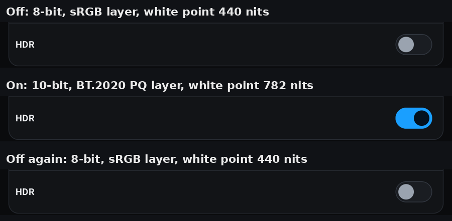
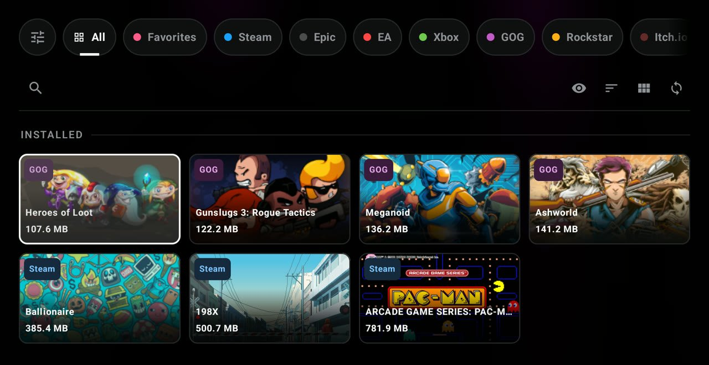
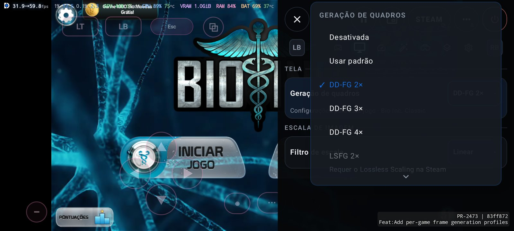
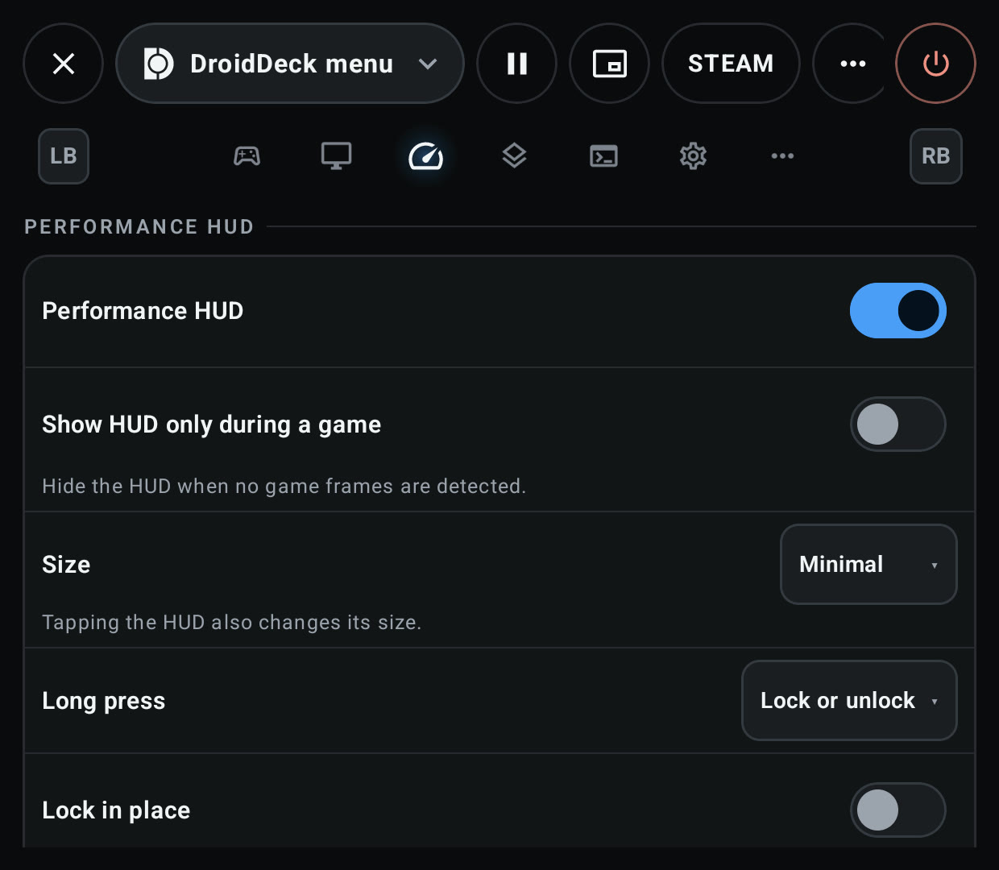
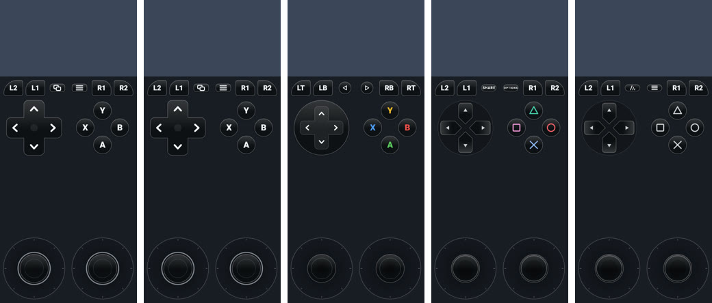
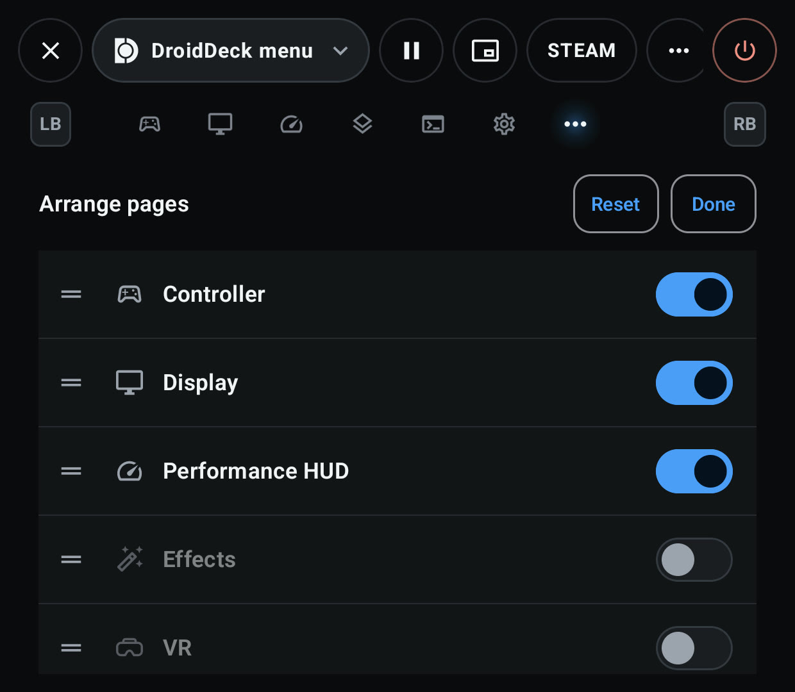
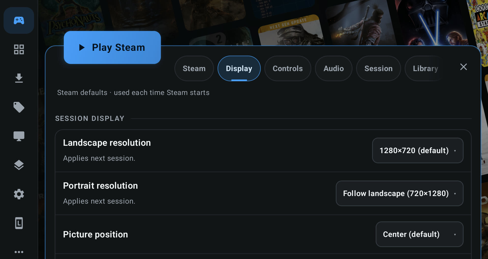
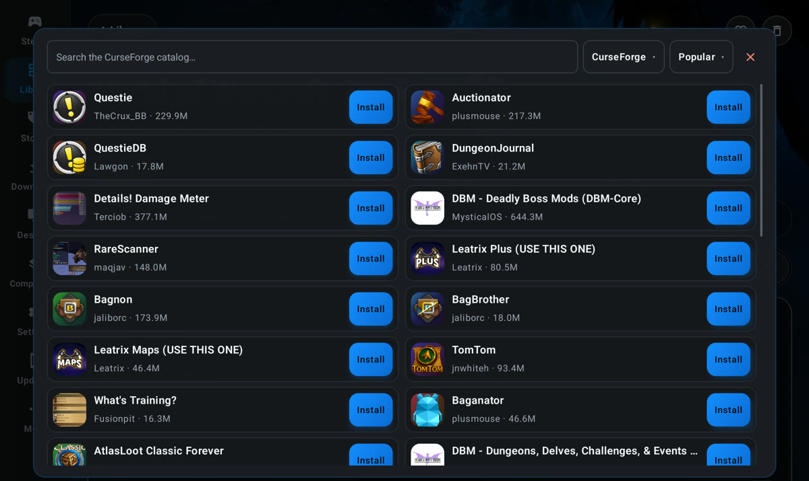
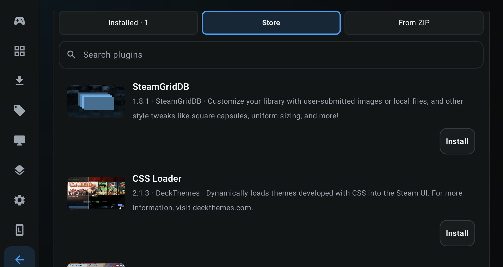
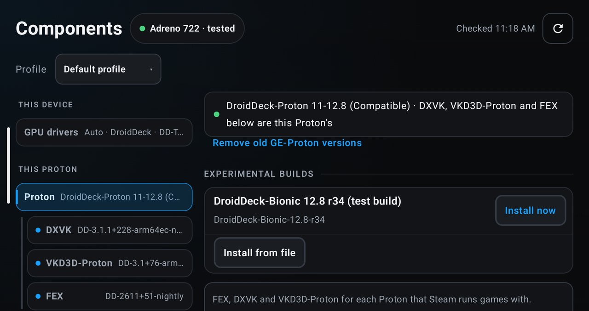

# DroidDeck 0.7.11

  
  

<!-- Maintainer check: Steam, Proton downloads and the games themselves come from Valve and the stores and are not part of DroidDeck; the intro below only claims DroidDeck's own code and the packs it builds. -->

**DroidDeck is 100% open source. No ads. No subscriptions. No telemetry. No proprietary components. No source withheld.**

Since 0.7.1, **42 people** sent **461 pull requests**, and **25 of them were first-timers**. 66% of the pull requests came from the community. Thank you to everyone who sent code, translations, device testing and bug reports.

0.7.11 is the convenience store release: three new stores on the shelf and a long list of conveniences.

### What’s in store

- **Three new stores: EA, Ubisoft Connect and Rockstar Games.** Sign in, browse, download and play without their launchers, with cloud saves for EA and Ubisoft
- **Games on a memory card start in seconds, not minutes:** a cold session start plus game launch averaged 104 s on 0.7.1, up to 192 s, and now takes 18 to 35 s, and installs to the card are faster too
- **Zero-copy presentation:** game frames go straight to the display without an extra copy, and **HDR switches on and off mid-game**, in step with Steam
- **A rebuilt Library:** installed games up front, everything else on one row, store chips like the Stores tab, Custom games and one Manage stores sheet
- **Per-game frame generation and screen effects**, plus integer scaling, SMAA and black frame insertion
- **No proot by default:** Steam, games, the desktop and the Terminal now run straight on Android, with DroidDeck-Bionic as a test build for games
- **Your tabs, your way:** reorder, shelve or hide any tab, in the launcher and in the in-game menu, and Setup is now **Settings**, with search and one home for every setting
- **A smoother first run:** the downloads start in the background, one setup card shows the progress, and the first Play no longer waits on Steam
- **Controller-specific on-screen controls**, a **CurseForge** addon browser and a **Decky plugin store**
- **Library Favorites, a Hidden tab synced with Steam, and a music player** for your Steam soundtracks
- **Memory is managed for you:** fewer low-memory kills on dual-screen handhelds and fewer stutters from memory compression
- **Pens work as a mouse**, **XREAL One and Aura glasses get head tracking**, and DroidDeck’s **virtual pads reach programs outside Steam**

### Features

- Added the **EA store**: sign in with EA’s own page, see your library, download, update and launch without the EA app. Browse EA’s catalog with What’s New, Deals, Free Games and search, and **Get for free** works in the app. The library lists only games your account can download, details show the size before you install, and **EA games get cloud saves**. (@xXJSONDeruloXx, [#2259](https://github.com/Droid-Deck/DroidDeck/pull/2259), [#2527](https://github.com/Droid-Deck/DroidDeck/pull/2527), [#2521](https://github.com/Droid-Deck/DroidDeck/pull/2521), [#2438](https://github.com/Droid-Deck/DroidDeck/pull/2438), [#2440](https://github.com/Droid-Deck/DroidDeck/pull/2440), [#2486](https://github.com/Droid-Deck/DroidDeck/pull/2486), [#2824](https://github.com/Droid-Deck/DroidDeck/pull/2824))
- Added the **Ubisoft Connect store**: sign-in, your library, downloads and launch all run inside DroidDeck, with no Ubisoft Connect client. It gets cloud saves and keeps a game’s Denuvo token, so restarts no longer spend the account’s daily activations. Games that use Ubisoft’s newer API, such as Prince of Persia: The Lost Crown and Far Cry 3 Blood Dragon, get past their menu, and owned games the profile list leaves out get their art. (@xXJSONDeruloXx, @K11MCH1, [#2322](https://github.com/Droid-Deck/DroidDeck/pull/2322), [#2436](https://github.com/Droid-Deck/DroidDeck/pull/2436), [#2450](https://github.com/Droid-Deck/DroidDeck/pull/2450), [#2460](https://github.com/Droid-Deck/DroidDeck/pull/2460), [#2865](https://github.com/Droid-Deck/DroidDeck/pull/2865), [#2824](https://github.com/Droid-Deck/DroidDeck/pull/2824))
- Added the **Rockstar Games store**: sign in, see your library and the catalog, download with verification and launch, starting with the original GTA III, Vice City and San Andreas and widened to other Rockstar titles. Protected games such as GTA V Legacy no longer quit asking for the Rockstar Games Launcher. (@xXJSONDeruloXx, @maxjivi05, [#2537](https://github.com/Droid-Deck/DroidDeck/pull/2537), [#2547](https://github.com/Droid-Deck/DroidDeck/pull/2547), [#2590](https://github.com/Droid-Deck/DroidDeck/pull/2590))
- **Xbox games that use PlayFab Game Saves**, such as Forza Horizon 6, get past “Initialization Failed”, and Xbox sign-in looks like the other stores’. **Older Xbox games install too**: legacy EAppx titles through Windows Update and back-compat MSIXVC2 titles from their content boxes, with Nexus backend 0.2.15 and DLC mounting. (@l4nr3, @xXJSONDeruloXx, @The412Banner, [#2662](https://github.com/Droid-Deck/DroidDeck/pull/2662), [#2718](https://github.com/Droid-Deck/DroidDeck/pull/2718), [#2825](https://github.com/Droid-Deck/DroidDeck/pull/2825), [#2851](https://github.com/Droid-Deck/DroidDeck/pull/2851), [#2696](https://github.com/Droid-Deck/DroidDeck/pull/2696))
- Added **Zero-copy presentation** under Steam Settings > Display > Session Display, on by default. With DD-Turnip v0.9.0 or newer, game frames reach the display as they are instead of being copied once more: the compositor’s work per frame fell from 2.7–8.6 ms to 0.2–1.4 ms, and on a 120 Hz handheld the frames that missed a refresh in 60 s fell from 229 to 3. Scaling, frame generation and HDR stay on the fast path. **HDR now switches on and off during a session** from the session drawer or Steam’s own display settings, which stay in sync, and reads **Fake HDR** on panels without HDR. A frame limit the refresh rate doesn’t divide, such as 45 or 40 fps on 60 Hz, is now spread evenly instead of being ignored, and the panel picks a refresh rate that suits the limit. (@maxjivi05, [#2905](https://github.com/Droid-Deck/DroidDeck/pull/2905))

- **The Library is rebuilt.** Installed games come first and every game you own but haven’t installed folds into one **Not installed** row, with store-owned games linked to their store. The Library gets the same store chips and toolbar as the Stores tab, a **Custom games** tab, and one **Manage stores** sheet to reorder, hide or turn off stores, which now also manages the Hidden tab. (@xXJSONDeruloXx, @FX192, [#2894](https://github.com/Droid-Deck/DroidDeck/pull/2894), [#2897](https://github.com/Droid-Deck/DroidDeck/pull/2897), [#2920](https://github.com/Droid-Deck/DroidDeck/pull/2920))

- **Run without proot is now on by default.** The Linux side, Steam, Proton games, the desktop and the Terminal run straight on Android, with no proot in between. A choice you already made is kept, and a session falls back to proot when the runtime can’t run without it. The long list of programs that needed work to start this way is under Improvements. (@xXJSONDeruloXx, @maxjivi05, @K11MCH1, [#2300](https://github.com/Droid-Deck/DroidDeck/pull/2300), [#2522](https://github.com/Droid-Deck/DroidDeck/pull/2522), [#2560](https://github.com/Droid-Deck/DroidDeck/pull/2560), [#3041](https://github.com/Droid-Deck/DroidDeck/pull/3041))
- Added **DroidDeck-Bionic**, a compatibility tool that runs the game itself on Android’s own libc instead of glibc inside proot, while Steam and the stores stay on DroidDeck’s Linux side. It is a test build listed only when Run without proot is on, never becomes anyone’s default and installs from Components like the other extra tools. With proot on, a game sent to it starts on the newest DroidDeck-Proton instead. (@The412Banner, [#3037](https://github.com/Droid-Deck/DroidDeck/pull/3037))
- Added **per-game frame generation and per-game screen effects**: pick DD-FG 2x, 3x or 4x, Lossless Scaling or none for each game, from the Library or the in-game menu, with a default for the rest. Upscaling and sharpening now stay at full screen size with frame generation on. (@EnzoDLofi, @xXJSONDeruloXx, [#2473](https://github.com/Droid-Deck/DroidDeck/pull/2473), [#2472](https://github.com/Droid-Deck/DroidDeck/pull/2472), [#2728](https://github.com/Droid-Deck/DroidDeck/pull/2728))

- Added **integer scaling** next to Fit for pixel art and 2D games, with a small tolerance so a near fit still scales, and **SMAA** as an anti-aliasing option. Nearest is the new default filter; a filter you already picked stays. (@EnzoDLofi, [#2620](https://github.com/Droid-Deck/DroidDeck/pull/2620), [#2690](https://github.com/Droid-Deck/DroidDeck/pull/2690), [#2708](https://github.com/Droid-Deck/DroidDeck/pull/2708), [#2760](https://github.com/Droid-Deck/DroidDeck/pull/2760))
- Added **black frame insertion** to Screen effects on screens of 100 Hz and faster. The game runs at half the refresh rate, for example 60 fps on a 120 Hz screen. (@xXJSONDeruloXx, [#2653](https://github.com/Droid-Deck/DroidDeck/pull/2653))
- **Tabs and Settings are rebuilt.** Reorder tabs with drag handles, shelve them under **More** or hide them, with new defaults and a reset. Setup is renamed **Settings**, Performance gets its own page, every setting has one home, and a search box finds settings by everyday words such as fps, logs or ram. Storage, Syncthing and Downloads are tabs of their own. (@xXJSONDeruloXx, [#2569](https://github.com/Droid-Deck/DroidDeck/pull/2569), [#2627](https://github.com/Droid-Deck/DroidDeck/pull/2627), [#2791](https://github.com/Droid-Deck/DroidDeck/pull/2791), [#2798](https://github.com/Droid-Deck/DroidDeck/pull/2798), [#2809](https://github.com/Droid-Deck/DroidDeck/pull/2809), [#2811](https://github.com/Droid-Deck/DroidDeck/pull/2811), [#2812](https://github.com/Droid-Deck/DroidDeck/pull/2812), [#2558](https://github.com/Droid-Deck/DroidDeck/pull/2558))
- Added a **Favorites** tab with a heart button on the game page, a **Hidden** tab that stays in sync with Steam’s hidden games, and a **Soundtracks tab with a music player** for your Steam soundtracks, with favorites, collections and Android’s media controls. (@FX192, [#2613](https://github.com/Droid-Deck/DroidDeck/pull/2613), [#2803](https://github.com/Droid-Deck/DroidDeck/pull/2803), [#2389](https://github.com/Droid-Deck/DroidDeck/pull/2389), [#2835](https://github.com/Droid-Deck/DroidDeck/pull/2835))
- Added a **Game resolution** choice for games started without Steam. (@xXJSONDeruloXx, [#2520](https://github.com/Droid-Deck/DroidDeck/pull/2520))
- Added **per-game Steam Input** choices: Steam’s default, on or off. (@xXJSONDeruloXx, [#2407](https://github.com/Droid-Deck/DroidDeck/pull/2407))
- A **pen works as a mouse**: hover moves the pointer, the tip clicks and the side button right-clicks. (@alien2003, [#2625](https://github.com/Droid-Deck/DroidDeck/pull/2625))
- Added **head tracking for XREAL One, One Pro, One Pro+ and Aura** glasses, with One Pro+ tracking corrected and its verified controls on. (@mhaye20, @informalTechCode, [#2532](https://github.com/Droid-Deck/DroidDeck/pull/2532), [#2680](https://github.com/Droid-Deck/DroidDeck/pull/2680))
- DroidDeck’s **virtual pads reach programs outside Steam**, such as Firefox, Chromium and SDL games. (@kingokksa, [#1593](https://github.com/Droid-Deck/DroidDeck/pull/1593))
- **Steam Remote Play** works with the controller set to Steam Deck or Steam Controller mode and with touch controls. (@vinegh4, [#2033](https://github.com/Droid-Deck/DroidDeck/pull/2033))
- The **DroidDeck HUD** gets a switch and a row order for every reading, an **estimated battery runtime**, and a **long press that collapses or expands it**; locking is now an option. **Hold the GPU at its top clock** can be switched from the in-game menu and applies right away. A new switch shows the HUD only while a game runs. (@kingokksa, @EnzoDLofi, @xXJSONDeruloXx, @maxjivi05, [#2454](https://github.com/Droid-Deck/DroidDeck/pull/2454), [#2573](https://github.com/Droid-Deck/DroidDeck/pull/2573), [#2723](https://github.com/Droid-Deck/DroidDeck/pull/2723), [#2882](https://github.com/Droid-Deck/DroidDeck/pull/2882), [#2970](https://github.com/Droid-Deck/DroidDeck/pull/2970))

   

- Added the **True black** theme for OLED screens, with a highlight color you pick, a color picker that fits landscape screens, and a **Custom theme** where you set each of the theme’s colors. The Inner gamer theme works with launcher animations off. (@DeathKhan, @EnzoDLofi, [#2541](https://github.com/Droid-Deck/DroidDeck/pull/2541), [#2542](https://github.com/Droid-Deck/DroidDeck/pull/2542), [#2850](https://github.com/Droid-Deck/DroidDeck/pull/2850))
- **One screen picker for the bottom screen**: a dropdown next to X switches between the DroidDeck menu and the panels, replacing the D button and the Second screen tab, and every panel gets the swap button. The menu’s tabs get Steam Deck style icons. (@xXJSONDeruloXx, [#2912](https://github.com/Droid-Deck/DroidDeck/pull/2912), [#2900](https://github.com/Droid-Deck/DroidDeck/pull/2900))

- **Controller-specific on-screen controls.** The on-screen controls come in a kit for the Steam Deck, Steam Controller, Xbox 360, DualShock 4 and DualSense, restyled after the real pads, with the Steam Deck’s keyboard, Steam, Select, Start and Quick Access along the bottom and the triggers beside the bumpers. The editor shows a control at the size it is saved with, lets you restore deleted controls, move and resize the D-pad as one control, and set a size above 100%. A layout keeps its own portrait and landscape edits, tablets keep the controls in the lower half, and the floating Steam Deck and Steam Controller overlays get separate switches for rear buttons and trackpads. (@xXJSONDeruloXx, @maxjivi05, [#2966](https://github.com/Droid-Deck/DroidDeck/pull/2966), [#2988](https://github.com/Droid-Deck/DroidDeck/pull/2988), [#2996](https://github.com/Droid-Deck/DroidDeck/pull/2996), [#3013](https://github.com/Droid-Deck/DroidDeck/pull/3013), [#3019](https://github.com/Droid-Deck/DroidDeck/pull/3019))

- **The in-game menu is yours to arrange.** A **More** tab at the end of the strip keeps rarely used pages, such as SteamVR, out of the way, and **Arrange pages** reorders and hides pages with the same editor as the launcher’s tabs. Drag the grip beside the menu’s edge to set its width, and set **Dual screen sessions** from the Display page. The DroidDeck menu is now a bottom-screen mode of its own, and a docked menu is touch only, so the controller stays with the game unless you turn on **Physical controls can use bottom screen**. Pause shows its screen at once and with a real last frame under Zero-copy. (@xXJSONDeruloXx, [#3001](https://github.com/Droid-Deck/DroidDeck/pull/3001), [#2989](https://github.com/Droid-Deck/DroidDeck/pull/2989), [#3084](https://github.com/Droid-Deck/DroidDeck/pull/3084), [#3080](https://github.com/Droid-Deck/DroidDeck/pull/3080))

- **Landscape and portrait resolutions are set separately**, each able to follow the other, and an **Avoid notch** switch in Steam’s Display options keeps the picture out of the camera cutout. (@FX192, [#2990](https://github.com/Droid-Deck/DroidDeck/pull/2990), [#2983](https://github.com/Droid-Deck/DroidDeck/pull/2983))

 Display with a Landscape resolution of 1280×720 and a Portrait resolution that follows landscape at 720×1280">

- Added a **CurseForge source** to the addon browser. DroidDeck installs the CurseForge app for you, updates addons per game, shows installed addons as installed while the manager rescans, and no longer reads whole files to list them. (@maxjivi05, [#3028](https://github.com/Droid-Deck/DroidDeck/pull/3028), [#2986](https://github.com/Droid-Deck/DroidDeck/pull/2986), [#3042](https://github.com/Droid-Deck/DroidDeck/pull/3042), [#3056](https://github.com/Droid-Deck/DroidDeck/pull/3056), [#3057](https://github.com/Droid-Deck/DroidDeck/pull/3057), [#3060](https://github.com/Droid-Deck/DroidDeck/pull/3060), [#3081](https://github.com/Droid-Deck/DroidDeck/pull/3081))

- **Decky and Boot movies get their own tabs**, shelved under More like Storage. Decky has Installed, **Store** and From ZIP pages: the store lists plugins by downloads with search, checks each download’s SHA-256 and updates what you have installed. (@xXJSONDeruloXx, [#3068](https://github.com/Droid-Deck/DroidDeck/pull/3068))

 

- The **file manager has a plain text editor**, and the **Updates icon shows the build you’re on**: stable, Preview, a test build or a local build. (@Dantalian-dev, @xXJSONDeruloXx, [#2980](https://github.com/Droid-Deck/DroidDeck/pull/2980), [#3064](https://github.com/Droid-Deck/DroidDeck/pull/3064))
- **Controller and gesture settings for the launcher:** LT and RT step between the main tabs on every layout, including pads whose triggers only report an axis, a light **haptic tick** follows controller navigation, and **Swipe between pages** can be turned off, with edge swipes in landscape left to Android. (@2-Shar, @xXJSONDeruloXx, [#3035](https://github.com/Droid-Deck/DroidDeck/pull/3035), [#3039](https://github.com/Droid-Deck/DroidDeck/pull/3039), [#2993](https://github.com/Droid-Deck/DroidDeck/pull/2993), [#2924](https://github.com/Droid-Deck/DroidDeck/pull/2924))
- **A smoother first run.** The runtime, DroidDeck-Proton and Steam’s own package cache download in the background, one setup card and a progress chip on the Steam page show every step, the first Play no longer waits on Steam, and Steam already has its client update applied at first launch. The child-process setting always uses the guided flow, Bluetooth is asked from the setup card, and Steam starts with big art and the bouncing logo screensaver. (@xXJSONDeruloXx, [#3091](https://github.com/Droid-Deck/DroidDeck/pull/3091), [#3114](https://github.com/Droid-Deck/DroidDeck/pull/3114), [#3087](https://github.com/Droid-Deck/DroidDeck/pull/3087), [#3152](https://github.com/Droid-Deck/DroidDeck/pull/3152))

 Overview with a Getting DroidDeck ready card at 52%: Linux runtime Ready, DroidDeck Proton Ready and the Steam client downloading">

- **Frontends can launch any DroidDeck game**: Steam IDs, `steam://` and `droiddeck://` links, Daijisho templates, `.url` shortcuts, store game files and `.exe` paths of library games all start the game, and store games export as `.epic`, `.gog`, `.xbox` and similar files. (@xXJSONDeruloXx, [#2872](https://github.com/Droid-Deck/DroidDeck/pull/2872))
- The game page’s **LB and RB keys follow the tab bar’s rounded ends**. (@2-Shar, [#2856](https://github.com/Droid-Deck/DroidDeck/pull/2856))
- The **Apps page gets icon packs**, per-app icons and an Appearance panel for icon size, spacing and names. (@measlesbagel, [#2207](https://github.com/Droid-Deck/DroidDeck/pull/2207))
- Added **Home button opens** (Steam or Android apps), **exit the launcher with three presses of Back**, and an optional **Hide launcher from Recents while idle**. (@DeathKhan, @kingokksa, @xXJSONDeruloXx, [#2493](https://github.com/Droid-Deck/DroidDeck/pull/2493), [#1599](https://github.com/Droid-Deck/DroidDeck/pull/1599), [#2579](https://github.com/Droid-Deck/DroidDeck/pull/2579))
- Added a **Shuffle** switch for boot movies, backed by Steam’s own setting, and a **Skip boot movie** switch. (@xXJSONDeruloXx, [#2462](https://github.com/Droid-Deck/DroidDeck/pull/2462), [#2577](https://github.com/Droid-Deck/DroidDeck/pull/2577))
- The **Storage manager names every prefix and store game** and can select and remove them, instead of one large “Kept” total, and launcher prefixes and Linux system caches can be removed too. (@xXJSONDeruloXx, [#2565](https://github.com/Droid-Deck/DroidDeck/pull/2565), [#2867](https://github.com/Droid-Deck/DroidDeck/pull/2867))
- The **Updates tab lists every kept Preview build**, so you can go back to an earlier one, links each build to its pull request and commit, and flags stale test builds. (@xXJSONDeruloXx, [#2624](https://github.com/Droid-Deck/DroidDeck/pull/2624))
- Components > Proton lists **DroidDeck-Proton prerelease builds under Experimental**, each with Install now, and removes them once they become a stable release. **Install from file** takes zip, 7z and tar archives, for everyone. (@maxjivi05, @FryMcNugget, [#2831](https://github.com/Droid-Deck/DroidDeck/pull/2831), [#2864](https://github.com/Droid-Deck/DroidDeck/pull/2864), [#2889](https://github.com/Droid-Deck/DroidDeck/pull/2889))

- **Steam picks up game folders found in an added library** without pressing Install on each game, and a Games folder that is not a Steam library yet is offered as one. (@maxjivi05, @xXJSONDeruloXx, [#2317](https://github.com/Droid-Deck/DroidDeck/pull/2317), [#2432](https://github.com/Droid-Deck/DroidDeck/pull/2432))
- Steam’s first-run defaults now show the **battery percentage**, download rates in bytes and the library sorted by recent. (@xXJSONDeruloXx, [#2599](https://github.com/Droid-Deck/DroidDeck/pull/2599))
- A **Clear** key in the bottom-screen terminal’s key row, and the bottom-screen terminal keeps its shell when another app covers that screen. (@xXJSONDeruloXx, [#2368](https://github.com/Droid-Deck/DroidDeck/pull/2368), [#2366](https://github.com/Droid-Deck/DroidDeck/pull/2366))
- The game can move to a **clip-on second screen** that reports as an external display. (@maxjivi05, [#2350](https://github.com/Droid-Deck/DroidDeck/pull/2350))
- **Quest headsets** get steps for turning off the child-process limit with SideQuest, since Quest has no switch for it. (@maxjivi05, [#2306](https://github.com/Droid-Deck/DroidDeck/pull/2306))
- Added **Lab builds** for contributors: build and run your own DroidDeck build on the device from the **Dev Harness** tab, which stays hidden until you show it in Edit tabs. (@xXJSONDeruloXx, @KeegantheVeganat0r, @SlicelessBread, @FryMcNugget, [#2375](https://github.com/Droid-Deck/DroidDeck/pull/2375), [#2494](https://github.com/Droid-Deck/DroidDeck/pull/2494), [#2512](https://github.com/Droid-Deck/DroidDeck/pull/2512), [#2667](https://github.com/Droid-Deck/DroidDeck/pull/2667), [#2550](https://github.com/Droid-Deck/DroidDeck/pull/2550), [#2744](https://github.com/Droid-Deck/DroidDeck/pull/2744), [#2862](https://github.com/Droid-Deck/DroidDeck/pull/2862))

### Improvements

- **Much faster games on a memory card.** DroidDeck no longer walks every game folder on the card at each session start and launch: on 0.7.1 a cold session start took anywhere from 7 s to 170 s, over 100 s on 7 of 16 starts, and it now takes 7 to 9 s every time. Across eight games on the card, cold start plus launch went from an average of 104 s to 25 s. Steam’s file checks on the card are answered from a cache, so a 3,800-file install went from 261 s to 183.5 s, and programs on the card begin loading in 13.7 s instead of 18.5 s. Reserving space, verifying and installing no longer drop to a slow path after one unsupported call. (@maxjivi05, [#2533](https://github.com/Droid-Deck/DroidDeck/pull/2533), [#2881](https://github.com/Droid-Deck/DroidDeck/pull/2881), [#2553](https://github.com/Droid-Deck/DroidDeck/pull/2553), [#2509](https://github.com/Droid-Deck/DroidDeck/pull/2509), [#2379](https://github.com/Droid-Deck/DroidDeck/pull/2379), [#2504](https://github.com/Droid-Deck/DroidDeck/pull/2504))

 

- **Memory is managed automatically.** Sessions reclaim memory from what Android actually reports, react to a fast fall on large-RAM devices before Android kills the session, and no longer compress Steam after every game start when there is enough memory. This fixes sessions killed with gigabytes still free, such as a 15 GB AYN Thor Max with 5.3 GB available, and 5 to 10 s freezes every 30 s on 11 to 12 GB devices. The four manual memory settings under Performance (RAM cap, VRAM cap and the two compression switches) are removed. (@maxjivi05, @xXJSONDeruloXx, [#2853](https://github.com/Droid-Deck/DroidDeck/pull/2853), [#2382](https://github.com/Droid-Deck/DroidDeck/pull/2382), [#2754](https://github.com/Droid-Deck/DroidDeck/pull/2754), [#2335](https://github.com/Droid-Deck/DroidDeck/pull/2335), [#2347](https://github.com/Droid-Deck/DroidDeck/pull/2347), [#2758](https://github.com/Droid-Deck/DroidDeck/pull/2758))
- **Steam’s shader pre-caching is on by default**, so games get Valve’s prebuilt shaders and stutter less on first play. (@xXJSONDeruloXx, [#2888](https://github.com/Droid-Deck/DroidDeck/pull/2888))
- **Play Protect installs DroidDeck without a warning**: the app targets Android 14, and the accessibility service for shortcuts moved into an optional companion that no longer keeps DroidDeck running. (@xXJSONDeruloXx, [#2683](https://github.com/Droid-Deck/DroidDeck/pull/2683), [#2654](https://github.com/Droid-Deck/DroidDeck/pull/2654), [#2764](https://github.com/Droid-Deck/DroidDeck/pull/2764), [#2774](https://github.com/Droid-Deck/DroidDeck/pull/2774))
- **Cooler steady games:** a game that holds a steady 30 fps or more for 3 s moves off the fastest cores, and the busiest game threads get a boost on every Snapdragon 8 Elite phone, the SM8750P included, not only the Odin 3. (@xXJSONDeruloXx, @Tapuuk, @xlulx, [#2572](https://github.com/Droid-Deck/DroidDeck/pull/2572), [#2608](https://github.com/Droid-Deck/DroidDeck/pull/2608), [#2914](https://github.com/Droid-Deck/DroidDeck/pull/2914))
- **Turnip system-memory rendering** now reaches games and apps, not only the Steam client, and Steam’s interface uses GPU compositing where the driver supports it. (@maxjivi05, [#2338](https://github.com/Droid-Deck/DroidDeck/pull/2338), [#2660](https://github.com/Droid-Deck/DroidDeck/pull/2660))
- **Mali:** MaliBridge 0.5.5.4, with the RE6 benchmark at about 25 fps on a Galaxy Tab S10+ and fewer hangs; DXVK runs on Mali GPUs without dual-source blending; and the x86-64 Steam client starts on Venus. (@ASEbrahim, @maxjivi05, [#2704](https://github.com/Droid-Deck/DroidDeck/pull/2704), [#2293](https://github.com/Droid-Deck/DroidDeck/pull/2293), [#2601](https://github.com/Droid-Deck/DroidDeck/pull/2601))
- **Programs that need no proot.** Without proot, AppImages (from the catalog, DwarFS, arm64 and x86-64), Electron and Chromium apps, Flatpaks, Go programs, scripts without a shebang line and package updates that set file capabilities start the way they do with proot, and x86 programs under FEX see the session’s identity, Unix sockets, locales and GL libraries. FEX now follows the latest release, point releases included, and Plasma and Firefox draw on the system PowerVR driver. (@maxjivi05, @The412Banner, @JMLambo, [#3096](https://github.com/Droid-Deck/DroidDeck/pull/3096), [#3097](https://github.com/Droid-Deck/DroidDeck/pull/3097), [#3098](https://github.com/Droid-Deck/DroidDeck/pull/3098), [#3099](https://github.com/Droid-Deck/DroidDeck/pull/3099), [#3103](https://github.com/Droid-Deck/DroidDeck/pull/3103), [#3104](https://github.com/Droid-Deck/DroidDeck/pull/3104), [#3106](https://github.com/Droid-Deck/DroidDeck/pull/3106), [#3108](https://github.com/Droid-Deck/DroidDeck/pull/3108), [#3112](https://github.com/Droid-Deck/DroidDeck/pull/3112), [#3120](https://github.com/Droid-Deck/DroidDeck/pull/3120), [#3121](https://github.com/Droid-Deck/DroidDeck/pull/3121), [#3147](https://github.com/Droid-Deck/DroidDeck/pull/3147), [#3151](https://github.com/Droid-Deck/DroidDeck/pull/3151), [#3154](https://github.com/Droid-Deck/DroidDeck/pull/3154), [#3155](https://github.com/Droid-Deck/DroidDeck/pull/3155), [#3157](https://github.com/Droid-Deck/DroidDeck/pull/3157), [#3158](https://github.com/Droid-Deck/DroidDeck/pull/3158), [#3159](https://github.com/Droid-Deck/DroidDeck/pull/3159), [#3161](https://github.com/Droid-Deck/DroidDeck/pull/3161), [#3162](https://github.com/Droid-Deck/DroidDeck/pull/3162), [#3171](https://github.com/Droid-Deck/DroidDeck/pull/3171), [#3077](https://github.com/Droid-Deck/DroidDeck/pull/3077), [#3059](https://github.com/Droid-Deck/DroidDeck/pull/3059), [#3054](https://github.com/Droid-Deck/DroidDeck/pull/3054), [#3055](https://github.com/Droid-Deck/DroidDeck/pull/3055), [#3074](https://github.com/Droid-Deck/DroidDeck/pull/3074), [#3094](https://github.com/Droid-Deck/DroidDeck/pull/3094), [#3105](https://github.com/Droid-Deck/DroidDeck/pull/3105), [#3110](https://github.com/Droid-Deck/DroidDeck/pull/3110), [#3070](https://github.com/Droid-Deck/DroidDeck/pull/3070), [#3052](https://github.com/Droid-Deck/DroidDeck/pull/3052), [#3040](https://github.com/Droid-Deck/DroidDeck/pull/3040), [#3020](https://github.com/Droid-Deck/DroidDeck/pull/3020), [#3026](https://github.com/Droid-Deck/DroidDeck/pull/3026), [#2836](https://github.com/Droid-Deck/DroidDeck/pull/2836), [#2839](https://github.com/Droid-Deck/DroidDeck/pull/2839))
- **A first launch with nothing to unpack:** the setup applies Steam’s client update itself, so the first Steam start skips about 30 s of unpacking and its restart, and the parallel installer claims packages under a lock so a failed claim fails the install instead of leaving it half done. (@xXJSONDeruloXx, [#3152](https://github.com/Droid-Deck/DroidDeck/pull/3152), [#3145](https://github.com/Droid-Deck/DroidDeck/pull/3145), [#3149](https://github.com/Droid-Deck/DroidDeck/pull/3149))
- **Pressing Play on a launcher-run game** shows Starting until it launches, instead of sitting on Play for 12 to 24 s. (@maxjivi05, [#2586](https://github.com/Droid-Deck/DroidDeck/pull/2586))
- **A session that fails to start says why**, and stopping a session while it starts undoes the start-up work. (@Tapuuk, [#2841](https://github.com/Droid-Deck/DroidDeck/pull/2841), [#2840](https://github.com/Droid-Deck/DroidDeck/pull/2840))
- **Battle.net** keeps the launch behavior you chose, shows its own reason when it refuses a game folder, and a download that stops moving ends with Retry. (@xXJSONDeruloXx, @visail, @maxjivi05, [#2750](https://github.com/Droid-Deck/DroidDeck/pull/2750), [#1661](https://github.com/Droid-Deck/DroidDeck/pull/1661), [#2602](https://github.com/Droid-Deck/DroidDeck/pull/2602))
- **Translations** cover the missing strings, including the input settings, in every language. (@kingokksa, [#2556](https://github.com/Droid-Deck/DroidDeck/pull/2556))
- **Clearer logs** for bug reports: runtime install failures, the GPU driver lines, why a GOG cloud sync failed, whether the device restarted, the guest start steps, errors from Windows programs started from the desktop, the GPU clock ceiling and holds, and RPCS3’s own log in Share logs. (@maxjivi05, @The412Banner, @xXJSONDeruloXx, [#2591](https://github.com/Droid-Deck/DroidDeck/pull/2591), [#2593](https://github.com/Droid-Deck/DroidDeck/pull/2593), [#2596](https://github.com/Droid-Deck/DroidDeck/pull/2596), [#2752](https://github.com/Droid-Deck/DroidDeck/pull/2752), [#2502](https://github.com/Droid-Deck/DroidDeck/pull/2502), [#2695](https://github.com/Droid-Deck/DroidDeck/pull/2695), [#2343](https://github.com/Droid-Deck/DroidDeck/pull/2343), [#2893](https://github.com/Droid-Deck/DroidDeck/pull/2893), [#3130](https://github.com/Droid-Deck/DroidDeck/pull/3130))
- Building and testing: local builds work on x86_64 Linux, source builds start on storage without hard links, test tools for pens and two-screen phones, preview renders of the Library and in-game menu, and steadier CI. (@xXJSONDeruloXx, @maxjivi05, @alien2003, @Tapuuk, [#2807](https://github.com/Droid-Deck/DroidDeck/pull/2807), [#2639](https://github.com/Droid-Deck/DroidDeck/pull/2639), [#2628](https://github.com/Droid-Deck/DroidDeck/pull/2628), [#2844](https://github.com/Droid-Deck/DroidDeck/pull/2844), [#2469](https://github.com/Droid-Deck/DroidDeck/pull/2469), [#2483](https://github.com/Droid-Deck/DroidDeck/pull/2483), [#2672](https://github.com/Droid-Deck/DroidDeck/pull/2672), [#2635](https://github.com/Droid-Deck/DroidDeck/pull/2635), [#2908](https://github.com/Droid-Deck/DroidDeck/pull/2908), [#2899](https://github.com/Droid-Deck/DroidDeck/pull/2899), [#2938](https://github.com/Droid-Deck/DroidDeck/pull/2938))

### Fixed

- Fixed **games failing to start since 0.7.1** in ARM64 prefixes, such as Unreal Engine games asking for the Visual C++ arm64 redistributable and Red Dead Redemption 2 missing `vulkan-1.dll`. (@xXJSONDeruloXx, @maxjivi05, [#2442](https://github.com/Droid-Deck/DroidDeck/pull/2442), [#2647](https://github.com/Droid-Deck/DroidDeck/pull/2647))
- Fixed **Windows games on Android shared storage** crashing at launch, and 32-bit games such as Spore, Terraria and Borderlands 2 hanging at launch after that fix. (@maxjivi05, @xXJSONDeruloXx, [#2594](https://github.com/Droid-Deck/DroidDeck/pull/2594), [#2706](https://github.com/Droid-Deck/DroidDeck/pull/2706))
- Fixed **digital triggers** on handhelds such as the AYN Thor no longer responding since 0.7.0, **right sticks reported on other axes** never reaching the game, and the app closing when a controller disconnects mid-press. (@maxjivi05, [#2291](https://github.com/Droid-Deck/DroidDeck/pull/2291), [#2333](https://github.com/Droid-Deck/DroidDeck/pull/2333), [#2369](https://github.com/Droid-Deck/DroidDeck/pull/2369))
- Fixed **the on-screen controls editor** drawing layouts squashed and overlapping, and saving a Steam touch layout for a game with no touch config. (@maxjivi05, @kingokksa, [#2339](https://github.com/Droid-Deck/DroidDeck/pull/2339), [#2783](https://github.com/Droid-Deck/DroidDeck/pull/2783), [#2580](https://github.com/Droid-Deck/DroidDeck/pull/2580))
- Fixed **touch on the game stopping** after overlapping touches, taps clicking while an on-screen mouse button is shown, and System Back turning into a right-click without an external mouse. (@maxjivi05, [#2528](https://github.com/Droid-Deck/DroidDeck/pull/2528), [#2465](https://github.com/Droid-Deck/DroidDeck/pull/2465), [#2323](https://github.com/Droid-Deck/DroidDeck/pull/2323))
- Fixed **mouse and controller edge cases**: a USB mouse in REDMAGIC cast mode stopping at the screen edge, the Back gesture with controllers that bring their own mouse, held keyboard keys dropping when pointer capture ends, and rumble that kept going after a game crashed. (@OmarAlTaki1, @KvFxKaido, @zdennisz, @Tapuuk, [#2298](https://github.com/Droid-Deck/DroidDeck/pull/2298), [#2666](https://github.com/Droid-Deck/DroidDeck/pull/2666), [#2779](https://github.com/Droid-Deck/DroidDeck/pull/2779), [#2614](https://github.com/Droid-Deck/DroidDeck/pull/2614))
- Fixed **driver picks on non-Adreno and smaller Adreno GPUs**: Auto no longer gives Adreno 710, 720 and 722 a display driver that finds no GPU, gives Xclipse 540 a working driver pair instead of a black Steam at about 1 fps, never loads an Adreno-only driver elsewhere, and handles the Mali bridge switch correctly. (@maxjivi05, @unixenon, [#2356](https://github.com/Droid-Deck/DroidDeck/pull/2356), [#2337](https://github.com/Droid-Deck/DroidDeck/pull/2337), [#2588](https://github.com/Droid-Deck/DroidDeck/pull/2588), [#2406](https://github.com/Droid-Deck/DroidDeck/pull/2406), [#2684](https://github.com/Droid-Deck/DroidDeck/pull/2684))
- Fixed **Steam flickering on the Mali bridge** and **stalling on Venus** with a Dimensity 9300. (@rainleee, @The412Banner, @xXJSONDeruloXx, [#2506](https://github.com/Droid-Deck/DroidDeck/pull/2506), [#2721](https://github.com/Droid-Deck/DroidDeck/pull/2721), [#2441](https://github.com/Droid-Deck/DroidDeck/pull/2441))
- Fixed **x86-64 Steam and Linux programs**: with the x86-64 Steam client, store shortcuts that closed within a second now get a compatibility tool, setup no longer stops on an existing link, x86-64 Linux games under FEX find their libraries, 32-bit Linux games such as Left 4 Dead 2 no longer abort, and imported AppImages get current Wayland libraries. (@maxjivi05, @xXJSONDeruloXx, [#2336](https://github.com/Droid-Deck/DroidDeck/pull/2336), [#2334](https://github.com/Droid-Deck/DroidDeck/pull/2334), [#2484](https://github.com/Droid-Deck/DroidDeck/pull/2484), [#2592](https://github.com/Droid-Deck/DroidDeck/pull/2592), [#2426](https://github.com/Droid-Deck/DroidDeck/pull/2426))
- Fixed **Steam coming back empty** after aborting a game stuck on a black screen, and **an OpenGL game going black** after a level while its music played. (@maxjivi05, [#2600](https://github.com/Droid-Deck/DroidDeck/pull/2600), [#2562](https://github.com/Droid-Deck/DroidDeck/pull/2562))
- Fixed **Return to DroidDeck after a game** ending the session at Steam’s install-script step, and Steam’s saved scaling mode and filter not applying until the slider moved. (@The412Banner, @xXJSONDeruloXx, [#2732](https://github.com/Droid-Deck/DroidDeck/pull/2732), [#2681](https://github.com/Droid-Deck/DroidDeck/pull/2681))
- Fixed **Steam’s frame limits** following Game Mode’s FPS override instead of the screen, for example 40 Hz on a 120 Hz Odin 3. (@xXJSONDeruloXx, [#2717](https://github.com/Droid-Deck/DroidDeck/pull/2717))
- Fixed **cloud saves missing** when a Steam game is launched as an added game from the same folder. (@xXJSONDeruloXx, [#2463](https://github.com/Droid-Deck/DroidDeck/pull/2463))
- Fixed **GOG installs hanging on Finishing** for games with thousands of files, such as Darkest Dungeon. (@maxjivi05, [#2367](https://github.com/Droid-Deck/DroidDeck/pull/2367))
- Fixed **Epic’s Install** failing for everyone after Epic stopped publishing its Linux launcher download, and Epic now says which launcher installs a third-party game. (@maxjivi05, [#2281](https://github.com/Droid-Deck/DroidDeck/pull/2281), [#2344](https://github.com/Droid-Deck/DroidDeck/pull/2344))
- Fixed **Game Pass downloads and launches** failing with HTTP 401, and Xbox games reporting the account service unavailable. (@maxjivi05, @Zeratullo, [#2598](https://github.com/Droid-Deck/DroidDeck/pull/2598), [#2751](https://github.com/Droid-Deck/DroidDeck/pull/2751))
- Fixed **game-specific crashes**: Death Stranding running out of memory on 39-bit kernels, Godot games with Sentry or UI Automation crashing, Final Fantasy VII Rebirth and Kingdom Come: Deliverance II at the D3D12 level they need, a game’s own DLL overrides replacing DroidDeck’s, and Call of Duty: Black Ops II starting through Steam. (@KeegantheVeganat0r, @Kobtul, @maxjivi05, @xXJSONDeruloXx, @Drik0, [#2641](https://github.com/Droid-Deck/DroidDeck/pull/2641), [#2644](https://github.com/Droid-Deck/DroidDeck/pull/2644), [#2605](https://github.com/Droid-Deck/DroidDeck/pull/2605), [#2595](https://github.com/Droid-Deck/DroidDeck/pull/2595), [#2289](https://github.com/Droid-Deck/DroidDeck/pull/2289), [#2787](https://github.com/Droid-Deck/DroidDeck/pull/2787), [#2332](https://github.com/Droid-Deck/DroidDeck/pull/2332), [#2892](https://github.com/Droid-Deck/DroidDeck/pull/2892))
- Fixed **the Desktop session**: it draws again and Sunshine can capture it, Windows games started from Steam no longer close after a second, Flatpak apps get the GPU and removable drives show in Dolphin. (@xXJSONDeruloXx, @maxjivi05, [#2780](https://github.com/Droid-Deck/DroidDeck/pull/2780), [#2446](https://github.com/Droid-Deck/DroidDeck/pull/2446), [#2597](https://github.com/Droid-Deck/DroidDeck/pull/2597), [#2699](https://github.com/Droid-Deck/DroidDeck/pull/2699), [#2671](https://github.com/Droid-Deck/DroidDeck/pull/2671))
- Fixed **audio not coming back** after a long sleep, and **the HUD and game clocks** reading wrong after sleep and wake. (@maxjivi05, @xXJSONDeruloXx, [#2396](https://github.com/Droid-Deck/DroidDeck/pull/2396), [#2821](https://github.com/Droid-Deck/DroidDeck/pull/2821), [#2393](https://github.com/Droid-Deck/DroidDeck/pull/2393), [#2552](https://github.com/Droid-Deck/DroidDeck/pull/2552))
- Fixed **a session freezing while a program waits for a browser sign-in**, and picture-in-picture leaving no way back to the front end. (@maxjivi05, @xXJSONDeruloXx, [#2615](https://github.com/Droid-Deck/DroidDeck/pull/2615), [#2559](https://github.com/Droid-Deck/DroidDeck/pull/2559))
- Fixed **controller navigation** on the Apps page and its folders, header search changing height, B closing the page behind the on-screen keyboard, and the file manager toolbar and Back after a drive change. (@DeathKhan, @Dantalian-dev, [#2492](https://github.com/Droid-Deck/DroidDeck/pull/2492), [#2499](https://github.com/Droid-Deck/DroidDeck/pull/2499), [#2534](https://github.com/Droid-Deck/DroidDeck/pull/2534), [#2544](https://github.com/Droid-Deck/DroidDeck/pull/2544), [#2545](https://github.com/Droid-Deck/DroidDeck/pull/2545), [#2543](https://github.com/Droid-Deck/DroidDeck/pull/2543), [#2498](https://github.com/Droid-Deck/DroidDeck/pull/2498), [#2564](https://github.com/Droid-Deck/DroidDeck/pull/2564), [#2567](https://github.com/Droid-Deck/DroidDeck/pull/2567))
- Fixed **the bottom screen ignoring touch** while a game runs, **Home** leaving a game that another app launched unable to resume, and **launching a running game again** asking Steam twice instead of resuming it. (@xXJSONDeruloXx, [#2910](https://github.com/Droid-Deck/DroidDeck/pull/2910), [#2937](https://github.com/Droid-Deck/DroidDeck/pull/2937), [#2919](https://github.com/Droid-Deck/DroidDeck/pull/2919), [#2940](https://github.com/Droid-Deck/DroidDeck/pull/2940))
- Fixed **a DualShock or DualSense picked mid-session** not reattaching to Steam. (@xXJSONDeruloXx, [#2963](https://github.com/Droid-Deck/DroidDeck/pull/2963))
- Fixed **broken pictures on GPUs whose driver lists no explicit buffer layouts**, such as the Adreno 710, by reading linear frames at their real row pitch. (@The412Banner, [#2927](https://github.com/Droid-Deck/DroidDeck/pull/2927))
- Fixed **Epic games that check for Epic’s launcher**, such as GTA V, quitting at start (they now also get the Rockstar SDK they need), and the **itch.io browse grid** staying empty on the default filters. (@K11MCH1, @FX192, [#2932](https://github.com/Droid-Deck/DroidDeck/pull/2932), [#2918](https://github.com/Droid-Deck/DroidDeck/pull/2918))
- Fixed **the app closing** when opening Game environment from the menu on the second screen. (@xXJSONDeruloXx, [#2452](https://github.com/Droid-Deck/DroidDeck/pull/2452))
- Fixed **other apps reaching DroidDeck’s private folders** through the system folder picker. (@Tapuuk, [#2846](https://github.com/Droid-Deck/DroidDeck/pull/2846))
- Fixed **the Stores tab** (with the Battle.net and Epic launchers) moving under More on a default layout, **apps launched to a screen you chose** opening behind the launcher panel or on the wrong screen, and **changing the language** leaving the launcher frozen. Dual screen sessions also gets **On, game on second screen**, for a phone driving a monitor or TV. (@maxjivi05, @xXJSONDeruloXx, [#3115](https://github.com/Droid-Deck/DroidDeck/pull/3115), [#3093](https://github.com/Droid-Deck/DroidDeck/pull/3093), [#3163](https://github.com/Droid-Deck/DroidDeck/pull/3163))
- Fixed **display and Steam window sizes**: the 16:9 stretch size staying after Steam resizes the game screen, a fixed portrait resolution being ignored when landscape follows the screen, padded layer buffers, and layer buffers imported only on the phone’s own Vulkan driver. (@xXJSONDeruloXx, @The412Banner, [#2738](https://github.com/Droid-Deck/DroidDeck/pull/2738), [#3124](https://github.com/Droid-Deck/DroidDeck/pull/3124), [#2985](https://github.com/Droid-Deck/DroidDeck/pull/2985), [#3076](https://github.com/Droid-Deck/DroidDeck/pull/3076))
- Fixed **Remote Play** failing to connect with the virtual pads present and fullscreen streams cropped to a corner after the stream size changes. (@xXJSONDeruloXx, @The412Banner, [#2946](https://github.com/Droid-Deck/DroidDeck/pull/2946), [#2968](https://github.com/Droid-Deck/DroidDeck/pull/2968), [#3095](https://github.com/Droid-Deck/DroidDeck/pull/3095))
- Fixed **input edge cases**: SDL 3 games crashing on the virtual pads’ udev devices, apps that reload libudev crashing in the input wrappers, hardware Escape reaching Back handlers late, stick-only pad reports not paced at 250 Hz, a left mouse button on screen stopping taps from clicking, and the nested mouse not moving the pointer while touch is Disabled. (@Necomer0920, @maxjivi05, @0use-TE, @The412Banner, @xlulx, [#2915](https://github.com/Droid-Deck/DroidDeck/pull/2915), [#3180](https://github.com/Droid-Deck/DroidDeck/pull/3180), [#2976](https://github.com/Droid-Deck/DroidDeck/pull/2976), [#2902](https://github.com/Droid-Deck/DroidDeck/pull/2902), [#3008](https://github.com/Droid-Deck/DroidDeck/pull/3008), [#2961](https://github.com/Droid-Deck/DroidDeck/pull/2961))
- Fixed **store installs and launches**: GOG checking space for an offline installer’s extracted files and resolving exact-path depot overlays, GOG Cloud saves marked deleted, an Epic sign-in that looped at its terms step, a failed EA touchup not being retried, Xbox bundles with resource packages or a GameCore config beside the generated manifest, Battle.net games installed inside the runtime vanishing after a native session, and World of Warcraft: Forever now offered in the store. (@xXJSONDeruloXx, @maxjivi05, @KvFxKaido, @The412Banner, [#2419](https://github.com/Droid-Deck/DroidDeck/pull/2419), [#2720](https://github.com/Droid-Deck/DroidDeck/pull/2720), [#3025](https://github.com/Droid-Deck/DroidDeck/pull/3025), [#2421](https://github.com/Droid-Deck/DroidDeck/pull/2421), [#2505](https://github.com/Droid-Deck/DroidDeck/pull/2505), [#3172](https://github.com/Droid-Deck/DroidDeck/pull/3172), [#3175](https://github.com/Droid-Deck/DroidDeck/pull/3175), [#3003](https://github.com/Droid-Deck/DroidDeck/pull/3003), [#3029](https://github.com/Droid-Deck/DroidDeck/pull/3029), [#3148](https://github.com/Droid-Deck/DroidDeck/pull/3148), [#3075](https://github.com/Droid-Deck/DroidDeck/pull/3075))
- Fixed **Library and storage**: a Steam install’s other programs staying out of the Steam app’s route, a Steam target whose file is gone going back to the app’s exe, selected executables persisting in discovered folders, the Add game picker listing every card the file manager can open, and a warning when game storage is FAT32. (@xXJSONDeruloXx, @moronigranja, @maxjivi05, @The412Banner, @zdennisz, [#2742](https://github.com/Droid-Deck/DroidDeck/pull/2742), [#2411](https://github.com/Droid-Deck/DroidDeck/pull/2411), [#2818](https://github.com/Droid-Deck/DroidDeck/pull/2818), [#3177](https://github.com/Droid-Deck/DroidDeck/pull/3177), [#3123](https://github.com/Droid-Deck/DroidDeck/pull/3123), [#2883](https://github.com/Droid-Deck/DroidDeck/pull/2883))
- Fixed **Mali drivers**: the Mali bridge switch on GPUs without a Mali kernel node, Zink drawing on Mali-G610 when the depth test is off, a Mali layer that grew its maps on null handles, and shaders the phone’s compiler rejected. (@The412Banner, @LarzVader, @maxjivi05, [#3164](https://github.com/Droid-Deck/DroidDeck/pull/3164), [#3102](https://github.com/Droid-Deck/DroidDeck/pull/3102), [#3101](https://github.com/Droid-Deck/DroidDeck/pull/3101), [#2587](https://github.com/Droid-Deck/DroidDeck/pull/2587))
- Fixed **game-specific starts**: Hades II at the D3D12 level it needs, Dragon’s Dogma 2 with its Wine detection off, Dragon Quest Monsters 4 drawing slime bodies, a SecuROM racing game that needs FEX’s x87 pointer emulation, and Mount & Blade: Warband, Don’t Starve Together and Europa Universalis IV with native shader compilers. (@xXJSONDeruloXx, @maxjivi05, @albert-carreras, @The412Banner, @xlulx, [#2855](https://github.com/Droid-Deck/DroidDeck/pull/2855), [#3011](https://github.com/Droid-Deck/DroidDeck/pull/3011), [#2847](https://github.com/Droid-Deck/DroidDeck/pull/2847), [#3092](https://github.com/Droid-Deck/DroidDeck/pull/3092), [#2998](https://github.com/Droid-Deck/DroidDeck/pull/2998))
- Fixed **controller focus and navigation** around the launcher: the focus ring following each corner of a focused shape and staying on the tab rail after LT or RT, Up and Down in the app grid following fast presses, focused cards keeping their ground under the highlight and the Reset tabs popover taking focus. The game page’s main action sits above its box and its tabs scroll and slide. (@2-Shar, @DeathKhan, @xXJSONDeruloXx, [#3036](https://github.com/Droid-Deck/DroidDeck/pull/3036), [#3039](https://github.com/Droid-Deck/DroidDeck/pull/3039), [#2906](https://github.com/Droid-Deck/DroidDeck/pull/2906), [#2909](https://github.com/Droid-Deck/DroidDeck/pull/2909), [#3082](https://github.com/Droid-Deck/DroidDeck/pull/3082), [#2994](https://github.com/Droid-Deck/DroidDeck/pull/2994), [#2973](https://github.com/Droid-Deck/DroidDeck/pull/2973), [#2929](https://github.com/Droid-Deck/DroidDeck/pull/2929), [#3017](https://github.com/Droid-Deck/DroidDeck/pull/3017))
- Fixed **launch and start-up hangs**: launch requests are now handled one at a time, and FEX or AppImage extraction no longer hangs at start-up. The arm64 Steam client’s update progress shows in every language. (@visail, @maxjivi05, @guohaomin1995-dev, [#3044](https://github.com/Droid-Deck/DroidDeck/pull/3044), [#3070](https://github.com/Droid-Deck/DroidDeck/pull/3070), [#2651](https://github.com/Droid-Deck/DroidDeck/pull/2651))
- Fixed **the desktop panel**: the SteamOS layout replaces an older or Kubuntu-default panel, and the KDE language-pack index loads straight from GitHub. (@xXJSONDeruloXx, @Tapuuk, [#3173](https://github.com/Droid-Deck/DroidDeck/pull/3173), [#2845](https://github.com/Droid-Deck/DroidDeck/pull/2845))
- Fixed smaller things: Decky Loader’s menu appears in Steam again, Electron apps run their Node mode helpers, a Bluetooth controller that fails to disconnect no longer closes the app, Clean up keeps the EasyAntiCheat and BattlEye runtimes, new prefixes get redistributable markers before install scripts run, an explicitly picked executable stays in the Library, game file export works before the game library folder exists, an unreadable game environment file no longer stops every session, per-game Turnip debug settings reach the game, a Mesa sampler fix, and refreshed loading tips. (@xXJSONDeruloXx, @maxjivi05, @zdennisz, @coffeemeist3r, [#2481](https://github.com/Droid-Deck/DroidDeck/pull/2481), [#2418](https://github.com/Droid-Deck/DroidDeck/pull/2418), [#2670](https://github.com/Droid-Deck/DroidDeck/pull/2670), [#2254](https://github.com/Droid-Deck/DroidDeck/pull/2254), [#2327](https://github.com/Droid-Deck/DroidDeck/pull/2327), [#2703](https://github.com/Droid-Deck/DroidDeck/pull/2703), [#2549](https://github.com/Droid-Deck/DroidDeck/pull/2549), [#2808](https://github.com/Droid-Deck/DroidDeck/pull/2808), [#2781](https://github.com/Droid-Deck/DroidDeck/pull/2781), [#2178](https://github.com/Droid-Deck/DroidDeck/pull/2178), [#2197](https://github.com/Droid-Deck/DroidDeck/pull/2197))

### DroidDeck-Proton and drivers

These ship outside the app and reach you through Components. DroidDeck 0.7.1 had DroidDeck-Proton 11-12.3 and DD-Turnip v0.5.0; 0.7.11 brings DroidDeck-Proton 11-14.1 and DD-Turnip v0.9.1.

- **Faster game starts, most of all from a memory card** (DroidDeck-Proton 11-12.5 to 11-12.7). Closing an event no longer stops every other thread while wineserver answers, events come back ready to wait on, closed private events are reused, and file lookups skip extended-attribute queries and folder scans a memory card can’t answer. World of Warcraft’s start fell from 111 s to 60 s. (@maxjivi05, [Proton#17](https://github.com/Droid-Deck/DroidDeck-Proton/pull/17), [Proton#19](https://github.com/Droid-Deck/DroidDeck-Proton/pull/19), [Proton#26](https://github.com/Droid-Deck/DroidDeck-Proton/pull/26))
- Fixed **games that debug a copy of themselves**, such as Metal Gear Solid V: Ground Zeroes, stuck on the same breakpoint at start, and **old Steam DRM games failing with error 55**. (@xXJSONDeruloXx, [Proton#16](https://github.com/Droid-Deck/DroidDeck-Proton/pull/16), [Proton#12](https://github.com/Droid-Deck/DroidDeck-Proton/pull/12))
- Fixed **intro videos that never end**, such as Burnout Paradise Remastered waiting forever on the last frame of its first intro. (@K11MCH1, [Proton#13](https://github.com/Droid-Deck/DroidDeck-Proton/pull/13), [Proton#14](https://github.com/Droid-Deck/DroidDeck-Proton/pull/14))
- **DroidDeck-Proton 11-14.1 moves to GE-Proton11-14**, Valve’s Wine from 21 November and FEX-2611-68, with DXVK v3.1.1, VKD3D-Proton v3.1 and about 25 video playback fixes. Games that use D3D8 or 32-bit DirectDraw stay on wined3d, as in 11-12, unless you set `PROTON_DXVK_D3D8=1` or `PROTON_USE_D7VK=1`.
- Fixed **games freezing after a thread is stopped mid-wait**, such as the Forza Horizon 6 loading screen, **Crash Bandicoot N. Sane Trilogy** closing seconds after its title screen, **Death Stranding Director’s Cut** crashing when a graphics setting is applied, **Call of Duty: Black Ops III** crashing about 20 seconds after start, and hooking libraries that couldn’t patch relocated 32-bit DLLs. (@l4nr3, @66sam, @KeegantheVeganat0r, @FryMcNugget, @maxjivi05, [Proton#30](https://github.com/Droid-Deck/DroidDeck-Proton/pull/30), [Proton#24](https://github.com/Droid-Deck/DroidDeck-Proton/pull/24), [Proton#31](https://github.com/Droid-Deck/DroidDeck-Proton/pull/31), [Proton#34](https://github.com/Droid-Deck/DroidDeck-Proton/pull/34), [Proton#40](https://github.com/Droid-Deck/DroidDeck-Proton/pull/40))
- **DD-Turnip v0.6.0 to v0.9.1** follow Mesa main (more than 1,300 upstream commits). The GPU can clock down again when there is little to draw, so it runs cooler and saves battery, and game frames can go straight to the compositor’s display buffers for Zero-copy presentation. (@xXJSONDeruloXx, @maxjivi05, [Drivers#22](https://github.com/Droid-Deck/Drivers/pull/22), [Drivers#26](https://github.com/Droid-Deck/Drivers/pull/26), [Drivers#20](https://github.com/Droid-Deck/Drivers/pull/20), [Drivers#27](https://github.com/Droid-Deck/Drivers/pull/27))
- **DD-Turnip-Emu**, the Android driver packaged for emulators, is now published with every DD-Turnip release. (@maxjivi05, [Drivers#31](https://github.com/Droid-Deck/Drivers/pull/31))
- Fixed **invisible game menus after a descriptor pool reset**, such as the Scaleform UI in Detroit: Become Human on Adreno 840, and made **subgroup shuffles** cost one step instead of one per thread. (@l4nr3, [Drivers#12](https://github.com/Droid-Deck/Drivers/pull/12), [Drivers#10](https://github.com/Droid-Deck/Drivers/pull/10))

### Community

DroidDeck is built in the open by the people who use it. These are everyone whose code is in 0.7.11:

| Contributor | Pull requests |
|---|---|
| @xXJSONDeruloXx | 191: EA, Ubisoft and Rockstar stores, run without proot by default, tabs and Settings, Library rebuild, screen picker, in-game menu pages, first run, Decky store, frontend launches, Xbox installs, Updates tab, Storage manager, black frame insertion, Lab builds and more |
| @maxjivi05 | 137: zero-copy presentation and live HDR, memory card speed, memory management, programs without proot, CurseForge addons, controller-specific controls, driver picks, ARM64 prefixes, x86-64 Steam, input fixes, Rockstar and Battle.net, Proton test builds and more |
| @The412Banner | 22: DroidDeck-Bionic, Xbox Nexus backend and DLC, AppImages and Flatpaks without proot, Remote Play and input fixes, Mali bridge, display buffers, Venus stall, Return after game, linear frame pitch |
| @DeathKhan | 12: True black theme, Home button page, Apps page and folder controls, header search |
| @Tapuuk | 10: Snapdragon 8 Elite thread boost, start-up failure reasons, rumble stop, private folders, HUD and CI |
| @KeegantheVeganat0r | 9: Lab builds, Death Stranding memory fix, Dev Harness fixes, build label |
| @EnzoDLofi | 9: per-game frame generation and screen effects, integer scaling, SMAA, HUD battery estimate and HUD only in game, Custom theme |
| @2-Shar | 9: LT and RT tab stepping, page swipes, focus ring, game page tabs, rounded LB and RB keys |
| @FX192 | 8: Soundtracks and music player, Favorites, Hidden tab, Manage stores, itch.io browse, landscape and portrait resolutions, Avoid notch |
| @kingokksa | 5: virtual pads outside Steam, HUD readings, three presses of Back to exit, layout editor, translations |
| @K11MCH1 | 4: Ubisoft launches, Steam deadlock without proot, Epic launcher check |
| @zdennisz | 4: held keys, per-game Turnip debug, input cleanup, FAT32 warning |
| @alien2003 | 3: pen as a mouse, pen test tool, two-screen screenshots |
| @Dantalian-dev | 3: file manager toolbar and Back, plain text editor |
| @FryMcNugget | 3: Proton from a .zip, Lab build memory |
| @xlulx | 3: SM8750P thread hints, nested mouse with touch disabled, native shader compilers for three games |
| @JMLambo | 2: Plasma and Firefox on the system PowerVR driver |
| @KvFxKaido | 2: Back gesture with controllers that bring a mouse, Xbox bundle packaging files |
| @LarzVader | 2: Zink on Mali-G610, Mali layer map growth |
| @visail | 2: Battle.net folder errors, launch request coordinator |
| @0use-TE | 1: hardware Escape before Back |
| @albert-carreras | 1: Dragon Quest Monsters 4 |
| @ASEbrahim | 1: MaliBridge 0.5.5.4 |
| @coffeemeist3r | 1: Mesa sampler fix |
| @Drik0 | 1: per-game DLL overrides |
| @guohaomin1995-dev | 1: arm64 Steam update progress in every language |
| @informalTechCode | 1: XREAL One Pro+ tracking |
| @JanPokorny | 1: Dev Harness focus fix |
| @Kobtul | 1: Godot games with Sentry |
| @l4nr3 | 1: Xbox PlayFab Game Saves |
| @measlesbagel | 1: icon packs |
| @mhaye20 | 1: XREAL One and Aura head tracking |
| @moronigranja | 1: Steam target whose file is gone |
| @Necomer0920 | 1: SDL 3 games and the virtual pads’ udev devices |
| @OmarAlTaki1 | 1: USB mouse in cast mode |
| @pablogonz12 | 1: payload shebangs |
| @rainleee | 1: Mali bridge flicker |
| @SlicelessBread | 1: Lab builds on 8 GB devices |
| @unixenon | 1: Mali (Venus) switch after restart |
| @vinegh4 | 1: Remote Play controllers |
| @Zeratullo | 1: Xbox launch folder |
| @66sam | 1: Crash Bandicoot fix in DroidDeck-Proton |

### New contributors

- @vinegh4 made their first contribution in [#2033](https://github.com/Droid-Deck/DroidDeck/pull/2033).
- @measlesbagel made their first contribution in [#2207](https://github.com/Droid-Deck/DroidDeck/pull/2207).
- @Drik0 made their first contribution in [#2332](https://github.com/Droid-Deck/DroidDeck/pull/2332).
- @DeathKhan made their first contribution in [#2492](https://github.com/Droid-Deck/DroidDeck/pull/2492).
- @rainleee made their first contribution in [#2506](https://github.com/Droid-Deck/DroidDeck/pull/2506).
- @zdennisz made their first contribution in [#2524](https://github.com/Droid-Deck/DroidDeck/pull/2524).
- @mhaye20 made their first contribution in [#2532](https://github.com/Droid-Deck/DroidDeck/pull/2532).
- @Tapuuk made their first contribution in [#2607](https://github.com/Droid-Deck/DroidDeck/pull/2607).
- @alien2003 made their first contribution in [#2625](https://github.com/Droid-Deck/DroidDeck/pull/2625).
- @guohaomin1995-dev made their first contribution in [#2651](https://github.com/Droid-Deck/DroidDeck/pull/2651).
- @KvFxKaido made their first contribution in [#2666](https://github.com/Droid-Deck/DroidDeck/pull/2666).
- @SlicelessBread made their first contribution in [#2667](https://github.com/Droid-Deck/DroidDeck/pull/2667).
- @unixenon made their first contribution in [#2684](https://github.com/Droid-Deck/DroidDeck/pull/2684).
- @Zeratullo made their first contribution in [#2751](https://github.com/Droid-Deck/DroidDeck/pull/2751).
- @JanPokorny made their first contribution in [#2769](https://github.com/Droid-Deck/DroidDeck/pull/2769).
- @JMLambo made their first contribution in [#2836](https://github.com/Droid-Deck/DroidDeck/pull/2836).
- @albert-carreras made their first contribution in [#2847](https://github.com/Droid-Deck/DroidDeck/pull/2847).
- @2-Shar made their first contribution in [#2856](https://github.com/Droid-Deck/DroidDeck/pull/2856).
- @FryMcNugget made their first contribution in [#2864](https://github.com/Droid-Deck/DroidDeck/pull/2864).
- @xlulx made their first contribution in [#2914](https://github.com/Droid-Deck/DroidDeck/pull/2914).
- @Necomer0920 made their first contribution in [#2915](https://github.com/Droid-Deck/DroidDeck/pull/2915).
- @pablogonz12 made their first contribution in [#2930](https://github.com/Droid-Deck/DroidDeck/pull/2930).
- @0use-TE made their first contribution in [#2976](https://github.com/Droid-Deck/DroidDeck/pull/2976).
- @LarzVader made their first contribution in [#3101](https://github.com/Droid-Deck/DroidDeck/pull/3101).
- @66sam made their first contribution in [Proton#24](https://github.com/Droid-Deck/DroidDeck-Proton/pull/24).

[Full changelog](https://github.com/Droid-Deck/DroidDeck/compare/0.7.1...0.7.11)
