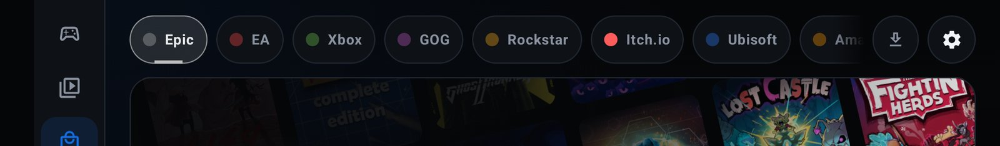
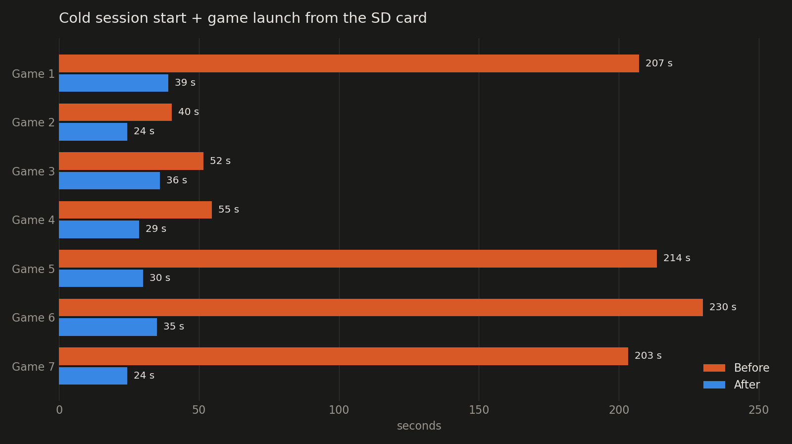
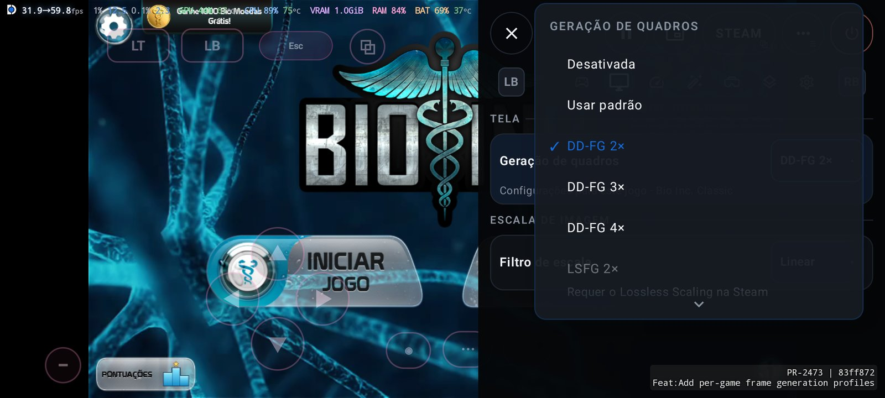
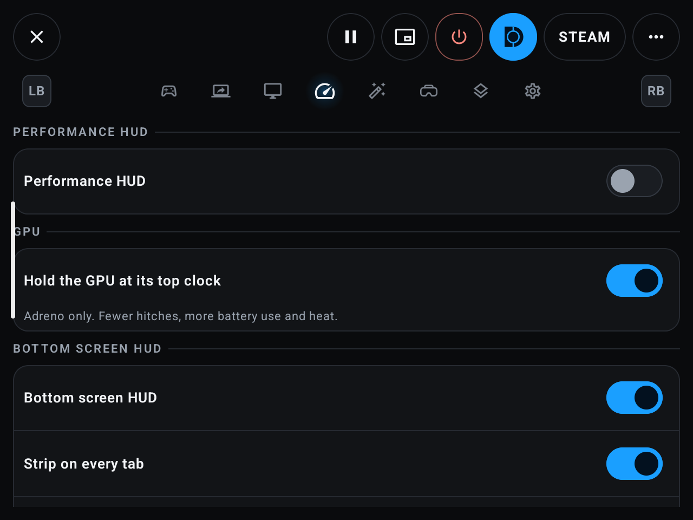
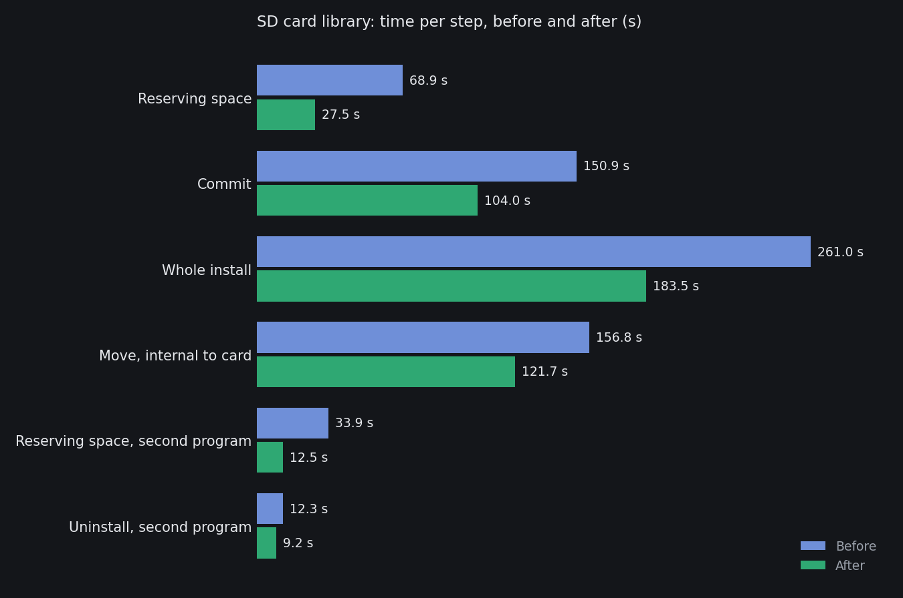

# DroidDeck 0.7.7

  
  

<!-- Maintainer check: Steam, Proton downloads and the games themselves come from Valve and the stores and are not part of DroidDeck; the intro below only claims DroidDeck's own code and the packs it builds. -->

**DroidDeck is 100% open source. No ads. No telemetry. No source withheld.**

Since 0.7.1, **30 people** sent **263 pull requests**, and **15 of them were first-timers**. 72% of the pull requests came from the community. Thank you to everyone who sent code, translations, device testing and bug reports.

**0.7.7 in 30 seconds**

- **Three new stores: EA, Ubisoft Connect and Rockstar Games.** Sign in, browse, download and play without their launchers, with cloud saves for EA and Ubisoft

  

- **Games on a memory card start in seconds, not minutes:** a cold session start plus game launch that took up to 230 s now takes 24 to 39 s, and installs to the card are faster too

  

- **Per-game frame generation and screen effects**, plus integer scaling, SMAA and black frame insertion

  

- **Run without proot (experimental):** an opt-in mode that runs Steam, games and the desktop straight on Android
- **Your tabs, your way:** reorder, shelve or hide any tab, and Setup is now **Settings**, with search and one home for every setting
- **Library Favorites, a Hidden tab synced with Steam, and a music player** for your Steam soundtracks
- **Memory is managed for you:** fewer low-memory kills on dual-screen handhelds and fewer stutters from memory compression
- **Pens work as a mouse**, **XREAL One and Aura glasses get head tracking**, and DroidDeck’s **virtual pads reach programs outside Steam**

### Features

- Added the **EA store**: sign in with EA’s own page, see your library, download, update and launch without the EA app. Browse EA’s catalog with What’s New, Deals, Free Games and search, and **Get for free** works in the app. The library lists only games your account can download, details show the size before you install, and **EA games get cloud saves**. (@xXJSONDeruloXx, [#2259](https://github.com/Droid-Deck/DroidDeck/pull/2259), [#2527](https://github.com/Droid-Deck/DroidDeck/pull/2527), [#2521](https://github.com/Droid-Deck/DroidDeck/pull/2521), [#2438](https://github.com/Droid-Deck/DroidDeck/pull/2438), [#2440](https://github.com/Droid-Deck/DroidDeck/pull/2440), [#2486](https://github.com/Droid-Deck/DroidDeck/pull/2486), [#2824](https://github.com/Droid-Deck/DroidDeck/pull/2824))
- Added the **Ubisoft Connect store**: sign-in, your library, downloads and launch all run inside DroidDeck, with no Ubisoft Connect client. It gets cloud saves and keeps a game’s Denuvo token, so restarts no longer spend the account’s daily activations. Games that use Ubisoft’s newer API, such as Prince of Persia: The Lost Crown and Far Cry 3 Blood Dragon, get past their menu, and owned games the profile list leaves out get their art. (@xXJSONDeruloXx, @K11MCH1, [#2322](https://github.com/Droid-Deck/DroidDeck/pull/2322), [#2436](https://github.com/Droid-Deck/DroidDeck/pull/2436), [#2450](https://github.com/Droid-Deck/DroidDeck/pull/2450), [#2460](https://github.com/Droid-Deck/DroidDeck/pull/2460), [#2865](https://github.com/Droid-Deck/DroidDeck/pull/2865), [#2824](https://github.com/Droid-Deck/DroidDeck/pull/2824))
- Added the **Rockstar Games store**: sign in, see your library and the catalog, download with verification and launch, starting with the original GTA III, Vice City and San Andreas and widened to other Rockstar titles. Protected games such as GTA V Legacy no longer quit asking for the Rockstar Games Launcher. (@xXJSONDeruloXx, @maxjivi05, [#2537](https://github.com/Droid-Deck/DroidDeck/pull/2537), [#2547](https://github.com/Droid-Deck/DroidDeck/pull/2547), [#2590](https://github.com/Droid-Deck/DroidDeck/pull/2590))
- Added **Run without proot (experimental)** in Performance. It runs the Linux side, Steam, Proton games, the desktop and the Terminal straight on Android, with no proot in between. It is off by default and the usual path is unchanged. (@xXJSONDeruloXx, @maxjivi05, @K11MCH1, [#2300](https://github.com/Droid-Deck/DroidDeck/pull/2300), [#2522](https://github.com/Droid-Deck/DroidDeck/pull/2522), [#2560](https://github.com/Droid-Deck/DroidDeck/pull/2560))
- Added **per-game frame generation and per-game screen effects**: pick DD-FG 2x, 3x or 4x, Lossless Scaling or none for each game, from the Library or the in-game menu, with a default for the rest. Upscaling and sharpening now stay at full screen size with frame generation on. (@EnzoDLofi, @xXJSONDeruloXx, [#2473](https://github.com/Droid-Deck/DroidDeck/pull/2473), [#2472](https://github.com/Droid-Deck/DroidDeck/pull/2472), [#2728](https://github.com/Droid-Deck/DroidDeck/pull/2728))
- Added **integer scaling** next to Fit for pixel art and 2D games, with a small tolerance so a near fit still scales, and **SMAA** as an anti-aliasing option. Nearest is the new default filter; a filter you already picked stays. (@EnzoDLofi, [#2620](https://github.com/Droid-Deck/DroidDeck/pull/2620), [#2690](https://github.com/Droid-Deck/DroidDeck/pull/2690), [#2708](https://github.com/Droid-Deck/DroidDeck/pull/2708), [#2760](https://github.com/Droid-Deck/DroidDeck/pull/2760))
- Added **black frame insertion** to Screen effects on screens of 100 Hz and faster. The game runs at half the refresh rate, for example 60 fps on a 120 Hz screen. (@xXJSONDeruloXx, [#2653](https://github.com/Droid-Deck/DroidDeck/pull/2653))
- **Tabs and Settings are rebuilt.** Reorder tabs with drag handles, shelve them under **More** or hide them, with new defaults and a reset. Setup is renamed **Settings**, Performance gets its own page, every setting has one home, and a search box finds settings by everyday words such as fps, logs or ram. Storage, Syncthing and Downloads are tabs of their own. (@xXJSONDeruloXx, [#2569](https://github.com/Droid-Deck/DroidDeck/pull/2569), [#2627](https://github.com/Droid-Deck/DroidDeck/pull/2627), [#2791](https://github.com/Droid-Deck/DroidDeck/pull/2791), [#2798](https://github.com/Droid-Deck/DroidDeck/pull/2798), [#2809](https://github.com/Droid-Deck/DroidDeck/pull/2809), [#2811](https://github.com/Droid-Deck/DroidDeck/pull/2811), [#2812](https://github.com/Droid-Deck/DroidDeck/pull/2812), [#2558](https://github.com/Droid-Deck/DroidDeck/pull/2558))
- Added a **Favorites** tab with a heart button on the game page, a **Hidden** tab that stays in sync with Steam’s hidden games, and a **Soundtracks tab with a music player** for your Steam soundtracks, with favorites, collections and Android’s media controls. (@FX192, [#2613](https://github.com/Droid-Deck/DroidDeck/pull/2613), [#2803](https://github.com/Droid-Deck/DroidDeck/pull/2803), [#2389](https://github.com/Droid-Deck/DroidDeck/pull/2389), [#2835](https://github.com/Droid-Deck/DroidDeck/pull/2835))
- Added a **Game resolution** choice for games started without Steam. (@xXJSONDeruloXx, [#2520](https://github.com/Droid-Deck/DroidDeck/pull/2520))
- Added **per-game Steam Input** choices: Steam’s default, on or off. (@xXJSONDeruloXx, [#2407](https://github.com/Droid-Deck/DroidDeck/pull/2407))
- A **pen works as a mouse**: hover moves the pointer, the tip clicks and the side button right-clicks. (@alien2003, [#2625](https://github.com/Droid-Deck/DroidDeck/pull/2625))
- Added **head tracking for XREAL One, One Pro, One Pro+ and Aura** glasses. (@mhaye20, [#2532](https://github.com/Droid-Deck/DroidDeck/pull/2532))
- DroidDeck’s **virtual pads reach programs outside Steam**, such as Firefox, Chromium and SDL games. (@kingokksa, [#1593](https://github.com/Droid-Deck/DroidDeck/pull/1593))
- **Steam Remote Play** works with the controller set to Steam Deck or Steam Controller mode and with touch controls. (@vinegh4, [#2033](https://github.com/Droid-Deck/DroidDeck/pull/2033))
- The **DroidDeck HUD** gets a switch and a row order for every reading, an **estimated battery runtime**, and a **long press that collapses or expands it**; locking is now an option. **Hold the GPU at its top clock** can be switched from the in-game menu and applies right away. (@kingokksa, @EnzoDLofi, @xXJSONDeruloXx, @maxjivi05, [#2454](https://github.com/Droid-Deck/DroidDeck/pull/2454), [#2573](https://github.com/Droid-Deck/DroidDeck/pull/2573), [#2723](https://github.com/Droid-Deck/DroidDeck/pull/2723), [#2882](https://github.com/Droid-Deck/DroidDeck/pull/2882))

  

- Added the **True black** theme for OLED screens, with a highlight color you pick, and a color picker that fits landscape screens. (@DeathKhan, [#2541](https://github.com/Droid-Deck/DroidDeck/pull/2541), [#2542](https://github.com/Droid-Deck/DroidDeck/pull/2542))
- The **Apps page gets icon packs**, per-app icons and an Appearance panel for icon size, spacing and names. (@measlesbagel, [#2207](https://github.com/Droid-Deck/DroidDeck/pull/2207))
- Added **Home button opens** (Steam or Android apps), **exit the launcher with three presses of Back**, and an optional **Hide launcher from Recents while idle**. (@DeathKhan, @kingokksa, @xXJSONDeruloXx, [#2493](https://github.com/Droid-Deck/DroidDeck/pull/2493), [#1599](https://github.com/Droid-Deck/DroidDeck/pull/1599), [#2579](https://github.com/Droid-Deck/DroidDeck/pull/2579))
- Added a **Shuffle** switch for boot movies, backed by Steam’s own setting, and a **Skip boot movie** switch. (@xXJSONDeruloXx, [#2462](https://github.com/Droid-Deck/DroidDeck/pull/2462), [#2577](https://github.com/Droid-Deck/DroidDeck/pull/2577))
- The **Storage manager names every prefix and store game** and can select and remove them, instead of one large “Kept” total. (@xXJSONDeruloXx, [#2565](https://github.com/Droid-Deck/DroidDeck/pull/2565))
- The **Updates tab lists every kept Preview build**, so you can go back to an earlier one, links each build to its pull request and commit, and flags stale test builds. (@xXJSONDeruloXx, [#2624](https://github.com/Droid-Deck/DroidDeck/pull/2624))
- Components > Proton offers **DroidDeck-Proton test builds**, and with Developer tools on it can **install a Proton build from a .zip**. (@maxjivi05, @FryMcNugget, [#2831](https://github.com/Droid-Deck/DroidDeck/pull/2831), [#2864](https://github.com/Droid-Deck/DroidDeck/pull/2864))
- **Steam picks up game folders found in an added library** without pressing Install on each game, and a Games folder that is not a Steam library yet is offered as one. (@maxjivi05, @xXJSONDeruloXx, [#2317](https://github.com/Droid-Deck/DroidDeck/pull/2317), [#2432](https://github.com/Droid-Deck/DroidDeck/pull/2432))
- Steam’s first-run defaults now show the **battery percentage**, download rates in bytes and the library sorted by recent. (@xXJSONDeruloXx, [#2599](https://github.com/Droid-Deck/DroidDeck/pull/2599))
- A **Clear** key in the bottom-screen terminal’s key row, and the bottom-screen terminal keeps its shell when another app covers that screen. (@xXJSONDeruloXx, [#2368](https://github.com/Droid-Deck/DroidDeck/pull/2368), [#2366](https://github.com/Droid-Deck/DroidDeck/pull/2366))
- The game can move to a **clip-on second screen** that reports as an external display. (@maxjivi05, [#2350](https://github.com/Droid-Deck/DroidDeck/pull/2350))
- **Quest headsets** get steps for turning off the child-process limit with SideQuest, since Quest has no switch for it. (@maxjivi05, [#2306](https://github.com/Droid-Deck/DroidDeck/pull/2306))
- Added **Lab builds** for contributors: build and run your own DroidDeck build on the device from the **Dev Harness** tab, which stays hidden until you show it in Edit tabs. (@xXJSONDeruloXx, @KeegantheVeganat0r, @SlicelessBread, [#2375](https://github.com/Droid-Deck/DroidDeck/pull/2375), [#2494](https://github.com/Droid-Deck/DroidDeck/pull/2494), [#2512](https://github.com/Droid-Deck/DroidDeck/pull/2512), [#2667](https://github.com/Droid-Deck/DroidDeck/pull/2667), [#2550](https://github.com/Droid-Deck/DroidDeck/pull/2550), [#2744](https://github.com/Droid-Deck/DroidDeck/pull/2744))

### Improvements

- **Much faster games on a memory card.** DroidDeck no longer walks every game folder on the card at each session start and launch: a session start after a game was played or updated took 182 s and now takes 9.3 s. Steam’s file checks on the card are answered from a cache, so a 3,800-file install went from 261 s to 183.5 s, and programs on the card begin loading in 13.7 s instead of 18.5 s. Reserving space, verifying and installing no longer drop to a slow path after one unsupported call. (@maxjivi05, [#2533](https://github.com/Droid-Deck/DroidDeck/pull/2533), [#2881](https://github.com/Droid-Deck/DroidDeck/pull/2881), [#2553](https://github.com/Droid-Deck/DroidDeck/pull/2553), [#2509](https://github.com/Droid-Deck/DroidDeck/pull/2509), [#2379](https://github.com/Droid-Deck/DroidDeck/pull/2379), [#2504](https://github.com/Droid-Deck/DroidDeck/pull/2504))

  

- **Memory is managed automatically.** Sessions reclaim memory from what Android actually reports, react to a fast fall on large-RAM devices before Android kills the session, keep the session on top on dual screens under pressure, and no longer compress Steam after every game start when there is enough memory. This fixes sessions killed with gigabytes still free, such as a 15 GB AYN Thor Max with 5.3 GB available, and 5 to 10 s freezes every 30 s on 11 to 12 GB devices. The four manual memory settings under Performance (RAM cap, VRAM cap and the two compression switches) are removed. (@maxjivi05, @xXJSONDeruloXx, [#2853](https://github.com/Droid-Deck/DroidDeck/pull/2853), [#2382](https://github.com/Droid-Deck/DroidDeck/pull/2382), [#2754](https://github.com/Droid-Deck/DroidDeck/pull/2754), [#2763](https://github.com/Droid-Deck/DroidDeck/pull/2763), [#2335](https://github.com/Droid-Deck/DroidDeck/pull/2335), [#2347](https://github.com/Droid-Deck/DroidDeck/pull/2347), [#2758](https://github.com/Droid-Deck/DroidDeck/pull/2758))
- **Cooler steady games:** a game that holds a steady 30 fps or more for 3 s moves off the fastest cores, and the busiest game threads get a boost on every Snapdragon 8 Elite phone, not only the Odin 3. (@xXJSONDeruloXx, @Tapuuk, [#2572](https://github.com/Droid-Deck/DroidDeck/pull/2572), [#2608](https://github.com/Droid-Deck/DroidDeck/pull/2608))
- **Turnip system-memory rendering** now reaches games and apps, not only the Steam client, and Steam’s interface uses GPU compositing where the driver supports it. (@maxjivi05, [#2338](https://github.com/Droid-Deck/DroidDeck/pull/2338), [#2660](https://github.com/Droid-Deck/DroidDeck/pull/2660))
- **Mali:** MaliBridge 0.5.5.4, with the RE6 benchmark at about 25 fps on a Galaxy Tab S10+ and fewer hangs; DXVK runs on Mali GPUs without dual-source blending; and the x86-64 Steam client starts on Venus. (@ASEbrahim, @maxjivi05, [#2704](https://github.com/Droid-Deck/DroidDeck/pull/2704), [#2293](https://github.com/Droid-Deck/DroidDeck/pull/2293), [#2601](https://github.com/Droid-Deck/DroidDeck/pull/2601))
- **Pressing Play on a launcher-run game** shows Starting until it launches, instead of sitting on Play for 12 to 24 s. (@maxjivi05, [#2586](https://github.com/Droid-Deck/DroidDeck/pull/2586))
- **A session that fails to start says why**, and stopping a session while it starts undoes the start-up work. (@Tapuuk, [#2841](https://github.com/Droid-Deck/DroidDeck/pull/2841), [#2840](https://github.com/Droid-Deck/DroidDeck/pull/2840))
- **Battle.net** keeps the launch behavior you chose, shows its own reason when it refuses a game folder, and a download that stops moving ends with Retry. (@xXJSONDeruloXx, @visail, @maxjivi05, [#2750](https://github.com/Droid-Deck/DroidDeck/pull/2750), [#1661](https://github.com/Droid-Deck/DroidDeck/pull/1661), [#2602](https://github.com/Droid-Deck/DroidDeck/pull/2602))
- **Translations** cover the missing strings, including the input settings, in every language. (@kingokksa, [#2556](https://github.com/Droid-Deck/DroidDeck/pull/2556))
- **Clearer logs** for bug reports: runtime install failures, the GPU driver lines, why a GOG cloud sync failed, whether the device restarted, the guest start steps, and errors from Windows programs started from the desktop. (@maxjivi05, @xXJSONDeruloXx, [#2591](https://github.com/Droid-Deck/DroidDeck/pull/2591), [#2593](https://github.com/Droid-Deck/DroidDeck/pull/2593), [#2596](https://github.com/Droid-Deck/DroidDeck/pull/2596), [#2752](https://github.com/Droid-Deck/DroidDeck/pull/2752), [#2502](https://github.com/Droid-Deck/DroidDeck/pull/2502), [#2695](https://github.com/Droid-Deck/DroidDeck/pull/2695), [#2343](https://github.com/Droid-Deck/DroidDeck/pull/2343))
- Building and testing: local builds work on x86_64 Linux, test tools for pens and two-screen phones, and steadier CI. (@xXJSONDeruloXx, @maxjivi05, @alien2003, @Tapuuk, [#2807](https://github.com/Droid-Deck/DroidDeck/pull/2807), [#2639](https://github.com/Droid-Deck/DroidDeck/pull/2639), [#2628](https://github.com/Droid-Deck/DroidDeck/pull/2628), [#2844](https://github.com/Droid-Deck/DroidDeck/pull/2844), [#2469](https://github.com/Droid-Deck/DroidDeck/pull/2469), [#2483](https://github.com/Droid-Deck/DroidDeck/pull/2483), [#2672](https://github.com/Droid-Deck/DroidDeck/pull/2672), [#2635](https://github.com/Droid-Deck/DroidDeck/pull/2635))

### Fixed

- Fixed **games failing to start since 0.7.1** in ARM64 prefixes, such as Unreal Engine games asking for the Visual C++ arm64 redistributable and Red Dead Redemption 2 missing `vulkan-1.dll`. (@xXJSONDeruloXx, @maxjivi05, [#2442](https://github.com/Droid-Deck/DroidDeck/pull/2442), [#2647](https://github.com/Droid-Deck/DroidDeck/pull/2647))
- Fixed **Windows games on Android shared storage** crashing at launch, and 32-bit games such as Spore, Terraria and Borderlands 2 hanging at launch after that fix. (@maxjivi05, @xXJSONDeruloXx, [#2594](https://github.com/Droid-Deck/DroidDeck/pull/2594), [#2706](https://github.com/Droid-Deck/DroidDeck/pull/2706))
- Fixed **digital triggers** on handhelds such as the AYN Thor no longer responding since 0.7.0, **right sticks reported on other axes** never reaching the game, and the app closing when a controller disconnects mid-press. (@maxjivi05, [#2291](https://github.com/Droid-Deck/DroidDeck/pull/2291), [#2333](https://github.com/Droid-Deck/DroidDeck/pull/2333), [#2369](https://github.com/Droid-Deck/DroidDeck/pull/2369))
- Fixed **the on-screen controls editor** drawing layouts squashed and overlapping, and saving a Steam touch layout for a game with no touch config. (@maxjivi05, @kingokksa, [#2339](https://github.com/Droid-Deck/DroidDeck/pull/2339), [#2783](https://github.com/Droid-Deck/DroidDeck/pull/2783), [#2580](https://github.com/Droid-Deck/DroidDeck/pull/2580))
- Fixed **touch on the game stopping** after overlapping touches, taps clicking while an on-screen mouse button is shown, and System Back turning into a right-click without an external mouse. (@maxjivi05, [#2528](https://github.com/Droid-Deck/DroidDeck/pull/2528), [#2465](https://github.com/Droid-Deck/DroidDeck/pull/2465), [#2323](https://github.com/Droid-Deck/DroidDeck/pull/2323))
- Fixed **mouse and controller edge cases**: a USB mouse in REDMAGIC cast mode stopping at the screen edge, the Back gesture with controllers that bring their own mouse, held keyboard keys dropping when pointer capture ends, and rumble that kept going after a game crashed. (@OmarAlTaki1, @KvFxKaido, @zdennisz, @Tapuuk, [#2298](https://github.com/Droid-Deck/DroidDeck/pull/2298), [#2666](https://github.com/Droid-Deck/DroidDeck/pull/2666), [#2779](https://github.com/Droid-Deck/DroidDeck/pull/2779), [#2614](https://github.com/Droid-Deck/DroidDeck/pull/2614))
- Fixed **driver picks on non-Adreno and smaller Adreno GPUs**: Auto no longer gives Adreno 710, 720 and 722 a display driver that finds no GPU, gives Xclipse 540 a working driver pair instead of a black Steam at about 1 fps, never loads an Adreno-only driver elsewhere, and handles the Mali bridge switch correctly. (@maxjivi05, @unixenon, [#2356](https://github.com/Droid-Deck/DroidDeck/pull/2356), [#2337](https://github.com/Droid-Deck/DroidDeck/pull/2337), [#2588](https://github.com/Droid-Deck/DroidDeck/pull/2588), [#2406](https://github.com/Droid-Deck/DroidDeck/pull/2406), [#2684](https://github.com/Droid-Deck/DroidDeck/pull/2684))
- Fixed **Steam flickering on the Mali bridge** and **stalling on Venus** with a Dimensity 9300. (@rainleee, @The412Banner, @xXJSONDeruloXx, [#2506](https://github.com/Droid-Deck/DroidDeck/pull/2506), [#2721](https://github.com/Droid-Deck/DroidDeck/pull/2721), [#2441](https://github.com/Droid-Deck/DroidDeck/pull/2441))
- Fixed **x86-64 Steam and Linux programs**: with the x86-64 Steam client, store shortcuts that closed within a second now get a compatibility tool, setup no longer stops on an existing link, x86-64 Linux games under FEX find their libraries, 32-bit Linux games such as Left 4 Dead 2 no longer abort, and imported AppImages get current Wayland libraries. (@maxjivi05, @xXJSONDeruloXx, [#2336](https://github.com/Droid-Deck/DroidDeck/pull/2336), [#2334](https://github.com/Droid-Deck/DroidDeck/pull/2334), [#2484](https://github.com/Droid-Deck/DroidDeck/pull/2484), [#2592](https://github.com/Droid-Deck/DroidDeck/pull/2592), [#2426](https://github.com/Droid-Deck/DroidDeck/pull/2426))
- Fixed **Steam coming back empty** after aborting a game stuck on a black screen, and **an OpenGL game going black** after a level while its music played. (@maxjivi05, [#2600](https://github.com/Droid-Deck/DroidDeck/pull/2600), [#2562](https://github.com/Droid-Deck/DroidDeck/pull/2562))
- Fixed **Return to DroidDeck after a game** ending the session at Steam’s install-script step, and Steam’s saved scaling mode and filter not applying until the slider moved. (@The412Banner, @xXJSONDeruloXx, [#2732](https://github.com/Droid-Deck/DroidDeck/pull/2732), [#2681](https://github.com/Droid-Deck/DroidDeck/pull/2681))
- Fixed **Steam’s frame limits** following Game Mode’s FPS override instead of the screen, for example 40 Hz on a 120 Hz Odin 3. (@xXJSONDeruloXx, [#2717](https://github.com/Droid-Deck/DroidDeck/pull/2717))
- Fixed **cloud saves missing** when a Steam game is launched as an added game from the same folder. (@xXJSONDeruloXx, [#2463](https://github.com/Droid-Deck/DroidDeck/pull/2463))
- Fixed **GOG installs hanging on Finishing** for games with thousands of files, such as Darkest Dungeon. (@maxjivi05, [#2367](https://github.com/Droid-Deck/DroidDeck/pull/2367))
- Fixed **Epic’s Install** failing for everyone after Epic stopped publishing its Linux launcher download, and Epic now says which launcher installs a third-party game. (@maxjivi05, [#2281](https://github.com/Droid-Deck/DroidDeck/pull/2281), [#2344](https://github.com/Droid-Deck/DroidDeck/pull/2344))
- Fixed **Game Pass downloads and launches** failing with HTTP 401, and Xbox games reporting the account service unavailable. (@maxjivi05, @Zeratullo, [#2598](https://github.com/Droid-Deck/DroidDeck/pull/2598), [#2751](https://github.com/Droid-Deck/DroidDeck/pull/2751))
- Fixed **game-specific crashes**: Death Stranding running out of memory on 39-bit kernels, Godot games with Sentry or UI Automation crashing, Final Fantasy VII Rebirth and Kingdom Come: Deliverance II at the D3D12 level they need, and a game’s own DLL overrides replacing DroidDeck’s. (@KeegantheVeganat0r, @Kobtul, @maxjivi05, @xXJSONDeruloXx, @Drik0, [#2641](https://github.com/Droid-Deck/DroidDeck/pull/2641), [#2644](https://github.com/Droid-Deck/DroidDeck/pull/2644), [#2605](https://github.com/Droid-Deck/DroidDeck/pull/2605), [#2595](https://github.com/Droid-Deck/DroidDeck/pull/2595), [#2289](https://github.com/Droid-Deck/DroidDeck/pull/2289), [#2787](https://github.com/Droid-Deck/DroidDeck/pull/2787), [#2332](https://github.com/Droid-Deck/DroidDeck/pull/2332))
- Fixed **the Desktop session**: it draws again and Sunshine can capture it, Windows games started from Steam no longer close after a second, Flatpak apps get the GPU and removable drives show in Dolphin. (@xXJSONDeruloXx, @maxjivi05, [#2780](https://github.com/Droid-Deck/DroidDeck/pull/2780), [#2446](https://github.com/Droid-Deck/DroidDeck/pull/2446), [#2597](https://github.com/Droid-Deck/DroidDeck/pull/2597), [#2699](https://github.com/Droid-Deck/DroidDeck/pull/2699), [#2671](https://github.com/Droid-Deck/DroidDeck/pull/2671))
- Fixed **audio not coming back** after a long sleep, and **the HUD and game clocks** reading wrong after sleep and wake. (@maxjivi05, @xXJSONDeruloXx, [#2396](https://github.com/Droid-Deck/DroidDeck/pull/2396), [#2821](https://github.com/Droid-Deck/DroidDeck/pull/2821), [#2393](https://github.com/Droid-Deck/DroidDeck/pull/2393), [#2552](https://github.com/Droid-Deck/DroidDeck/pull/2552))
- Fixed **a session freezing while a program waits for a browser sign-in**, and picture-in-picture leaving no way back to the front end. (@maxjivi05, @xXJSONDeruloXx, [#2615](https://github.com/Droid-Deck/DroidDeck/pull/2615), [#2559](https://github.com/Droid-Deck/DroidDeck/pull/2559))
- Fixed **controller navigation** on the Apps page and its folders, header search changing height, B closing the page behind the on-screen keyboard, and the file manager toolbar and Back after a drive change. (@DeathKhan, @Dantalian-dev, [#2492](https://github.com/Droid-Deck/DroidDeck/pull/2492), [#2499](https://github.com/Droid-Deck/DroidDeck/pull/2499), [#2534](https://github.com/Droid-Deck/DroidDeck/pull/2534), [#2544](https://github.com/Droid-Deck/DroidDeck/pull/2544), [#2545](https://github.com/Droid-Deck/DroidDeck/pull/2545), [#2543](https://github.com/Droid-Deck/DroidDeck/pull/2543), [#2498](https://github.com/Droid-Deck/DroidDeck/pull/2498), [#2564](https://github.com/Droid-Deck/DroidDeck/pull/2564), [#2567](https://github.com/Droid-Deck/DroidDeck/pull/2567))
- Fixed **the app closing** when opening Game environment from the menu on the second screen. (@xXJSONDeruloXx, [#2452](https://github.com/Droid-Deck/DroidDeck/pull/2452))
- Fixed **other apps reaching DroidDeck’s private folders** through the system folder picker. (@Tapuuk, [#2846](https://github.com/Droid-Deck/DroidDeck/pull/2846))
- Fixed smaller things: Decky Loader’s menu appears in Steam again, Electron apps run their Node mode helpers, a Bluetooth controller that fails to disconnect no longer closes the app, Clean up keeps the EasyAntiCheat and BattlEye runtimes, new prefixes get redistributable markers before install scripts run, an explicitly picked executable stays in the Library, game file export works before the game library folder exists, an unreadable game environment file no longer stops every session, per-game Turnip debug settings reach the game, a Mesa sampler fix, and refreshed loading tips. (@xXJSONDeruloXx, @maxjivi05, @zdennisz, @coffeemeist3r, [#2481](https://github.com/Droid-Deck/DroidDeck/pull/2481), [#2418](https://github.com/Droid-Deck/DroidDeck/pull/2418), [#2670](https://github.com/Droid-Deck/DroidDeck/pull/2670), [#2254](https://github.com/Droid-Deck/DroidDeck/pull/2254), [#2327](https://github.com/Droid-Deck/DroidDeck/pull/2327), [#2703](https://github.com/Droid-Deck/DroidDeck/pull/2703), [#2549](https://github.com/Droid-Deck/DroidDeck/pull/2549), [#2808](https://github.com/Droid-Deck/DroidDeck/pull/2808), [#2781](https://github.com/Droid-Deck/DroidDeck/pull/2781), [#2178](https://github.com/Droid-Deck/DroidDeck/pull/2178), [#2197](https://github.com/Droid-Deck/DroidDeck/pull/2197))

### Community

DroidDeck is built in the open by the people who use it. These are everyone whose code is in 0.7.7:

| Contributor | Pull requests |
|---|---|
| @xXJSONDeruloXx | 115: EA, Ubisoft and Rockstar stores, Run without proot, tabs and Settings, Xbox installs, Updates tab, Storage manager, black frame insertion, Lab builds and more |
| @maxjivi05 | 74: memory card speed, memory management, driver picks, ARM64 prefixes, x86-64 Steam, input fixes, Rockstar and Battle.net, Proton test builds and more |
| @DeathKhan | 10: True black theme, Home button page, Apps page and folder controls, header search |
| @KeegantheVeganat0r | 9: Lab builds, Death Stranding memory fix, Dev Harness fixes, build label |
| @Tapuuk | 8: Snapdragon 8 Elite thread boost, start-up failure reasons, rumble stop, private folders, HUD and CI |
| @EnzoDLofi | 7: per-game frame generation and screen effects, integer scaling, SMAA, HUD battery estimate |
| @kingokksa | 5: virtual pads outside Steam, HUD readings, three presses of Back to exit, layout editor, translations |
| @FX192 | 4: Soundtracks and music player, Favorites, Hidden tab |
| @The412Banner | 3: Xbox Nexus backend and DLC, Venus stall, Return after game |
| @K11MCH1 | 3: Ubisoft launches, Steam deadlock without proot |
| @alien2003 | 3: pen as a mouse, pen test tool, two-screen screenshots |
| @zdennisz | 3: held keys, per-game Turnip debug, input cleanup |
| @Dantalian-dev | 2: file manager toolbar and Back |
| @ASEbrahim | 1: MaliBridge 0.5.5.4 |
| @coffeemeist3r | 1: Mesa sampler fix |
| @Drik0 | 1: per-game DLL overrides |
| @FryMcNugget | 1: Proton from a .zip |
| @JanPokorny | 1: Dev Harness focus fix |
| @Kobtul | 1: Godot games with Sentry |
| @KvFxKaido | 1: Back gesture with controllers that bring a mouse |
| @l4nr3 | 1: Xbox PlayFab Game Saves |
| @measlesbagel | 1: icon packs |
| @mhaye20 | 1: XREAL One and Aura head tracking |
| @OmarAlTaki1 | 1: USB mouse in cast mode |
| @rainleee | 1: Mali bridge flicker |
| @SlicelessBread | 1: Lab builds on 8 GB devices |
| @unixenon | 1: Mali (Venus) switch after restart |
| @vinegh4 | 1: Remote Play controllers |
| @visail | 1: Battle.net folder errors |
| @Zeratullo | 1: Xbox launch folder |

### New contributors

- @vinegh4 made their first contribution in [#2033](https://github.com/Droid-Deck/DroidDeck/pull/2033).
- @measlesbagel made their first contribution in [#2207](https://github.com/Droid-Deck/DroidDeck/pull/2207).
- @Drik0 made their first contribution in [#2332](https://github.com/Droid-Deck/DroidDeck/pull/2332).
- @DeathKhan made their first contribution in [#2492](https://github.com/Droid-Deck/DroidDeck/pull/2492).
- @rainleee made their first contribution in [#2506](https://github.com/Droid-Deck/DroidDeck/pull/2506).
- @zdennisz made their first contribution in [#2524](https://github.com/Droid-Deck/DroidDeck/pull/2524).
- @mhaye20 made their first contribution in [#2532](https://github.com/Droid-Deck/DroidDeck/pull/2532).
- @Tapuuk made their first contribution in [#2607](https://github.com/Droid-Deck/DroidDeck/pull/2607).
- @alien2003 made their first contribution in [#2625](https://github.com/Droid-Deck/DroidDeck/pull/2625).
- @KvFxKaido made their first contribution in [#2666](https://github.com/Droid-Deck/DroidDeck/pull/2666).
- @SlicelessBread made their first contribution in [#2667](https://github.com/Droid-Deck/DroidDeck/pull/2667).
- @unixenon made their first contribution in [#2684](https://github.com/Droid-Deck/DroidDeck/pull/2684).
- @Zeratullo made their first contribution in [#2751](https://github.com/Droid-Deck/DroidDeck/pull/2751).
- @JanPokorny made their first contribution in [#2769](https://github.com/Droid-Deck/DroidDeck/pull/2769).
- @FryMcNugget made their first contribution in [#2864](https://github.com/Droid-Deck/DroidDeck/pull/2864).

[Full changelog](https://github.com/Droid-Deck/DroidDeck/compare/0.7.1...0.7.7)
