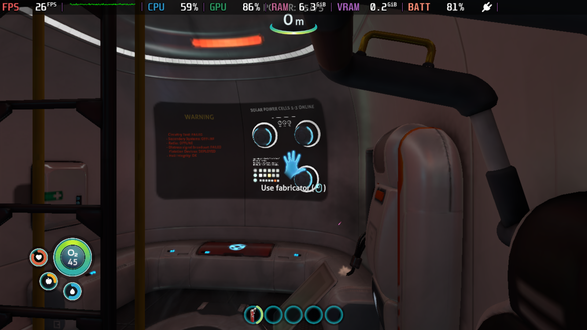
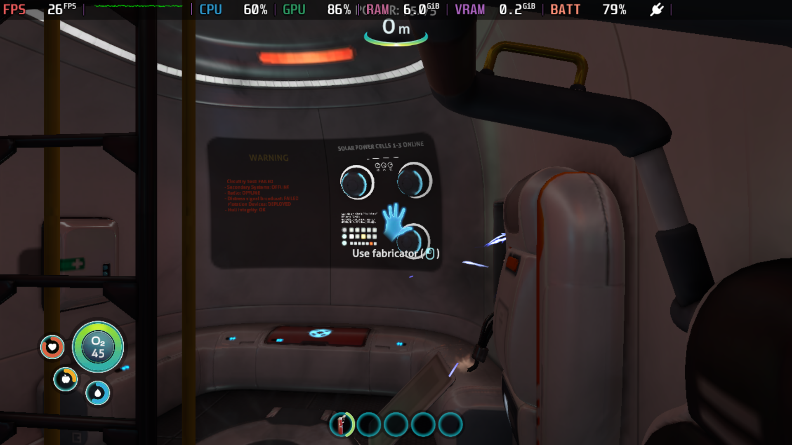
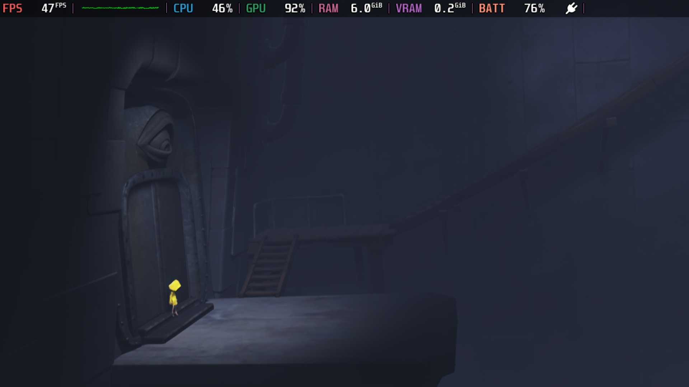
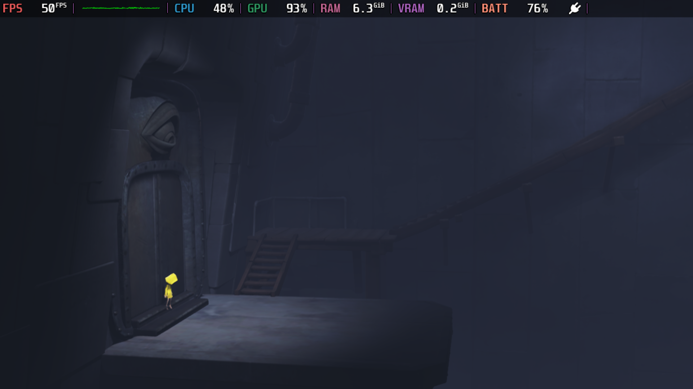
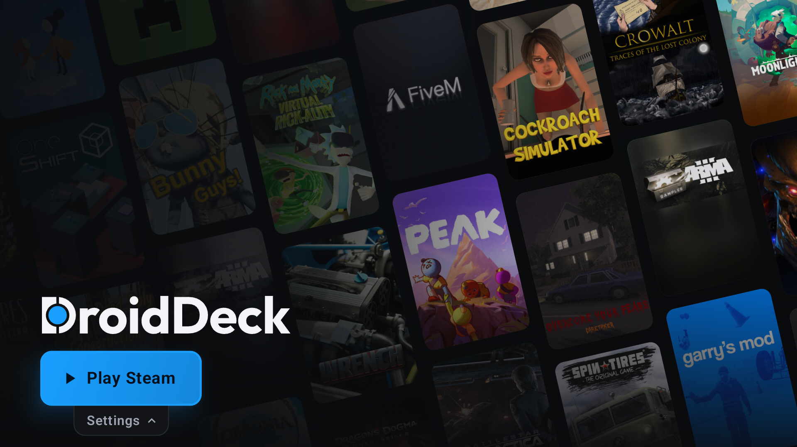

# DXVK tiler-mode cross-game tests

The results do not support forcing `dxvk.tilerMode = False` globally. Little Nightmares gains a small amount of throughput, Fallout: New Vegas remains capped near 60 FPS, and Subnautica develops longer presentation tails without a throughput gain. Keep the existing Spintires workaround scoped to the validated device and driver.

Test dates: 3–4 November 2026. Physical Retroid Pocket Duo, Adreno 722, DD-Turnip 0.4.0, Mesa 26.99.99, DXVK 3.1.1-134, Proton 11-11.11, Ubuntu r1-rc4. DroidDeck 0.6.9, main f3650d3 with the already tested environment-helper fix. Output 1280×720 at 60 Hz. No production defaults, drivers, game quality settings or runtime components were changed for this sweep.

## Matched gameplay results

Each measurement lasts approximately 30 seconds. Checkpoint and camera are held constant within each game, with fresh launches between modes. Runs are sequential, not randomized. FPS is presented frames at the Android game surface. Histogram labels are coarse system buckets; the reported 95th percentile is a bucket, not an exact engine frame time.

| Game and scene | Auto FPS | False FPS | Finding |
|---|---|---|---|
| Little Nightmares, checkpoint platform | 46.9, 46.8 | 47.9, 47.9 | About 2.2% faster; 95th-percentile bucket remains 33 ms. No obvious visual or movement/jump regression in the spot checks. |
| Fallout: New Vegas, Doc Mitchell interior | 59.8 | 59.8, 59.9 | Neutral at the 60 Hz cap. Both modes retain a 16 ms 95th-percentile bucket and zero intervals in buckets ≥50 ms. Movement and PipBoy checked with False. Outdoor performance is untested. |
| Subnautica, saved lifepod after extinguishing fire | 25.3, 25.4 | 25.2, 25.2 | No throughput benefit; repeatable worse tail pacing. The 95th-percentile bucket rises from 66 to 86 ms. Intervals in buckets ≥86 ms rise from 2.50%/1.70% to 9.11%/8.72%. PDA input/rendering checked with False. |

Subnautica's total CPU utilization remains about 62%, GPU utilization about 85–87%, and sampled GPU clock 1150 MHz. The False runs include more short intervals alongside longer holds: the percentage in buckets ≥50 ms actually falls, despite the worse upper tail. This is why neither average FPS nor the tool's modal “off cadence” percentage is sufficient to assess smoothness. The opening fire scene used during checkpoint preparation is excluded.

## Startup and backend checks

Moonlighter remains black with Auto and False after 120 seconds from obtaining focus, followed by identical Enter/controller-A attempts and a further 15 seconds. The process receives the requested mode and uses the same driver. No gameplay FPS is assigned to black frames. This option does not resolve the observed startup blocker, and gameplay regression risk remains unassessed. The existing missing plugin-dependency log is an investigation lead, not a proven cause.

Stardew Valley's installed MonoGame library identifies DesktopGL and SDL2/OpenGL; the live process maps its Zink shader cache and Turnip driver. This is an OpenGL control, not a DXVK optimization target. Its original existing test-save/profile data was backed up before testing and restored afterward. The farmhouse control measured 59.8 FPS with Auto and 59.7 with False, both with a 16 ms 95th-percentile bucket and no intervals in buckets ≥50 ms. Walking responded with False. This single pair is neutral at the 60 Hz ceiling and does not demonstrate a DXVK speedup.

SteamWorld Dig's live process likewise maps OpenGL32, its Zink shader cache and Turnip. The matched controllable opening cave measured 59.8 FPS with Auto and 59.7 with False, both with a 16 ms 95th-percentile bucket and no intervals in buckets ≥50 ms. Movement/jump worked with False. Its profile was restored between modes and after testing. This single OpenGL pair is neutral at the 60 Hz ceiling; the DXVK option is inapplicable to this path.

## Evidence and exclusions

`measurements.csv` contains individual valid measurements, device CPU/GPU load, GPU clock/temperature, memory and paging counters. `comparison.png` charts throughput, the 95th-percentile bucket and the upper-tail share. Each measured run has a pacing JSON, telemetry, screenshot, state and supporting thread snapshots. Per-process environment snapshots confirm the requested mode and driver. Raw session logs and account/device details remain private.

The first SteamWorld control encountered another tutorial dialogue and is excluded from gameplay results (`steamworld-dialogue-auto-a-*`). The valid replacement pair finishes the dialogue and matches the controllable cave. Animated-title matching and an early ignored save-row tap delayed Stardew preparation; neither delay is included in the gameplay measurements.

The initial manual Fallout sample entered the game's idle vanity camera and is excluded. Its files are named `fallout-uncontrolled-auto-a-*`; `exclusions.json` records the reason. The replacement comparisons restore the same original autosave before each launch and match the camera. An interrupted Subnautica runner produced no sample; its replacement collected the valid False-A measurement. No loading, sleeping, suspended-session, menu or black-window intervals are counted as gameplay.

Temperatures and long-session thermal behavior are not controlled. Android thermal pressure was present during testing even though GPU clock samples held 1150 MHz. Short scene results cannot certify an entire game, other hardware, other driver releases, physical-button latency or sustained performance. CPU/GPU utilization is device-wide; it does not isolate FEX, PRoot or engine cost.

All game quit checks report no remaining game processes. Original per-game environment bytes were restored and their SHA-256 verified against the private backup. Original backed-up profile files compare byte-for-byte for Fallout, Subnautica, Stardew and SteamWorld; the temporary Subnautica world slot was removed. The temporary return-after-game preference was removed, matching its original absence. Session logs and test fixtures were copied to a private local backup before deleting only the temporary shared device folder. Steam was stopped, DroidDeck force-closed and reopened, and the final provider state verifies IDLE, no running session, no guest PID and no focused game. UI inspection and the final screenshot verify the main Play Steam page. The temporary debugging dex was removed after verification.

## Saved-scene screenshots

Subnautica Auto:

Subnautica False:

Little Nightmares Auto:

Little Nightmares False:

Final main page:

