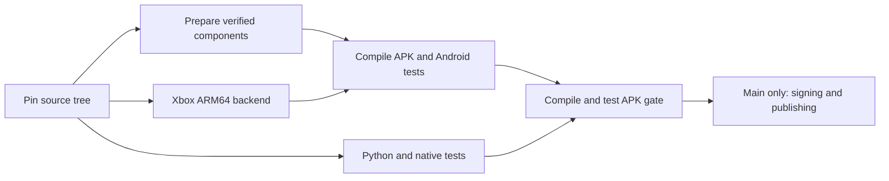

# Runtime component preparation

`recipes.json` owns component source inputs, builders, outputs, package requirements
and pinned downloads. `prepare.py` runs those recipes, calculates cache identities,
installs the union of missing tools and verifies the prepared artifact handoff.
Builders live in `recipes/`; the workflow describes scheduling and gates.

All workers verify the same source tree. The component artifact records that tree,
recipe identities and every output hash; the APK worker verifies the inventory
before building. This handoff verifies consistency within the same CI run. It is
not independent provenance for arbitrary artifacts. Source policy checks, tests,
APK content/ABI checks and signing/publication gates remain in place.

`tools/ci/toolchains.env` pins the Android NDK shared by component, APK and native
test workers. Linux builds use Ubuntu 24.04. Recipe and input changes invalidate
the relevant component cache; ordinary caches remain performance aids.

## Verified preload snapshots

`preloads.lock.json` pins a small immutable preload archive. It records each
binary's hash, its producing main CI run, the original APK artifact identity and
digest, source/header hashes, the ARM64 build recipe and x86 compiler-image inputs.
It covers core ARM64 preloads and the x86 preload libraries. VR, Android native
libraries, Comet and Xbox use their registered recipes and existing release pins
or component caches.

Every build compares current source inputs, including transitive quoted headers,
and build recipes with this manifest. Changed groups rebuild from source. A
missing release also selects a rebuild. Corrupt archives, unexpected files and
binary hash mismatches fail the build. Existing preload checks, runtime packaging
checks and all test jobs still run.

The trust anchor is the manifest in the pinned main base. A new or changed PR
manifest is independently checked against a successful `push` build of main:
GitHub must confirm the run/source/workflow and original APK artifact digest, and
every claimed binary must match that APK. The claimed source inputs and recipe
must match that run's Git source. A PR cannot establish trust by changing both a
binary and its claimed checksum. This is approved-build reuse, not a claim of
bit-for-bit reproducible compilation or a signed SLSA attestation.

To refresh after source or compiler changes:

1. Let a main build compile and test the new inputs.
2. Run `python tools/components/preloads.py snapshot --run RUN_ID`.
3. Publish `app/build/component-snapshot/preloads.tar.gz` to
   DroidDeck-Components as `preloads-<full archive SHA-256>`, without replacing an
   existing release. Include the manifest and producing run in the release notes.
4. Review and commit the updated manifest. CI independently checks its origin.

The workflow dispatch `rebuild_preloads` option forces source compilation even
when an approved snapshot matches. Use it when refreshing a compiler or system
header revision. Runner image updates do not silently replace an approved binary;
the producing run remains the record of its compiler environment.
